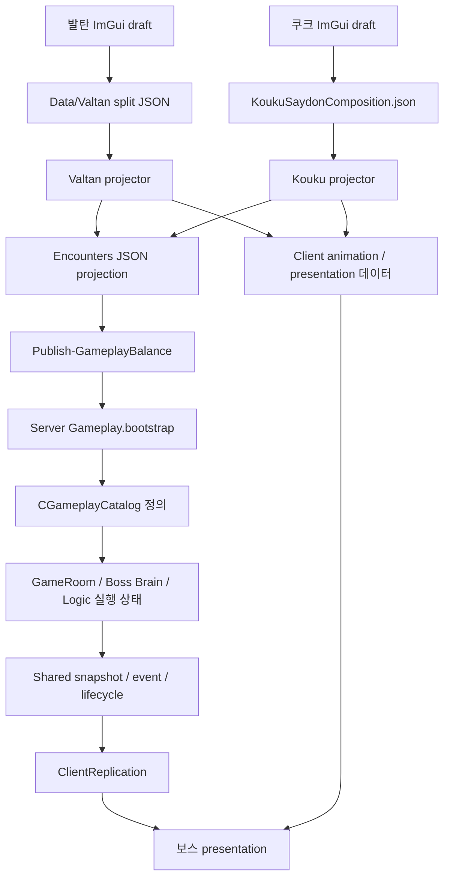

# 발탄과 쿠크세이튼 패턴 데이터 조사와 학습 시작점

> **최신 진행 — 2026-10-14:** 문서 끝의 「PPT 7페이지 — SPIN의 예약 기회와 소비 이력」을 진행한다. 금요일 제출물에 넣을 주장과 그림을 작성하면서 필요한 코드를 이해한다. 앞선 시작점과 질문은 당시 기록으로 보존한다.

> **현재 시작점 — 2026-10-12:** 문서 끝의 「BP01 — 현재 보스의 stage 정의를 찾는 구조」부터 이어간다. 앞선 반복 판정 풀이와 질문은 당시 기록으로 보존하고, 지금은 목표의 필요성·필요한 정보·연산부터 생각한 뒤 실제 자료구조·함수·의존 관계와 대조한다.

조사일: 2026-10-11. 저장소: `C:/Users/tnest/Desktop/LostArk`. 기준 HEAD: `01518032dde86b5558976a2fbe5fd94ad625cfd1`. 브랜치: `codex/warlord-altv-radial-render-fix`. 조사 시 HEAD와 origin/main의 commit 차이는 없었지만 작업 폴더에는 다른 작업의 미커밋 변경이 있었다. 아래 경로와 심볼은 작업 폴더에서 확인했으며 HEAD permalink의 행 번호로 대체하지 않는다.

이 기록은 실제 코드·데이터 연결과 학습 시작점을 보존한다. 사용자의 독립 이해, 직접 구현, 제품의 현재 빌드·실행 성공을 뜻하지 않는다. 학습 운영은 [GB 프로젝트학습기준](../프로젝트학습기준.md)을 따른다.

## 기술소개서에 사용할 현재 구조의 사실 초안

LostArk의 보스 패턴은 편집 데이터, 게시 데이터, 실행 정의와 실행 상태로 구분된다. ImGui 도구는 편집하기 좋은 형태의 저작 문서를 다루고, publisher는 참조와 필드를 검증해 Server 판정 및 Client 표현에 필요한 데이터를 만든다. Server는 게시된 `Gameplay.bootstrap`을 읽어 패턴 정의를 구성한다. 실제 전투에서는 이 정의를 바탕으로 현재 stage, 시작 tick, 이미 소비한 판정 횟수 같은 실행 상태를 갱신한다.

발탄은 gameplay와 presentation을 별도 정본으로 보관하고 stable pattern·stage·action ID로 연결한다. 쿠크세이튼은 Composition에서 재사용할 정의와 시간·위치를 가진 occurrence를 조립한 뒤, 판정창과 결과를 Server용으로 투영한다. 두 보스가 공용 gameplay catalog를 이용한다고 해서 저작 JSON까지 같은 구조인 것은 아니다.

Server는 선택·진행·충돌·피해의 권위를 소유하고 Client는 복제된 상태와 재생 정보를 표현한다. 편집 저장, 파일 게시, 실행 중 정의 활성화, 화면 확인은 서로 다른 단계다. 일부 도구의 버튼이 여러 단계를 연결하더라도 실패한 단계를 구분해야 한다.

이 구조는 편집과 게임 판정의 책임을 분리하지만, 새 필드를 추가할 때 저작 codec, projector, 직렬화, Server parser와 Client 소비자를 함께 맞춰야 한다. 이 비용은 현재 구조에서 확인할 수 있는 설명이며, 실제 개발자가 당시 어떤 대안을 검토했는지 또는 개인별 누가 설계했는지는 별도 근거가 필요하다.

## 실제 파일의 연결



| 경계 | 발탄 | 쿠크세이튼 |
|---|---|---|
| 편집 정본 | `Data/Valtan/Valtan.gameplay.json`, `Valtan.presentation.json`, `Valtan.combatobjects.json`, `Valtan.worldeventsets.json`, `Valtan.legacy-compatibility.json` | `Data/KoukuSaydon/Gate1/KoukuSaydonComposition.json` |
| 저작 처리 | `Client/Private/ValtanPatternTree.cpp`와 `BalanceTool.cpp::Save_ValtanProduct` | `KoukuSaydonActionWorkbench.cpp::Save` → `KoukuSaydonCompositionDocument.cpp::Save_Atomic` |
| 투영 도구 | `Tools/ValtanPipeline/valtan_tuning_pipeline.py` | `Tools/KoukuSaydonPipeline/project_kouku_saydon_composition.py` |
| 생성 중간 데이터 | `Data/Encounters/Valtan/ValtanEncounter.json` | `Data/Encounters/KoukuSaydon/KoukuSaydonEncounter.json` |
| 애니메이션 연결 | `Data/Animation/Authored/Valtan/Valtan.patternbindings.json` | `Data/Animation/Authored/KoukuSaydon/KoukuSaydon.patternbindings.json` |
| Server 파일 | 두 보스 모두 `Server/Bin/DataFiles/Gameplay/Gameplay.bootstrap` | 왼쪽과 같은 공용 게시 파일 |
| 메모리 정의 | `Server/Public/GameplayCatalog.h` | 같은 공용 정의에 `LogicWindows` 등 쿠크 lane 추가 |
| 실행 | `GameRoom_BossSimulation.cpp` → `ValtanBrain.cpp` | `GameRoom_KoukuAudition.cpp` → `KoukuSaydonBrain.cpp`와 `KoukuSaydonLogicRuntime.cpp` |
| Client 표현 | `ClientReplication.cpp` → `Valtan.cpp::Apply_NetworkState` | `Collect_KoukuPresentationViews` → `KoukuSaydonPresentationPlayer.cpp::Update` |

`Data/Encounters`의 이 두 파일은 직접 편집할 정본이 아니라 생성 projection이다. `.bootstrap`은 이름과 달리 바이너리가 아니라 탭 구분 텍스트다. 현재 header는 `LOSTARK_GAMEPLAY_BOOTSTRAP`, version `38`, row count `109868`이다. 이 수량은 공용 파일 전체이며 보스 패턴 개수가 아니다. version 정본은 `Shared/Public/GameplayDataRevision.h`다.

`GameplayCatalog.cpp::Load_BootstrapBytes`는 header, row, ID와 참조를 읽어 검증한다. 기존 상태를 보존하는 rollback 처리가 있다. 파싱이 성공했다는 것만으로 실행 중 모든 room이 새 정의를 사용한다고 설명하지 않는다.

쿠크의 명시적인 draft Play는 별도 설명이 필요하다. 검증한 메모리 draft를 제한된 runtime row로 전송하고 `Load_DraftKoukuProduct`에서 공용 parser/runtime으로 소비하는 경로가 있다. 이 경우에도 Server가 판정한다. 정식 저작 파일·게시 파일을 변경한 것으로 간주하지 않는다.

## 요구사항이 실제 자료구조가 되는 곳

| 기억할 정보와 필요한 연산 | 현재 코드의 저장 형태 | 읽을 때 주의할 점 |
|---|---|---|
| encounter에 속한 패턴 목록 조회 | `unordered_map<string, vector<BOSS_PATTERN_DEFINITION>> m_BossPatterns` | 바깥 key는 encounter다. 모든 pattern ID를 상수 시간으로 찾는 구조라고 설명하면 틀린다. |
| 한 패턴의 stage 순서 | `vector<BOSS_PATTERN_STAGE_DEFINITION> Stages` | 저장 ID와 vector index는 별개다. |
| stage 시간과 판정 규칙 | `iDurationMs`, `eHitShape`, `iHitCount`, `iHitIntervalMs`, `iHitDelayMs`, `HitOffsetsMs` | 정의 값이다. 각 실행의 진행도를 이 안에 함께 저장하지 않는다. |
| 이번 실행의 진행도 | `SERVER_WORLD_ENTITY::iPatternStageIndex`, `iAppliedPatternHitCount` 및 tick 필드 | 소유 room의 해당 보스 실행 상태다. 정의의 예정 횟수와 이미 소비한 횟수를 구분한다. |
| 쿠크 재사용 Logic과 발생 위치 | Composition의 `Logics` 및 각 Pattern의 `LogicOccurrences` | `logicId`는 내용, `occurrenceId`는 그 패턴 안의 발생을 식별한다. |
| 플레이어별 판정 기록 | `KOUKUSAYDON_LOGIC_WINDOW_STATE::Answers`, `InsidePlayers`, `NextContactHitTicks` | 한 사람의 성공·진입·반복 접촉 상태를 다른 사람과 섞지 않는다. |

현재 구조를 학습할 때 작은 vector와 선형 검색을 기준선으로 비교할 수 있다. 데이터 수, 조회 빈도, 수정 빈도를 계산하기 전에 hash·tree·manager부터 정답으로 고르지 않는다. 특정 구조가 성능상 최적이라는 측정은 이번 조사에 없다.

## 발탄의 작은 실제 예제

[Valtan.gameplay.json](../../../Data/Valtan/Valtan.gameplay.json)의 `VALTAN_WHIRLWIND`를 따라간다. 세 stage는 `WINDUP 1333ms → SPIN 1200ms → RECOVERY 1467ms`다. SPIN의 필드는 다음과 같다.

```json
{
  "stageId": "SPIN",
  "durationMs": 1200,
  "shape": "CIRCLE",
  "outerRadiusM": 10.0,
  "count": 4,
  "firstOffsetMs": 0,
  "intervalMs": 350,
  "serverDamageProfileId": "damage.valtan.circular-spin"
}
```

위 블록은 설명용 필드 발췌이며 원본 JSON schema가 아니다. 원본에서는 shape와 schedule 등이 `hit` 안에 중첩된다.

SPIN 진입 기준 예약 시각은 `0, 350, 700, 1050ms`다. 패턴 시작 기준, 실제 서버 tick 시각, 네트워크 도착 시각, 화면 표시 시각과 구분한다. 판정 기회를 소비했다고 반드시 플레이어에게 피해가 발생하는 것도 아니다.

bootstrap의 대응 `PATTERNSTAGE` 행은 SPIN, ACTIVE, 1200, CIRCLE, 10, 4, 350, 0과 damage ID를 담는다. `GameplayCatalog.cpp`가 이를 `BOSS_PATTERN_STAGE_DEFINITION`으로 읽는다. `ValtanBrain.cpp`의 반복 판정에서는 다음 예약 시각을 계산하고 도달한 기회를 소비한 뒤 `iAppliedPatternHitCount`를 증가시킨다. 명시적 `HitOffsetsMs`가 있으면 그 시각 배열을 사용한다.

현재 발탄 자동 선택의 저작 모델은 `HEALTH_BAR_ROTATIONS`이며 `ORDERED_LOOP` 구간을 사용한다. 가중 선택 구현도 존재하지만 현행 전투를 단순 가중 랜덤이라고 설명하지 않는다. 연출은 같은 pattern·stage·action ID에 묶이며 WHIRLWIND SPIN의 현재 animation timing은 `EXACT`다.

WHIRLWIND의 최종 Effect → GPU 경로는 이번 범위에서 확정하지 않았다. 효과 전체를 `presentation.effectCues`만으로 설명하지 않으며, 현행 Effect V2의 binding·Authored·Groups 소비는 별도 후속 조사다.

## 쿠크세이튼에서 확장할 실제 예제

[KoukuSaydonComposition.json](../../../Data/KoukuSaydon/Gate1/KoukuSaydonComposition.json)의 `KAKULSAYDON_G1_PATTERN_109`는 BINGO의 `boss.kakulsaydon.bingo.saydon`을 대상으로 한다. 파일 경로의 Gate1이나 ID 접두어만 보고 현재 관문을 추정하지 않는다.

패턴 길이는 2100ms, animation stage는 2000ms다. `.logic.1` occurrence는 `logic.508`의 `ENTER_AREA`를 1122ms부터 112ms 동안 실행하고, 성공 시 `logic.538`의 최대 HP 10% 피해와 4m/1000ms 밀침 등을 적용한다. collider occurrence `.presentation.9`가 `logicOccurrenceId`로 이 판정과 연결된다.

projector는 reusable BOX resource와 occurrence의 위치·배율·anchor, Logic의 결과를 결합해 Server용 `logicWindows`를 만든다. Server의 `BOSS_PATTERN_LOGIC_WINDOW`에는 판정 시각, 영역과 결과가 들어간다. Client의 collider 표시 자체가 피해를 확정하지 않는다.

`CKoukuSaydonLogicRuntime::Build`는 시작과 종료 경계를 각각 tick으로 환산한다. 현재 30Hz에서 이 예제의 시작은 `ceil(1122 × 30 / 1000) = 34`, 종료는 `ceil(1234 × 30 / 1000) = 38`이다. duration 112ms를 따로 올림하여 시작 tick에 더하는 계산과 구분한다. 이것은 코드와 입력값으로부터의 계산이며 실행 측정이 아니다.

조사 시 저작 formatVersion 3, revision 2500, saved patterns 121개였고 Encounter projection에는 114개가 있었다. `authoringStatus=DRAFT`만으로 실행 불가라고 판정하지 않는다. `_prepare_publication`이 참조하는 패턴까지 검증하고 실행 가능한 closure를 투영하며 실패 이유를 inventory에 남긴다.

## 직접 확인할 코드 위치

행 번호는 2026-10-11 작업 폴더 참고값이다. 파일을 열 때 심볼로 다시 찾는다.

| 파일 | 심볼 또는 조사 위치 |
|---|---|
| `Tools/ValtanPipeline/valtan_tuning_pipeline.py` | source join 약6375행, Product projection 약7470행 |
| `Tools/GameplayPipeline/Publish-GameplayBalance.ps1` | 발탄 encounter 약2027행, stage 행 생성 약2807행, 쿠크 연결 약3566행 |
| `Server/Private/GameplayCatalog.cpp` | `Load` 약1421행, `Load_BootstrapBytes` 약1646행, PATTERNSTAGE 약4911행 |
| `Server/Public/GameplayCatalog.h` | `BOSS_PATTERN_STAGE_DEFINITION` 1034행, `BOSS_PATTERN_DEFINITION` 1366행, `m_BossPatterns` 1770행 부근 |
| `Server/Private/GameRoom_BossSimulation.cpp` | 발탄 Brain 호출 약2503행 |
| `Server/Private/ValtanBrain.cpp` | 선택 약1247행, stage 진입 약1791행, tick 약2989행, 반복 hit 약3473행 |
| `Client/Private/ClientReplication.cpp` | 쿠크 view 약2087행, world snapshot 약4514행 |
| `Client/Private/Valtan.cpp` | `Apply_NetworkState` 약5889행 |
| `Client/Private/KoukuSaydonActionWorkbench.cpp` | `Save` 약1827행, `Publish_AllPatterns` 약1898행 |
| `Client/Private/KoukuSaydonCompositionDocument.cpp` | `Save_Atomic` 약5812행 |
| `Tools/KoukuSaydonPipeline/project_kouku_saydon_composition.py` | `_prepare_publication` 약2876행, `project_encounter` 약5000행, `project_presentation` 약6204행 |
| `Server/Private/GameRoom_KoukuAudition.cpp` | Begin/Build 약1120행, Logic Update와 output 적용 약1588행 |
| `Server/Private/KoukuSaydonLogicRuntime.cpp` | `Ticks_FromMs` 약87행, `Build` 약128행, `Apply_Result` 약1437행, `Update` 약1749행 |
| `Client/Private/KoukuSaydonPresentationPlayer.cpp` | `Reload_Product` 약2250행, `Prepare_AdmittedRun` 약3716행, `Update` 약3761행 |

## 한 번에 할 첫 연습

오늘 전부 구현하지 않는다. 시작은 반복 판정 소비 한 가지다. JSON parser, 네트워크, 충돌·damage, ImGui는 이 첫 연습의 범위 밖이다.

> SPIN의 예약 시각은 0·350·700·1050ms다. 0ms 기회는 이미 소비했다. 다음 갱신이 800ms에 왔다. 이번에 새로 소비할 예약 시각과 누적 소비 개수는 무엇인가? 같은 800ms로 다시 호출되면 무엇이 달라져야 하는가?

처음에는 이 질문을 제시했고, 이후 사용자가 첫 파일과 상태의 의미부터 설명을 요청했다. 아래에 풀이 예제와 실제 읽기 위치를 연결했다. 사용자의 독립 답변·구현은 아직 확인하지 않았다. 예제를 이해한 뒤 “다음 판단을 위해 기억할 최소 상태”를 정하고, 이 상태를 받아 이번에 소비할 기회를 반환하는 작은 함수를 직접 작성한다. 이미 소비한 개수는 실제 피해 성공 횟수가 아니다. 처음에는 원형 충돌 검사 대신 소비한 예약 시각을 출력하면 된다.

여기까지 확인하면 다음 순서로 넓힌다.

1. 작은 정의를 JSON에서 파싱하고 시간·횟수·ID를 검증한다. 실패하면 이전 정상 정의를 유지한다.
2. stage 정의와 현재 stage·경과 시간·소비 횟수를 분리한다. 종료, 취소, 재시작에서 남는 상태를 검사한다.
3. 현재 제품의 파싱 → Brain → 판정 흐름과 연습의 차이를 대조한다.
4. ImGui에서 바꾼 한 필드의 Save·projection·bootstrap·Server 변수까지 따라간다.
5. 쿠크의 Logic definition·occurrence·window와 플레이어별 판정 기록으로 확장한다.
6. 확인한 범위를 문제·직접 해법·현재 메커니즘·대안·대가로 압축한다.

연습용 별도 구현은 제품에 두 번째 런타임으로 연결하지 않는다. 실제 C++ 파일 추가를 진행할 때 별도 연습 위치와 프로젝트 등록 범위를 정한다. 이번 조사에서는 정답 구현과 새 C++ 파일을 생성하지 않았다.

## 첫 파일과 첫 비평: SPIN의 판정 기회

전체 파일을 완독하지 않고 다음 블록만 읽는다. 행 번호는 2026-10-11 재확인 값이며 이후에는 심볼로 찾는다. 이 순서는 학습을 위한 읽기 순서이고, JSON을 Server가 직접 읽는 호출 순서가 아니다. 실제 게시·로딩 경계는 앞의 데이터 흐름을 따른다.

| 순서 | 실제 파일과 읽을 위치 | 이 자리에서 답할 질문 |
|---|---|---|
| 1 | [Valtan.gameplay.json](../../../Data/Valtan/Valtan.gameplay.json) 729행 SPIN, 특히 739~744행 `hit.schedule` | 판정 기회가 언제 몇 번 예정되어 있는가? 이 파일에 이미 처리한 횟수를 넣으면 여러 보스의 실행을 어떻게 구분할 것인가? |
| 2 | [ServerWorldEntity.h](../../../Server/Public/ServerWorldEntity.h) 405~408행 | 최대 횟수와 소비한 횟수는 왜 다른가? 같은 경과 시간인데 처리 이력이 다른 두 상태를 구분할 수 있는가? |
| 3 | [ValtanBrain.cpp](../../../Server/Private/ValtanBrain.cpp) `EnterPatternStage`, 1841~1844행 | 어느 값을 정의에서 복사하고 어느 값을 초기화하는가? 재진입에서 초기화를 빼면 어떻게 되는가? |
| 4 | 같은 CPP의 `CValtanBrain::Update`, 3473~3509행 | 다음 예약 시각을 어떻게 구하는가? 왜 `while`인가? 언제 멈추고 언제 소비 횟수가 증가하는가? |

Server 정의의 이름을 확인할 때에만 [GameplayCatalog.h](../../../Server/Public/GameplayCatalog.h) 1073~1081행의 `iHitCount`, `iHitIntervalMs`, `iHitDelayMs`, `HitOffsetsMs`를 보조로 연다. 명중 조건을 묻기 전에는 `ApplyPatternHit` 내부의 모든 판정 종류를 읽지 않아도 된다.

### 정의·상태·계산의 연결

저작 값은 `count=4`, `firstOffsetMs=0`, `intervalMs=350`이다. `EnterPatternStage`는 정의에서 `iPatternHitCount`, `iPatternHitIntervalMs`, `iPatternHitDelayMs`를 복사하고 `iAppliedPatternHitCount=0`으로 새 stage의 소비 이력을 시작한다. 보스 entity에 있는 앞의 세 값은 선택된 규칙의 실행용 복사본이고, 마지막 값은 실행하며 바뀌는 이력이다.

동일 stage를 시간 순서대로 실행하며 예약을 순서대로 소비한다는 전제에서, 소비한 개수는 다음 예약의 0-based index와 같다. 별도의 처리 완료 bool 배열이나 우선순위 큐 없이 다음 식으로 구할 수 있다.

```text
다음 예약 시각 = 첫 offset + 소비한 개수 × 간격
```

이 표현이 가능한 이유는 이미 소비한 예약이 순서상 앞부분을 연속으로 이룬다는 조건 때문이다. 개별 예약의 임의 취소·순서 외 실행·시간 역행이 필요해지면 이 표현과 정책을 다시 검토한다. 제품은 불규칙 시각을 위한 `HitOffsetsMs`도 지원하지만 이번 WHIRLWIND 예제는 등간격 경로를 따른다.

0ms 기회를 이미 소비했다면 소비한 개수는 1이다. 학습용 경과 시간 800ms에서의 손추적은 다음과 같다.

| 처리 전 소비 개수 | 다음 예약 | 800ms와 비교 | 처리 후 소비 개수 |
|---|---|---|---|
| 1 | 350ms | 도달했으므로 판정 기회 소비 | 2 |
| 2 | 700ms | 도달했으므로 판정 기회 소비 | 3 |
| 3 | 1050ms | 아직 도달하지 않았으므로 중단 | 3 |

같은 800ms로 다시 판단해도 다음 예약은 1050ms이므로 새 기회를 소비하지 않는다. 경과 시간만으로 예정된 횟수는 계산할 수 있지만, 이전 호출에서 이미 소비했는지는 별도의 이력 또는 그에 해당하는 표현이 필요하다. 이 예제의 선택은 `iAppliedPatternHitCount`다.

실제 제품의 시계는 학습용 `elapsedMs` 변수와 구분한다. `StageElapsedTicks`(CPP 100행)는 `iPatternStageFirstEvaluationTick`과 입력 `serverTick`으로 경과 tick을 계산하고 첫 평가를 포함한다. `HasElapsedMilliseconds`(118행)는 30Hz 정수 tick과 ms를 비교한다. `elapsedStageTicks`는 3426행의 지역 파생 값이며, 판정 경계는 누적 float delta에 의존하지 않는다.

### 실제 코드에서 시작하는 비평

- `iAppliedPatternHitCount`는 이름만 보고 명중 횟수라고 해석하지 않는다. `ApplyPatternHit`은 `void`이며 범위 밖 대상 등을 건너뛰어도 외부 반복문 3509행의 증가가 실행된다. 의미는 소비한 판정 기회 수다. 이름·주석 개선은 검토할 수 있지만 이번에는 제품 식별자를 바꾸지 않는다.
- `while`을 `if`로 줄이면 800ms 호출에서 350ms 기회만 소비하고 700ms 기회가 남는다. 어느 동작이 요구사항인지 먼저 결정해야 한다. 호출당 한 번만 처리하는 정책과 도달한 기회를 모두 처리하는 정책은 비용·동작이 다르다.
- catch-up은 과거 위치 복원이 아니다. 반복 호출은 같은 현재 `serverTick`과 현재 boss·player 상태를 사용한다. WHIRLWIND 기본 anchor는 `BOSS_CURRENT`다. 지났던 판정 시각을 소비하는 것과 그 당시 위치에서 맞았는지를 재현하는 것을 혼동하지 않는다. 취소·분기·pause가 있는 전체 Update의 무조건적인 누락 없음도 이 블록만으로 보장하지 않는다.
- `FinishPattern`의 2169~2171행은 count·delay·consumed를 지우며 interval은 이 부분에서 지우지 않는다. 이것만 보고 초기화 버그라고 결론내리지 않는다. count와 현재 pattern 상태가 소비를 차단하는지, 다음 진입에서 interval이 덮어써지는지와 다른 소비자를 먼저 확인한다.

다음 사용자 시도는 하나만 한다. **800ms 호출의 `while`을 `if`로 바꿨다고 가정하고, 그 호출이 반환한 뒤 아직 처리되지 않은 예약을 적고 요구사항과 맞는지 설명한다.** 위 풀이를 참고해도 된다. 이 답을 확인한 뒤 작은 구현으로 넘어간다. 이 문서의 풀이와 비평은 제공한 설명이며 사용자의 독립 수행 증거가 아니다.

## 확인 상태

현재 완료는 코드·JSON·게시 파일의 읽기 조사, 두 학습 원문 계열 대조, GB 학습 기준과 자료 보존이다. 실제 source save·publish·Server 실행·Client 화면 확인·사용자 직접 구현은 이번에 수행하지 않았다. 과거 PLAN/RESULT의 PASS를 이번 결과로 재사용하지 않는다.

개인 기여와 현재 이해도도 확정하지 않았다. 위 사실 초안은 기술소개서의 근거 재료이며 제출용 문장과 PPT는 사용자의 설명·검증에 맞춰 발전시킨다. 원래 [10월10일 방향 합의](../10-10/2026-10-10_TECHNICAL_INTRO_LEARNING_DIRECTION_RESULT.md)는 당시 기록으로 보존한다.

이번 문서 검증으로 새 작성 Markdown의 UTF-8 읽기와 로컬 링크 존재, `git diff --no-index --check`, 변경 규칙 파일 및 전체 tracked diff의 `git diff --check`를 확인했다. 원문 복사 5개는 source와 사본의 SHA256이 같았고, SEED는 대화 본문을 문단·표로 복원한 사본이다. 발탄과 쿠크 source JSON 및 쿠크 Encounter를 파싱해 위 수량과 stage 값을 재확인했다. 독립 읽기 검토에서 학습 기준의 착수 관문처럼 보이는 표현을 완화했고, 발탄·쿠크 설명에서 수정이 필요한 사실 오류는 발견되지 않았다.

`AGENTS.md`에는 GB 학습 작업의 시작 읽기 행 하나를, `local.md`에는 학습 기준 연결 절을 추가했다. 기존 미커밋 변경은 보존했다. C++·제품 데이터·PPT 변경, 빌드, commit/push는 수행하지 않았다.

## 같은 날 추가한 지원 준비 방향

사용자가 Liberation 출시 경험과 Winters·NYPC·LostArk의 구현 이해 공백을 바탕으로 지원 준비 방향을 물었다. 기존 이력서의 Liberation 진술과 7월 제출본, Interview의 초안 작성 방향·현재 포트폴리오 상태를 확인했고 Steam 제품 페이지에서 출시일과 개발·배급 명의를 대조했다. 공개 페이지로 개인 구현 범위까지 검증한 것은 아니다.

새 프로젝트나 전체 재학습을 지원 전제에 추가하지 않고, 기존 대표 사례에서 실제 기여와 현재 독립 수행 능력을 확인하며 지원 자료를 갱신하는 방향을 [GB 학습 기준](../프로젝트학습기준.md)에 보존했다. 이번 추가 작업도 문서 수정이며 기존 이력서·PPT·제품 코드·데이터는 수정하지 않았다. 사용자 직접 구현과 면접 준비 수준의 확인은 여전히 미완료다.


## 2026-10-12 BP01 — 현재 보스의 stage 정의를 찾는 구조

조사 기준: LostArk 작업 폴더, HEAD `01518032dde86b5558976a2fbe5fd94ad625cfd1`, 브랜치 `codex/warlord-altv-radial-render-fix`. 기존 미커밋 변경을 포함한 현재 소스를 읽었다. 아래 행 번호는 이 조사 시점의 참고값이며 심볼을 우선한다. 이전 날짜의 행 번호와 수량을 현재 사실로 다시 사용하지 않는다.

이번 목표는 **같은 WHIRLWIND 규칙을 사용하는 보스들이 서로 다른 진행 상태를 가질 수 있게 하는 저장 구조**를 읽는 것이다. JSON 전체 파서나 Brain 전체를 먼저 암기하지 않는다. 아래는 구현 변경안이 아니라 제품 코드의 현재 동작을 설명하는 학습 기록이다.

### 코드를 열기 전에: 이 기능이 왜 필요한가

이번 작은 기능은 “휠윈드 한 번의 공격 기회를 각 보스의 진행에 맞춰 소비한다”다. 여러 패턴을 만들기 쉽다는 전체 도구 목표와 구분한다. 현재 저작 예는 SPIN 1,200ms 안에 0·350·700·1,050ms의 네 판정 기회를 예약한다. 네 번 모두 명중한다는 요구는 아니다.

이 기능의 필요성은 같은 규칙을 사용하는 실행들이 서로 방해하지 않고, 갱신이 반복되거나 늦게 와도 이미 처리한 판정 기회를 또 처리하지 않는 데 있다. 이것은 현재 동작을 설명하기 위해 재구성한 요구다. 과거 개발자가 실제로 이 순서로 설계했다는 증거로 쓰지 않는다.

먼저 저장 형식을 정하지 않고 다음 정보를 구분한다.

| 알아야 하는 것 | 왜 필요한가 | 저장·계산의 구분 |
|---|---|---|
| 실행할 패턴과 stage의 규칙 | 어떤 시각에 어떤 판정을 해야 하는지 결정한다. | 여러 실행이 참조할 정의이며 매 보스의 처리 이력과 다르다. |
| 이 보스가 어느 stage에 언제 진입했는가 | 현재 시각을 그 stage의 진행 시각으로 해석한다. | 실행별 기준점이 필요하다. 경과 시간은 그 기준점과 현재 tick으로 계산할 수 있다. |
| 이 실행에서 이미 처리한 판정은 어디까지인가 | 같은 시각에 다시 평가돼도 같은 기회를 두 번 소비하지 않는다. | 현재 시각만으로 알 수 없는 실행 이력이다. 표현은 요구조건에 따라 선택한다. |

다음에는 연산을 정한다. stage 진입 때 이력을 초기화하고, Update 때 규칙을 조회하고, 도달했으나 미소비인 기회를 처리하며, 소비 이력을 진행한다. 종료·재시작·시간 이동이 허용되는 범위를 확인한다. 소비가 항상 앞에서부터 연속으로 이뤄진다면 개수 하나가 다음 위치를 표현할 수 있다. 임의의 판정만 취소·재실행하는 요구가 추가되면 같은 표현이 충분한지 다시 검토한다.

이렇게 필요한 정보를 정한 뒤 아래 H의 정의와 entity 상태에 대조한다. 조건을 충족하는 가장 단순한 후보에서 시작하되, 실제 성능은 별도 측정한다. 현재 사용한 컨테이너를 먼저 정답으로 놓고 요구를 거꾸로 만들지 않는다.

### 먼저 열 파일과 각 파일이 필요한 이유

| 읽을 파일·심볼 | 소유하는 것 또는 수행하는 일 |
|---|---|
| [GameplayCatalog.h](C:/Users/tnest/Desktop/LostArk/Server/Public/GameplayCatalog.h:1428)의 `BOSS_PATTERN_DEFINITION`, `m_BossPatterns` | 게시 파일에서 구성한 패턴 규칙을 값으로 소유하는 타입과 컨테이너 선언 |
| [GameplayCatalog.cpp](C:/Users/tnest/Desktop/LostArk/Server/Private/GameplayCatalog.cpp:8953)의 `Find_BossPatterns` | encounter ID로 패턴 목록을 빌려주는 조회 구현 |
| [ValtanBrain.cpp](C:/Users/tnest/Desktop/LostArk/Server/Private/ValtanBrain.cpp:444)의 `FindPattern`, `CValtanBrain::Update` | 목록에서 pattern ID를 찾고 현재 stage를 읽어 실행 판단에 사용 |
| [ServerWorldEntity.h](C:/Users/tnest/Desktop/LostArk/Server/Public/ServerWorldEntity.h:224)의 `SERVER_WORLD_ENTITY` | 이 보스가 무엇을 실행 중인지와 얼마나 처리했는지를 보관 |
| [Valtan.gameplay.json](C:/Users/tnest/Desktop/LostArk/Data/Valtan/Valtan.gameplay.json:681)의 `VALTAN_WHIRLWIND` | 저작 규칙의 원본 예. WINDUP → SPIN → RECOVERY와 SPIN의 판정 예약 |

JSON을 옆에서 읽는 것은 값의 출처를 이해하기 위해서다. `Find_BossPatterns`나 `FindPattern`이 JSON을 파싱하는 것은 아니다. 이미 게시·로드한 메모리 정의를 조회한다. 저작 JSON → projector → 게시 bootstrap → Catalog 구성의 전체 경로는 앞의 조사와 BP03에서 이어간다.

### H의 선언에서 읽을 구조

다음은 각 실제 타입 안의 멤버 선언을 따로 인용한 것이다. 새 struct 전체나 제품에 붙일 교체 코드가 아니다.

```cpp
// CGameplayCatalog의 멤버: encounter ID 하나가 패턴 정의 목록 하나를 소유한다.
std::unordered_map<std::string, std::vector<BOSS_PATTERN_DEFINITION>>
    m_BossPatterns;
```

```cpp
// BOSS_PATTERN_DEFINITION의 멤버: 정의의 ID와 순서를 가진 stage 목록이다.
std::string strPatternId;
std::vector<BOSS_PATTERN_STAGE_DEFINITION> Stages;
```

```cpp
// SERVER_WORLD_ENTITY의 멤버: 현재 실행 위치와 이미 처리한 판정 기회 수다.
std::uint32_t iPatternStageIndex = 0;
std::uint32_t iAppliedPatternHitCount = 0;
```

`m_BossPatterns`의 key는 **encounter ID**다. pattern ID를 바로 key로 갖는 map이 아니다. map이 소유한 vector 안에 여러 패턴 정의가 있고, 각 패턴 정의의 `Stages` vector 안에 단계가 있다. 서로 다른 중첩 수준을 같은 “패턴 배열”이라고 부르면 실제 조회를 설명할 수 없게 된다.

entity의 `strEncounterId`, `strPatternId`는 어떤 정의를 실행하는지 식별한다. `iPatternStageIndex`는 현재 고정된 정의 목록 안에서 몇 번째 stage인지 나타낸다. index는 저장용 stable ID를 대신하지 않는다. `iAppliedPatternHitCount`는 성공적으로 명중한 수가 아니라 소비한 판정 기회 수다.

entity의 모든 필드가 진행 이력인 것도 아니다. `EnterPatternStage`는 정의에서 예정 횟수 등을 `iPatternHitCount`에 복사하고, 이번 실행의 소비 이력 `iAppliedPatternHitCount`를 0으로 시작한다. 규칙의 실행용 복사본과 실행하며 바뀌는 이력을 구별한다.

### CPP의 첫 조회 함수

[GameplayCatalog.cpp](C:/Users/tnest/Desktop/LostArk/Server/Private/GameplayCatalog.cpp:8953)의 함수 전문이다. 설명 주석은 학습을 위해 여기에 붙였고 원본 C++는 변경하지 않았다.

```cpp
// Brain이 보스의 encounter ID로 호출한다. Catalog가 소유한 목록을 빌려준다.
// 조회 실패는 nullptr이며 기존 Catalog와 보스 상태를 변경하지 않는다.
const std::vector<LostArk::Server::BOSS_PATTERN_DEFINITION>*
LostArk::Server::CGameplayCatalog::Find_BossPatterns(
    const std::string& encounterId) const
{
    const auto iter = m_BossPatterns.find(encounterId);
    return m_BossPatterns.end() == iter ? nullptr : &iter->second;
}
```

H에는 외부 호출자가 볼 함수 계약이, CPP에는 map을 어떻게 조회하는지가 있다. `LostArk::Server`는 이름의 소속을 구분하는 namespace다. Server를 실행하거나 네트워크 요청을 보내는 명령이 아니다. `CGameplayCatalog::`는 이 정의가 해당 클래스의 멤버 함수임을 나타낸다.

입력의 `const std::string&`는 호출자의 문자열을 복사하지 않고 읽는다. 반환형의 `const ...*`는 기존 목록을 가리키며 이 포인터를 통해 목록을 수정하지 못하게 한다. 함수 뒤 `const`는 이 호출을 통해 Catalog의 일반 멤버를 수정하지 않는 멤버 함수 계약이다. 어느 `const`도 객체의 수명이나 스레드 안전을 자동으로 보장하지 않는다.

`find`는 없는 encounter를 새로 삽입하지 않는다. `end()`이면 `nullptr`, 찾으면 pair의 value인 `second`의 주소를 돌려준다. 결과를 새로 할당하지 않고 소유권도 넘기지 않는다. 호출자가 `delete`할 대상이 아니다.

### 목록 안에서 패턴을 찾는 함수

[ValtanBrain.cpp](C:/Users/tnest/Desktop/LostArk/Server/Private/ValtanBrain.cpp:444)의 `FindPattern` 전문이다.

```cpp
// 선택/분기/현재 실행 검사가 Catalog에서 받은 정의 목록을 stable pattern ID로 조회한다.
// 반환 포인터는 전달받은 정의 vector의 수명 안에서만 유효하다.
const BOSS_PATTERN_DEFINITION* FindPattern(
    const std::vector<BOSS_PATTERN_DEFINITION>& patterns,
    const std::string& patternId)
{
    const auto found = std::find_if(patterns.begin(), patterns.end(),
        [&patternId](const BOSS_PATTERN_DEFINITION& pattern)
        {
            return pattern.strPatternId == patternId;
        });
    return patterns.end() == found ? nullptr : &*found;
}
```

`std::find_if`는 앞에서부터 조건이 맞는 원소를 찾는다. 대괄호의 `&patternId`는 조건 함수인 lambda가 이 호출 동안 바깥 ID를 참조해서 비교하도록 한다. 반환형의 `const*`는 이 vector가 가진 원소를 빌려 읽는 포인터다. 원소를 지우거나 vector가 재할당되면 주소가 무효해질 수 있고, Catalog가 사라져도 사용할 수 없다. `const`만으로 이런 상황을 막지는 못한다.

[Update](C:/Users/tnest/Desktop/LostArk/Server/Private/ValtanBrain.cpp:3180)는 `boss.strEncounterId`로 목록을 얻는다. 이후 [현재 패턴 검사](C:/Users/tnest/Desktop/LostArk/Server/Private/ValtanBrain.cpp:3485)에서 `boss.strPatternId`로 정의를 찾고 stage index 범위를 검사한 뒤 `currentPattern->Stages[boss.iPatternStageIndex]`를 읽는다. 유효하지 않은 실행 정의라면 `FinishPattern(... INVALID_RUNNING_DEFINITION)`으로 종료 처리한다. 조회 함수의 “상태를 바꾸지 않는 실패”와 호출자의 “실행을 정리하는 실패”는 다른 책임이다.

`GameplayCatalog.h`의 `<string>`, `<vector>`, `<unordered_map>`은 이 선언에 필요한 표준 타입을 제공한다. `ValtanBrain.cpp`의 `<algorithm>`은 `std::find_if`를 제공한다. `#include`는 소스가 타입과 함수 선언을 볼 수 있게 하는 컴파일 단계의 처리이며, 런타임 파일 로딩 호출과 다르다. 프로젝트 헤더와 Shared 의존의 전체 이유는 해당 선언을 읽는 다음 단위에서 범위를 넓힌다.

### 이 자료구조의 선택을 어떻게 설명할 것인가

| 현재 선택 | 이 구현에서 얻는 점 | 비용과 비교할 대안 |
|---|---|---|
| encounter별 `unordered_map` | encounter ID로 필요한 목록을 조회한다. 실행 순서를 map의 정렬에 맡기지 않는다. | 해시·bucket·문자열 저장 비용이 있다. 평균 상수 시간 lookup도 문자열 해시/비교 비용과 최악 조건을 지우지 않는다. 정렬 조회가 필요하면 `map` 등과 요구사항을 다시 비교한다. |
| 패턴 정의 `vector`와 선형 조회 | 값 소유와 목록 순회가 단순하다. | 패턴 N개 중 최대 N개의 ID를 비교한다. `patternId → index` 보조 map은 검색을 줄일 수 있지만 메모리·구축·변경 시 정합성 관리가 추가된다. |
| stage `vector`와 현재 index | 순서를 가진 stage의 현재 위치에 상수 시간으로 접근한다. | index 유효 범위와 정의 revision의 일치가 필요하다. 새 목록에 예전 index를 그대로 적용하면 다른 stage를 가리킬 수 있다. |
| 정의와 entity 상태 분리 | 같은 규칙을 사용하는 보스들의 진행을 독립적으로 표현할 수 있다. | 정의의 수명, 실행 revision, 참조 유효성 관리가 필요하다. |

vector에서 연속인 것은 `BOSS_PATTERN_DEFINITION` 원소 객체다. 그 내부 string·vector가 소유한 모든 내용까지 한 덩어리로 연속 배치된다고 설명하지 않는다. 이 사실만으로 DOD 최적화나 성능 향상을 입증할 수 없다. Catalog라는 객체 책임과 데이터 중심의 표현 선택은 동시에 존재할 수 있다.

현재 조회를 “가장 빠르다”라고 결론내리지 않는다. 먼저 encounter/패턴/stage 수와 조회 횟수를 확인하고, 같은 입력·빌드·실행 조건에서 검색과 전체 Update의 비용을 측정해야 한다. 후보는 보조 index, 정렬된 목록, 실행 중 참조 보관 등이지만 각각 수정·수명·메모리 비용이 있다. 이번 회차에는 런타임 시간 측정을 수행하지 않았다.

정의 고정에 관한 `PinnedDefinitionRevision`과 GameRoom의 Catalog 보관 계약은 [ServerWorldEntity.h](C:/Users/tnest/Desktop/LostArk/Server/Public/ServerWorldEntity.h:335)에 있다. 이 회차에서 해당 계약을 확인한 것과 실제 GameRoom의 모든 획득·교체·해제 경로를 검증한 것은 구분한다. 후자는 BP03에서 이어간다.

### 이번에 답해볼 질문 한 개

> 같은 SPIN 경과 시각 800ms라도 실행 A는 0ms 기회만 처리했고, 실행 B는 0·350·700ms 기회를 이미 처리했다. 이번 Update에서 새로 처리할 기회를 구별하려면 무엇을 추가로 기억해야 할까? 먼저 변수명이나 컨테이너 이름 없이 필요한 정보와 이유를 적어 보자.

코드를 보면서 답해도 된다. 먼저 필요한 정보부터 적은 뒤 위 멤버의 소유자와 표현 방식에 대조한다. 사용자 답변은 아직 없으며 이해·직접 구현 완료로 기록하지 않는다. 다음 단계는 답에서 막힌 선언이나 포인터 문법부터 설명한 뒤 BP02의 실제 편집 함수로 넘어가는 것이다.

### 요청한 문법 보충: const char* const*

실제 용례는 [CompositionTimeline.h](C:/Users/tnest/Desktop/LostArk/Client/Public/CompositionTimeline.h:41)의 `GetCompactLabelWidth(const char* const* labels, const std::size_t count)`다. 화면에 표시할 문자열 목록의 최대 폭을 읽는 함수이며 보스 규칙 저장 형식은 아니다.

| 접근 | 이 타입으로 가능한가 | 이유 |
|---|---|---|
| `labels[i][0] = 'X'` | 불가 | 가리키는 문자를 const로 읽는다. |
| `labels[i] = "Other"` | 불가 | 목록 안의 문자열 포인터도 const로 읽는다. |
| `labels = anotherList` | 타입상 가능 | 가장 바깥의 지역 포인터 변수 자체는 const가 아니다. 실제 함수는 재지정하지 않는다. |

따라서 “문자열과 각 문자열 주소를 바꾸지 않고 목록을 읽기 위한 포인터”라고 이해할 수 있다. 포인터 타입에는 배열 길이가 없으므로 `count`를 함께 받는다. 함수는 포인터를 저장하지 않고 호출 중에만 읽는다. 호출자는 [EffectAuthoringSequencer_Timeline.cpp](C:/Users/tnest/Desktop/LostArk/Client/Private/EffectAuthoringSequencer_Timeline.cpp:566)의 지역 포인터 배열이고 그 원소는 문자열 literal을 가리킨다. 지역 배열의 수명과 literal의 정적 수명은 서로 다르다.

같은 헤더의 `inline constexpr float LabelWidth = 180.f`도 이후 함께 읽는다. `constexpr`는 상수식으로 사용할 값을 선언하고, 여기의 `inline` 변수는 여러 번역 단위에서 헤더 정의를 공유할 수 있게 한다. `inline`을 적었다고 호출 비용이 반드시 없어지거나 더 빨라지는 것은 아니다.

### 다음 실제 기능: 쿠크의 편집 한 건

BP02는 [KoukuSaydonActionWorkbench_Patterns.cpp](C:/Users/tnest/Desktop/LostArk/Client/Private/KoukuSaydonActionWorkbench_Patterns.cpp:1229)의 `Rename_Pattern`에서 시작한다. draft를 후보로 복사하고 stable pattern ID로 찾은 행과 연결 folder의 표시 이름을 바꾼 뒤 `Commit_Candidate(std::move(candidate), ...)`에 넘긴다.

진짜 메모리 교체는 [KoukuSaydonActionWorkbench_Document.cpp](C:/Users/tnest/Desktop/LostArk/Client/Private/KoukuSaydonActionWorkbench_Document.cpp:382)의 검증 뒤 `m_Draft = std::move(candidate)`다. `std::move` 호출 자체를 commit이라고 부르지 않는다. 입력의 `string_view`, 소유 문자열 복사, `PATTERN* const`, 출력 `string&`, 전체 후보 복사 비용과 변경 이력의 관계를 이 함수에서 설명한다. 이 흐름을 디스크 Save·publish와 합쳐 말하지 않는다.

후속 저장 회차의 주의점도 실제 코드에서 확인했다. `Save_Atomic`의 [COMMIT_SUCCEEDED_REOPEN_FAILED](C:/Users/tnest/Desktop/LostArk/Client/Private/KoukuSaydonCompositionDocument.cpp:7457)는 디스크 교체 후 재열기 실패를 구분한다. 따라서 모든 단계의 `false`를 “파일도 바뀌지 않았다”로 일반화하면 안 된다. 발탄과 쿠크 저작 소유자·저장 절차 역시 같다고 전제하지 않는다.

### 이번 보충의 확인 상태

완료: 현재 H/CPP/JSON 읽기, 두 조회 함수와 호출자의 대조, 정의·진행 상태의 소유자 확인, 실제 문자열 목록 문법 용례 확인, Interview와 LostArk 방향 기록 및 원고 연결. 제품 H/CPP/Data와 PPTX는 이 보충에서 수정하지 않았다. 빌드·publish·Server/Client 실행·성능 측정·사용자 답변·직접 구현 검증은 수행하지 않았다. 필요한 제품 수정은 다음 코드 단위의 근거가 생길 때 별도로 반영·검증한다.

이번 보충 검증: 두 학습 문서의 UTF-8 읽기, 추가 로컬 링크 존재, 변경 전 원문 바이트 보존, `git diff --no-index --check`를 확인했다. 인용한 두 함수는 현재 소스와 공백·학습 주석을 제외하고 일치하며, WHIRLWIND JSON의 stage 순서와 예약 값도 다시 파싱해 확인했다. 독립 검토에서 코드 사실과 목표 → 정보 → 연산의 설명에 수정 필요사항은 없었다. 이 검증은 문서·정적 소스 대조이며 런타임 성능 검증이 아니다.

<!-- workbench-learning-comments:begin -->
## Workbench 한글 주석과 BP02의 실제 코드 연결

이번 코드 정비는 위 BP01에서 정한 학습 순서를 바꾸지 않는다. 먼저 필요한 규칙과 실행 이력을 구별하고, 이후 편집 기능에서 같은 사고 순서를 적용한다. 코드 주석은 실제 구현의 책임을 설명하는 자료다. 지금 재구성한 설계 이유와 과거 개발 당시의 의사결정, 사용자가 직접 구현한 범위는 구분한다.

BP02의 작은 목표는 **선택한 패턴의 표시 이름을 바꾸되, 잘못된 후보로 기존 편집 내용을 잃지 않는 것**이다. 코드를 읽기 전에 다음 정보를 나눈다.

| 필요한 정보·연산 | 실제 코드에서 확인할 표현과 비용 |
|---|---|
| 어느 패턴인지 찾기 | pattern ID로 대상을 조회한다. 화면 표시 이름이나 vector 위치를 identity로 삼지 않는다. |
| 새 이름을 소유하기 | 입력 `string_view`는 호출 중 차용하고 문서의 `string`에는 값을 복사한다. view를 저장해 입력 버퍼 수명에 묶지 않는다. |
| 실패하면 이전 편집본 유지하기 | `Rename_Pattern`이 `m_Draft`를 후보로 복사하고 후보만 변경한다. 전체 복사의 비용이 있으므로 항상 가장 싼 방법이라는 뜻은 아니다. |
| 연결된 표시와 검증 유지하기 | 패턴과 연결 folder의 표시 이름을 후보 안에서 바꾼 뒤 `Commit_Candidate`로 넘긴다. 이름 하나를 바꿔도 같은 문서의 연결 조건을 검증한다. |
| 변경 뒤 화면에서 다시 찾기 | 후보 검증 뒤 실제 값이 달라졌을 때 `m_Draft`를 교체한다. 이전 행 포인터는 재사용하지 않고 stable ID와 새 generation으로 표시를 갱신한다. 같은 후보는 교체 없이 성공을 반환한다. |

읽는 순서는 [Patterns의 Rename_Pattern](C:/Users/tnest/Desktop/LostArk/Client/Private/KoukuSaydonActionWorkbench_Patterns.cpp) → [Document의 Commit_Candidate](C:/Users/tnest/Desktop/LostArk/Client/Private/KoukuSaydonActionWorkbench_Document.cpp) → [Workbench H의 m_Draft·선택·generation 선언](C:/Users/tnest/Desktop/LostArk/Client/Public/KoukuSaydonActionWorkbench.h)이다. 함수의 입력·결과를 먼저 확인하고 그 함수가 사용하는 상태 선언으로 이동한다. `std::move`는 이동을 허용하는 표현이며 그 자체가 문서 반영이나 디스크 저장은 아니다. 대조할 대안은 필드별 변경 기록 또는 부분 후보이며 구현·rollback·참조 일관성 비용을 함께 비교한다. 이번에는 대안을 구현하거나 성능을 측정하지 않았다.

그 다음 질문이 생겼을 때만 다음 연결을 펼친다.

| 이해하려는 문제 | 열 파일과 핵심 설명 |
|---|---|
| 여러 도메인이 같은 창을 쓰는 이유 | [CompositionWorkbenchSession.h](C:/Users/tnest/Desktop/LostArk/Client/Public/CompositionWorkbenchSession.h), [SequencerTool.cpp](C:/Users/tnest/Desktop/LostArk/Client/Private/SequencerTool.cpp): virtual 호출 계약, domain별 편집 상태, Begin → pane → End와 지연 명령 |
| 복사 원본이 없어져도 붙여넣을 값이 남는 이유 | [CompositionEditing.h](C:/Users/tnest/Desktop/LostArk/Client/Public/CompositionEditing.h): 값 snapshot과 shared_ptr의 수명, const가 보장하지 않는 것 |
| 시간 구간과 화면 행을 따로 보관하는 이유 | [CompositionTimeline.h](C:/Users/tnest/Desktop/LostArk/Client/Public/CompositionTimeline.h), [TimelineTypes.h](C:/Users/tnest/Desktop/LostArk/Client/Private/KoukuSaydonActionWorkbench_TimelineTypes.h): 정렬용 vector, ID 조회표, 화면 cache와 ms/px 단위 |
| 새 헤더와 CPP가 왜 필요한가 | [Internal.h](C:/Users/tnest/Desktop/LostArk/Client/Private/KoukuSaydonActionWorkbench_Internal.h), [Helpers.cpp](C:/Users/tnest/Desktop/LostArk/Client/Private/KoukuSaydonActionWorkbench_Helpers.cpp): 공유 선언과 한 곳의 정의, 완전한 타입과 전방 선언, 세션 상태 소유 유지 |
| 도구와 프레임 수명을 누가 연결하는가 | [MainApp.cpp](C:/Users/tnest/Desktop/LostArk/Client/Private/MainApp.cpp)의 EnsureDebugTool/Free, [Client.cpp](C:/Users/tnest/Desktop/LostArk/Client/Default/Client.cpp)의 wWinMain: 생성·차용·해제와 OS 메시지/Update/Render |

`GetCompactLabelWidth`의 `const char* const*`에는 문자·문자열 포인터·바깥 지역 포인터의 차이와 `count`가 필요한 이유를 실제 함수 바로 앞에 적었다. inline/constexpr/namespace/interface도 그 기능의 역할과 문법을 구분해 보충했다. 모든 파일을 한 번에 읽는 목록이 아니라 막힌 연결만 찾는 지도다.

제품 C++의 실제 주석 수정과 검증은 [코드 정비 RESULT](C:/Users/tnest/Desktop/LostArk/.md/GB/10-11/2026-10-11_CODE_READABILITY_RESULT.md)에 기록한다. 이번 소스 연결 보충으로 BP01의 사용자 답변·직접 구현·BossPattern 전체 학습 또는 PPTX 완성을 선언하지 않는다. 다음 사용자 질문은 위 BP01에 남긴 같은 800ms·서로 다른 소비 이력 질문을 유지한다.
<!-- workbench-learning-comments:end -->

## 2026-10-14 PPT 7페이지 — SPIN의 예약 기회와 소비 이력

사용자 요청은 발탄 7페이지를 문제 해결 사례로 구성하고, 설명에 필요한 실제 함수·변수·자료구조·계산식까지 함께 이해하는 것이다. 제출 문장과 그림 구성은 [Interview의 기존 작성 원고](C:/Users/tnest/Desktop/Interview/기술소개서/기술소개서_작성원고.md)에 보충한다. 아래는 실제 구현을 읽는 학습 기록이며 사용자의 이해 완료나 과거 개인 기여를 판정하는 자료가 아니다.

조사 기준은 2026-10-14 작업 폴더, HEAD `01518032dde86b5558976a2fbe5fd94ad625cfd1`, branch `codex/warlord-altv-radial-render-fix`다. 기존 미커밋 변경을 포함해 조사했으므로 아래 행 번호는 이 작업 폴더 기준이다. 제품 코드·데이터를 바꾸거나 Client를 실행하지 않았다.

### 목표와 필요한 정보

한 stage의 여러 공격 기회를 순서대로 처리하면서 같은 기회를 재평가하지 않아야 한다. 다음 판단에 필요한 정보는 규칙(몇 회, 첫 지연, 간격), 실행 시계(현재 stage의 경과 tick), 과거 이력(이미 소비한 기회 수)다. 실제 명중 여부는 별도 결과다. 공격 기회 한 번이 플레이어 0명 또는 여러 명을 맞힐 수 있으므로 소비 수를 명중 수로 대체할 수 없다.

현재 범위는 정확한 ID `VALTAN_WHIRLWIND`의 `SPIN`이다. `VALTAN_SEQUENCE_WHIRLWIND` 등 이름이 비슷한 패턴을 섞지 않는다.

### 실제 데이터와 게시 연결

| 입력 | 현재 값 | 근거 |
|---|---|---|
| stage 순서 | WINDUP → SPIN → RECOVERY | [Valtan.gameplay.json](C:/Users/tnest/Desktop/LostArk/Data/Valtan/Valtan.gameplay.json:714) |
| SPIN duration | 1200ms | [SPIN](C:/Users/tnest/Desktop/LostArk/Data/Valtan/Valtan.gameplay.json:729) |
| schedule | INTERVAL, count 4, firstOffsetMs 0, intervalMs 350 | [schedule](C:/Users/tnest/Desktop/LostArk/Data/Valtan/Valtan.gameplay.json:739) |
| 판정 도형 | CIRCLE, outerRadiusM 10.0 | 같은 SPIN의 hit.shape |
| 게시 projection | 동일 duration·count·delay·interval | [ValtanEncounter.json](C:/Users/tnest/Desktop/LostArk/Data/Encounters/Valtan/ValtanEncounter.json:1984) |
| Server 실행 파일 입력 | 동일 PATTERNSTAGE 행 | [Gameplay.bootstrap](C:/Users/tnest/Desktop/LostArk/Server/Bin/DataFiles/Gameplay/Gameplay.bootstrap:105893) |

Server가 저작 JSON을 매 tick 재파싱하는 흐름이 아니다. 게시 bootstrap을 읽어 CGameplayCatalog의 typed 정의를 만들고 GameRoom이 선택한 정의 세대를 Brain에 전달한다. 현재 SPIN에는 명시 HitOffsetsMs/AttackContacts 행이 없어 등간격 계산을 사용한다. 다른 패턴의 명시 offset 경로는 별도다.

### 읽을 함수와 책임

| 읽기 순서 | 위치 | 입력·상태·결과 |
|---|---|---|
| 1. EnterPatternStage | [ValtanBrain.cpp:1883](C:/Users/tnest/Desktop/LostArk/Server/Private/ValtanBrain.cpp:1883) | stage 정의를 const 참조로 받고 boss의 현재 index·duration·첫 평가 tick을 설정. count/interval/delay를 복사하고 소비 수를 0으로 초기화한다. |
| 2. StageElapsedTicks | [ValtanBrain.cpp:103](C:/Users/tnest/Desktop/LostArk/Server/Private/ValtanBrain.cpp:103) | boss의 첫 평가 tick과 현재 serverTick으로 논리 경과 tick을 계산. 첫 평가를 1로 세며 tick 0 예약과 wrap을 처리한다. |
| 3. HasElapsedMilliseconds | [ValtanBrain.cpp:123](C:/Users/tnest/Desktop/LostArk/Server/Private/ValtanBrain.cpp:123) | 경과 tick과 예약 ms를 64bit 정수 교차곱으로 비교. 상태 변경 없이 도달 여부를 반환한다. |
| 4. CValtanBrain::Update의 while | [ValtanBrain.cpp:3601](C:/Users/tnest/Desktop/LostArk/Server/Private/ValtanBrain.cpp:3601) | 다음 미소비 기회의 시각을 구하고 도달했으면 ApplyPatternHit 호출 뒤 소비 수 증가. 아직 이르면 break한다. |
| 5. ApplyPatternHit | [ValtanBrain.cpp:2822](C:/Users/tnest/Desktop/LostArk/Server/Private/ValtanBrain.cpp:2822) | 현재 boss/player 위치와 판정 정의로 플레이어를 순회하고 HP·준비 상태·도형·엄폐·카운터 등을 검사한다. 공용 피해 처리로 전달하며 소비 수 자체를 증가시키지는 않는다. |
| 6. 정상 시간 종료 | [ValtanBrain.cpp:3642](C:/Users/tnest/Desktop/LostArk/Server/Private/ValtanBrain.cpp:3642) | 예약 while 뒤 duration을 검사하고 timeout 분기·다음 stage 진입·FinishPattern으로 이어진다. |

실제 함수명은 EnterPatternStage이며 BeginStage가 아니다. CValtanBrain::Update의 직접 호출은 [GameRoom_BossSimulation.cpp](C:/Users/tnest/Desktop/LostArk/Server/Private/GameRoom_BossSimulation.cpp:2506)의 brain.Update다. 상위 흐름은 ServerApp의 simulation tick → CGameRoom::Tick → Update_WorldEntities → Brain이다. Client MainApp이 별도 Server.exe의 함수를 직접 호출하는 그림으로 만들지 않는다.

### 변수·자료구조·소유와 수명

| 분류 | 실제 표현 | 필요한 이유 |
|---|---|---|
| 정의의 소유 | [m_BossPatterns](C:/Users/tnest/Desktop/LostArk/Server/Public/GameplayCatalog.h:1831), unordered_map<string, vector<BOSS_PATTERN_DEFINITION>> | encounter ID로 패턴 목록을 찾고 목록이 정의 값을 소유한다. |
| stage 순서 | [BOSS_PATTERN_DEFINITION::Stages](C:/Users/tnest/Desktop/LostArk/Server/Public/GameplayCatalog.h:1477) | vector에 순서가 있는 단계 정의를 저장한다. |
| 규칙 | [BOSS_PATTERN_STAGE_DEFINITION](C:/Users/tnest/Desktop/LostArk/Server/Public/GameplayCatalog.h:1130)의 iHitCount / iHitDelayMs / iHitIntervalMs | 총 기회 수 N, 첫 지연 d(ms), 간격 Δ(ms). |
| 실행 시점 복사 | [SERVER_WORLD_ENTITY](C:/Users/tnest/Desktop/LostArk/Server/Public/ServerWorldEntity.h:380)의 iPatternHitCount / iPatternHitDelayMs / iPatternHitIntervalMs | stage 진입 시 규칙 중 필요한 필드를 현재 보스에 복사한다. 정의·상태 분리가 모든 값의 무복사를 뜻하지 않는다. |
| 실행 이력 | iAppliedPatternHitCount | 이미 소비한 기회 수 c. 순서대로 처리하므로 다음 미소비 기회의 0-based index이기도 하다. |
| 실행 위치와 시계 | iPatternStageIndex / iPatternStageFirstEvaluationTick | 현재 고정된 정의의 단계 위치와 논리 경과시간 계산 기준. vector index는 저장 identity가 아니다. |
| 파생 지역값 | elapsedStageTicks / hitOffsetMs | 현재 tick과 정의·소비 이력에서 다시 계산하는 값. 별도의 영구 이력으로 저장할 필요가 없다. |
| 명시 일정 | vector<uint32_t> HitOffsetsMs | 불규칙한 예약 시각용. 비어 있지 않으면 등간격 계산 대신 c번째 원소 사용. 현재 SPIN은 비어 있다. |

GameRoom의 m_WorldEntities가 entity를 소유한다. Find_BossPatterns와 FindPattern이 반환하는 const raw pointer는 기존 정의를 빌려 읽는 값이며 delete 대상이 아니다. const는 이 참조를 통한 변경을 제한하지만 수명이나 스레드 안전을 보장하지 않는다. GameRoom의 CGameplayCatalogGenerations가 shared_ptr<const CGameplayCatalog> 세대를 보관하며 entity의 revision 값으로 실행 정의를 고정한다. 제품 sequence pin이 우선할 수 있으므로 매 패턴 시작에 무조건 최신 정의를 읽는다고 설명하지 않는다.

### 다음 판정 기회를 계산하는 식

다음 기회 시각을 h(c), 소비한 수를 c, 전체 수를 N, 첫 지연을 d, 간격을 Δ라 하면 등간격 경로는 다음과 같다.

```text
h(c) = d + c × Δ                 (단위 ms, 0 ≤ c < N)
현재 SPIN: N = 4, d = 0, Δ = 350
h(0), h(1), h(2), h(3) = 0, 350, 700, 1050ms
```

Server의 논리 경과 tick을 t라 하면 도달 비교는 `t × 1000 ≥ h(c) × 30`이다. 이는 `t / 30초 ≥ h(c) / 1000초`의 양변에 30000을 곱한 식이며 정수 나눗셈의 잘림과 누적 float 오차를 피한다. 곱셈 전에 64bit로 확장한다. 표시·이동용 fActionElapsedSeconds는 t/30으로 유도하지만 예약 판정의 기준으로 누적하지 않는다.

SPIN의 첫 평가를 t=1로 세므로 최초 도달 tick은 1·11·21·32이고, 논리 경과시간은 약33.33·366.67·700·1066.67ms다. 1200ms duration은 t=36에서 도달한다. 이 값은 코드로 계산한 논리 시간이며 wall-clock이나 화면 측정값이 아니다. 슬라이드에는 예약 시각을 그리고 30Hz 평가라는 각주를 둔다.

게시 로더는 마지막 예약이 stage 안에 있는지 `d + (N-1) × Δ < duration`으로 검사한다. 현재는 1050 < 1200이다. 명시 목록은 count와 길이가 같고 엄격히 증가하며 마지막 offset이 duration 미만이어야 한다. [검증 코드](C:/Users/tnest/Desktop/LostArk/Server/Private/GameplayCatalog.cpp:7395)

### 같은 시각, 다른 이력의 손추적

아래는 실제 실행 로그가 아니라 현재 코드로 도출한 설명용 상태 예다. 논리 경과 tick 24는 800ms에 해당한다.

| 입력 상태 | 이번 검사 | 변경 |
|---|---|---|
| 실행 A: c=1 | h(1)=350ms 도달 | 판정 요청 뒤 c=2 |
| 같은 Update: c=2 | h(2)=700ms 도달 | 판정 요청 뒤 c=3 |
| 같은 Update: c=3 | h(3)=1050ms 미도달 | break, c=3 유지 |
| 실행 B: 같은 t=24, 이미 c=3 | h(3)=1050ms 미도달 | 추가 판정 없음 |

ApplyPatternHit에서 아무도 맞지 않아도 c는 증가한다. 명중할 때만 증가시키면 이미 지난 예약 기회를 다음 tick에서 다시 검사하게 된다. if 한 번으로 바꾸면 한 평가에서 여러 기회를 지나쳤을 때 한 개만 처리하며, while은 도달한 미소비 기회를 순서대로 소비한다.

불변식은 `0 ≤ c ≤ N`이고 `[0,c)`는 소비 완료, `[c,N)`는 미소비다. 같은 tick으로 재평가해도 c가 다음 기회를 가리켜 이전 기회를 반복하지 않는다. 이 단순 카운터는 순서대로 접두 구간을 소비한다는 조건에 맞는다. 임의 순서 처리·개별 재시도까지 필요하면 카운터 하나만으로 충분하지 않다.

### 시간·공간 비용과 설명의 한계

- 한 평가에서 새로 처리할 기회가 q개라면 스케줄 부분은 O(q+1), 소비 이력의 추가 공간은 보스당 O(1)이다. 완료까지 H개 기회와 U번 평가를 합치면 스케줄 비용은 O(H+U)다. SPIN의 H=4는 구체적 상한이고 일반 알고리즘 설명에서는 H를 변수로 둔다.
- ApplyPatternHit의 플레이어 map 순회는 전체 P개를 방문하므로 O(P)다. map이라는 이유로 순회 비용을 O(log P)라고 쓰지 않는다. 엄폐 검사·공용 피해 적용·결과 vector 증가 비용은 별도이며 전체 전투 Update를 O(q)로 표현하지 않는다.
- encounter 해시 조회는 평균 O(1), 최악 O(E)이며 문자열 해시 비용이 있다. FindPattern은 Pn개 정의의 순차 ID 비교여서 O(Pn), stage vector 인덱스 접근은 범위 확인 뒤 O(1)이다. 실제 실행시간을 측정한 결과가 아니다.
- 등간격 규칙은 N/d/Δ로 표현하므로 규칙 공간 O(1)이다. 명시 시각 목록은 O(H)를 사용하지만 불규칙한 일정을 표현한다. 단순 카운터 대신 bool 배열을 쓰는 대안은 O(H) 상태가 필요하며 현재 순차 소비 요구에는 불필요한 표현이다.
- while은 과거 위치를 복원하지 않는다. 밀린 여러 기회는 각 호출 시점의 현재 boss/player 상태로 검사한다. 네트워크 지연 보상이나 과거 충돌 재현으로 설명하지 않는다.
- outcome 분기·사망·중지 등은 예약 while 이전에 반환할 수 있다. 정상 시간 종료에서 기회를 처리한 뒤 stage를 바꾸는 순서와 모든 중단 경로에서 기회를 강제 소진한다는 주장은 다르다.

### 다음 사용자 확인 한 개

`elapsedStageTicks=18`(논리600ms), `iAppliedPatternHitCount=1`일 때 다음 예약 시각과 이번 Update 종료 후 소비 수를 설명한다. 다음에 확인할 실제 코드는 ValtanBrain.cpp의 3601행 while과 3640행 증가다. 사용자 답변과 breakpoint 관측은 아직 없으며, 답변 후 필요한 선언·수식만 보충한다.

### 검증 상태

완료: 현재 저작 JSON·게시 projection·bootstrap의 해당 ID 대조, 실제 함수/변수·정수 시간 비교·정상 종료 순서 확인, 독립 소스 비평. 미수행: 제품 빌드, Server/Client 실행, 실제 피해 횟수·성능 계측, 사용자 이해 확인. 슬라이드의 시간축과 상태표는 정적 코드에 근거한 설명이며 성능 그래프가 아니다.

### 2026-10-14 후속 요청 — 발탄·쿠크 구조도 우선 정돈

사용자는 전체 구조 중심의 PPT 초안을 먼저 보고 싶다고 방향을 정했고, 저장본의 7·8페이지가 대상임을 확인했다. 위 SPIN 학습 문제는 보충 자료로 보존하며 구조도 완성을 그 답변에 의존시키지 않았다.

[전체 43장 수정본](C:/Users/tnest/Desktop/Interview/out/2026-10-14-boss-architecture/기술소개서_발탄_쿠크_구조정리.pptx)에서 발탄7·쿠크8을 같은 폰트 체계와 다섯 책임 박스로 정돈했다. 실제 저작 정본, Tools 게시자, Server bootstrap 소비, Client 표현 파일·타입, Resources 경로를 확인했다. 현재 runtimeEligible=false인 bosscomposition/sequencer 게시물을 실제 제품 전투 입력으로 연결하지 않았다. 타입명과 긴 경로, 현재 코드 근거는 발표노트와 [작성 원고](C:/Users/tnest/Desktop/Interview/기술소개서/기술소개서_작성원고.md)에 보존했다.

완료: PPTX 구조·수정 두 장의 폰트·배치 검사, 전체 렌더 및 두 장의 개별 확인, 원본 해시 보존, 나머지 41장과 패키지 항목 동일성 확인. 원본과 달라진 항목은 슬라이드7·8 및 각 발표노트 네 개뿐이다. 미수행: PowerPoint 앱 실행 검증, 게임 실행, 추가 성능 계측. 기존 다른 슬라이드의 배치 경고는 이번 범위에서 수정하지 않았다.
