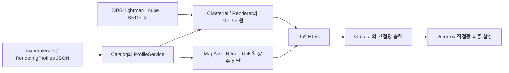

# LostArk JSON을 코드와 연결해서 읽기

이 문서는 2026-10-14 주석 정비에서 확인한 읽기 경로다. 데이터 값을 바꾸는 계획서가 아니다.
파일별 목록은 `2026-10-11_CODE_READABILITY_JSON_INDEX.csv`, 코드 반영과 검증 상태는 같은 날짜의
CODE_READABILITY PLAN/RESULT에서 구분한다. 목록의 문자열 참조 후보는 실행 소비 확인과 다르다.

JSON은 객체를 직접 생성하지 않는다. 로더가 JSON을 읽어 정의·배치·설정 값을 만들고, 그 값을 받은
Level·Catalog·View·GameRoom이 필요한 상태나 객체를 만든다. 먼저 해당 파일의 소비자를 찾고,
소비자가 사용하는 필드 묶음을 읽는다. 숫자와 ID를 파일 첫 줄부터 외우는 순서로 읽지 않는다.

직접 읽기와 게시 후 읽기는 현재 코드에 모두 존재한다. 모든 파일이 DataFiles를 거친다고 설명하지
않는다. `schema`가 같더라도 저작본·투영본·시험 입력·과거 receipt의 역할은 경로와 소비자로 구분한다.

## UI: 배치 정의에서 sprite와 입력까지

`Data/UI`의 `lostark.ui-layout` 문서는 각 View가 지정한 경로에서 읽는다.
[HUDLayoutTool.cpp](../../../Client/Private/HUDLayoutTool.cpp)는 그중 문서 목록에 등록된 대상을 편집한다.
[CUILayoutRuntime](../../../Client/Private/UILayoutRuntime.cpp)은 `CProjectDataRoot::Resolve`로
Data 아래의 layout을 직접 읽는다. PNG는 `Resources/UI/...`에 있고 JSON의 이미지 경로는
`UI/...` 상대 ID다. layout 파일 자체는 이미지 데이터를 소유하지 않는다.

| 필드 묶음 | 코드에서 필요한 이유 |
|---|---|
| `resolution` | `rect`가 작성된 화면 좌표 기준이다. 실제 viewport 좌표와 구분한다. |
| `slots[].id` | View가 특정 그림·텍스트·입력 영역을 찾는 stable ID다. 배열 순번이나 객체 주소가 아니다. |
| `slots[].rect` | 기준 해상도에서 위치와 크기를 정의한다. 화면 피킹도 같은 기준으로 변환해야 한다. |
| `ownerClass` | runtime이 직업별로 표시할 slot을 고른다. C++ 클래스의 메모리 소유권을 뜻하지 않는다. |
| `layers`, `animation` | runtime이 읽는 이미지·색·겹침과 프레임 재생 자료다. 게임 전투 판정을 저장하지 않는다. |
| `rotation` | 일반 이미지와 프레임 애니메이션 sprite에 적용할 회전 값이다. |
| `classes`, `shine`, `stages`, `type` | HUDLayoutTool의 저작·미리보기에서 사용하지만 현재 CUILayoutRuntime::Load는 읽지 않는다. 저장된 모든 필드가 제품 화면에 적용되는 것은 아니다. |

View가 layout을 보유하고 slot ID로 표시 상태를 바꾼다. `CUI_Sprite`는 GameObject로 Layer에
등록되어 공통 호출을 받으며, 클릭은 `CUIInputRouter`가 중재한다. View나 layout의 C++ 참조가
사라지는 일과 Layer에서 sprite를 제거하는 일은 같지 않다. 현재 `CUILayoutRuntime` 소멸자는
`Release_Sprites`를 자동 호출하지 않는다.

현재 `CUILayoutRuntime::Load`는 누락·파싱 실패 등 일부 실패를 `S_OK`로 반환하고 잘못된 행을
건너뛰는 경로가 있다. 이 문서에서 모든 UI 로드가 원자적인 rollback을 제공한다고 약속하지 않는다.
표시 문자열·키프레임·직업 패널 등 Data/UI의 다른 schema는 layout 필드로 해석하지 않는다.
각 파일의 소비 후보는 JSON_INDEX에서 찾고 해당 Document/View의 로더를 따라간다.

## 발탄: 전투 판단과 표현을 분리해 읽기

현재 편집 정본은 `Data/Valtan/Valtan.gameplay.json`과 `Valtan.presentation.json`이다.
[ValtanPatternTree.cpp](../../../Client/Private/ValtanPatternTree.cpp)의 로드 경로와
[valtan_tuning_pipeline.py](../../../Tools/ValtanPipeline/valtan_tuning_pipeline.py)를 함께 읽는다.
예전 `Valtan.pattern.json`을 이름만 보고 유일한 최신 정본으로 삼지 않는다.

| 정본과 필드 | 역할 |
|---|---|
| gameplay의 `decisionModel` | 패턴 선택과 기믹 진입에 필요한 결정 자료를 묶는다. |
| gameplay의 `patterns`, `patterns[].stages` | Server가 해석할 패턴·단계·동작 및 대상 조건이다. |
| gameplay의 `counterReactionLayers` | 반응 구간을 소유하는 패턴/단계와 성공·실패 동작을 연결한다. |
| presentation의 `patterns[].patternId` | 같은 전투 패턴에 붙일 표현 자료를 ID로 연결한다. |
| presentation의 `patterns[].presentationSources`, `patterns[].stages` | 애니메이션·이펙트·소리 등의 표현 연결을 묶는다. |
| presentation의 `independentEffects` | 독립 이펙트의 소유와 시작 사건을 별도 ID로 연결한다. |

게시 경로는 encounter·animation binding 등 투영 파일과
`Server/Bin/DataFiles/Gameplay/Gameplay.bootstrap`을 만든다.
[Publish-GameplayBalance.ps1](../../../Tools/GameplayPipeline/Publish-GameplayBalance.ps1)와
[CGameplayCatalog](../../../Server/Private/GameplayCatalog.cpp)가 이어지는 지점이다.
JSON의 저작 시간·단계 정의와 실행 중 Server의 현재 HP·현재 tick·선택 패턴을 구분한다.

## 쿠크: composition의 정의와 occurrence를 구분하기

현재 정본은 `Data/KoukuSaydon/Gate1/KoukuSaydonComposition.json`과
`Data/Compositions/Sequences/KoukuSaydonSequenceComposition.json`이다.
[KoukuSaydonCompositionDocument.cpp](../../../Client/Private/KoukuSaydonCompositionDocument.cpp)의
`Resolve_Path`와 `Resolve_SequencePath`에서 두 파일을 구분한다.

| 필드 묶음 | 읽는 기준 |
|---|---|
| `presentationResources`, `logics`, `worlds`, `sceneProfiles` | 재사용할 정의와 stable ID를 먼저 확인한다. |
| `patterns`와 각 `*Occurrences` | 어느 정의를 어떤 패턴 안에서 언제 사용하는지 읽는다. 정의 자체와 개별 사용을 구분한다. |
| `stages`, `durationMs` | 패턴의 시간 구간과 단계 연결이다. 시간 단위를 임의로 frame으로 해석하지 않는다. |
| `folders`, `bundles`, `patternFlows` | 저작 화면의 조직과 실행 순서 연결이다. 각각의 소비 코드가 다르다. |
| `next*Ordinal` | 새 ID 발급에 쓰이는 저작 상태다. 기존 항목을 정렬했다고 다시 번호를 매기지 않는다. |

[project_kouku_saydon_composition.py](../../../Tools/KoukuSaydonPipeline/project_kouku_saydon_composition.py)는
`Data/Encounters/KoukuSaydon/KoukuSaydonEncounter.json`과
`Data/Animation/Authored/KoukuSaydon/KoukuSaydon.patternbindings.json`을 투영한다.
Client의 PresentationAssetService·PresentationPlayer가 이 제품을 읽는 경로와,
일반 composition 게시자가 `Client/Bin/DataFiles/Compositions`에 만드는 제품을 구분한다.
`boss-composition`은 원본 문서를 연결하는 manifest이고 `arena-sequencer`는 트랙 연결 문서다.
둘을 쿠크 저작 문서의 모든 필드를 복제한 두 번째 정본으로 읽지 않는다.

## Effect JSON에서 HLSL까지

`Data/Effects/Authored`의 `lostark.effect-authoring`은 `effectAssetId`로 효과를 식별하고
`elements`에 효과를 구성하는 요소를 둔다. [CEffectCatalog](../../../Client/Private/Effect_Catalog.cpp)가
catalog와 문서 경로를 연결하고 [CEffectDocumentCodec](../../../Client/Private/Effect_DocumentCodec.cpp)이
문서를 해석한다. 생성된 runtime 자료와 원본 복원 근거를 같은 필드로 취급하지 않는다.

| 묶음 | 다음에 읽을 코드/자료 |
|---|---|
| `particleSystem` | 전체 효과에 적용하는 크기·방향·속도 보정과 각 element의 별도 값을 구분한다. |
| `elements[].id`, `groupId`, `kind`, `visible` | 요소의 stable ID, 조직, 종류와 표시 선택을 읽는다. |
| `resources`, `material` | Resources 상대 asset과 재질 입력을 확인한 뒤 renderer의 실제 binding을 읽는다. |
| `sourceRecipe`, `sourceNode`, `sourcePresentation` | 원본 추적·복원 입력이다. runtime 소비 범위는 codec/renderer에서 확인한다. |
| `actionCueAttachment`, `transformInheritance` | actor·socket·local/world 변환 연결을 확인한다. 위치 숫자만 보고 회전을 추가하지 않는다. |

V2의 `effectId` 문서는 `slots`와 `params`를 가지고, group의 `children`은 resource 참조와
`startMs`, `durationMs`, `localTransform`을 가진다.
[CEffectV2Document](../../../Client/Private/EffectV2_Document.cpp)와
[CEffectV2Catalog](../../../Client/Private/EffectV2_Catalog.cpp)에서 문서·group·binding의 세 단계를
구분해 읽는다. V1과 V2의 필드 이름이 비슷하다고 서로의 schema로 읽지 않는다.

HLSL을 볼 때는 JSON 필드 → C++ descriptor → constant/texture binding → shader 입력 → 계산 →
출력 순서로 연결한다. 모든 JSON 값이 HLSL에 그대로 전달되는 것은 아니다. CPU에서 해석하는
배치·시간·소유 상태도 있다. shader 안의 register·cbuffer·semantic은 C++ binding과 함께 읽고,
생성 셰이더의 원본 opcode/hash 기록은 긴 영어 설명과 별도로 보존한다.

## 렌더링·맵·World 데이터

`Data/Rendering/Authored/RenderingProfiles.json`의 `globalQuality`는 공통 품질 설정이고,
`profiles`는 `profileId`로 찾는 장면 환경·광원·그림자·안개 및 override 값이다.
[CRenderingProfileService](../../../Client/Private/RenderingProfileService.cpp)의 저작 저장 경로와
`Load_Runtime`이 읽는 DataFiles 경로를 함께 확인한다. 팀장이 저장한 FXAA·fog 등의 값은
주석 정비를 이유로 켜거나 초기화하지 않는다.

`Data/Maps/MapCatalog.json`은 Area와 사용 문서를 연결한다. Area의 `mapmaterials`는 재질/배치
조명 입력, `worldsequences`는 template·instance·objectResource를 구분한 연출 자료다.
배치 ID와 asset ID를 구분한 뒤 MapTool의 저장과 `Publish-MapAuthoring.ps1`의 출력을 읽는다.
생성 가능 정의가 있다는 사실만으로 현재 Level에 객체가 배치됐다고 판단하지 않는다.

`Data/Worlds`는 Server가 사용할 gameplay 배치·spawn group 등의 정본이며,
`Publish-WorldGameplay.ps1`은 Server bootstrap과 Client presentation 입력을 나누어 만든다.
Navigation·파괴·pickup은 각 게시 경로와 별도 실행 자료가 있으므로 맵 이미지 배치와 합쳐 읽지 않는다.
자세한 Area 계약은 [AREA_DATA_LAYER_GUIDE](../../TEAM/AREA_DATA_LAYER_GUIDE.md)를 따른다.

## 맵·캐릭터 렌더링: HLSL과 저장된 조명 입력을 함께 읽기

2026-10-14 실측에서 Engine/Client의 HLSL·HLSLI는 물리 파일 675개다. Engine 105개와
Client의 같은 이름 105개는 바이트가 같으며, 이 사본 관계를 제외한 파일 이름은 570개다.
파일군 기준으로 이펙트·carrier·미리보기 388개, native 모델·캐릭터·맵 공유 코드 150개,
맵·정적 표면 21개, 공통 조명·후처리·가시성·UI 11개다. 파일 수는 GPU 시간이나 화면 기여율이 아니다.
`SourceCharacter`라는 이름의 native 재질 경로는 정적 맵에서도 사용하므로 캐릭터 전용으로 세지 않는다.

HLSL에는 C++ 객체의 생성자·소멸자 대신 렌더 패스의 입력과 출력이 있다. 다음 순서로 읽는다.

| 읽는 대상 | 먼저 확인할 내용 |
|---|---|
| 파일과 진입 함수 | 맵 표면, 캐릭터, 이펙트, 직접광, 합성 중 어느 단계를 담당하는가 |
| CPU 호출자 | 어떤 GameObject·Material·Renderer가 이 패스를 선택하고 draw/dispatch하는가 |
| 입력 | 정점·상수·텍스처의 생산자, 단위·좌표계와 texture 채널의 뜻은 무엇인가 |
| 수식 블록 | 현재 표면에서 필요한 계산과 원본 재질별 예외는 무엇인가 |
| 출력 | 어느 render target에 무엇을 저장하며 다음 패스가 어떻게 소비하는가 |
| 생성·해제 | CShader·CMaterial·Renderer의 어느 상태가 GPU 자원의 참조를 보관하는가 |

PBR은 재질과 조명을 물리적 관계로 다루는 접근이고, BRDF는 빛의 입사·관찰 방향과 표면 특성에
따른 반사를 나타낸다. IBL은 주변 환경 영상에서 조명을 얻는 방법이다. 따라서 IBL과 BRDF를
서로 같은 기능으로 설명하지 않는다. 환경에서 오는 빛을 BRDF에 따라 반사시키는 데 함께 쓴다.
이 일반적인 구분은 [Filament 조명 문서](https://google.github.io/filament/main/filament.html)와
대조하되, 그 문서의 LUT 채널·수식을 아래 native 경로에 그대로 대입하지 않는다.

| HLSL 밖의 입력 | 저장 위치와 현재 소비 |
|---|---|
| 재질 정의 | `Data/Maps/Authoring/<Area>/*.mapmaterials.json`의 family·material 입력을 `MapAssetCatalog.cpp`가 검증하고 렌더 자료로 연결한다. |
| 장면 선택 | `RenderingProfiles.json`의 장면 환경을 ProfileService가 활성화한다. 재질의 `sourceIndirect`와 장면의 `useSourcePBRIndirect`가 함께 허용해야 native 간접광 경로를 쓴다. |
| BRDF 조회표 | `Resources/Map/Lighting/CharacterSelect/character_select_native_brdf_rg16.dds`는 128×32, R16G16_UNORM, 1 mip이다. 기존 `character_select_project_brdf.dds`는 128×128, R16G16B16A16_FLOAT, 1 mip이다. |
| 환경 큐브 | RGBM6 DDS의 방향별 색과 mip을 읽는다. 현재 native 경로는 RGB×A×6으로 복호화하고 roughness에 따른 기존 mip을 선택한다. |
| SH 계수 | native `sourceIndirect.packedSH`와 project `environment.cubeDiffuse.packedSH` 모두 float4 7개를 전달하지만 계수 준비·배율 계약이 다르다. 같은 배열 크기만으로 서로 교환할 수 없다. |
| RNM lightmap | 배치별 lightmap UV·scale과 평균·방향 DDS를 읽는다. tangent normal로 세 기저의 기여를 구하며 SH와 별도 입력이다. |
| CSO | HLSL을 컴파일한 실행 코드다. BRDF 표나 미리 계산한 조명 데이터와 다르다. `CShader`는 EXE 옆 CSO에서 Effect를 만들며 실행 중 HLSL을 컴파일하지 않는다. |

`Shader_MapMaterialSurface.hlsli`의 native 간접광 경로에서는 roughness와 보정된 시선 값으로
BRDF 표를 조회한다. mesh UV나 화면 RGB로 읽는 표가 아니다. native 표의 R은 Fresnel 항,
G는 base 항이며 shader의 실제 조합식을 따라야 한다. 이 표와 화면 색을 변환하는 color-grading
LUT도 서로 다른 입력이다. 환경 큐브는 주변 빛, BRDF 표는 표면 반사 계산에 필요한 계수를 제공한다.

native SH는 평가 뒤 환경색·π와 환경 보정값을 적용한다. project cubeDiffuse는 E/π가 포함된
계수와 별도 intensity를 사용한다. native 모드에서 project cubeDiffuse 추가분을 억제하는 이유도
두 근사를 겹쳐 더하지 않기 위해서다. native SH의 원래 9개 기저 계수를 7행에 포장했다는 설명과,
실제 JSON·GPU 배열에 9행을 저장한다는 설명을 혼동하지 않는다.

MapPBR의 간접광 결과는 RT7로 나가고 Deferred 합성에서 한 번 소비한다. RT6의 환경 반사 진단값을
다시 합산하면 같은 기여를 중복한다. 맵의 다른 BG 재질, native character program과 forward 경로는
각자의 수식·출력 계약이 있으므로 모든 맵·캐릭터가 이 MapPBR 계산을 쓰는 것으로 설명하지 않는다.

CPU 쪽 읽기 시작점은 [MapAssetCatalog](../../../Client/Private/MapAssetCatalog.cpp),
[CMaterial](../../../Engine/Private/Material.cpp),
[MapAssetRenderUtils](../../../Client/Private/MapAssetRenderUtils.cpp),
[CRenderer](../../../Engine/Private/Renderer.cpp)다. 이어
[MapMaterialSurface](../../../Client/Bin/ShaderFiles/Shader_MapMaterialSurface.hlsli)와
[Deferred](../../../Engine/Bin/ShaderFiles/Shader_Deferred.hlsl)를 읽는다.
캐릭터·공유 native 프로그램은 `SourceCharacterMaterialParameters`의 descriptor 포장과
`CMaterial::Bind_SourceCharacter`를 거쳐 `Shader_SourceCharacterPrograms/Material/Forward`로 이어진다.

이번 읽기 검증에서 11개 mapmaterials가 위 조명 필드로 참조한 고유 DDS 9,151개는 모두 존재했다.
명시적인 `sourceIndirect` 행 181개는 주 Character Select 맵에서 확인했다. 이 수치는 검사한
필드의 파일 존재 확인이며, 모든 재질 입력·모든 장면의 IBL·GPU 표시 성공을 보증하지 않는다.
파일 목록·형식 실측은 `out/CodeReadability/session-20261014-all/render-map-input-audit.json`과
`session-20261014-cleanup/engine-server-shared/rendering-shader-inventory.json`에 기록했다.

native BRDF 생성·SH 포장 복원의 기존 근거는
[09-22 복원 RESULT의 G13](../09-22/2026-09-22_CHARACTER_SELECT_MATERIAL_RESTORE_IMPLEMENTATION_RESULT.md)에 있다.
이번에는 설치된 DDS의 형식·hash와 현재 로더·shader 소비를 대조했다. 당시 out에 둔 생성기 원본은
현재 checkout에서 찾지 못했으므로 이번 작업으로 lookup을 재생성하거나 원본 수치 검증을 반복했다고
기록하지 않는다. 렌더 옵션·JSON 값·DDS 내용은 바꾸지 않았다.

## Guide와 작은 catalog

Guide는 `GuideCatalog`, `Placement`, `Prompts`, `Triggers`, `Combat`의 다섯 저작 JSON을
[Publish-Guide.ps1](../../../Tools/GuidePipeline/Publish-Guide.ps1)이 묶는다. `Save`는 저작 정본을
stable ID로 병합하고, `Publish`는 Client/Server의 `Guide.runtime.json`을 교체한다.
Load용 `Validate`가 허용하는 편집 가능 경고와 Save/Publish의 거부 조건을 구분한다.
파일 게시가 이미 실행 중인 Server 메모리까지 자동 교체했다는 뜻은 아니다.

Items·Vehicles·HonorTitles·ClearRewards는 각 publisher가 Server용 bootstrap을 만든다.
예를 들어 Client의 `CHonorTitleCatalog`은 Data의 JSON을 직접 읽으므로 Server와 같은 파일을
같은 방법으로 읽는다고 설명하지 않는다. actor/model/UI 같은 표현 입력과 Server의 전투 수치는
해당 catalog의 소비자에서 나누어 읽는다.

## 파일별 목록 사용법

JSON_INDEX의 경로와 schema로 파일을 찾고, root 필드와 schema의 정의를 확인한 다음 소비 후보의
실제 로드 함수를 읽는다. `문자열 참조 후보`는 단순히 파일 이름이 소스에 등장한다는 뜻이다.
`build_inputs`/`build_outputs`는 BuildDomains.json에 선언된 패턴과의 연결이며, `domain_tools`는
그 도메인에 등록된 도구·검증기·보조 파일 목록이다. 이 열의 모든 파일이 직접 게시자라는 뜻은 아니다.
동적 경로로 로드되는 파일은 문자열 검색에 잡히지 않을 수 있다. reference·receipt·fixture는
실행 정본으로 승격하지 않는다. JSON parse 성공은 필드 의미·게시 최신성·실행 화면 검증을 대신하지 않는다.
