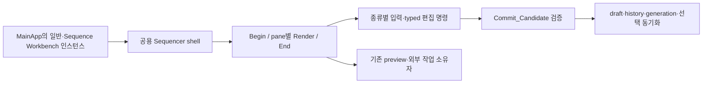

> **최신 진행 — 2026-10-14:** LostArk만 대상으로 정비 중이다. MainApp·Client 진입점의 중복 문법 설명을 줄이고 실제 관리자·UI 소유와 초기화/프레임 연결을 보완했다. 아래 과거 완료 수는 당시 기록이다. 현재 반영·검증·미완료 경계는 문서 끝의 「2026-10-14 전체 범위 재개와 MainApp 설명 교정」을 따른다. 전체 프로젝트 완료를 뜻하지 않는다.

<!-- readability-reaudit:begin -->
## 2026-10-12 비평을 포함한 재조사

**전체 정비는 미완료다.**

이번 재조사는 사용자가 직접 발견한 PlayerHandGripTransform.h의 미반영과 기존 완료 판정의 부족을 계기로 수행한다. 최초 진행표에는 일부 확장자·미추적 소스가 빠졌고, include 설명이 없는 파일도 과거 전체 반영으로 표시되어 있었다. 그 표의 완료 판정을 이번 기준의 완료로 승계하지 않는다.

진행표는 실제 경로 확인, 자체 정본/생성/배포 관계, 본문 검토 범위, 반영 이력, 독립 비평, 최신 hash의 검증 증거를 분리한다. `prior_review_status`는 과거 이력이며 `review_status`만 현재 판정이다. 목록 확인과 영문 검색은 본문 검토가 아니다. 소스 변경을 발견하면 이전 hash의 비평·컴파일 증거를 현재 완료 판정에 재사용하지 않는다.

정비 기준은 include가 제공하는 타입/API의 실제 사용 이유, 클래스·멤버의 소유/수명과 책임, 함수의 직접 호출자·입력/결과·상태 변경·실패 경계, 본문의 의미 단위와 좌표/수식/단위 설명이다. 긴 복합문과 한 줄에 겹친 제어 흐름을 읽기 쉽게 정리하고 영어 설명 주석을 한국어로 바꾼다. 실제 식별자·문자열·공개 계약·라이선스·생성기 표식은 유지한다. 기존 작성자의 한국어 메모와 질문도 원문 그대로 보존한다. 이 작업에서 새로 붙인 부정확한 설명은 최초 원본과 대조해 교정한다.

파일 완료에는 전문 및 필요한 소비자 대조, 작성자와 다른 비평자의 최신 후보 검토, 기존 동작/원문/인코딩 보존과 필요한 컴파일·기존 검사 통과가 모두 필요하다. 일부 함수만 끝난 파일은 전체 완료로 올리지 않는다. 생성/배포 사본은 원본과 생성자에서 처리하고 전달 결과를 별도로 확인한다. JSON 계약의 문자열 값은 주석으로 간주해 번역하지 않는다.

현재 목록은 자체 실행·계약·빌드·학습 소스 2,893개와 생성/배포 관계 125개를 구분한다. 외부 공급자와 작업 산출 경로는 별도 제외 장부에 이유를 남겼다. 파일별 상태는 [진행표](2026-10-11_CODE_READABILITY_FILE_STATUS.csv)에 기록한다.

| 현재 상태 | 자체 소스 파일 수 |
|---|---:|
| 미검토 | 2,584 |
| 보완 필요 | 61 |
| 완료 | 136 |
| 재비평 대기 | 112 |

완료 수는 이전 수정 이력 수가 아니라 위 조건을 현재 파일에서 모두 확인한 수다. 재목록·제외 이유·비평 지적·소스 hash 증거는 `out/CodeReadability/session-20261012/reaudit-scope` 및 각 담당 감사 폴더에 있다. 모든 대기 파일은 후속 정비 대상이며 목록에서 누락하거나 완료로 간주하지 않는다.
<!-- readability-reaudit:end -->

<!-- readability-stop:begin -->
## 2026-10-12 사용자 요청에 따른 마무리

추가 정비와 미반영 후보의 소스 적용은 중단했다. **전체 프로젝트 정비는 미완료**이며 재개 지시 전 자동으로 다음 묶음을 적용하지 않는다.

- 현재 기준 전문 독립 비평·반영·검증 완료: LostArk **136 / 2,893개**, WintersEngine **116 / 1,294개**. 기존 일부 수정 이력과 현재 완료 수를 구분한다.
- 마지막 정상 Debug Product 검증은 PASS다. `out/BuildPipeline/runs/20261012T103802619Z-debug-product.json`에서 Engine·Shared·Server·Client 컴파일/링크와 공식 SDK 전달을 확인했다. 경과 300,252 ms, 세션 적용 소스 238개 hash 유지, EngineSDK 헤더 78개 byte 일치다.
- Product7에서 Light/Light_Manager4, RenderTarget2, Target_Manager2, Shadow2, Engine_RenderTypes1, Bone/Channel/Animation6, CustomFont/Font_Manager/UIObject6의 **23개**를 최신 전문 비평과 제품 검증으로 완료 처리했다. Admission CPP **1개**도 전문 완료로 기록했다. GameRoom.h는 부분 범위로 유지했다.
- 앞선 Product6 기록의 22개 이후 Render_OutputContract HCPP **2개**를 byte 동일 재비평으로 추가 확인했다. 현재 완료 합계에는 포함하되 소스 신규 수정으로 세지 않는다.
- 미반영: Engine 공통 타입8(매크로 전개 포함, 독립 비평 통과), Server Replication CPP/H2(CPP 전문·H 부분 비평 통과), Kouku merge helper 후보(부분 비평 통과), Kouku logic-values 초안(자기/독립 검토 미완료). 후자의 기준은 앞선 미반영 merge 후보이므로 적용 순서 확인이 필요하다. Winters의 RHI scene helper6·value6도 미반영으로 남겼다.
- 새 함수 조사만 진행한 GameRoom_PlayerCommands는 후보·반영 없이 남겼다. 영어 주석 검색 결과나 본문 일부 검토를 전수 완료로 승격하지 않았다.
- 마지막 반영 묶음의 `git diff --check`를 통과했다. 빌드에는 기존 C4819/C4828 및 외부 DirectXTK PDB의 LNK4099 경고가 있으며 경고 없는 빌드로 기록하지 않는다. Client/UI 실행·화면 검증·데이터 publish·commit/push는 수행하지 않았다.

종료 근거는 `out/CodeReadability/session-20261012/closing-status.json`이며, 세부 미완료 범위는 `readability-audit-stop-state.json`, `client-startup/stop-handoff-20261012.json`과 Winters의 `closing-status.json`에 남겼다. 다음 작업은 최신 소스 hash와 미반영 후보의 선행 순서를 다시 확인한 뒤 시작한다.

<!-- readability-stop:end -->

<!-- readability-current-start -->
## 재조사 이전의 반영·검증 이력

다음 수치와 기록은 재조사 이전의 반영 이력이다. 현재 기준의 완료 수는 문서 맨 위 재조사 표를 따른다. 생성/배포 관계와 누락 확장자도 재목록에서 교정했다.

| 과거 상태 | 파일 수 |
|---|---:|
| 미검토 | 2717 |
| 전체 검토·반영 | 287 |
| 일부 함수 반영 | 14 |

아래 초기 반영 결과는 당시 검증 이력이다. 그 뒤 추가 묶음은 관련 번역 단위의 Debug 조건 컴파일을 수행했으며, 초기 전체 제품 빌드가 최신 추가 묶음의 링크·화면 검증까지 증명하지는 않는다. 후보 hash, 실제 반영 hash와 각 compile 로그는 `out/CodeReadability`의 묶음별 manifest/applied/result에 남긴다. PLAN에는 반영 전에 확정 코드를 기록했다.

추가 반영: ValtanBrain 전체, Level/Layer/객체 관리와 Transform/Timer, 입력·Frustum·Picking, 보스 전투 상태·피격·몬스터 AI·충돌·월드 파괴, 쿠크 Composition/AnimationAction/AnimationPattern 및 공통 BossComposition 문서, Shared 추적·폭탄·판정·Balance와 네트워크 수신/송신/프레임 코드를 정리했다. ValtanPatternTree H/CPP는 각각 전문 검토 뒤 반영했다. GameplayCatalog.h는 사용자 추가 메모 세 줄을 보존하여 전문 반영했다. ValtanBrain alias와 GameplayCatalog의 anchor/transform key 설명은 현재 실제 파일에서 한국어로 읽을 수 있다.

Engine의 Collider/Bounding/AABB/OBB/Sphere 10개 파일도 전문 검토·반영했고 실제 소비 CPP 5개 컴파일에 성공했다. AABB의 회전 제거, OBB 6개 축 검사의 기존 범위, clone의 GPU 자원 공유와 local shape 독립, Client 충돌과 Server 피해 판정의 책임 차이를 설명했다.

확인한 추가 컴파일: full-batch-01의 8 CPP, server01의 2 CPP, engine02의 3 CPP, server02~04와 shared01의 6 CPP, engine03의 3 CPP, GameplayCatalog.h를 소비하는 GameplayCatalog/KoukuSaydonLogicRuntime의 2 CPP 모두 종료 코드 0. Client 문서 4 CPP와 ValtanPatternTree.h 소비자는 각 후보의 기본 Client object 생성과 실제 BossTool UTF-8 구문 검사 성공 뒤 같은 hash 파일을 반영했다. 네트워크 8파일 반영 뒤 Shared.lib와 NetworkProtocolHarness를 실제 재빌드하고 기존 C++ 검증 프로그램을 실행하여 failures=0을 확인했다.

Shared 8개 공개 헤더는 UTF-8 /W4 /WX 성공. 당시 기본 CP949 /WX 검사는 Network 헤더의 기존 C4819 때문에 실패했고 실제 제품의 /WX- 조건은 성공했다. 이후 네트워크 정비 결과를 전체 경고 제거로 확대해 주장하지 않는다. Engine04 및 아래 한글 원문 복원 뒤 공식 PrepareEngineSdk target을 실행했다. SDK는 원본 검토 개수에 포함하지 않는다.

한글 원문 보존 재검사: Engine 최초 43파일의 한국어 주석 32개 중 수정된 31개를 13파일에 복원했고 기존 GameObject.h의 한 개는 그대로 보존되어 있었다. Server/Shared 감사에서는 Network 8파일의 46블록을 복원하고 GameplayCatalog.h의 기존 메모 보존을 확인했다. Composition CPP 초기 단계 주석 세 줄도 복원했다. 복원 후 Engine 10개·Shared 4개 실제 CPP를 다시 컴파일해 전부 성공했다. Composition은 동일 hash 후보로 Client object 및 BossTool UTF-8 구문 검사 성공을 확인했다. 최초 Tools Python 2파일에는 한국어 주석이 없었다.

원문 복원 직후 원본/SDK 대조: 당시 적용 원본 93개는 반영 hash와 모두 일치했고, 대상 Engine 공개 헤더 22개는 공식 배포된 EngineSDK와 byte hash가 같았다. 당시 적용 원본에 한정한 Git diff --check의 경고는 GameplayCatalog.h의 원래 메모 두 행과 PacketReader.cpp의 원래 질문 한 행뿐이었다. 복원 직전 baseline과 비교한 Network 후보 검사에서는 원문 끝 공백 여섯 행이 보고되므로 비교 기준을 구분한다. 후속 적용을 포함한 최신 수치는 delivery-source-verification.json과 delivery-source-diff-check.log에 있다.

GameplayCatalog.h의 사용자 메모 두 행과 Network 원문 여섯 행의 끝 공백은 그대로 보존했다. diff --check 경고를 원문 대조 증거와 함께 별도 기록하며 원문을 공백 정리 대상으로 삼지 않는다. 현재 별도 Catalog 후보 로드와 private parser의 모든 멤버 rollback은 같은 보장이 아니며, raid 무력화 최대치 멤버의 기존 rollback 한계도 설명에 명시했다.

후속 반영: full-server-06의 보상·파괴 bootstrap·Esther 6파일, full-client-06의 ValtanPatternTree.cpp 전체 정비, full-client-07의 ValtanPatternAuthoringEffectDocument 2파일도 PLAN 기록 후 적용했다. Server 3개 CPP는 적용 뒤 object 컴파일 성공. Client 두 CPP는 최신 후보 hash로 기본 Client object 및 BossTool UTF-8 구문 검사 성공을 확인했다. Effect 소유 관계 문서의 정규 문자열 비교와 파일 교체 사이의 동시 편집 경계, 상위 Tool이 수행하는 두 문서 실패 보상을 구분했다. WorldDestructionBootstrap은 짧은 입력 행의 필드를 개수 검사보다 먼저 읽는 기존 순서가 있으므로 모든 잘못된 입력을 안전하게 거른다고 설명하지 않는다.

최신 추가 반영: full-engine-05의 Camera/VIBuffer/VIBuffer_Rect 6파일과 full-server-07의 KoukuSaydonBrain 2파일은 적용 뒤 실제 CPP 4개 컴파일에 성공했다. full-client-08의 ValtanPatternPreviewDocument H/CPP도 독립 검토 및 최신 후보의 Client object/BossTool UTF-8 구문 검사 뒤 반영했다. Camera의 override 소유권과 복귀 방식, Rect clone의 GPU 공유, Preview의 참조 연결과 marker 상한 예외, Kouku의 두 stage 시계와 false/true의 상태 변경 경계를 설명했다. Kouku 헤더의 사용자 질문 네 개와 Rect.h의 기존 CP949 한글 주석을 그대로 보존했다. 공식 PrepareEngineSdk 동기화는 sdk-after-engine05.log에 기록했다.

Kouku 호출 순서 후속 비평: full-server-08은 주 보스 일반 tick, 방향 child의 이동/접촉 처리, SLAM 전환의 staged 호출 차이를 주석 네 줄로 보충했다. 07의 기존 설명과 사용자 원문은 그대로 유지했고 CPP를 다시 컴파일해 통과했다. 새 전체 검토나 적용 파일 수로 중복 집계하지 않는다.

WorldBootstrap 후속 반영: full-server-09의 H/CPP 두 파일을 전문 검토하고 한국어 설명·압축문 펼침을 반영했다. 기존 WorldDestructionBootstrap과 별개의 미검토 범위였으며 전체 정비 완료로 소급하지 않는다. 사용자의 기존 한글 질문·좌표 주석 두 개를 원문과 코드 위치 그대로 보존했다. WORLD_OBJECT의 동적 생성, 망원경의 현재 망치 타격 경로와 고정 placement 조회, 쿠크 sequence의 Server 레이드 준비 분기, WALL_CLIMB 표본의 단위, NPC 정의/실행 상태, Load 실패 보존과 Mario 보간 전제를 실제 소비자와 대조했다. 실행 토큰·문자열은 동일하며 원래 ASCII CPP는 한글 주석을 위해 UTF-8 BOM으로 저장했다. 관련 WorldBootstrap.cpp의 MSVC Debug 조건 object 컴파일과 이번 두 파일의 Git diff --check는 통과했다. 이번 묶음으로 전체 제품 재링크나 실제 전투·화면 확인을 완료했다고 주장하지 않는다. 검증 기록은 full-server-09/verification.json과 compile-full-server-09/result.json이다.

전체 정비 재개 첫 묶음: full-engine-06의 BinaryAsset 17파일, full-server-10의 NPC 행동·콜로세움 위협 평가·기믹 소품 6파일, full-client-09의 그래프·타임라인·카메라 흔들림 8파일, full-shared-02의 revision·ID·진단·PCH 5파일을 전문 검토하여 반영했다. CPU 소유 데이터와 파일 바이트 차용, 부분 실패 상태, 예측 점수와 실제 피해, 입장/복제 책임을 실제 소비자에 맞춰 설명했다. 실행 토큰·문자열은 동일하다. 후보 Engine CPP 7개, Server CPP 3개, Client CPP 4개의 두 구성 검사와 적용 Shared CPP 2개가 통과했다.

워터팡 공통 계약: full-shared-03은 헤더 1개 전문과 Python 2개 일부 변경이다. 헤더의 일정·30Hz tick·강제 이벤트·지면 XZ·총구/높이 책임을 한국어로 설명했다. 기존 Python 소비자 두 곳은 ASCII/Windows 기본 코드페이지로 읽어 새 한글 주석을 처리하지 못하므로 해당 read_text 한 줄씩만 UTF-8 BOM 대응으로 변경했다. 기존 함수/읽기식의 숫자 25개와 NPC ID 8개 결과 동일, 두 도구 AST parse, 실제 GameRoom_PartyWorld.cpp 컴파일을 확인했다. 도구의 resource 생성 main이나 게임 실행은 하지 않았다.

후속 본문 정비: full-client-10은 AssetPreparationBatch·CharacterSelectionState·CharacterRoster H/CPP와 EditorUndoHistory.h 7파일, full-server-11은 CombatObjectRuntime H/CPP 2파일 전문을 반영했다. 압축 분기·루프·복합문을 펼치고 비동기 준비 실패, 응답 소비와 서버 적용 성공의 차이, Undo callback 실패 시 외부 상태 책임, 공격 객체의 준비/commit/이동/CONTACT/TIMED/소멸 순서를 설명했다. 후보 Client CPP 세 개의 두 구성 검사와 Undo 헤더 컴파일, Server CPP 컴파일을 통과했다. 긴 함수 전체의 책임 분해가 끝났다는 뜻은 아니며, 전개와 설명을 구조 분해 완료로 집계하지 않는다.

검증 도구 설명: 기존 EditorUndoHistoryContracts.cpp와 Run-EditorUndoHistoryContracts.ps1 두 파일 전문을 정비했다. 무엇을 입력하고 어떤 결과를 비교하는지, 실제 제품 C++ 헤더를 컴파일하고 실행하는 절차를 한국어로 설명했다. C++ 실행 토큰과 PowerShell 비주석 토큰 674개가 동일하며 기존 C++ 검사 15,048건에서 실패 0을 확인했다. 이는 15,048개의 별도 요구사항이나 실제 UI 검사라는 뜻이 아니다. Python 검증 도구의 소스 파싱과 실제 C++ 실행도 구별한다.

렌더링 전문 정비: Engine Shader_Deferred.hlsl와 Client Shader_MapMaterialSurface.hlsli 두 정본을 반영했다. roughness→alpha→분포 함수, 원본 Fresnel 변형과 일반 Schlick의 차이, 직접광과 환경 반사, 서로 다른 두 SH 입력 규약, RNM/LUT/cube와 합성 순서를 주석과 수식 블록으로 연결했다. 실행 토큰 23,894개 및 기존 한글 주석 13블록을 유지했다. 최종 hash 고정본의 Deferred 전체 fx_5_0/O1, 실제 VtxMeshBinary 소비자 PS_MAIN ps_5_0/Od를 통과했다. 이전 주석 snapshot의 VtxMeshBinary 전체 effect/O1 성공은 최종 byte-hash 빌드와 구분한다. 공식 PrepareEngineSdk로 Deferred 소스를 SDK와 Client 사본에 동기화했고 hash 일치를 확인했다. 이번 추가분의 제품 CSO 교체/전체 제품 재링크/화면 검증은 하지 않았다. 렌더링 값·옵션·수식 동작도 바꾸지 않았다.

이펙트 연결 전문 정비: Effect_ShaderFamily.h·Effect_MaterialProgramRegistry.h·Shader_EffectRuntimeMaterialPacket.hlsli 3파일에서 carrier/family/profile의 shader 선택과 program/layout/descriptor/adapter, uniform packing을 설명했다. 현재 제품의 Create_Empty 및 direct-authored inline Execution 경로를 명시했으며 registry CPP 전체 정비까지 완료한 것으로 확대하지 않는다. C++ 소비자와 FXC 검증을 별도 기록했다.

동시 학습 메모 보존: GameplayDataRevision.h에 새로 저장된 format version 질문을 유지하고 그 아래에 실제 Server/Client의 버전 동등 비교와 형식 변경 이유를 설명했다. 최신 저장본을 다시 읽고 실행 토큰 동일·관련 Shared CPP 컴파일을 확인했다. 조사 당시 Shared 상수는 38, valtan_tuning_pipeline.py의 별도 상수는 37이었다. 이 차이는 별도 게시 경로에서 확인할 기존 계약 불일치이며 주석 작업에서 실행 상수나 게시 데이터를 임의 변경하지 않았다.

함수 본문 구조 개선의 다음 대상도 실제 호출 경계를 따라 조사했다. `GameRoom_BossSimulation::Update_WorldEntities`, `GameRoom_WorldEntities::Apply_BossPatternStageTransition`, BossStageActions, Kouku Logic Update, ClientReplication의 snapshot 반영, GameRoom Tick, MainApp LevelRequest다. 이 7개는 아직 부분 조사·미구현이며 전문 검토 완료 수에 넣지 않았다. 단계 전환은 전투 객체 commit 뒤 다른 owner가 실패할 수 있고, snapshot은 일부 반영 실패에도 tick이 진행하는 구간이 있으므로 이를 먼저 구분한 뒤 helper를 추출해야 한다. 단순히 함수 길이를 줄이거나 모든 실패를 하나의 rollback으로 묶지 않는다. 제안과 근거는 `out/CodeReadability/next-readability-priorities.json`에 기록했다.

현재 변경의 종류를 구분한다. `AttackHitTemplate.h`의 시간·밀어내기·도형·피해 검증은 실제 helper 분리를 완료했다. CombatObjectRuntime 등의 새 정비는 주로 압축 분기·루프·복합문을 펼치고 실행 순서와 실패 경계를 설명했다. 전문 검토·반영이라는 상태는 해당 파일의 모든 긴 함수를 책임별로 분리했다는 뜻이 아니다.

사용자 확인 파일 우선 반영: `Shared/Public/Network/PacketMessages.h`의 기존 4,021행 전문을 두 연속 구간으로 나눠 검토하고 영어 설명을 한국어로 바꿨다. 메시지의 역할·ID/sequence/revision·실제 상태 소비를 설명하고 압축 enum·짧은 제어문도 펼쳤다. 기존 한글 질문과 한글이 섞인 원문은 그대로 보존하고 아래에 설명을 추가했다. 전체 파일의 실행 토큰·문자열·선언 순서와 UTF-8 BOM 없음/CRLF를 유지했다. Shared와 기존 NetworkProtocolHarness를 실제 Debug로 빌드하고 C++ protocol 검사를 실행했다. 적용 hash·원문 보존·검사 로그는 `full-packet-01`에 기록했다.

인용된 `S2C_COMBAT_OBJECT_PRESENTATION_EVENT`는 피해 성공을 확정하는 결과 메시지가 아니다. Server의 판정 기회·연출 사건을 stable ID와 발생 pose로 전달한다. Valtan의 pose 기반 월드 Effect 생성은 이미 구현돼 있어 원래 영어의 'future'를 그대로 번역하지 않았다. 종류별 Client owner/occurrence 검증, 로컬 Sound 연결, reader 출력 보존과 cursor 진행을 구분했다. 이 헤더가 미검토였던 동안의 '전체 진행 중'이라는 답변은 파일 반영 완료를 뜻하지 않았으며, 이 정비로 PacketMessages.cpp 전체까지 완료한 것으로 표시하지 않는다.

Debug Product 검증: `out/BuildPipeline/runs/20261012T043416790Z-debug-product.json`에서 Engine→Shared→Server→Client의 컴파일·링크·공식 SDK/shader/runtime 배포가 모두 통과했다. 검증 시점 적용 파일 152개의 hash를 별도 기록하고 진행표에는 그 hash와 현재 파일이 같은 경우만 제품 빌드 완료로 표시한다. 기본 read-only runtime 검사에서 누락/부적합 입력은 없었으며 데이터 publish는 하지 않았다. 기존 혼합 코드페이지 경고와 외부 라이브러리 PDB 부재 경고는 남아 있다. Release와 실제 화면 검증을 뜻하지 않는다.

렌더링 학습 보강: 사용자 요청에 따라 PBR·BRDF·Fresnel·IBL·SH와 effect family를 수식 입력→계산→소비 순서로 설명한다. 수식 이름, 일반 이론, 원본 프로그램 복원과 프로젝트 근사를 구분하고 기존 한글 메모를 보존한다. 입력·정본·호출 흐름을 기술소개서에 활용하되 당시 설계 의도나 사용자 독립 구현 경험을 추측하지 않는다. 현재 범위 재조사에서 기존 목록 2,903개와 Engine/Client의 byte-identical shader 사본 101쌍을 확인했다. 생성 wrapper/배포 사본 관계를 확인하는 작업과 파일 전문 정비를 구분하며, 스캔만으로 전체 검토 완료를 늘리지 않는다.

최신 저장본 대조: 적용 원본 169개 모두 반영 hash와 같고 Engine 공개 헤더 30개가 공식 SDK 사본과 같다. Git diff --check의 경고는 보존 대상 한글 메모의 끝 공백이다. 최신 추가 질문을 포함한 실제 경고 위치와 개수는 delivery-source-diff-check.log에 기록했다. 해당 원문을 그대로 보존했다.

2026-10-12 사용자 추가 기준: 기존 한글 주석·질문·메모는 문구·오타·구두점까지 원문 그대로 보존하고 현재 코드의 보충 설명을 바로 아래에 적는다. 예전 설명이 현재 구현과 다르더라도 원문을 고쳐 쓰지 않고 아래 설명에서 구분한다. 이 보존 작업은 새로운 전체 파일 검토나 신규 적용 파일 수로 중복 집계하지 않는다.

클라이언트/UI 실행, 게시 데이터 변경, 성능 측정, commit/push는 수행하지 않았다.
<!-- session-20261012-current:begin -->
### 현재 세션의 상세 기준 추가 반영

첨부 ServerApp.h와 사용자가 승인한 Load 예시를 기준으로 include의 실제 소비, 클래스 소유권, 함수의 입력/상태/실패, 본문의 의미 단위를 설명한다. 이 세션의 반영 파일은 238개이며 일부는 앞선 정비의 추가 보강이므로 누적 수에 중복 가산하지 않는다. 파일 목록·적용 hash·검증 경로는 `out/CodeReadability/session-20261012/source-verification.json`과 진행표에 기록한다. 이 중 현재 hash와 일치하는 238개는 정상 Debug Product 증분 컴파일·링크·공식 SDK 배포를 통과했다. 이후 추가 반영한 hash에는 과거 제품 빌드 증거를 재사용하지 않는다.

- ServerApp.h, 세션/소켓, NumericStore는 실제 스레드와 큐 소유, 종료 순서, 준비/저장/적용과 보상 경계를 대조했다. 일반 단독 월드 이동과 파티 전원 준비의 차이를 설명했다.
- Client 경로 해석·레벨 전환·로더·비동기 준비와 MainApp의 분리된 구현 파일을 실제 호출 흐름대로 정리했다. MainApp.cpp 전체 완료를 의미하지 않는다.
- Engine 공통 타입·매크로, 작업 pool, PipeLine, Graphic_Device와 shader/texture의 소유·실패 경계를 대조했다. Texture의 개별 로드 실패를 반환하지 않는 기존 한계를 임의로 변경하지 않았다.
- GameplayCatalog.cpp는 이번에 Load만 의미 단위로 정리했다. 임시 catalog 로드→optional receipt 읽기→형식/revision/hash 검증→최종 move의 순서와 기존 오류 문자열을 유지했다. 원본/수정 함수를 실행하는 28,416건의 격리 차등 검사에서 반환값·상태 메시지·active revision·기존 payload 보존·내부 호출 순서가 같았다. 실제 데이터 전체 통합 검사와는 구분한다.
- 기존 한국어 주석/질문과 다른 세션의 미커밋 내용을 baseline에 포함하여 보존한다. 일반적인 ASCII 원본은 실제 CPP 문자 모드에 맞추고, 원래 CP949/UTF-8 인코딩은 유지한다. 외부 라이브러리·생성 사본은 원본 작업 수로 집계하지 않는다.

현재 추가 반영 hash와 일치하는 실제 CPP 89개는 MSVC Debug 격리 object 컴파일에 성공했다. 해당 검증은 링크·GPU 화면 검증이 아니다. 후보 단계 파일은 이 수치와 완료 표에 포함하지 않는다. 전체 요청은 계속 진행 중이다.
<!-- session-20261012-current:end -->

<!-- readability-current-end -->

# LostArk·Winters 코드 가독성 정비 RESULT

## 요청과 현재 범위

사용자가 확정한 대상은 **LostArk 솔루션 전체와 Winters Engine·LoL**이다. 문서 설명만 보완하는 요청이 아니라 실제 함수·제어 흐름·한국어 주석을 정리하는 작업이다. PPT 원고 작업은 중단했다. 전체 목표는 아직 진행 중이며 아래에 명시한 코드만 첫 반영분이다.

정리 기준은 호출자, 입력과 결과, 변경 상태, 소유권과 수명, 실패 시 보존·정리 책임이다. 외부 라이브러리와 생성·배포 사본은 직접 번역하지 않는다. 기존 코드의 동작·식별자·데이터 계약을 유지하고 책임이 실제 나뉘는 곳에서만 함수를 분리한다.

## 반영한 LostArk 코드

| 파일 | 실제 변경 범위 |
|---|---|
| `Shared/Public/Gameplay/AttackHitTemplate.h` | 공격 정의 필드를 의미별로 나누고 시간·피격 이동·도형·피해 검증을 네 inline helper로 분리했다. 세 공개 검증 함수의 목적과 빈 목록·stage 일정·ID 문법 검사 범위를 설명했다. |
| `Server/Private/GameplayCatalog.cpp` | `PATTERNATTACKHIT` 파싱과 최종 stage contacts 검증의 압축된 제어문을 펼쳤다. 임시 값·실제 owner/profile 참조·로드 실패 rollback을 설명했다. |
| `Client/Private/KoukuSaydonCompositionDocument.cpp` | `Parse_AttackHits`의 JSON 형식 검사와 Shared 의미 검증, 상위 임시 문서의 commit 책임을 설명했다. |
| `Client/Private/ValtanPatternTree.cpp` | `Parse_ValtanStageAttackContacts`의 숫자 검사와 성공 시 move를 드러냈다. 누락 입력과 명시적 빈 배열의 서로 다른 처리를 유지했다. |
| `Client/Private/KoukuSaydonActionWorkbench.cpp` | `Render_AttackHitTemplates`의 편집 draft, ID 생성, erase 뒤 index 유지, 적용 전 검증을 설명하고 잘못 붙어 있던 closure 주석을 옮겼다. |
| `Engine/Public/Prototype.h`, `Engine/Private/Prototype.cpp` | 원형·복제 객체·장치 참조 공유와 파생 클래스의 책임을 설명했다. |
| `Engine/Public/Prototype_Manager.h`, `Engine/Private/Prototype_Manager.cpp` | Level별 원형 소유권, 단일·묶음 등록 실패, 임시 map 이동과 Clone/Clear 책임을 설명했다. |
| `Engine/Public/Component.h`, `Engine/Private/Component.cpp` | 기본 no-op 구현과 파생 Component의 초기화·렌더 책임을 설명했다. |
| `Tools/KoukuSaydonPipeline/combat_hit_templates.py` | 두 보스 저작 pipeline이 공유하는 검증기의 입력 보존·기본값·시간·도형·피해·Logic owner 검사를 설명하고 긴 조건식을 펼쳤다. |
| `Tools/KoukuSaydonPipeline/test_combat_hit_templates.py` | 기존 14개 테스트에 입력과 기대 결과를 한국어로 설명했다. C++ Server 실행이나 화면 검사가 아니라는 범위를 명시했다. |

위 13개 파일의 지정된 함수·선언을 수정했다. 큰 Client/Server 파일 전체를 검토·번역했다는 뜻은 아니다. 제품 JSON, 게시 파일, protocol, rendering option은 수정하지 않았다. 새로운 C++ 파일과 project/filter 변경도 없다.

두 Python 파일은 함수·상수·assert의 AST가 원본과 같으며 UTF-8 BOM 없음·LF를 유지했다. 검증기의 모듈 docstring만 한국어로 바꾸면서 두 보스의 현재 시간 기준을 반영했다. 이 설명 문자열을 제외한 AST가 완전히 같고 `__doc__`를 사용하는 제품 계약은 발견하지 못했다. 검증기 파일은 두 보스 publisher의 source fingerprint 대상이므로 주석 변경도 이전 게시 영수증의 hash와 달라질 수 있다. 이 작업은 publisher를 실행하지 않았으며 게시 데이터·메모리 draft·실행 중 Server 데이터를 갱신한 것으로 보고하지 않는다.

원본은 `out/CodeReadability/baseline`, 후보와 SHA256은 `out/CodeReadability/candidate-manifest.json`에 보관했다. 적용 직전 원본 hash를 확인했다. Shared 헤더에 다른 경로에서 동시에 추가된 빈 줄 두 개는 새 코드에도 보존했다. 다른 미커밋 코드·문서는 되돌리지 않았다.

Engine 원본 중 ASCII였던 CPP 세 파일은 현재 Engine 컴파일러의 CP949 해석에 맞춰 새 한국어를 CP949로 저장했다. 이미 CP949인 Prototype_Manager.h도 유지했다. ASCII였던 Prototype.h·Component.h와 Shared AttackHitTemplate.h는 기본 CP949와 `/utf-8` 양쪽에서 사용하므로 UTF-8 BOM으로 확정했다. 세 헤더의 해석한 전체 텍스트는 BOM 적용 전후 동일하다. Client/Server 기존 소스의 인코딩과 전체 프로젝트의 문자 설정은 바꾸지 않았다.

## 반영한 Winters 코드

Winters는 `codex/code-readability` 브랜치에서 `Engine/Public/ECS/Entity.h`, `ComponentStore.h`, `Client/Public/GameApp.h`, `Client/Private/GameApp.cpp`를 수정했다. 슬롯 재사용과 generation, sparse/dense와 삭제 시 이동, LoL의 제품 선택→Login/Replay Loading 연결을 설명했다. 별도 [Winters PLAN](../../../../WintersEngine/.md/plan/2026-10-11_CODE_READABILITY_PLAN.md)과 RESULT를 따른다. 기존 untracked 문서 두 개는 보존했다.

## 확인한 검증과 남은 검증

- Shared 독립 C++20 검사: ID 예상값 517개, validator 경계 예상값 104개, 일반 검증 30,092쌍과 stage 검증 20,012쌍을 이전 구현과 비교하여 failures=0. 24개 필드의 타입·offset·기본값과 `sizeof=336`, `alignof=8`이 같다. 마지막 주석 교정은 실행 토큰을 바꾸지 않았다. 로그는 `out/CodeReadability/verification/AttackHitTemplateDifferential.log`다.
- Python 제품 경로에 반영한 뒤 `python -B -m unittest -v Tools.KoukuSaydonPipeline.test_combat_hit_templates test_valtan_stage_contacts`를 실행했다. 실제 runtime Python을 사용하고 `PYTHONPATH=Tools/ValtanPipeline`을 지정했다. 기존 쿠크 14개·발탄 6개가 총 20/20 PASS, 로그는 `out/CodeReadability/python-applied-tests.log`다. Python 검증·projection의 증거이며 실제 C++ 공격 실행의 증거와 구분한다.
- NetworkProtocolHarness를 Debug x64로 새로 빌드하고 실행하여 failures=0이었다. 로그는 `out/CodeReadability/protocol-build.log`, `protocol-test.log`다.
- LostArk Engine 6개와 Shared 후보의 독립 검토를 받았다. 시간 기준과 contact 설명의 두 표현을 수정했다. root가 Client/Server의 실제 diff를 검토했다.
- LostArk 수정 소스 13개의 후보 SHA256 일치와 `git diff --check`는 통과했다. 전체 working tree 검사에서는 이 작업이 건드리지 않은 기존 HLOD PLAN·GameInstance·GameplayDataRevision 등의 공백 오류가 발견되어 별도로 보존했다.
- 새로 빌드한 `Server/Bin/Debug/Server.exe --kouku-object-overlap-contract-test`는 failures=0이었다. 실제 C++의 접촉·반복 시각·중복 tick·영역 이탈·종료·피해/광기 처리를 검증하는 기존 검사다. 로그는 `out/CodeReadability/server-kouku-overlap-test.log`이며 Client 화면과 네트워크 전체 시나리오 검증으로 확대하지 않는다.
- Winters의 주석·공백 제외 실행 토큰은 원본과 같다. 기존 EntityGenerationSmoke를 원본·후보 각각 컴파일·실행하여 PASS, 후보 ECS 헤더의 `/Zs /W4 /WX` 검사도 PASS다. 독립 검토에서 21개 교체 앵커와 호출·수명·복원 책임을 확인했고 P0/P1 잔여 0 뒤 적용했다.
- Winters는 솔루션 폴더가 포함된 `/t:01_ Client\Client`로 Debug x64 Engine·GameSim·Client 빌드와 링크가 PASS(종료 코드 0)였다. SDK의 두 ECS 헤더도 원본 hash와 일치한다. 첫 `/t:Client` 지정 오류는 PLAN에 교정했다.
- LostArk 첫 Product는 OBJ 쓰기 권한 오류, 작업 수를 줄인 두 번째는 기존 Debug PDB 열기 오류로 중단됐다. 읽기 전용 재확인에서 해당 잠금이 풀렸고 파일은 ReadOnly가 아니며 권한도 정상이었다. 당시 잠금 주체는 확정하지 않았다. 세 번째 Product의 Engine·Shared·Server·Client 컴파일·링크·정상 배포가 모두 PASS(종료 코드 0)였다. 로그는 `out/CodeReadability/product-build-final.log`, runner 기록은 `out/BuildPipeline/runs/20261011T152928091Z-debug-product.json`이다. 기존 인코딩·형변환·외부 PDB 경고가 있어 무경고 성공으로 표현하지 않는다.
- BossToolTests를 새로 Debug x64 빌드하고 `--kouku-fixed-damage-contract`를 실행해 PASS였다. 공격 정의·밀침·공유 Result 편집·저장/재열기·잘못된 입력의 기존 상태 보존 등을 확인했다. 로그는 `out/CodeReadability/boss-tool-build.log`, `boss-tool-fixed-damage-test.log`다.
- Product 빌드 후 위 세 공개 헤더의 문자 표식만 보완했다. Shared는 BOM 없음+기본 CP949의 C4819를 재현했고, BOM 후보는 기본 모드와 `/utf-8`의 `/W4 /WX /std:c++20` 컴파일 모두 PASS였다. Engine 후보 두 헤더도 실제 include 의존성으로 기본 모드·`/utf-8` 구문 검사 모두 PASS, 해당 두 헤더의 인코딩 경고 0이다. 다른 기존 헤더의 경고는 분리했다. 이 최종 변경 뒤 Product 전체를 반복하지 않았으며, 실행 코드가 아닌 문자 해석만 바뀌었다. `Client.vcxproj /t:PrepareEngineSdk /p:BuildProjectReferences=false`의 기존 배포 target을 실행해 SDK를 동기화했다. 증거는 `attack-header-encoding-probe`, `encoding-probe/engine-bom`, `encoding-sdk-deploy.log`에 있다.
- Client·게임 UI 실행, 화면 확인, 성능 측정, commit/push는 하지 않았다.

## 전체 정비에서 아직 남은 범위

2026-10-12 사용자는 ValtanBrain의 미수정 영어 주석을 확인한 뒤 **모든 파일을 전수로 진행**하도록 재확정했다. 파일을 저장하지 않아서 생긴 문제가 아니며, 위 첫 반영분만 완료되고 해당 파일이 아직 미반영이었던 상태다. 전체 목록을 큐로 사용해 실제 파일별 검토·후보 준비·반영·검증을 이어간다. 일부 함수 수정 상태를 파일 전체 검토 완료로 승격하지 않는다.

Git 추적 C/C++·HLSL·Python·PowerShell 파일 3,510개를 목록화했다. 외부 코드 586개와 생성이 확인된 21개를 제외한 2,903개 중 지정 함수 수정 상태는 13개, 미검토는 2,890개다. 이 목록에는 학습·참조 코드 59개와 추후 원본/배포 관계를 더 구분할 shader도 포함된다. 2,657,926행과 압축 후보 52,987행은 기계적 측정이며 결함 수·필수 수정량·완독을 뜻하지 않는다. `out/CodeReadability/source-inventory.csv`, `source-inventory-excluded.csv`, `source-inventory-summary.json`에 경로·인코딩·상태·분류 근거가 있다.

| 영역 | 다음 검토 단위 | 상태 |
|---|---|---|
| LostArk 보스 실행 | `ValtanBrain`, `KoukuSaydonBrain`, `KoukuSaydonLogicRuntime`의 시작·갱신·취소·종료 상태 | 미반영 |
| LostArk 데이터·도구 | domain별 저작 Save→검증→publish→runtime 소비, 자체 Python·PowerShell·C++ 도구 | 위 공격 검증기·테스트 두 파일 외 미반영 |
| LostArk Client | 전체 워크벤치·문서·표현 객체·UI의 함수 책임과 실패 경계 | 위 세 함수 외 미반영 |
| LostArk Engine | Level/Layer/객체 관리, 자원·렌더링·수학·물리·프로파일러의 소유권·단위·스레드 경계 | 위 기본 클래스 외 미반영 |
| LostArk Server·Shared | 네트워크 명령·시뮬레이션·복제·기타 데이터 검증 | 위 공격 정의·파서 외 미반영 |
| Winters·LoL | GameSim·Server·네트워크·챔피언·렌더러·도구·나머지 ECS | 위 네 파일 외 미반영 |

다음 세션은 이 RESULT와 같은 이름의 PLAN을 읽고 실제 소스 변경 상태부터 확인한다. 전체 자동 포맷이나 파일 수 집계만으로 완료를 선언하지 않는다. 부분 반영을 전체 가독성 정비 완료로 표현하지 않는다.

<!-- readability-product4:begin -->
## 2026-10-12 네 번째 Product 검증과 후속 보완

정상 Debug Product 빌드 `20261012T090723606Z-debug-product.json`이 Engine·Shared·Server·Client 컴파일·링크와 공식 SDK 전달을 통과했다. 빌드 시작 snapshot의 이번 세션 반영 소스 192개는 종료 시에도 동일했고, 그중 Engine 공개 헤더 64개는 SDK의 동일 상대 경로와 byte가 일치했다. 이 숫자는 전수 가독성 완료 수가 아니며 별도 변경 파일/단계의 검증 증거다. Client/UI 실행과 화면 판정, data publish는 하지 않았다.

이 검증과 전문 독립 비평 증거를 함께 갖춘 Timer/Level 8개, Prototype/Object 8개, Layer/Parts 8개, Input/Camera 9개, Shared 전투 helper 4개, Client 설명 교정 4개와 기초 include 보완 6개를 현재 기준 완료로 승격했다. 소비 파일의 일부 구간 대조를 그 소비 파일의 전문 완료로 집계하지 않았다. 후속 Bounding/Collider 10개와 Transform/Buffer/Rect 6개는 독립 비평 및 실제 CPP 8개 격리 컴파일을 통과했고, 최신 SDK/Product 전달은 다음 묶음에서 확인한다.

ServerApp H/CPP와 GameRoom 내부 header/helper CPP 네 파일은 별도 정상 Server Debug x64 증분 컴파일·링크 및 diff check를 통과했다. GameRoom 두 파일과 ServerApp.h는 전문 독립 비평을 마쳤다. ServerApp.cpp는 작성자가 전문을 읽었으나 독립 비평은 명시한 변경 구간에 한정되므로 전체 완료로 올리지 않았다. ValtanPatternTree.cpp도 반영한 함수 구간과 남은 함수 목록을 구분한다. 비평에서 드러난 strict master/product stage 수 대조의 기존 위험 VT-RISK-01은 동작 변경 없이 미해결로 기록했다.

Product 빌드는 경고가 없는 상태가 아니다. BOM 없는 UTF-8 PacketMessages.h를 CP949 소비자가 읽는 C4819와 CP949 Camera_Free.h를 UTF-8 소비자가 읽는 C4828을 구분했다. HEAD와 기존 snapshot, 이전 Product2/3에도 이 인코딩 경계가 존재함을 확인했으며 개별 경고의 최초 도입을 단정하지 않았다. PacketMessages.h에는 본문 byte와 모든 ASCII 실행 토큰을 보존한 UTF-8 BOM 3byte만 더했고, 원본/후보의 두 문자셋 구문 검사 4개, 정상 NetworkProtocolHarness 빌드/실행과 실제 Client 소비 CPP 검증을 통과했다. 이 변경은 파일 전체 의미 검토 완료가 아니다. Camera_Free.h 및 나머지 기존 인코딩 경고는 별도 조사 대상으로 유지했다.

세부 증거는 `out/CodeReadability/session-20261012/product-debug-4-proof.json`, 각 묶음의 manifest/independent-review/compile 기록, `server-second-pass/verification.json`, `server-room-helpers/verification.json`, `charset-audit`에 있다. 이전 실행 증거는 당시 hash에만 적용하며 후속 후보에 재사용하지 않는다.
<!-- readability-product4:end -->

## 2026-10-12 Product 5 검증

Engine·Shared·Server·Client Debug Product 정상 증분 컴파일·링크가 PASS했다. 실행 기록은 out/BuildPipeline/runs/20261012T094053912Z-debug-product.json이며 477704ms가 걸렸다. 빌드 시작 시 기록한 이 세션의 적용 소스 218개가 검증 후에도 같은 SHA-256이었고, 포함된 Engine 공개 헤더 75개의 공식 EngineSDK 복사본이 byte 단위로 일치했다. 근거는 out/CodeReadability/session-20261012/product-debug-5-proof.json이다.

경계 상자·충돌5쌍, Transform/VIBuffer/Rect3쌍, BinaryReader/decoder registry 경계5개(총21개)는 독립 전문 비평과 실제 CPP 컴파일, 이번 정상 Product 검증 증거를 합쳐 현재 기준 완료로 승격했다. ServerApp.cpp는 동일 최신 hash에 대한 두 비평자의 읽기 구간 합집합이5758행 전부를 덮는 합성 비평이며, 한 비평자가 전체를 읽은 것으로 기록하지 않는다. 이 시점 LostArk 현재 기준 완료87개이며 전체2893개가 완료된 것은 아니다.

기존 C4819/C4828 인코딩 경고가 있어 무경고 성공으로 기록하지 않는다. Client/UI 실행, 화면 확인과 데이터 publish는 수행하지 않았다. 이 검증 뒤 적용하는 후속 후보는 개별 실제 컴파일 및 다음 Product 증거로 구분한다.

## 2026-10-12 Product 6 검증

- 정상 Debug Product 빌드: PASS. `out/BuildPipeline/runs/20261012T100841047Z-debug-product.json`, 경과 363,495 ms.
- Engine·Shared·Server·Client 정상 증분 컴파일/링크 및 공식 EngineSDK 전달을 수행했다. 빌드 전후 이번 세션 적용 소스 236개 hash와 Engine 공개 헤더 77개의 SDK byte 일치를 확인했다.
- 이번 완료 승격은 ModelAssetData/WModelDecoder3, WAnimation/WSkeleton4, WMesh/WMaterial/WFormat5, CPU/particle4, Shader/Texture4, CPipeLine2 등 전문 독립 비평 22개다. CPipeLine2와 CPU CPP는 byte 동일 재비평을 구분한다.
- GameRoom.cpp 전문은 별도 독립 비평 및 정상 Server Debug 컴파일·링크를 통과했다. GameRoom.h와 Valtan/Kouku 문서의 부분 구간은 이번 제품 빌드를 통과해도 파일 전체 완료로 올리지 않는다.
- 빌드에는 기존 C4819/C4828 문자 집합 및 외부 DirectXTK PDB 관련 LNK4099 경고가 있다. 경고 없는 빌드로 기록하지 않는다. UI 실행·실제 화면/오디오 검증·데이터 publish는 수행하지 않았다.
- source hold 해제 후 다음 승인 묶음은 별도 반영/컴파일 증거를 기록하며 이 Product6의 검증 hash를 최신 파일에 무조건 재사용하지 않는다. 전체 프로젝트 정비는 계속 미완료다.

<!-- workbench-split-current:begin -->
## 2026-10-12 Kouku Workbench 분리와 전수 목록 조사

이번 요청의 기준 작업인 `KoukuSaydonActionWorkbench.h/.cpp`의 역할별 파일 분리와 긴 UI 함수·한국어 주석 정리를 반영했다. 추가 요청에 따라 LostArk 자체 소스·빌드 설정의 전수 목록을 조사하고 Valtan Details/Preview와 MainApp Profiler도 실제로 분리했다. **전수 목록 조사와 모든 파일의 의미 검토·분리 완료는 다르다.** 아래에 명시한 적용 범위만 완료했으며, 나머지 후보는 아직 구현하지 않았다. 이전 RESULT의 완료 수와 단순 합산하지 않는다.

### 적용 범위와 파일 연결

Kouku는 기존 CPP 17,563행을 같은 클래스의 CPP 16개로 나누었다. 본체는 1,397행이며 공개 진입점·선택·pane dispatch·기본 Details를 유지한다. 세션 필드를 새 manager나 별도 런타임에 복제하지 않았다. 현재 파일 목록은 다음과 같다.

| 구현 파일 | 책임과 소유 경계 |
|---|---|
| `KoukuSaydonActionWorkbench.cpp` | 생성/해제, 선택과 입력 동기화, toolbar, resource 종류 선택, Details dispatch, 공용 shell frame 연결 |
| `_Document.cpp` | Reload/Save/Validate, 부모 시각 정합성, 검증된 후보를 기존 draft에 commit |
| `_History.cpp` | 불변 문서 snapshot과 selection/geometry/World 이력, pane 종료 뒤 Undo/Redo 복원 |
| `_Publish.cpp` | 외부 compiler/publish 작업 관찰, 클릭 시점 draft·revision·world generation을 고정한 실행 요청 |
| `_Patterns.cpp` | Pattern/Stage/Animation occurrence의 typed 구조 편집과 조회 |
| `_Animation.cpp` | Animation 자원/저작 선택과 범위·재생 연결 |
| `_Clipboard.cpp` | 복사 payload와 붙여넣기 후보의 ID·참조 재연결 |
| `_Timeline.cpp` | ImGui timeline 입력, World clip 표시 구간, 행 배치와 파생 layout cache |
| `_Logic.cpp` | Logic 종류별 값 입력과 검증/적용 경계 |
| `_Summon.cpp` | Summon box 편집, spawn 행, 진형 위치 생성 |
| `_WorldScene.cpp` | World/Scene 항목 선택·편집 요청과 외부 소유 도구 연결 |
| `_Presentation.cpp` | 표현 box, Sound·Effect·Shake 자원/설정과 preview 요청 |
| `_Collider.cpp` | Collider/group 상세와 geometry overlay, 명시 적용/취소 |
| `_Camera.cpp` | 카메라 cue/shot 저작과 기존 camera preview 연결 |
| `_Preview.cpp` | 로컬 preview의 준비·시간·pause/stop/reset과 Server 재생 상태 연계 |
| `_Helpers.cpp` | 분리 파일이 공유하는 순수 조회·표현 변환·입력 검증 helper 정의 |

위 접미사는 모두 `Client/Private/KoukuSaydonActionWorkbench`에 이어진다. private `_Internal.h`는 공유 helper 선언·공통 상수, `_TimelineTypes.h`는 layout cache의 완전 타입, `_CameraLookup.h`는 Arena camera shot 조회 타입을 연결한다. Arena의 무거운 완전 타입을 모든 분리 파일에 전파하지 않았다. Public H에는 책임·상태 수명 설명과 새 private helper 선언 27개를 추가했고 공개 API와 기존 멤버 상태는 유지했다.

shell은 창 배치와 pane 표시를 소유한다. Workbench는 명령과 편집 세션을 소유하며 실제 Animation/Effect/Camera/Server 실행을 새로 구현하지 않는다. pane가 문서 행을 차용하는 동안 문서를 교체하지 않도록 기존 조기 반환과 End frame의 지연 편집 순서를 유지했다.

### 함수·자료구조·주석 정리 기준

- Logic의 큰 값 편집 분기를 종류별 private helper 17개로 나누었다. 입력 buffer와 최종 후보 검증/commit은 기존 세션 경계를 따른다.
- Summon은 spawn 목록과 formation 생성 2개, Timeline은 조작·순서 변경 조건·World clip 행·표시 행 배치·layout 재구축 5개, 기본 Details는 Pattern/Stage/Animation 속성 3개로 분리했다. 추출 지점에서 원래 처리 순서와 return 의미를 유지했다.
- `m_Document`의 디스크 기준본, `m_Draft`의 검증된 편집본, 미적용 Logic 입력, geometry overlay, Undo snapshot, preview snapshot/cache를 구분해 설명했다. 저장 ID와 frame 동안 차용하는 vector 행 포인터를 구분했다.
- Timeline은 기존 `AllocateDisplayRows`를 계속 사용한다. cache 재사용 조건은 draft/World 세대뿐 아니라 pattern ID, 표시 폭, World 편집 가능 여부와 camera blend-out 목록까지 포함한다. 화면 행 번호를 저장 ID로 쓰지 않는다.
- Undo는 같은 draft generation의 불변 문서를 공유하고 selection/geometry/외부 World 상태는 따로 보관한다. pane가 끝난 뒤 기존 검증·복원 경계로 적용한다.
- Composition Save 성공 뒤 외부 World Save가 실패할 수 있는 기존 경계를 명시했다. 두 저장 전체를 하나의 원자적 transaction으로 설명하지 않았다. Server draft play는 클릭 시점 snapshot을 유지하며 이후 draft 편집과 world generation 불일치를 구분했다.
- 함수 앞에는 직접 호출 흐름, 입력/결과, 상태 변경, 실패 시 유지/정리 책임을 한국어로 적었다. 기존 한글 질문·메모는 보존했다. 기존 CPP/H의 인코딩은 유지했고 새 C++ 파일은 UTF-8 BOM 없음이다.

원본 254개 멤버 정의 중 250개는 주석·공백을 제외한 실행 토큰이 그대로다. 나머지 4개는 helper를 원래 위치에 재전개해 검증했다. 추가된 private helper 27개를 포함해 현재 281개 정의가 정확히 한 번씩 존재한다. 유일한 의도적 동작 보완은 Summon의 `World Preview` 클릭 뒤 조기 반환에서 빠졌던 `ImGui::EndDisabled()` 한 번을 추가한 것이다. 이외의 UI label/ID, stable ID, 저장 schema와 rendering option은 바꾸지 않았다.

### 추가로 적용한 분리

| 대상 | 실제 적용 | 남아 있는 범위 |
|---|---|---|
| `ValtanActionWorkbench` | `_Details.cpp`, `_Preview.cpp`, private `_EditSupport.h` 추가. 기존 클래스의 함수 전체를 이동하고 공유 helper 16개는 본체에 정의 한 번만 유지. 기존 public H·Blueprint·Timeline은 그대로다. | 본체 12,727행의 Resources·Timeline UI·canonical session 등. `BalanceTool`의 draft/저장 작업까지 함께 조사할 필요가 있다. |
| `MainApp` | `_Profiler.cpp`에 입력/overlay/settings 3개 함수를 이동. HWND 소유 판정은 동일 본문의 private static 멤버로 공유. Debug/Release 조건과 frame 호출 순서 유지. | HUD·아이템 강화·다른 runtime 창과 초기화/종료. 본체의 frame 조율은 계속 한곳에서 읽을 수 있어야 한다. |

Valtan 원본 멤버/중첩 타입 140개와 helper 66개의 실행 토큰·기존 주석을 대조했다. 공유 helper의 기본 인자는 선언으로만 이동했다. MainApp은 3개 함수와 공용 helper 본문, 이동 구간을 제외한 본체, private 선언 외 헤더 토큰이 동일함을 독립 검증했다. 기존 한국어 주석 828개도 보존했다.

Client 및 Kouku 소스를 직접 컴파일하는 BossToolTests의 `.vcxproj/.filters`에 필요한 항목만 등록했다. Valtan/MainApp은 Client에만 등록했다. 새 Client CPP에는 파일별 `/utf-8`, PCH 미사용 및 `WinSock2.h`가 `Windows.h`보다 앞서는 forced include를 지정했다. 기존 다른 파일의 필터나 프로젝트 전체 문자 집합을 재배치하지 않았다.

소스 문자열 계약 검사는 등록된 분리 CPP 묶음을 읽도록 연결했다. 기존에 별도 검사하던 Valtan Blueprint/Timeline과 MainApp의 이전 분리 파일을 core 범위에 새로 합치지는 않는다. 인접 함수 배치를 가정한 슬라이스를 같은 함수 본문 추출로 교체했고, 공통 추출기의 기본 인자 `{}`·문자열·주석·lambda·raw string 경계를 보완했다. 기존 assertion을 삭제해 실패를 숨기지 않았다.

### 실제 검증

- 정상 Debug Product 컴파일·링크·공식 SDK/runtime 배포: PASS. 최종 기록은 `out/BuildPipeline/runs/20261012T114806371Z-debug-product.json`, 로그는 `out/WorkbenchSplit/session-20261012/product-build-3.log`다. 최종 C++/프로젝트 hash와 대조했다. 기존 C4819/C4828, 외부 DirectXTK PDB의 LNK4099 경고가 있으므로 무경고 빌드가 아니다.
- Debug x64 BossToolTests 빌드·링크: PASS. Kouku C++ 계약 11개 중 6개 PASS, 5개 FAIL. 실패 5개 모두 **분리 전 원본 CPP/H를 별도 실행 파일로 다시 빌드하여 같은 실패 메시지로 재현**했다. 전체 suite PASS로 기록하지 않는다.

| Kouku 기존 계약 | 결과 |
|---|---|
| pattern-delete, collider-duplicate, fixed-damage, sound-timeline, independent-row-clock, world-effect-frame | 6개 PASS |
| collider-group, preview-transport | 원본/분리본 모두 Save conflict의 group geometry/draft/external source 보존 검사 실패 |
| sequence-document, composition-editor | 원본/분리본 모두 Sequence seed의 전투 entry/기존 Gate 1 timeline 검사 실패 |
| parent-timing | 원본/분리본 모두 저장된 13009ms source 기대값 검사 실패 |

- 비교 증거는 `test-comparison.json`, `baseline-build.log`, `baseline-*.log`, `test-*.log`다. 기존 실패의 원인을 모두 고쳤다는 뜻이 아니며 이번 분리의 신규 회귀와 구분하는 근거다.
- 공통 source-domain/helper 회귀 검사: 최종 제품 경로 14/14 PASS. `source-domain-tests-final.log`에 기록했다.
- Valtan source 계약: 원본/후보 각각 207개 중 125 PASS / 기존 55 FAIL / 기존 27 ERROR이고 별도 import 오류 1개도 동일했다. 실패·오류·import ID 집합이 같아 신규 회귀는 0개다. `valtan/contracts-comparison.json`에 기록했으며 검사 8개의 assertion AST는 보존했다. 테스트 파일 8개는 마지막에 원래 LF 줄바꿈으로 되돌렸고 AST·정규화한 소스는 동일하다.
- Kouku source 계약: 기본 실행은 원본/분리본 모두 기존 Loader CP949 읽기 오류와 transport 경계 오류가 남는다. runner에서만 동일한 CP949 fallback을 둔 source-only 진단 18개에서는 원본/수정 검사와 원본/분리 소스 비교 후 기존 5 FAIL/1 ERROR가 같고, 분리로 추가된 경계 오류 2개는 제거했다. 장시간 데이터 projection 1개는 진단 비교에서 제외했고 실제 test의 데이터 검사는 삭제하지 않았다. 완료하지 않은 전체 projection 실행을 성공 근거로 사용하지 않는다.
- MainApp 두 CPP의 Debug/Release 구문 검사 4개와 Valtan 3TU 격리 컴파일도 통과했다. 최종 통합 링크 증거는 위 Debug Product다. Release 제품 전체 빌드나 UI 검증을 수행한 것은 아니다.
- 최종 XML parse, 새 C++ UTF-8 확인, 코드/검사 파일의 `git diff --check`와 적용 hash 대조: PASS. 신규 파일도 별도 whitespace 검사를 했으며 CRLF를 줄바꿈으로 처리했다. `delivery-verification-final.json`, `scope-diff-check.log`에 기록했다.

초기 제품 검증에서 발생한 WinSock2/Windows include 순서 충돌은 새 항목의 forced include 순서를 고쳐 최종 정상 Product에서 해소했다. 소스 assertion의 기존 데이터·옛 문구 불일치와 관계없는 인코딩 실패를 고치려고 기능 범위를 넓히지 않았다.

### 전수 목록 결과와 남은 후보

분리 전 snapshot은 자체 소스·설정 2,894개, 외부/생성/배포 사본 등 제외 2,625개였다. 최종 재조사는 신규 C++/H 22개를 포함한 자체 2,916개와 제외 2,625개, 총 5,541개 경로를 기록했다. 누락 경로·읽기 오류·읽는 중 hash 변경은 없었다. C/C++·shader·Python·PowerShell 등 자체 코드와 빌드 설정이 대상이며 리소스 바이너리 전체를 열어 의미 분석한 것은 아니다.

`repository-audit-final/repository-files.csv`에는 경로·영역·인코딩·hash·행 수·함수 크기·기존 분리 파일·우선 조사 지표가 있다. `function-spans.csv`는 함수 후보 범위다. C-family는 compiler AST가 아닌 lexical 측정이며 Python/PowerShell은 언어 parser를 사용했다. 고/중 우선 지표는 필수 분리 파일 수가 아니다. 최초 구조 확인 9개는 선택 구간 검토이며, 나머지 파일을 전문 검토 완료나 분리 불필요로 표시하지 않았다. 최초의 조사 hash/행 범위는 `repository-audit/inspections.json`에 따로 보존했다.

| 우선 후속 묶음 | 분리 판단과 필요한 조사 |
|---|---|
| Valtan Workbench·BalanceTool | Details/Preview는 반영. 남은 Resource/Timeline UI와 draft·patch·publish job을 실제 상태 소유권 기준으로 분리해야 한다. |
| MainApp | Profiler는 반영. 다른 창/HUD의 독립 책임을 확인하고 input·Level 전환·frame 순서를 본체에 유지해야 한다. |
| GameplayCatalog | `Load_BootstrapBytes`의 여러 rollback과 최종 revision commit을 함께 보존하는 context를 먼저 정한 뒤 row parser를 나눌 후보. 부분 catalog commit을 만들면 안 된다. |
| Effect_DocumentRenderer_PreparedDocument·Model·Renderer | 이미 분리된 준비/모델/렌더링 구조를 확인했다. 긴 파일이라는 이유만으로 재분리하지 않고 자원 수명·family/ABI 단위로 판단해야 한다. |
| valtan_tuning_pipeline.py | typed patch 처리와 canonical transaction/CLI의 경계가 후보. lock/journal 수명·예외 identity·명령 출력 계약을 보존해야 한다. |

이번 코드 반영 42개 파일과 계획 전문, 검증 hash는 `applied-manifest.json`, `planned-hashes.json`, `delivery-verification-final.json`에 연결한다. 이 목록은 기존 다른 가독성 작업과 중복될 수 있다. 전체 프로젝트 분리는 계속 미완료다.

Client/UI 실행, 실제 pane 조작·오디오 확인, 데이터 publish, commit/push는 수행하지 않았다. 화면에서는 기존 선택/드래그/복사·붙여넣기/Undo·Redo/Save·Reload/preview 흐름을 사용자가 확인하는 단계가 남는다. 기존 미커밋 내용과 다른 기능의 설정은 보존했다.
<!-- workbench-split-current:end -->

<!-- workbench-learning-comments:begin -->
## 2026-10-12 한글 주석과 목표·정보·연산 중심 학습 연결

### 실제 반영 범위

사용자의 추가 요청에 따라 이전 분리 결과의 영어 설명을 한국어로 바꾸고 핵심 자료구조·함수·include의 필요성을 보충했다. 목표가 왜 필요한가 → 성공/실패 조건 → 무엇을 왜 기억하는가 → 조회·순회·수정·복원 → 소유·수명·제약 → 자료구조·함수·파일 선택과 비용이라는 관점을 실제 코드 옆에 연결했다. 기존 한글 질문과 혼합 주석은 원문을 보존했다.

| 대상 | 파일 수 | 이번 설명 범위 |
|---|---:|---|
| Kouku Workbench | 20 | public H·private H 3개·CPP 16개. 문서/draft/미적용 입력/history/preview/cache, ID와 index, private 공유 선언과 정의, Rename/Commit 후보 복사·검증·교체 |
| Valtan Workbench | 7 | public H·private EditSupport H·CPP 5개. Balance/Animation/Effect의 실제 소유자, canonical/effective view 차용, 표시·편집·Server 재생의 다른 승인, timeline clock과 복원 |
| 공용 Composition·Sequencer | 6 | H 5개·CPP 1개. interface의 호출 계약, snapshot·callback 수명, vector/array/map, const char* const*, inline/constexpr, 화면 행 계산과 단위 |
| MainApp·Profiler·Client 진입점 | 3 | 도구 생성/차용/해제 연결, 기존 영어 설명 번역, 프레임·OS 메시지·키 상승 입력과 profiler 통계/저장 경계 |

정확한 36개 파일 목록과 적용 hash는 `out/WorkbenchLearningComments/session-20261012/applied-manifest.json`에 있다. 통합 lexer 기준 영어 전용 주석 토큰 423개를 교체했고, 기존 한글·혼합 주석 1917개를 원문과 중복 개수까지 보존했다. 연속 `//`를 묶어 세는 담당별 블록 수와는 다른 집계다. 대상에서 영어만으로 된 설명 잔여는 0이며, UI 문구와 코드 식별자는 번역하지 않았다. 다른 모든 프로젝트 파일의 영어 주석을 처리했다는 뜻은 아니다.

`Rename_Pattern`은 ID·이름을 호출 중 차용하고 전체 후보 복사를 수행한다. `Commit_Candidate`는 검증된 값이 달라졌을 때만 draft를 교체한다. 값이 같으면 성공만 반환한다. 전체 복사 비용, move 전달 시의 소유권 이동, 행 포인터 무효화와 stable ID 재조회까지 설명했다. 현재 선택을 유일한 해법·가장 빠른 구조·과거 개발자의 확인된 의도로 단정하지 않았다.

독립 검토에서 반환형 위 주석 배치, 실제 타입 이름과 helper 소비자, interface 호출 범위, clip 순서와 시간 offset, cache 세대 비교, 수정 대상 key의 검증 범위, 값 전달의 복사/이동, trim 방향, HUD 문자열 생성과 그리기 생략, viewport 산식, 수리 창의 F1 진입 범위를 교정했다. MainApp은 이번 영어 주석과 인접 구현·연결 검토이며 전체 본문 설계 전수 검토 완료로 기록하지 않는다.

### 보존 경계와 실제 검증

- 제품 적용 전에 같은 PLAN에 36개 H/CPP의 전체 후보와 검증 방식을 기록했다. 새 C++ 파일·멤버·함수·프로젝트 항목은 추가하지 않아 vcxproj/filters 변경이 없다.
- 36개 파일 모두 작업 전 사본과 실행 토큰 및 주석을 제외한 비어 있지 않은 코드행이 동일하다. 제품 교체 직전 baseline hash, 교체 후 candidate hash, 빌드 완료 후 hash를 대조했다. `verification-final.json`과 `comments.diff`에 기록했다.
- 기존 비ASCII 파일의 인코딩/BOM은 유지했다. 원래 ASCII만 있던 기존 파일 7개에는 최초 한글 추가 시 UTF-8 BOM을 명시해 CP949 기본 단위와 /utf-8 단위가 같은 한글을 읽도록 했다. 이 예외를 BOM 불변이라고 보고하지 않는다. 기존 CRLF와 네 CPP의 한글 주석 내부 단독 LF 여섯 줄도 보존했다.
- 정상 Debug Product 빌드·링크·공식 SDK/runtime 배포: **PASS**. 명령은 `Tools/Build/Invoke-BuildAndRegression.ps1 -Configuration Debug -Profile Product -MaxCompilerProcesses 4`, 실행 종료 코드 0, 새 결과는 `out/BuildPipeline/runs/20261012T122743085Z-debug-product.json`다. 로그는 현재 세션 `product-build.log`다. 이번 실제 빌드에서 C4819/C4828/C4244 경고가 있으므로 무경고 빌드가 아니다. C4828 경고의 주요 경로는 이번 수정 대상 밖의 EngineSDK 헤더와 Camera_Free.h다.
- 대상 36개 작업 전/후 `git diff --no-index --check`, tracked 요청 범위 `git diff --check`, 추가 학습 문단의 UTF-8 읽기·로컬 링크 존재 검사: **PASS**. 기존 혼합 개행에 대한 Git 변환 경고는 해당 검사 호출의 `core.safecrlf=false`로 분리했고 파일의 개행을 정규화하지 않았다. `scope-verification.json`에 기록했다.
- 이번 변경은 주석이며 동작 토큰을 유지했다. 별도 gameplay suite·Release 제품 빌드·성능 측정은 새로 실행하지 않았다. 이전 분리 회차의 C++ 계약 실패 5개가 해결됐다고 기록하지 않는다. Client/UI·Server 실행, 화면/오디오 판정, 데이터 publish, commit/push도 수행하지 않았다.

### 학습 기록 연결과 남은 범위

[프로젝트학습기준](C:/Users/tnest/Desktop/LostArk/.md/GB/프로젝트학습기준.md), [Boss Pattern 학습 RESULT](C:/Users/tnest/Desktop/LostArk/.md/GB/10-11/2026-10-11_BOSS_PATTERN_LEARNING_RESULT.md), [Interview 학습 방향](C:/Users/tnest/Desktop/Interview/기술소개서/2026-10-10_기술소개서_작성과_이해학습_방향.md)의 최신 내용 위에 소스 주석 연결을 보충했다. 다른 학습 세션이 기록한 목표→정보→연산→구조 방향과 BP01→BP02 순서를 유지했다. 다음은 동일 경과 시각·다른 소비 이력을 구분할 정보에서 시작하고, 이후 `Rename_Pattern → Commit_Candidate`를 읽는다. Client main부터 모든 파일을 순서대로 완독하는 관문은 추가하지 않았다.

사용자의 답변·직접 구현·전체 프로젝트 이해 또는 BossPattern 기술소개서 완성은 이번 주석 변경의 결과로 확정하지 않는다. PPTX는 현재 텍스트 연결 확인만 수행했고 수정하지 않았다. 이전 전수 목록의 미검토 의미 분석·미분리 후보와 실제 화면 확인은 계속 남아 있다.
<!-- workbench-learning-comments:end -->

<!-- startup-learning-20261014:begin -->
## 2026-10-14 Client 시작 파일 다섯 개의 학습 주석

사용자는 MinecraftDungeons에서 직접 추적했던 생성·초기화·프레임 호출·소유·해제 흐름으로 LostArk, Winters·LoL, NYPC Mushroom·Battlefield의 작성 규격과 설명을 맞추기로 했다. 10월12일의 정비 중단 이후 이번에 지정한 첫 범위부터 재개했다. 전체 프로젝트 정비나 사용자 이해 완료를 뜻하지 않는다.

실제 소스 반영은 `Client/Default/Client.h`, `framework.h`, `targetver.h`, `Client.cpp`, `Client/Private/Client_Pch.cpp`의 다섯 파일이다. 기존 한국어·영어 주석을 포함한 모든 원문 행을 보존하고 설명 주석146행을 추가했다. 코드·문자열·매크로·실행 순서는 변경하지 않았다. Resource.h·rc, PCH props/header, MainApp, MinecraftDungeons·Winters·NYPC 소스는 이번 반영 대상이 아니다.

설명은 include가 제공하는 선언과 런타임 생성의 구분, Win32 ID·handle, PCH의 /FI·/Yc·/Yu·/Fp, SDK 버전 매크로, wWinMain의 창·MainApp·Timer 준비, 메시지 루프와 프레임 실행, resize·실패 로그·종료, unique_ptr 소유와 실제 소멸 시점을 연결한다. Timer_60을 고정60Hz로 해석하거나 CMainApp을 CBase 상속 객체로 설명하지 않는다. 기존 치명적 종료 진단의 고정 버퍼·handler·재진입·기록 한계도 보충했다.

제품 반영 전에 기존 PLAN 끝에 다섯 파일의 전체 후보를 추가했다. 후보와 baseline은 `out/CodeReadability/session-20261014-startup/`에 보관했다. 적용 직전 각 원본 hash를 검사하고 파일별 원자 교체·백업·자기 변경 rollback 경로로 적용했다. 기존 UTF-8 BOM4개는 유지했고 ASCII였던 Client_Pch.cpp에는 기본 Client 컴파일 문자셋에 맞춰 CP949 무BOM 한국어 주석을 추가했다.

독립 검토에서 객체 생성 시점의 과도한 일반화, InitInstance의 실제 매개변수, break와 함수 반환 시점의 소멸 차이를 교정했다. 교정 후 다섯 파일의 원문 행·개행 순서 보존 및 추가 행이 주석뿐임을 독립 검사했고, root에서도 원문 행 순서·추가 주석·적용 전후 hash를 재확인했다. 최신 Client.cpp 후보 hash는 `30020db3bf09c917bf2b1b830d9f83834b251c9200822e31358f475b8db62ca1`이다. 다섯 파일 모두 기존 vcxproj/filter에 각각 한 번 등록돼 있음을 확인했으며 project/filter 변경은 없다.

### 이번 검증과 남은 경계

- 실행 내용·기존 원문 보존, 후보/반영 hash, project/filter 등록 검사: PASS. 증거는 `candidate-manifest.json`, `applied-verification.json`이다.
- 요청 소스 범위 `git diff --check`: PASS. JSON/XML 내용 변경은 없으며 project/filter XML은 등록 확인 과정에서 읽어 파싱했다.
- 정상 Debug Product 빌드: **PASS**, 종료 코드0. 명령은 `Tools/Build/Invoke-BuildAndRegression.ps1 -Configuration Debug -Profile Product -MaxCompilerProcesses 4`, 로그는 `out/CodeReadability/session-20261014-startup/product-build.log`, 정본 결과는 `out/BuildPipeline/runs/20261014T042209023Z-debug-product.json`이다. Engine·Shared·Server·Client가 모두 성공했다. 보고된 OBJ 쓰기는 각각0/3/94/358개, PCH 쓰기는 Client1개, CSO 쓰기는 네 프로젝트 모두0개다. Shared.lib·Server.exe·Client.exe가 각각 갱신됐고 Engine·SDK·runtime의 정상 배포 경로를 사용했다. 이 수치는 산출물 크기 또는 수정 시각 변화 기준이며 모든 compiler 시도 횟수가 아니다. 기존 미커밋 입력도 포함되므로 전체 갱신을 이 다섯 파일의 주석 효과만으로 설명하지 않는다. 기존 다른 헤더의 C4819/C4828 등 경고가 있어 무경고 빌드로 기록하지 않는다. 최종 실행 파일은 `Client/Bin/Debug/Client.exe`, `Server/Bin/Debug/Server.exe`다.
- 빌드 후 다섯 소스의 후보 hash 일치 확인: PASS. Product 기본 runtime 검사에서 missingRuntimeInputs·invalidRuntimeInputs는 빈 목록이다. 이는 파일 존재·Navigation 참조·Item/Valtan 보상 검사 범위이며 다른 domain의 전체 내용·실행·화면 검증을 뜻하지 않는다. 데이터 publish는 실행하지 않았다.
- Client/UI·Server 실행, 화면 확인, 성능 측정, 데이터 publish, commit/push는 수행하지 않았다. 기존 대규모 미커밋 변경을 자동 stage하지 않았다.

학습 상세와 MinecraftDungeons의 중복 insert·CBase 카운터·Prototype/Clone·UI 행렬 설명 교정은 [비교 학습 RESULT](../10-14/2026-10-14_SR_LOSTARK_CODE_LEARNING_COMPARISON_RESULT.md)의 같은 날 후속 절에 있다. MinecraftDungeons의 두 번째 Layer insert는 중복 key로 효과가 없고, Loading의 존재 확인용 Clone은 반환 객체 소유권을 잃는 코드상 문제임을 확인했지만 이번에는 수정·실행 누수 측정을 하지 않았다. 다음 실제 읽기는 CMainApp::Create → Initialize → ~CMainApp → Free와 그 소유 멤버다.
<!-- startup-learning-20261014:end -->

<!-- readability-all-20261014-result:begin -->
## 2026-10-14 전체 범위 재개와 MainApp 설명 교정

이번 작업은 LostArk만 대상으로 한다. 파일 목록 조사, 파일 전문 검토, 변경한 주석과 소비자만
검토한 작업, 생성 사본 확인, 실제 컴파일을 구분한다. 기존 모든 파일의 정비가 끝났다고 기록하지 않는다.
반영 파일·최신 SHA는 `out/CodeReadability/session-20261014-all/current-applied-ledger.json`,
Client 전문 검토 범위는 같은 폴더 `client-coverage.json`에 둔다. 파일 수가 곧 완료 수는 아니다.

### 사용자가 바로 읽는 시작 경로

- `Client/Default/Client.cpp`: 688→587행, `//` 주석 170→70행. auto/new/unique_ptr/namespace·인자 문법의
  반복을 걷고 창 준비→MainApp→메시지/프레임→종료를 연결했다. 종료 진단의 함수·콜백·문자열·실행 코드는 유지했다.
- `Client/Public/MainApp.h`: 1,151→1,079행. 중복 영어 15블록과 설명 59곳을 정리하고 Client의 UI·도구와
  GameInstance의 엔진 관리 관계를 구분했다. `<filesystem>`은 이 헤더 선언에서 직접 쓰지 않고 CPP 경로 처리에
  제공되는 기존 의존성이라는 사실을 밝혔으며, include 최소화까지 검증한 것으로 설명하지 않는다.
- `Client/Private/MainApp.cpp`: 69개 주석과 해당 처리·소비자를 대조했다. include의 실제 역할 묶음과
  초기화·프레임·Level 전환·종료를 연결하고 중복 영어 UI 설명을 줄였다. 이 배치는 15,000행 이상의
  실행 본문 전체를 새로 완독하거나 모든 긴 함수를 구조 분해한 작업이 아니다.
- `GameObject.h`의 DESC와 `GameInstance.h`의 관리 창구 설명을 보강했다. 입력 주소 전달과
  객체 소유를 구분하며, 두 헤더 전체를 이번 묶음의 전문 완료로 올리지 않는다.

실제 초기화는 `Client.cpp::wWinMain → CMainApp::Create → Initialize → CGameInstance::Initialize_Engine`
순서다. `Get()`의 접근과 엔진 내부 관리자 생성은 별도 단계이며, `Client.cpp`의 `Add_Timer("Timer_60")`는
그 뒤에 개별 시계를 등록한다. Object_Manager가 Level별 Layer를 보유하고 Layer가 GameObject 참조를,
GameObject가 Component 참조를 보유한다. Level_Manager는 활성 Level을 별도로 보유한다.

종료 진단은 게임 동작의 선행 조건이 아니라 비정상 종료·초기화/렌더 실패를 조사하는 기록 기능이다.
주석을 지워도 동작은 같지만 진단 등록과 호출까지 제거하면 로그·현재 스택·예외 문구가 사라진다.
이번에는 기능을 삭제하지 않고 목적과 실패 경계만 짧게 남겼다.

### 병행 반영한 도메인과 데이터

Client의 UI·입력·창·자원 준비·캐릭터 보조 파일, Engine/Server/Shared의 소유·패턴·입출력 설명,
생성 shader 템플릿과 사본, Guide/Composition/UI 생성/Light 도구를 독립 비평 후 반영했다.
긴 영어 검색 결과를 일괄 삭제하지 않고 실제로 틀린 기존 설명(재련·미로/Bingo·catalog 실패 처리 등)을
소비자와 대조했다. 라이선스·원본 opcode/hash·생성기 표식과 사용자 학습 메모는 보존했다.
Python의 문서 문자열 변경은 함수별 명시 목록으로 제한하고 나머지 AST·문자열을 대조했다.

JSON 목록은 `2026-10-11_CODE_READABILITY_JSON_INDEX.csv`의 2,400개이며 Data 정본 2,204개를 포함한다.
이 목록은 모든 필드의 의미를 이미 검토했다는 뜻이 아니다. 대표 도메인의 정본→로더→실행 흐름과
실제 UI 부분 실패 동작, Valtan/Kouku 게시 경계는 `2026-10-11_CODE_READABILITY_DATA_MAP.md`에 기록했다.
JSON 값·렌더 옵션·Resources DDS는 변경하지 않았다.

렌더링 검토는 HLSL만이 아니라 mapmaterials/RenderingProfiles·DDS BRDF/cube·RNM·SH와 CPU 바인딩까지
연결했다. Engine/Client 물리 shader 675개 중 같은 이름/바이트의 사본은 105쌍이며 이름 570개를 구분했다.
이펙트/carrier/미리보기 388개는 파일군의 수이고 성능이나 화면 비중이 아니다. native BRDF는 128×32
RG16_UNORM, 기존 lookup은 128×128 RGBA16_FLOAT였다. 두 SH 입력은 모두 7×float4지만 계수 준비와
배율 규칙이 다르다. 당시 native 생성기 재실행 성공으로 확대하지 않고 설치 파일·소비 코드 확인으로 한정했다.

렌더 안내 두 헤더에서 실제 GPU scene/HiZ/indirect 경로가 없다는 오래된 UI 문구 6개는 현재 옵션·batch
준비 조건에 맞게 교정했다. 이 여섯 문자열만 명시 예외이며 렌더 수식·설정·recipe ID는 유지했다.
두 소비 CPP는 기존 `/utf-8` 설정을 사용한다. 나머지 주석 변경은 실행 토큰·전처리 경계·문자열을 대조했다.

### 검증과 남은 경계

각 후보는 적용 전 full PLAN 또는 승인된 생성 템플릿·파일표, 독립 비평, 최신 원본 SHA를 확인했다.
동시 PLAN 추가는 공통 파일 잠금으로 읽기→저장 전체를 보호한다. 잠금을 쓰지 않는 외부 편집까지 원자적
CAS로 보장한다고 설명하지 않는다. GameInstance.cpp에 사용자/외부가 추가한 빈 줄은 그대로 보존했다.

최초 Debug Product 검증(`20261014T060745010Z-debug-product.json`)은 FXC 단계에서 실패했다.
ASCII shader에 한국어를 추가하며 UTF-8 BOM이 붙은 24개 원본/사본이 원인이었다. 설치 FXC로 같은
한국어 주석의 BOM 유무를 직접 파일/include 양쪽에서 비교하여 X3000과 뒤따르는 X1510을 재현했다.
UTF-8 BOM 없음과 기존 CP949 최소 예제는 통과했다. 토큰 비교만으로 잡히지 않는 저장 바이트 문제라
shader 전환 정책을 수정했고 BOM 3바이트만 제거하는 후보를 별도로 비평했다. 제품 재빌드 결과는
완료 후 이 절에 이어 기록한다.

MainApp.h와 Client.cpp는 전문 및 실제 연결을, MainApp.cpp는 변경한 69블록과 관련 경계를 검토했다.
Server의 큰 Simulation/Logic/Skill 파일과 Client 대형 영역, 많은 Tools·생성 프로그램의 수식 전문은
계속 남아 있다. 미적용 후보와 기존 세션의 컴파일 성공을 현재 소스의 완료 증거로 재사용하지 않는다.
Client·Server 실행, 사용자 화면 조작, 데이터 publish, commit/push는 수행하지 않았다.
사용자 후속 지시에 따라 crash report의 Engine 이관은 다른 세션이 담당한다. 이 세션은 기존 진단 설명 정리 이후 해당 Client.cpp·Engine 진단 코드와 주석을 추가 수정하지 않는다. 이후 외부 변경은 보존하고, 이전 후보 검토 결과를 새 구조의 검증으로 재사용하지 않는다. 재빌드 도중 Client.cpp의 진단 구현 삭제와 호출 변경을 실제 확인했다. 앞의 688→587행은 이 세션이 반영했던 시점의 수치이며, 이관 후 최신 파일의 행수·검증 결과가 아니다.

<!-- readability-all-20261014-result:end -->

<!-- crash-display-trigger-new-20261014:begin -->
## 2026-10-14 후속 — 종료 진단·창 표시·Trigger_Box·new 의존성 정리

사용자는 앞선 주석 정리에서 실제 책임 분리와 컴파일 검증까지 범위를 확대했다. 이 절은
그 후속 변경만 설명한다. 앞 절의 광범위한 주석 정비 전체를 이번 변경으로 다시 완료 판정하지 않는다.

### 제품에 반영한 책임

- CCrashReport_Manager는 Install만 공개하고 terminate/SIGABRT의 파일 handle·고정 버퍼·
  콜백·이전 처리기·중복 진입 표식을 private static으로 보유한다. ClientDiagnostics가 EXE 기준
  Client/Default/ClientCrash.user.log 경로를 만들고 wWinMain 시작에서 설치한다. GameInstance
  생성·해제 수명에 연결하지 않는다. 일반 Startup/Exit 파일 기록과 그 전용 wrapper·adapter 조회는 제거했다.
  실제 함수·파일 전문과 실패 계약은 10-14의 CRASH_REPORT_MANAGER_PLAN/RESULT를 따른다.
- CClientWindowDisplay의 상태 8개와 보조 함수 3개를 private static m_ 멤버로 옮겼다.
  Allman 중괄호·한국어 처리 블록·WinAPI 중간 결과 변수를 적용했다. public 함수 8개와
  적용/복구·최소화·resize 예약·재진입 동작은 유지한다. 익명 namespace 제거를 성능 개선으로 보지 않는다.
- Engine CWireBoxRenderer H/CPP가 PrimitiveBatch·BasicEffect·InputLayout과 DX::Draw를
  사용한다. Trigger_Box는 descriptor·OBB·선택 색·저작 표시·NONLIGHT 제출을 유지하고
  prototype과 clone이 같은 renderer를 공유한다. GameInstance manager나 collider를 추가하지 않았다.
  Engine 프로젝트와 기존 02.Utility/03.Renderer 필터에 H/CPP를 각각 한 번 등록했다.
- Engine_Defines의 new/DBG_NEW 재정의와 Engine·Client 70개 기존 파일의 new 보호 74쌍을
  제거했다. Physics_Manager의 빈 복구 표식도 제거했다. 외부 include와 min/max 보호는 보존했다.
  원래 new 표현식과 CRT Debug 누수 보고·할당 번호 중단은 유지한다. 자동 파일·행 주입은 사라진다.
- 작성 규칙·WinAPI 스니펫은 local.md의 2026-10-14 보충에, 새 Engine/Client 책임은 CLAUDE에
  반영했다. Engine_Defines에 DirectXTK의 구체적 구현 헤더를 추가하지 않았다.

### 확인한 증거

- 기존 Trigger 선분 생성과 실제 Engine DebugDraw.cpp 경로를 비교했다. 중심 3종·비균일 크기 4종·
  yaw 9종·색 5종의 540사례에서 6,480개 edge, 정점 8개·인덱스 24개·유일한 변 12개와 색이 일치했다.
  최대 성분 오차는 0.000244140625, 허용치는 0.0005다. GPU 화면 검증은 아니다.
  증거: out/CrashReportGuide20261014/TriggerGeometry/build-and-test.log 및 review-result.json.
- /MDd 콘솔에서 표준 new도 CRT normal block으로 추적되고 할당 번호가 존재함을 확인했다.
  살아 있는 할당의 누수 보고는 1, delete 후 보고는 0이었다. 명시 debug overload와 달리
  표준 new의 파일/행은 없음/0이었다. _CrtSetBreakAlloc 설정·조회만 확인했으며 중단 자체는 유발하지 않았다.
  증거: out/CrashReportGuide20261014/CrtNewAudit/run.log 및 validation.json.
- 독립 검토에서 일반 파일 69개는 지정한 new 지시문·낡은 설명 정리 외 실행문과 include가
  보존됐음을 대조했다. Physics_Manager의 남은 빈 조건 묶음 6줄을 후속 제거했다.
  전처리 조건 균형, Trigger의 5가지 색·원형 공유·NONLIGHT 순서, Engine H/CPP 등록과 XML parse를 확인했다.
- 기존 UTF-8 BOM 유무·CP949·개행을 파일별로 보존했다. 추가 C++ 파일은 UTF-8 BOM 없음이다.
  DependencyCleanup/Baseline은 적용 전 상태이며 Candidate/manifest는 최종 Physics 수정까지 동기화했다.
  GameInstance.h에는 후행 공백 한 곳 제거가 추가됐다. 다른 세션의 변경은 되돌리지 않았다.

최종 제품 빌드 상태는 아래 후속 검증 문단에 기록한다. 소스 문법 검사와 위 비교 실험만으로
제품 빌드 성공을 대신하지 않는다. Client/UI·의도적 fatal 종료는 실행하지 않았고,
Release 제품 빌드와 GPU 표시·성능 개선도 이번 검증으로 주장하지 않는다.

### 최종 제품 빌드 완료

Debug x64 Product 본빌드와 최종 증분 검증이 모두 exit 0으로 끝났다. Engine·Shared·Server·Client
각 프로젝트의 컴파일·링크·배포가 PASS다. 증분 검증은 CrashReport_Manager.cpp와 Physics_Manager.cpp를
다시 컴파일했다. 본빌드와 최종 확인 로그는 각각 out/CrashReportGuide20261014/product-debug-final.log,
product-debug-confirm.log다. 제품 결과 JSON은 out/BuildPipeline/runs/20261014T075124779Z-debug-product.json,
20261014T075146664Z-debug-product.json이며 둘 다 result=PASS, skippedBuild=false다.

Product 파이프라인의 런타임 파일 존재·Navigation 참조·Item/Valtan reward catalog 검사가 통과했다.
컴파일·링크 오류는 없으며 C4819/C4828 인코딩, LNK4099 외부 PDB 및 기존 shader 경고는 남는다.
최종 프로젝트 XML 4개 parse와 scoped git diff --check가 통과했다. Engine_Defines의 제품·EngineSDK
헤더 SHA256이 일치하며 현재 제품·SDK에 new 정의와 push/undef/pop 보호가 남지 않았음을 확인했다.
사용자가 편집 중인 CrashReport_Manager의 빈 줄·경로 질문 주석은 보존했다. 구현 이후 추가된 학습
질문 주석은 기능 변경으로 계산하지 않는다. Frame/GPU 성능 측정·Client 실행·의도적 crash는 하지 않았다.
<!-- crash-display-trigger-new-20261014:end -->

<!-- lostark-conventions-final-20261014:begin -->
## 2026-10-14 후속 — LostArk 컨벤션 정본과 편집 규칙 확정

WINTERS_ENGINE_CONVENTIONS.md를 읽고 문서 구성을 참고하되 LostArk의 실제 상속·소유권·
DLL·SDK 배포 계약에 맞는 .md/TEAM/LOSTARK_ENGINE_CONVENTIONS.md를 추가했다.
AGENTS.md, CLAUDE.md, TEAM/README.md, GB/local.md가 이 정본을 참조한다.
Winters의 타입 별칭·CBase 수명·Include/Public 분리를 LostArk에 그대로 이식하지 않았다.

### 실제 반영 범위

- 클래스 멤버 m_, Allman 중괄호, 목적별 빈 줄과 짧은 한국어 주석, public 헤더의 std::와
  직접 include, 차용·소유·수명·실패 처리, Engine/Client 책임과 DLL 공개 범위를 문서화했다.
  익명 namespace·static·private·DLL export는 다른 개념이며 일괄 제거를 최적화로 취급하지 않는다.
- .clang-format과 VS Code cpp.code-snippets, CodeStudy/Snippets의 Visual Studio XML 4개 및
  사용 안내를 추가했다. la_guard/la_step/la_function/la_local이 같은 기본 형태를 제공한다.
  자동 저장 포맷이나 IDE 전역 설정은 바꾸지 않았다. 포매터는 include/using 재정렬·문자열 분할·
  주석 재배치·중괄호 삽입/삭제를 하지 않으며 기존 파일의 인코딩 보존은 별도로 확인한다.
- 앞서 정리한 Crash H, Wire H/CPP, Trigger H/CPP, Display H의 6파일에 규칙을 재적용했다.
  Crash는 Install만 ENGINE_DLL로 공개한다. Wire/Trigger의 스마트 포인터와 생성 함수를 std::로
  명시하고 memory/string을 직접 포함했다. Display 공개 헤더의 문자열 타입도 std::string으로 명시했다.
  상태 수명·객체 layout·Trigger 공유·렌더 순서·색·실패 반환은 변경하지 않았다.

### 검증

- source-manifest.json의 실제 소스 6개와 후보의 SHA256·BOM을 독립 검토했다.
  후보 준비 중 Client 3파일의 BOM이 빠진 문제를 발견해 기존 BOM을 복구했고,
  최종 6개 모두 기대 hash와 인코딩이 일치한다. 사용자 질문 주석과 빈 줄은 유지했다.
- 설치된 clang-format 22.1.3으로 설정 parse와 예제의 재적용 안정성, include·using·주석·문자열
  보존 및 namespace/NS_BEGIN 줄 배치를 확인했다. VS Code JSON과 Visual Studio XML 4개 parse,
  단축어별 기본 전개 일치도 통과했다. IDE에서 실제 삽입하거나 구버전 formatter를 확인하지는 않았다.
- 컨벤션 적용 본빌드 20261014T080535356Z-debug-product.json, 중단 뒤 재실행한 확인 빌드
  20261014T081540195Z-debug-product.json, 마지막 주석 공백 수정까지 반영한 최종 빌드
  20261014T081652767Z-debug-product.json이 모두 PASS다. 마지막 빌드는 CrashReport_Manager.cpp
  한 OBJ를 재생성했고 Engine·Shared·Server·Client 컴파일·링크·배포가 모두 통과했다.
  최종 로그는 out/CrashReportGuide20261014/Conventions/product-debug-final.log다.
- 최종 Engine.dll export에서 CCrashReport_Manager는 Install 하나만 공개된다.
  CrashReport_Manager/WireBoxRenderer/Engine_Defines의 Public 원본과 EngineSDK 사본 hash가 같다.
  scoped git diff --check 104경로와 신규 파일 17개 공백 검사, 프로젝트 XML 4개 parse가 통과했다.
  증거는 Conventions/final-scoped-validation.json, validation-result.json, engine-exports.txt다.

컴파일·링크 오류는 없으며 기존 C4819/C4828 인코딩·LNK4099 외부 PDB 경고는 남는다.
Release·Client/UI·GPU 화면·실제 fatal 기록·성능은 이번 최종 확인에 포함하지 않았다.
데이터 publish와 commit/push도 수행하지 않았다.

### 전수 조사와 남은 범위

Engine/Client 자체 C++ 910파일(Engine 171, Client 739)을 조사했다. 이 중 public 헤더는 414개다.
주석·문자열을 제외한 어휘 조사에서 익명 namespace는 321파일의 378블록, 비자격 표준 템플릿은
public 헤더 154파일의 1,214회였다. 조건부 컴파일의 모든 분기를 포함한 후보 지표이므로
위반 수나 전체 리팩터링 완료 수가 아니다. 외부·생성 소스는 조사 범위에서 구분했다.
조사 원본은 out/CrashReportGuide20261014/Conventions/Audit/inventory.json과
2026-10-14_CONVENTIONS_AUDIT.md에 있다.

이번에 실제 완료한 것은 공통 규칙·포매터·스니펫, 종료 진단/창 표시/Trigger 렌더 분리,
new 매크로 의존성 정리와 위 6파일의 규칙 재적용이다. MainApp의 큰 기능 분리,
전체 public 헤더의 std::·include 독립성 정비와 나머지 파일의 개별 리팩터링은 남아 있다.
그 작업은 실제 소비자·상태 소유자·복제 계약을 확인하며 기능 단위로 진행해야 한다.
<!-- lostark-conventions-final-20261014:end -->

<!-- readability-asset-followup-wrapup-20261014:begin -->

## 2026-10-14 에셋 준비 후속 정비·명시 타입·Loader 호출명 반영

이 절은 `out/CodeReadability/session-20261014-asset-followup`의 적용 기록을 정리한다.
이번 묶음은 C++ 30개 파일, Python 도구 4개, 문서·snippet 6개로 **중복 없는 40개 경로**에 적용됐다.
적용 기록은 10묶음·43행이며 같은 파일의 후속 수정 3행을 중복으로 세지 않았다.
이 수는 이전 절의 작업 전체나 저장소 전체 정비 완료 수가 아니다. 이후 Kouku 이름 통일은 별도 작업이며 여기서는 해시 연결만 확인했다.

### 적용한 범위

| 묶음 | 파일 수 | 실제 변경·검토 범위 |
|---|---:|---|
| Engine | 9 | Mesh H/CPP, Texture CPP, Input_Device H/CPP, Render_OutputContract CPP, VIBuffer_DynamicTrail CPP, VIBuffer_ParticleRect CPP, Profiler_Geometry.inl의 목적·수명·단위·소비자 설명과 승인된 namespace 정리 |
| Effect_LoadPreparationJob | 2 | H/CPP의 작업 세대·메일박스·취소/종료·REBASE 책임, 소유 namespace와 단일 제어문 중괄호 |
| Client 지원 코드 | 6 | MapPublishRunner H/CPP, SourceEquipmentMaterialPrograms H, PartyTransferNotice H, SourceCharacterMaterialParameters H/CPP의 경계·수명 설명과 승인된 스타일 정리 |
| Effect 준비·catalog | 4 | Effect_ProductPrewarmQueue H/CPP, EffectResourceCatalog H/CPP의 producer/commit·snapshot 책임과 승인된 스타일 정리 |
| 컨테이너 CTAD | 추가 8 | Loader CPP 9선언 + 다른 7파일 9선언, 합계 18선언에 기존 추론 결과와 같은 템플릿 타입·배열 크기 명시 |
| 잠금 CTAD | 위 파일 중 2 | Effect_LoadPreparationJob CPP 14개, EffectResourceCatalog CPP 2개에 `std::mutex` 명시; 잠금 범위·획득/해제·wait/notify 순서 유지 |
| Loader 함수 이름 연결 | 추가 C++ 1 + Python 4 | 사용자가 바꾼 `Ready_For_KoukuSaydonArena()`에 맞춰 LevelRegistry 호출 1곳과 기존 검증 코드 10곳의 함수 이름만 변경 |
| 정본 규칙·snippet | 6 | LOSTARK_ENGINE_CONVENTIONS, VS Code snippet, CodeStudy snippet/README에 명시 타입 기준과 manager 접근 책임 반영. 정본 규칙의 후속 보완 1행은 같은 경로로 집계 |

첫 네 묶음은 C++ 21파일이다. 여기에 컨테이너 8파일과 Registry 1파일을 더해 C++ 30파일이 된다.
잠금 CTAD의 두 CPP는 21파일에 이미 포함돼 있다. Loader H/CPP의 사용자 함수명·메모 편집을 별도 에이전트 신규 정비 파일로 더하지 않았다.
이전 `explicit-loader-types`, `-2`, `-3`, `-4`는 교체 전 후보이며 적용 수에는 최종 `explicit-loader-types-5`만 포함했다.

컨테이너의 다른 7파일은 `AnimationPreviewAssets.h`, `KoukuSaydonCompositionDocument.cpp`, `Level_Loading.cpp`,
`PlayableCharacterPreviewContract.cpp`, `ProfilerCaptureIO.cpp`, `ValtanActionWorkbench.cpp`, `WorldObjectTool.cpp`이다.
실제 enum·문자열 포인터·filesystem::path 초기값과 배열 개수를 대조한 뒤 템플릿 인자만 추가했다.
기존 `auto` 복사식·iterator·lambda를 일괄 변경하지 않았고 `recursive_mutex`를 `mutex`로 바꾸지 않았다.

각 적용 기록은 해당 폴더의 `applied.json`과 그 파일이 가리키는 독립 review로 연결된다.
주석만 바뀐 구간은 실행 토큰·문자열·전처리 지문을 대조했고 namespace/중괄호는 선언된 변환을 별도로 검토했다.
CTAD·함수명 치환은 정방향/역방향 바이트 재생으로 다른 코드·사용자 메모를 보존했는지 확인했다.
한국어를 추가한 ASCII Client 후보는 파일별 검토된 header UTF-8 BOM / CPP CP949 정책을 적용했고, 나머지는 기존 인코딩·BOM·개행을 유지했다.
이 사실은 저장소의 인코딩 경고가 모두 해결됐다는 뜻이 아니다.

### 제품 빌드와 실패 원인

| Debug Product 실행 결과 JSON | 결과 | 근거 |
|---|---|---|
| `out/BuildPipeline/runs/20261014T102242227Z-debug-product.json` | PASS | 최초 21파일 반영 후 Engine → Shared → Server → Client 컴파일·배포 통과 |
| `out/BuildPipeline/runs/20261014T103242687Z-debug-product.json` | FAIL | Engine/Shared/Server 통과, Client의 LevelRegistry.cpp:195에서 옛 `Ready_For_KakulSaydonArena` 호출로 C2039 발생 |
| `out/BuildPipeline/runs/20261014T103459828Z-debug-product.json` | PASS | 사용자의 새 Loader 선언/정의를 보존하고 Registry 호출을 맞춘 뒤 네 프로젝트 모두 통과 |

로그는 이 절의 evidence 폴더에 있는 `product-debug.log`, `product-debug-explicit-types.log`, `product-debug-final.log`이다.
마지막 빌드에서 Client OBJ 1개와 binary 1개가 갱신됐다. 제품 빌드는 compile/deploy와 기존 runtime 입력 검사를 수행했으며 데이터를 게시하지 않았다.
Release 빌드나 실행 중 Client 화면·오디오·실제 에셋 표시를 이번 검증으로 완료했다고 기록하지 않는다.

첫 성공 로그에는 C4819·C4828 인코딩, C4244·C4267 형변환, C4251 DLL 인터페이스, C4805 bool 혼용, LNK4099 DirectXTK PDB 경고가 남았다.
마지막 증분 로그에는 C4819 23회가 남았다. 증분에서 다시 출력되지 않은 앞선 경고를 해결된 것으로 간주하지 않는다.
로그의 경고 횟수는 동일 header의 반복 진단을 포함하므로 고유 결함 파일 수가 아니다.
`engine/final_validation.json`은 Engine 9파일의 적용 해시·인코딩·개행을,
`post-apply-client-validation.json`은 Client 12파일의 해당 시점 적용 상태를 확인한다.
`validate_final.py`는 실행 결과 `final-validation.json`이 없으므로 그 스크립트의 전체 검증을 실행 완료로 세지 않았다.

Loader 호출명 수정 뒤 기존 Python 검증 결과는 `out/kouku-loader-rename/testlogs/result.json`에 별도로 남겼다.
world admission은 9/9 통과했다. 전체 client product source contract는 올바른 script/PYTHONPATH 호출로 다시 실행한 뒤
19개 중 15개 통과·3개 실패·1개 오류가 남았다. 실패는 `requestedAuthoringStatus`, Valtan include 금지,
`Publish All PRODUCT` 문자열 기대값이며 오류는 MainApp transport 문자열 탐색이다. 이번 함수 이름 치환과 다른 검사 경계이고 이 작업에서 고치지 않았다.
Valtan cutscene 검증은 publisher landing-frame 10사례 후 CP949 Loader를 UTF-8로 읽는 단계에서 실패했다.
따라서 제품 컴파일 PASS를 해당 기존 Python 검증 전체 PASS로 확대하지 않는다. 이후 이름 통일에서 수행한 테스트 보정·재검증은 그 작업의 결과로 분리한다.

### 현재 파일과 후속 이름 통일 구분

문서 마무리 시점의 40경로를 다시 읽었다. 30경로는 최종 readability 후보와 현재 바이트가 같다.
9경로는 readability 후보 해시 → `out/KoukuNamingMigration20261014/applied.json`의 baseline → migration candidate → 현재 파일 해시가 정확히 연결된다.
따라서 그 9경로의 이전 후보 해시 불일치는 적용 실패가 아니라 이후 승인된 이름 통일의 결과다.

Loader CPP 1경로에는 두 작업 사이의 사용자 변경이 있다. 함수명과 NPC 저장 문자열의 Kakul/KAKUL 표기가 Kouku/KOUKU로 바뀌고
`Map Asset, NPC Asset Loading` 메모·공백이 추가됐다. 두 이름을 정규화한 비주석 토큰은 이전 CTAD 후보와 같으며 9개 명시 타입 선언은 유지됐다.
현재 파일은 이름 통일 후보와 정확히 같다. 이 중간 편집을 주석만 변경됐다고 축약하거나 이전 후보와 바이트가 같다고 기록하지 않는다.
40경로의 실제 해시·적용 묶음·검토 근거는 `wrapup/evidence-summary.json`에 보관했다.

### 감사 범위와 남은 작업

최종 일반 규칙 검색은 Engine 171 + Client 741 = 912파일의 스냅샷이다.
CTAD 검색은 DebugDraw H/CPP까지 포함한 914파일이므로 두 감사의 분모를 혼용하지 않는다.
검색 후보 수는 raw namespace 357회/278파일, 단일 제어문 중괄호 후보 28,652회/501파일,
같은 줄 제어문 중괄호 후보 1,269회/138파일, bool 멤버 이름 후보 156회/43파일,
static s_ 후보 358회/42파일, 직접 표준 include 후보 911회/398파일이다.
이들은 lexer 기반 탐색 후보이며 forward declaration·매크로·간접 include 등을 전문/소비자와 대조해 결함으로 확정한 수가 아니다.
자동 검색의 `manual_confirmation_count`는 0으로 유지한다. 주석 보완·일부 변환 검토를 모든 검색 후보의 수동 확정으로 바꾸지 않는다.

Engine 별도 173파일 감사는 이번 적용 9, 기존 주석 충족 10, 지정 구간 부분 검토 8, 상세 미검토 146으로 남는다.
기존 주석 충족은 BinaryReader H/CPP, ModelDecoderRegistry H/CPP, CpuJobPool H/CPP,
Texture H, Render_OutputContract H, VIBuffer_DynamicTrail H, VIBuffer_ParticleRect H이다.
부분 검토는 ModelDecoder H, WModelDecoder H, Material H, Shader H, Profiler H/CPP, Model CPP, Model_StaticCluster.inl이다.
특히 Profiler CPP 전체 namespace와 INL 포함 경계는 후속 전문 검토 대상이다.

컨테이너/value CTAD는 최초 확인 18개를 모두 명시형으로 바꿨다. 최종 검색의 잠금 CTAD는 237→221개로 줄었으며 남은 221개는 미완료다.
최종 검색의 `other_template` 42개는 최초 실제 타입 대조에서 CTAD가 아닌 time_point 별칭으로 분류한 항목이다.
전체 `auto`나 모든 표준 템플릿 사용을 없앴다는 뜻이 아니며 전체 저장소 컨벤션 완료로 선언하지 않는다.

같은 날짜 CSV는 최종 검색 스냅샷의 912행·기존 검색 수치를 유지하고, 이전 8파일 검토 기록과 이번 적용 범위·독립 검토·현재 경로/해시를 분리했다.
`sha256`은 일반 규칙 검색 당시 값, `readability_sha256`은 마지막 해당 정비 후보, `current_sha256`은 문서 마무리 때 읽은 값이다.
`status`와 `review_scope`는 실제로 읽고 바꾼 범위만 설명한다. 이후 파일 수정 시 현재 해시 열 역시 새 스냅샷으로 다시 확인해야 한다.

<!-- readability-asset-followup-wrapup-20261014:end -->
