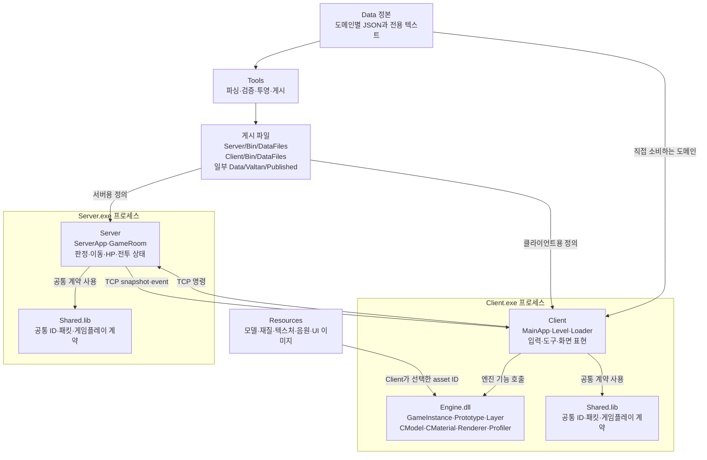
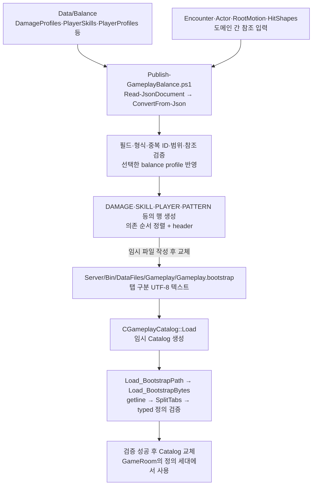
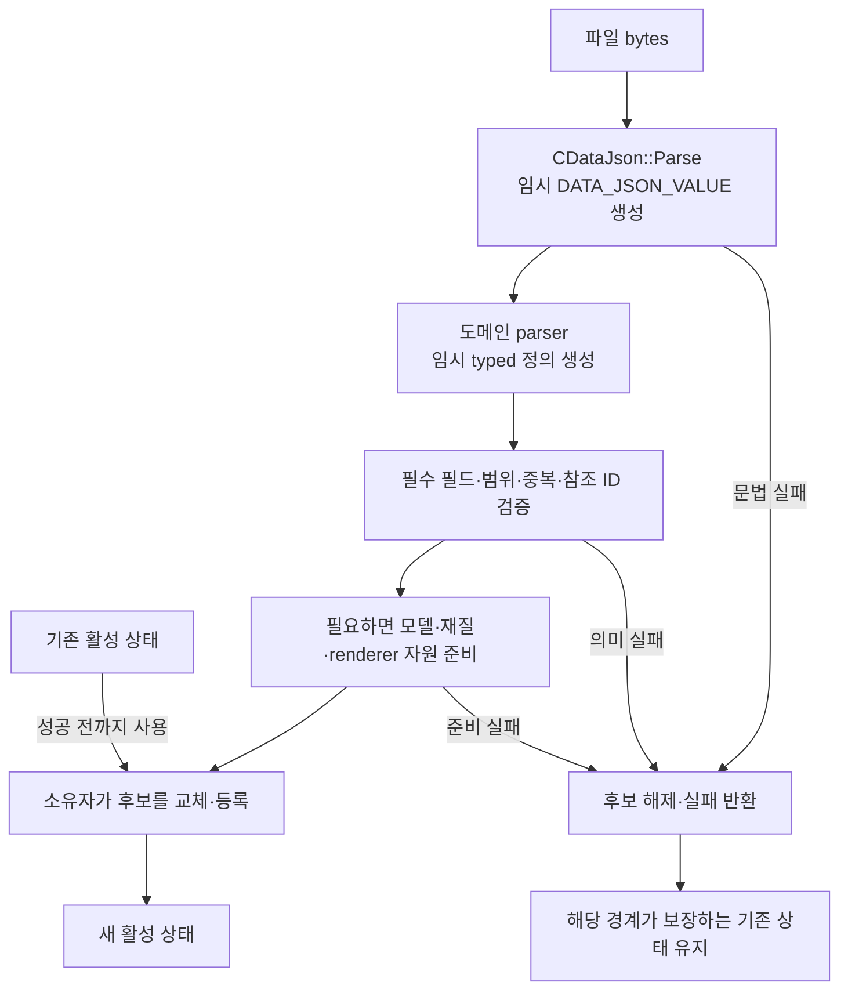
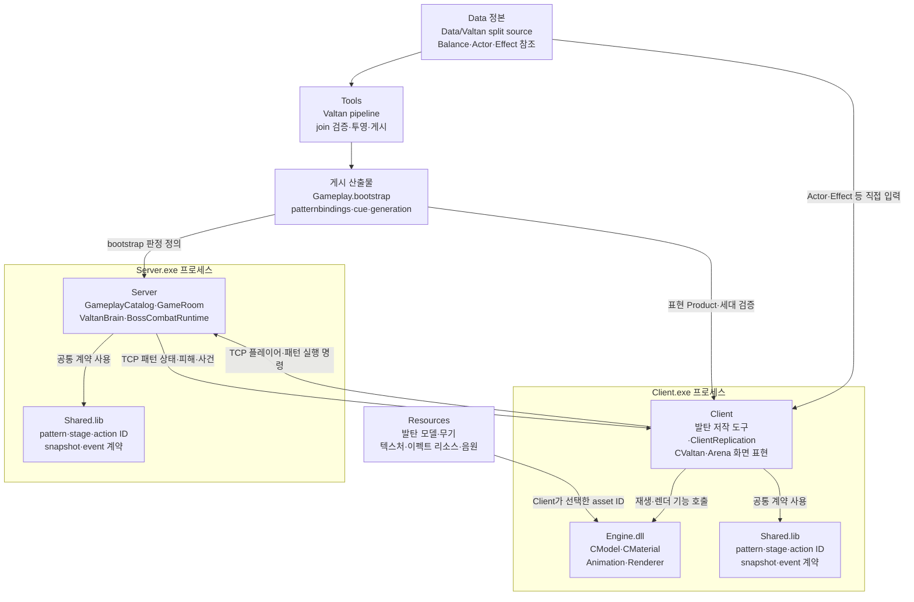
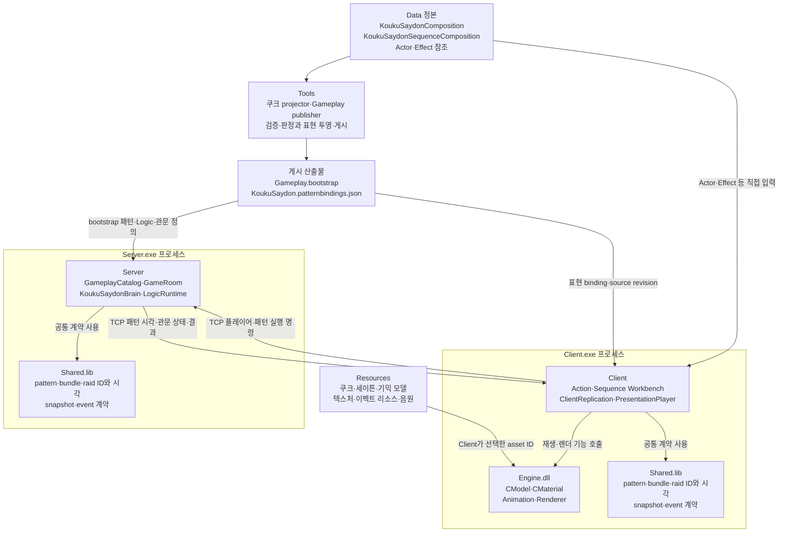
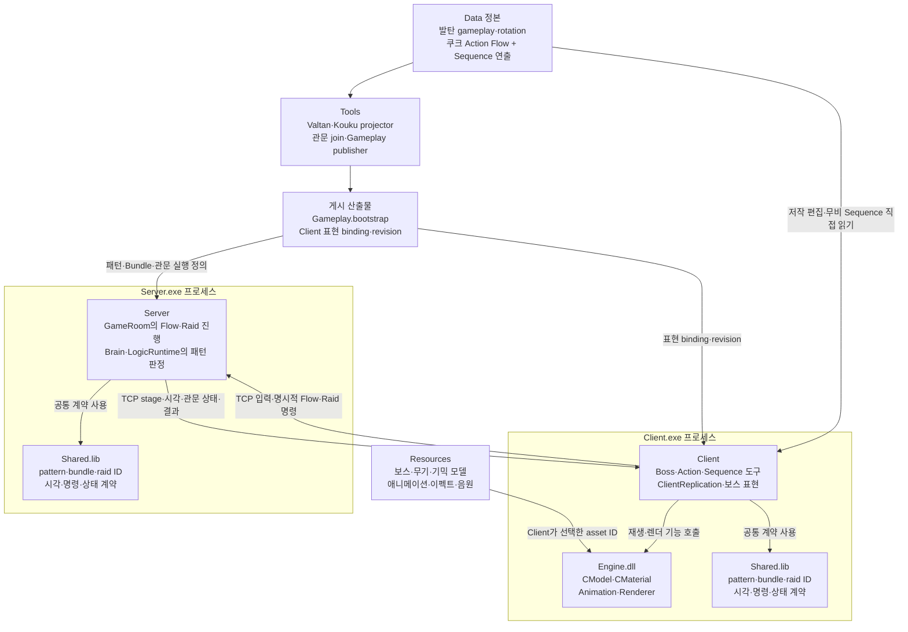
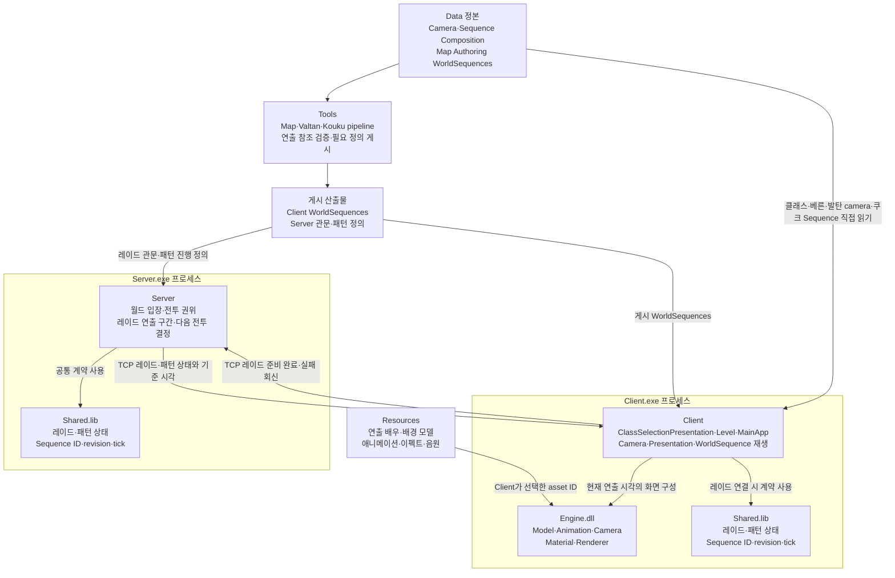
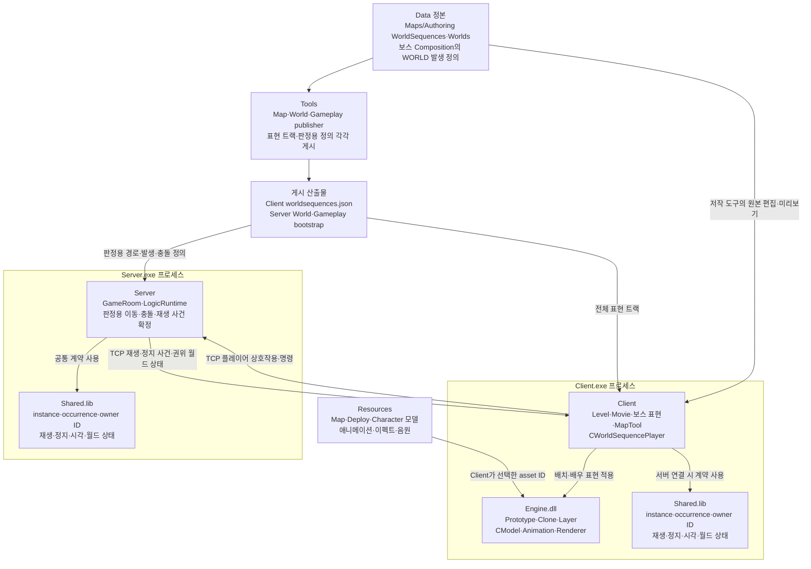
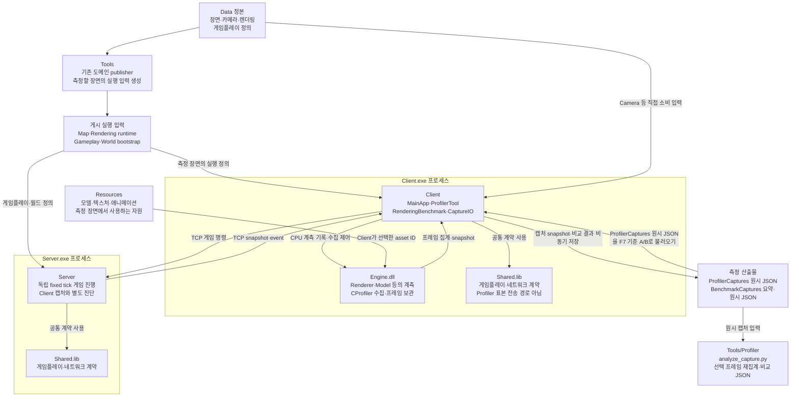
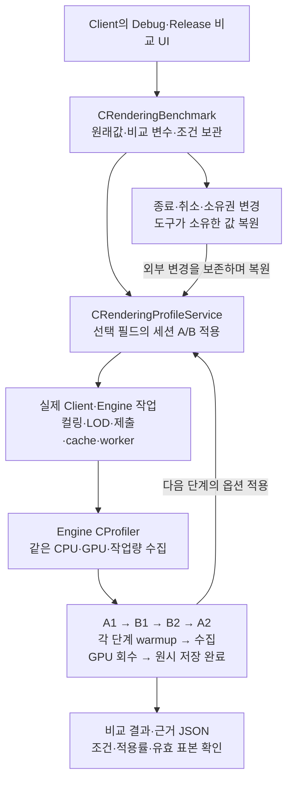

# LostArk 데이터 도메인 구조와 로드 경계 학습

> **현재 학습 시작점:** 문서 끝의 「A00 실제 읽기 — ConfigurationType에서 실행 진입점까지」부터 읽는다. 기존 박스 구조를 보존하고, 각 경계가 필요한 이유·대안·비용과 실제 빌드 설정을 보충한다.

2026-10-12 현재 작업 트리의 코드 기준이다. Client·Server·Engine·Shared의 관계, 저작 정본을 게시하는 위치, 원본을 직접 읽는 예외, 메모리 반영과 성능 측정을 연결한다. 게임 코드와 게시 데이터는 변경하지 않았다. 다른 세션이 같은 작업 트리를 편집 중이므로 함수 이름을 읽기 기준으로 사용한다.

핵심은 **정본의 위치, 실행 프로그램이 읽는 파일, 현재 메모리에 활성화된 정의가 서로 다른 상태**라는 점이다. 도메인별 게시 경로와 원본 직접 소비가 실제로 공존한다. 모든 데이터가 Gameplay.bootstrap으로 모이거나, 모든 게시 파일이 바이너리로 변환되는 구조는 아니다.

## 제품 프로젝트와 도구의 관계



Shared는 별도로 실행되는 중계 서버가 아니다. Client와 Server가 각각 링크하는 정적 라이브러리다. Client는 Engine과 Shared를 참조하고 Server는 Shared를 참조한다. Server가 Client의 GameObject나 Engine Renderer를 사용해서 게임 판정을 하는 구조는 아니다.

근거: [Client 프로젝트](C:/Users/tnest/Desktop/LostArk/Client/Default/Client.vcxproj), [Server 프로젝트](C:/Users/tnest/Desktop/LostArk/Server/Default/Server.vcxproj), [Shared 프로젝트](C:/Users/tnest/Desktop/LostArk/Shared/Default/Shared.vcxproj), [Engine 프로젝트](C:/Users/tnest/Desktop/LostArk/Engine/Default/Engine.vcxproj).

실행 흐름은 Client의 `CPlayerController → IPlayerCommandSink → CNetworkPlayerCommandSink`, Server의 명령 수신과 `CGameRoom::Tick`, Client의 `CClientReplication`과 presentation으로 연결된다. 데이터 Catalog는 이 실행에서 참조하는 정의이고, 현재 HP·패턴 stage·cooldown 같은 실행 상태는 별도다.

## 원본 JSON에서 Gameplay.bootstrap까지



실제 JSON 문법 파싱은 [Publish-GameplayBalance.ps1의 Read-JsonDocument](C:/Users/tnest/Desktop/LostArk/Tools/GameplayPipeline/Publish-GameplayBalance.ps1:70)에서 `Get-Content -Raw -Encoding UTF8 | ConvertFrom-Json`으로 수행한다. 이것은 문법을 PowerShell 객체로 바꾸는 단계다. 그 뒤 `Assert-ExactProperties`, `Assert-JsonInteger`, stable ID·중복·참조 검사가 게임 도메인의 의미를 확인한다.

같은 파일의 `DamageProfiles.json` 처리에서는 `damageProfileId`와 `damageRatePercent`를 읽고 검증한 뒤 선택한 balance profile의 override를 결합하여 `DAMAGE` 행을 만든다. 마지막에는 여러 종류의 행을 모아 정렬하고 `LOSTARK_GAMEPLAY_BOOTSTRAP`, 형식 버전, 행 개수를 header에 넣는다. 2026-10-12 확인한 설치본은 format 38, 109868행이다. 이는 전체 gameplay 행 수이며 보스 패턴 개수가 아니다.

Server의 [GameplayCatalog.cpp](C:/Users/tnest/Desktop/LostArk/Server/Private/GameplayCatalog.cpp)는 Gameplay.bootstrap 본문을 탭 구분 행으로 해석하여 `m_Skills`, `m_Players`, 패턴 정의 등의 typed 저장소로 만든다. 선택적인 `NumericBalance.active.json`은 이 함수가 별도로 직접 읽고 검증하는 receipt다. 게임 정의 JSON에서 실행용 행으로 바꾸는 일과, 실행용 행에서 C++ 정의를 만드는 일이 두 단계로 나뉘어 있다.

`Data/Balance`라는 폴더도 단일 publisher의 소유 범위와 같지 않다. `MonsterProfiles.json`은 World publisher의 SpawnGroup PROFILE 투영에 사용한다. Client의 [CPlayerSkillCatalog::Load](C:/Users/tnest/Desktop/LostArk/Client/Private/PlayerSkillCatalog.cpp:219)는 `DamageProfiles.json`, `PlayerSkills.json`, `PlayerSkillTargeting.json`을 직접 읽는다. 따라서 Balance조차 전체를 Server bootstrap 화살표 하나로 표현하면 Client 입력 경로가 빠진다.

## 도메인별 현재 소비 경로

| 도메인 | 정본과 변환 | 실행 소비 | 해석할 때 구분할 점 |
|---|---|---|---|
| Gameplay | Data/Balance 및 관련 도메인 → Publish-GameplayBalance.ps1 | Server Gameplay.bootstrap → CGameplayCatalog | Client PlayerSkillCatalog에는 Balance JSON 직접 소비도 있다. |
| Map | Data/Maps/Imported의 정의와 shard + Authoring의 배치·재질 등 → Publish-MapAuthoring.ps1 | Client/Bin/DataFiles/Map → CMapAssetCatalog·CMapPlacementRuntime | mapassets/mapplacements는 전용 텍스트, 재질·광원 등은 JSON이다. 제품 Load_Area와 편집용 Load_Source를 구분한다. |
| World | Data/Worlds + Actor/Profile 참조 → Publish-WorldGameplay.ps1 | Server의 worldbootstrap/spawngroupsbootstrap/encounterpropsbootstrap, Client의 npcpresentation/stagemarkers/viewer 문서 | 동일 원본에서 판정용·표시용 정보를 따로 만든다. Debug SequenceViewer는 저작본 우선 경로가 있다. |
| Rendering | Data/Rendering/Authored/RenderingProfiles.json → Publish-RenderingProfiles.ps1 | RenderingProfiles.runtime.json → CRenderingProfileService → Engine 값 적용 | 게시본도 JSON이다. Save, Publish, Reload, 현재 Engine 적용은 다른 단계다. |
| Items | Data/Items/ItemCatalog.json → Publish-ItemCatalog.ps1 | Server는 Items/Items.bootstrap, Client CItemCatalog는 원본 JSON | Gameplay.bootstrap과 별도다. 현재 Server 형식은 item bootstrap v7이다. |
| Actor | Data/Actors의 Character/Boss/Npc/Monster/Vehicle Catalog | CActorCatalog → presentation 준비 → Engine CModel | 최초 초기화 뒤 캐시한다. 원본 파일 수정이 자동 reload를 뜻하지 않는다. |
| Effect V1 | EffectCatalog.json + Data/Effects/Authored | CEffectCatalog → CEffectDocumentCodec → renderer 준비 | 현재 원본 직접 소비가 의도된 계약이다. 목록 로드와 first-use 본문 로드가 다르다. |
| Effect V2 | Data/Effects/V2의 leaf/group/binding, 발탄 binding은 별도 게시 | CEffectV2Catalog·CEffectV2Runtime | 발탄 제품 binding은 Data/Valtan/Published/BOSS_VALTAN.effectv2bindings.json이다. leaf/group은 원본을 읽는다. |

직접 읽는 정본도 배포 입력이다. [CProjectDataRoot](C:/Users/tnest/Desktop/LostArk/Client/Private/ProjectDataRoot.cpp)는 `LOSTARK_PROJECT_DATA_ROOT` 또는 EXE 상위의 Data를 찾는다. DataFiles만 복사해서는 Actor·Effect·Item 등 직접 소비 파일을 충족하지 못한다. Resources는 JSON의 대체물이 아니라 그 정의가 가리키는 실제 모델·텍스처 등의 별도 입력이다.

현재 빌드 도메인 등록은 [BuildDomains.json](C:/Users/tnest/Desktop/LostArk/Tools/Build/BuildDomains.json)에 있다. Navigation, World destruction/pickups, Vehicles, HonorTitles, Valtan rewards, Compositions 등의 별도 publisher도 등록돼 있다. 이 표는 요청한 핵심 도메인의 실제 경계이며, 등록 파일만으로 모든 UI·Animation·Sound·Guide·AI loader를 감사했다고 간주하지 않는다.

### 각 도메인의 코드 시작점

| 읽을 대상 | publisher 또는 입력 처리 | Client 또는 Server 소비 |
|---|---|---|
| Map | [Publish-MapAuthoring.ps1](C:/Users/tnest/Desktop/LostArk/Tools/MapPipeline/Publish-MapAuthoring.ps1) `Read-PlacementDocument`, `Invoke-FileSetTransaction` | [MapAssetCatalog.cpp](C:/Users/tnest/Desktop/LostArk/Client/Private/MapAssetCatalog.cpp) `Load_Area`, `Load_MaterialOverrides`; [MapPlacementRuntime.cpp](C:/Users/tnest/Desktop/LostArk/Client/Private/MapPlacementRuntime.cpp) `Load_Area` |
| World | [Publish-WorldGameplay.ps1](C:/Users/tnest/Desktop/LostArk/Tools/WorldPipeline/Publish-WorldGameplay.ps1) `Read-ProjectJson`, `Convert-WorldDocument` | [WorldBootstrap.cpp](C:/Users/tnest/Desktop/LostArk/Server/Private/WorldBootstrap.cpp) `Load`; [NpcPlacementPresentationService.cpp](C:/Users/tnest/Desktop/LostArk/Client/Private/NpcPlacementPresentationService.cpp) `Load` |
| Rendering | [Publish-RenderingProfiles.ps1](C:/Users/tnest/Desktop/LostArk/Tools/RenderingPipeline/Publish-RenderingProfiles.ps1) `Assert-RenderingProfileDocument` | [RenderingProfileService.cpp](C:/Users/tnest/Desktop/LostArk/Client/Private/RenderingProfileService.cpp) `Load_Runtime`, `Reload_Runtime`, `Commit_Resolved` |
| Items | [Publish-ItemCatalog.ps1](C:/Users/tnest/Desktop/LostArk/Tools/GameplayPipeline/Publish-ItemCatalog.ps1) `Read-JsonDocument` | [Client ItemCatalog.cpp](C:/Users/tnest/Desktop/LostArk/Client/Private/ItemCatalog.cpp) `Load`; [Server ItemCatalog.cpp](C:/Users/tnest/Desktop/LostArk/Server/Private/ItemCatalog.cpp) `Load` |
| Actor | [ActorCatalog.cpp](C:/Users/tnest/Desktop/LostArk/Client/Private/ActorCatalog.cpp) `ReadDocument` | 같은 파일의 `Initialize`와 각 catalog parser |
| Effect V1 | [Effect_Catalog.cpp](C:/Users/tnest/Desktop/LostArk/Client/Private/Effect_Catalog.cpp) `Load`, `Stage_ProductLoadTarget` | [Effect_DocumentCodec.cpp](C:/Users/tnest/Desktop/LostArk/Client/Private/Effect_DocumentCodec.cpp) `Parse`, `Parse_Value`, `Load`; Catalog의 `Commit_ProductLoadStage` |
| Effect V2 | [EffectV2_Catalog.cpp](C:/Users/tnest/Desktop/LostArk/Client/Private/EffectV2_Catalog.cpp) runtime/authoring snapshot 구축 | [EffectV2_Runtime.cpp](C:/Users/tnest/Desktop/LostArk/Client/Private/EffectV2_Runtime.cpp) `Ensure_Bindings`, `Ensure_Document`, `Ensure_Group` |

## parse validate stage commit의 실제 의미

이 표현은 코드에 네 함수가 반드시 이 순서로 존재한다는 뜻이 아니다. **현재 활성 상태를 건드리지 않는 후보를 만들고, 필요한 검증과 준비가 끝난 뒤 공개한다**는 규칙이다. parsing부터 이미 staged 객체를 채우기도 한다.



공용 JSON 문법 parser에 해당하는 코드는 [CDataJson::Parse](C:/Users/tnest/Desktop/LostArk/Client/Private/DataJson.cpp:580)다. 텍스트 크기·깊이·값 개수 제한을 검사하고 `DATA_JSON_READER(...).Read(staged, outError)`가 성공한 경우에만 `outValue = move(staged)`를 한다. 이 함수는 `skillId`가 존재하는 스킬인지, Effect texture가 실제 파일인지 알지 못한다.

Effect에서는 그 다음 `CEffectDocumentCodec::Parse_Value`가 `EFFECT_DOCUMENT_DESC Staged`를 채우고 `Validate` 또는 `Validate_SourceContract`가 성공해야 `OutDocument`를 교체한다. 이후 제품 로더의 worker stage와 owner commit, renderer 자원 교체가 다시 존재한다. JSON DOM 교체가 GPU 자원·현재 재생 상태까지 한 번에 바꿔 주는 것은 아니다.

Gameplay `Load()`는 새 `CGameplayCatalog staged`에서 bootstrap과 선택적 NumericBalance receipt를 검증한 뒤 전체 Catalog를 이동 대입한다. World `Load()`도 현재 지역 container를 끝에서 멤버로 옮긴다. Items는 Client와 Server 모두 일반적인 false 반환 실패에 대한 staged/rollback 처리가 있다.

Actor의 정책은 다르다. 다섯 catalog의 최초 초기화 중 하나가 실패하면 전체 global 목록을 비운다. 성공한 뒤 `g_isInitialized`가 다시 읽기를 막는다. 따라서 이를 기존 정상 Catalog를 유지하는 reload API로 설명하면 틀린다.

## 현재 문제와 설계상 대가

원본 직접 소비는 편집 후 사용하는 경로를 짧게 한다. 게시본은 검증된 입력을 재현하고 판정용·표시용 정보를 분리하기 쉽다. 혼용 자체가 오류는 아니지만 다음 범위를 명시해야 한다.

1. **Client와 Server가 서로 다른 저장 시점의 데이터를 볼 수 있다.** Item·PlayerSkill처럼 한쪽은 원본, 다른 쪽은 게시본을 읽는다. 각각 ID 검증에 성공해도 양쪽이 동일한 콘텐츠 세대라는 보장은 별도다. 이는 불일치 가능한 구조이며 현재 플레이에서 불일치가 발생했다는 실행 증거는 아니다.
2. **동일 도메인의 validator가 다르다.** Client ItemCatalog는 formatVersion 2를 검사하지만 publisher의 schema·정수·상한 검사와 동일하지 않다. Server/publisher에는 item 개수와 전체 bootstrap 행 수 상한의 기준 차이도 있다. 입력 계약을 공통 fixture로 비교해야 하는 구체적인 지점이다.
3. **실패 복구와 동시 reader의 일관성은 다르다.** Map/World publisher는 파일들을 stage하고 순서대로 교체하며 실패 시 역순 rollback한다. 단일 manifest를 한 번 교체해 전체 세대를 공개하는 방식은 아니므로 reader가 교체 중간을 보면 파일 부재나 신구 혼합이 가능하다. 개별 File.Replace 성공만으로 전체 파일 집합의 동시 전환을 보장하지 않는다.
4. **모든 내부 loader가 같은 rollback 범위를 갖지는 않는다.** Gameplay 내부 `Load_BootstrapBytes`는 `m_iRaidStaggerMaximum`을 파싱 중 변경하지만 기존 rollback 목록에 넣지 않는다. 외부 `Load()`의 별도 staged 객체에서는 기존 Catalog가 보호된다. `Load_FromBootstrap`처럼 내부 loader를 기존 객체에서 호출하는 경로까지 같은 보장으로 일반화하면 안 된다. World의 마지막 문자열 대입 역시 할당 예외까지 원자적인 교체라는 계약은 아니다.
5. **형식 버전의 중복 정의가 실제로 갈라져 있다.** 현재 [Shared 형식 상수](C:/Users/tnest/Desktop/LostArk/Shared/Public/GameplayDataRevision.h:24)와 설치 bootstrap은 38이다. [valtan_tuning_pipeline.py](C:/Users/tnest/Desktop/LostArk/Tools/ValtanPipeline/valtan_tuning_pipeline.py:91)의 상수는 37이며 bootstrap admission에서 동등 비교한다. 해당 경로의 v38 거절 가능성은 코드로 확인했지만 이번 조사에서 실행 재현하거나 수정하지 않았다.
6. **오래된 문서의 부채를 현재 버그로 재인용하면 안 된다.** [통합 데이터 관리 문서](C:/Users/tnest/Desktop/LostArk/.md/TEAM/UNIFIED_DATA_MANAGEMENT_ARCHITECTURE.md)의 World가 parse 전에 state를 비운다는 설명은 현재 `CWorldBootstrap::Load`의 staged 구현과 다르다. NPC 0개 등의 과거 상태도 현재 범위를 설명하는 근거로 쓰지 않는다. 이 학습 기록에서는 현재 코드 기준으로 교정했다.

추가 경계: [ServerBalanceNumericStore.cpp](C:/Users/tnest/Desktop/LostArk/Server/Private/ServerBalanceNumericStore.cpp)는 수치 수정 시 원본 JSON scalar, bootstrap, receipt를 함께 준비한다. 원문 token span을 보존하는 별도 parser와 freshness 검사가 있다. 따라서 “Server는 절대로 원본 JSON을 읽지 않는다”도 전체 프로그램에 대한 설명으로는 틀리다. 일반 gameplay 기동 경로와 저작 수치 저장 경로를 구분한다.

## 이미 있는 로딩 속도 증거

2026-10-04의 [Effect JSON 로딩 RESULT](C:/Users/tnest/Desktop/LostArk/.md/GB/10-04/2026-10-04_DEBUG_EFFECT_LOADING_IMPLEMENTATION_RESULT.md)는 실제 CDataJson 소스를 독립 실행기로 측정했다. 쿠크 V1 168개, 255638203 bytes, JSON 값 7853764개를 고정했고 파일을 먼저 메모리에 읽었다. 각 구성의 두 회 중앙값이다.

| 당시 적용 후보 구성 | JSON parse | DOM 해제 |
|---|---:|---:|
| Debug 1 worker | 11.513초 | 3.869초 |
| Debug 3 workers | 14.082초 | 5.117초 |
| Release 1 worker | 2.183초 | 0.842초 |
| Release 3 workers | 1.704초 | 0.764초 |

이 값은 현재 전체 프로젝트 로딩 시간이 아니다. 디스크 읽기, Effect 의미 검증, 모델·텍스처 준비, GPU 생성, 첫 화면을 포함하지 않는다. 기록의 후보 v2는 parser 개선안의 번호이고 Effect Tool V2라는 뜻이 아니다. Debug와 Release의 CRT·iterator 검사 조건도 다르므로 비율을 JSON 형식만의 비용으로 해석하지 않는다.

2026-09-16의 [Map 로딩 RESULT](C:/Users/tnest/Desktop/LostArk/.md/GB/09-16/2026-09-16_COLD_MAP_LOADING_IMPLEMENTATION_RESULT.md)는 Bern의 당시 catalog CPU 작업이 49.873초에서 16.136초로 줄어든 표본을 기록한다. path 검증 중복 제거와 관련 TU 최적화가 포함된 비교이며 순수 JSON parse나 전체 진입 시간은 아니다. 현재 Bern의 mapmaterials JSON은 99075371 bytes여서 작은 설정 JSON과 같은 규모로 가정할 수도 없다.

2026-10-12 확인 시 다른 MSBuild/FXC 작업이 실행 중이었다. 새 속도 비교는 수행하지 않았고 다른 작업을 종료하지 않았다. 위 수치는 날짜와 범위가 있는 기존 기록이다.

## 전체 도메인 측정과 개선을 연결하는 방법

| 측정 구간 | 포함할 작업 | 결과가 클 때 검토할 것 |
|---|---|---|
| Resolve/Read | 경로 확인, open, bytes 읽기 | 파일 개수, 중복 읽기·경로 검증, 파일 cache 상태 |
| JSON Parse | bytes에서 JSON DOM 생성 | 할당 수, 임시 복사, DOM 크기, 해제 비용 |
| Decode/Validate | typed 정의 변환, ID·범위·참조·파일 존재 검사 | 반복 선형 검색, 같은 dependency 반복 검사, index 재사용 |
| Resource Stage | 모델·재질·텍스처·셰이더·GPU 후보 준비 | 중복 geometry, 동시 worker 수, peak memory, main-thread 작업 |
| Commit/Activate | Catalog/Prototype/renderer 교체와 세대 승인 | main-thread 정지 시간, 교체 범위, 기존 상태 보존 |
| Destruction | 임시 DOM과 이전 snapshot 해제 | peak memory와 해제 지연을 parsing 개선에 포함 |

[Loader.cpp](C:/Users/tnest/Desktop/LostArk/Client/Private/Loader.cpp)에는 이미 `Loader.Map.Catalog`, `Loader.Map.Scope`, `Loader.Map.Models`, `Loader.Map.Navigation`, `Loader.Map.Commit`, `Loader.EffectPreparation` scope가 있다. model 준비 로그에는 model 수, geometry group 수, variant 수, worker 수, elapsedMs도 기록된다. 전체 로딩 wall time은 병렬 구간이 있으므로 각 worker의 inclusive 시간을 더해서 만들지 않는다. `Loader.LevelLoad` scope도 뒤의 effect join 전체를 포함하는 구간은 아니므로 이름만 보고 최종 활성화까지의 시간으로 취급하지 않는다.

JSON Read/Parse/Validate 각각의 비용이 필요한 위치에 기존 Profiler의 얇은 scope를 추가하는 것이 다음 계측 단위다. Server에는 Engine 의존성을 추가하지 않고 `steady_clock` 등 기존 독립 계측 방식으로 같은 구간 이름과 입력 식별을 기록한다. 이 조사에서 제품 계측 코드를 추가한 것은 아니다.

[기존 DataJsonLoadingBenchmark](C:/Users/tnest/Desktop/LostArk/Tools/DataJsonLoadingBenchmark/README.md)는 Client/UI 없이 실제 parser를 빌드하고 실행한다. Prepare-Corpus의 현재 범위는 쿠크 saved V1 closure다. 전체 도메인의 대표 입력으로 확장할 때도 실제 파일 목록·바이트 수·SHA-256·소스 hash·빌드 구성을 함께 고정해야 한다.

측정 순서는 다음과 같다.

1. 도메인별 대표 입력과 실제 consumer를 고르고 파일 hash를 고정한다. PlayerSkills와 94MiB급 Map material을 동일한 한 파일 표본으로 취급하지 않는다.
2. Debug/Release, 최초 프로세스/동일 프로세스 재로드, OS file cache가 찬 상태/통제한 cold 조건을 구분한다. 프로세스만 재실행한 것을 cold disk라고 부르지 않는다.
3. 전체 진입 wall time과 Read/Parse/Validate/Stage/Commit/Destroy를 함께 기록한다. 중첩 scope·병렬 worker 시간을 중복 합산하지 않는다.
4. 짧은 반복은 분포·중앙값·범위를 보고, 충분한 표본이 있을 때 p95를 사용한다. 컴파일 같은 큰 작업을 겹치지 않고 입력·오류·정의 digest가 같은지 먼저 확인한다.
5. 측정에서 가장 큰 비용 한 곳만 바꾸어 같은 입력으로 다시 비교한다. 불량 JSON·누락 참조·취소에서 기존 상태 보존과 후보 해제도 함께 확인한다.

이미 있는 개선을 새 제안으로 중복 구현하지 않는다. DataJson OBJECT owner 분리와 최종 payload 직접 parse, Map load 안의 path 검증 중복 제거, 준비한 placement stage 재사용, geometry group별 bounded preparation은 현재 코드에 있다. Debug 표본에서는 3 worker가 1 worker보다 느렸으므로 worker 증가를 기본 해법으로 선택하지 않는다.

측정에서 정적 JSON decode/validation이 계속 지배적이라면 publisher가 런타임용 typed/cooked snapshot을 만들도록 확장할 수 있다. 이때 source hash·schema/cooker version·dependency hash를 붙이고 기존 Catalog/renderer 경로가 소비하게 해야 한다. 별도 두 번째 runtime을 만들거나 freshness 검사를 제거하는 방식으로 개선하지 않는다. 이 항목은 후보 방향이며 현재 구현 또는 검증된 성능 개선이 아니다.

## 실제 코드로 이어서 읽는 순서

1. `Publish-GameplayBalance.ps1::Read-JsonDocument`와 DAMAGE 행 생성: JSON 문법 해석과 domain validation의 차이.
2. `CGameplayCatalog::Load → Load_BootstrapPath → Load_BootstrapBytes`: 게시 형식과 메모리 정의의 차이, 외부 stage와 내부 rollback 범위.
3. Client/Server `CItemCatalog::Load`: 하나의 정본이 서로 다른 소비 입력으로 나뉘는 실제 사례.
4. `CDataJson::Parse → CEffectDocumentCodec::Parse_Value → Stage_ProductLoadTarget → Commit_ProductLoadStage`: DOM, domain, resource, 활성화 네 경계.
5. `CLoader::Ready_MapArea`와 기존 profiler scope: 파일 로드 시간과 모델 준비 시간, thread별 작업 시간과 전체 wall time의 차이.

학습 상태: 사용자는 전체 구조와 도메인별 원본·게시본·로드 비용의 관계를 질문했다. 현재 코드 조사와 설명 자료를 제공한 단계다. 사용자 직접 구현, 자료 없는 설명, 신규 benchmark 실행, Client 화면 확인은 아직 이 기록의 성취로 표시하지 않는다.

## 전체 도메인 구조를 먼저 보는 순서

2026-10-12 사용자는 함수 상세에 들어가기 전에 전체 도메인의 박스 구조부터 이해하는 방식을 선택했다. 그림의 기준은 PPT 5페이지가 아니라 이 문서의 **제품 프로젝트와 도구의 관계**다. 같은 Data·Tools·게시 파일·Resources와 Client.exe/Server.exe 경계를 유지하고, 도메인마다 박스의 내용과 화살표가 전달하는 값만 바꾼다.

| 순서 | 구조도를 만들 영역 | 먼저 구분할 책임 |
|---|---|---|
| 1 | LostArk 도메인과 전체 프로젝트 | 제품 프로젝트·도구·정본·게시본·Resources |
| 2 | 보스 패턴 | 발탄·쿠크의 저작·게시·Server 실행·Client 표현 |
| 3 | 시퀀스 | 보스 진행·무비·월드 오브젝트 각각의 시계와 실행 주체 |
| 4 | 프로파일러와 최적화 | 계측 위치·수집·저장·분석·A/B 비교 |
| 5 | 렌더링 | 캐릭터·맵·이펙트·조명 입력과 공통 렌더 경로 |
| 6 | 이펙트와 툴 | 문서·binding·carrier·shader·저작 preview·제품 재생 |
| 7 | 빌드와 셰이더 컴파일 및 C++ 최적화 | 의존 프로젝트·컴파일·링크·배포·측정 |
| 8 | 데이터 관리와 ImGui | 편집 draft·Save·Publish·Reload·활성 상태 |
| 9 | 협업 시스템과 AI | 정본·담당 계약·Git/PR·검증·사람의 판단 |

이 표는 전체 탐색 순서다. 모든 영역의 상세 조사나 사용자 이해를 완료했다는 뜻은 아니다. 각 구조도에서 입력, 책임, 출력, 다음 소비자를 먼저 이해한 뒤 화살표 하나를 실제 함수로 확대한다.

## 발탄의 제품 프로젝트와 도구의 관계



발탄은 gameplay·presentation·combatobjects·worldeventsets 등의 분리 정본을 stable ID로 연결한다. Tools가 이 관계를 검사해 Server가 사용할 판정 정의와 Client가 사용할 표현 Product를 만든다. Server는 패턴 선택·stage·이동·피해를 확정하고 Client는 복제된 상태에 맞춰 몸·무기·이펙트·소리·카메라를 표현한다.

Client 표현 Product는 모두 Client/Bin/DataFiles 아래에 있지 않다. `Data/Animation/Authored/Valtan`의 생성 binding/cue, `Data/Valtan/Published`, `Data/Encounters/Valtan/ValtanEncounter.json`과 `ValtanWorldEvents.json`의 투영 결과도 실제 소비 범위다. 같은 폴더의 `ValtanCinematicCamera.json`은 전용 카메라 정본이며 직접 읽는다. 화살표의 **게시 산출물**은 폴더 이름이 아니라 생성·검증 역할을 뜻한다. Actor·Effect 등 직접 입력 화살표를 split gameplay 원본을 제품 전투가 직접 실행한다는 의미로 읽지 않는다.

그림의 Tools는 프로젝트 밖에서 실행하는 pipeline/publisher다. ImGui Boss·Balance·Animation·Effect 도구는 Client 쪽에서 각 담당 정본을 편집한다. CValtan/ValtanBrain 안에 전체 무비와 모든 WorldSequence 실행을 넣지 않으며, 독립 연출의 시계·소유자는 시퀀스 구조도에서 별도로 확대한다.

실제 연결 근거:

- [valtan_tuning_pipeline.py](C:/Users/tnest/Desktop/LostArk/Tools/ValtanPipeline/valtan_tuning_pipeline.py): split 정본, `project_v2_products`, `_publish_gameplay_bootstrap`.
- [GameRoom_BossSimulation.cpp](C:/Users/tnest/Desktop/LostArk/Server/Private/GameRoom_BossSimulation.cpp): 현재 정의 세대와 함께 `CValtanBrain::Update` 호출.
- [ValtanBrain.cpp](C:/Users/tnest/Desktop/LostArk/Server/Private/ValtanBrain.cpp), [BossCombatRuntime.cpp](C:/Users/tnest/Desktop/LostArk/Server/Private/BossCombatRuntime.cpp): 패턴 진행과 전투 결과 처리.
- [ClientReplication.cpp](C:/Users/tnest/Desktop/LostArk/Client/Private/ClientReplication.cpp): `Apply_WorldSnapshot`과 발탄 network/combat state 반영.
- [Valtan.cpp](C:/Users/tnest/Desktop/LostArk/Client/Private/Valtan.cpp), [ValtanPresentationGenerationAdmission.cpp](C:/Users/tnest/Desktop/LostArk/Client/Private/ValtanPresentationGenerationAdmission.cpp): 표현 소비·세대 검증.

## 쿠크세이튼의 제품 프로젝트와 도구의 관계



쿠크는 Action Composition의 패턴·stage·Logic·Collider·Parent·Bundle·전투 Flow와 Sequence Composition의 입장·종료 연출·플레이어 도착 track을 연결한다. 전투의 Pattern/Bundle 순서인 `patternFlows`는 Action 쪽 정본이다. projector는 두 문서를 join해 Encounter와 표현 binding을 만들고, Gameplay publisher가 Encounter의 판정 정의를 bootstrap 행으로 만든다. `GameRoom`의 raid flow, `KoukuSaydonBrain`의 패턴 진행, `KoukuSaydonLogicRuntime`의 판정창·결과가 책임을 나눈다. Client의 `CKoukuSaydonPresentationPlayer`는 복제된 패턴 시각과 승인된 revision에 맞춰 표현한다.

정본 경로는 `Data/KoukuSaydon/Gate1/KoukuSaydonComposition.json`과 `Data/Compositions/Sequences/KoukuSaydonSequenceComposition.json`이다. Gate1이라는 폴더명만으로 1관문 전용이라고 판단하지 않는다. 중간 생성물 `Data/Encounters/KoukuSaydon/KoukuSaydonEncounter.json`과 표현 생성물 `Data/Animation/Authored/KoukuSaydon/KoukuSaydon.patternbindings.json`은 직접 편집할 Composition 정본과 다르다.

위 그림은 정식 저장·게시 경로다. 쿠크의 미저장 Draft Play는 검증된 임시 데이터를 Server가 승인하여 같은 전투 runtime에서 시험하는 별도 경로이며 Save/Publish 완료를 뜻하지 않는다. 이 예외는 상세 audition 구조도에서 확대한다.

실제 연결 근거:

- [KoukuSaydonActionWorkbench.cpp](C:/Users/tnest/Desktop/LostArk/Client/Private/KoukuSaydonActionWorkbench.cpp): `Publish_AllPatterns`, 별도 `Start_DraftPlayPreparation`.
- [project_kouku_saydon_composition.py](C:/Users/tnest/Desktop/LostArk/Tools/KoukuSaydonPipeline/project_kouku_saydon_composition.py): `projected_outputs`, `project_encounter`, `project_presentation`.
- [Publish-GameplayBalance.ps1](C:/Users/tnest/Desktop/LostArk/Tools/GameplayPipeline/Publish-GameplayBalance.ps1): `Add-KoukuBootstrapRows`와 bootstrap 게시.
- [GameRoom_KoukuRaidFlow.cpp](C:/Users/tnest/Desktop/LostArk/Server/Private/GameRoom_KoukuRaidFlow.cpp): `Begin_KoukuRaidPreparation`, `Update_KoukuRaid`.
- [KoukuSaydonBrain.cpp](C:/Users/tnest/Desktop/LostArk/Server/Private/KoukuSaydonBrain.cpp), [KoukuSaydonLogicRuntime.cpp](C:/Users/tnest/Desktop/LostArk/Server/Private/KoukuSaydonLogicRuntime.cpp): pattern/stage 진행, Logic 실행 상태와 결과.
- [KoukuSaydonPresentationPlayer.cpp](C:/Users/tnest/Desktop/LostArk/Client/Private/KoukuSaydonPresentationPlayer.cpp): `Reload_Product`, `Update`.

두 그림의 공통 골격은 유지하되 발탄의 split join과 쿠크의 Composition/Logic/raid flow를 같은 내부 구현으로 일반화하지 않는다. Shared 박스는 각 EXE가 링크하는 계약이며 TCP 중간에서 별도로 실행되는 프로그램이 아니다. 현재 단계에서는 이 박스들의 입력·책임·출력만 잡고, 클래스·함수 내부는 다음 확대 단계에서 읽는다.

## 보스 시퀀스의 제품 프로젝트와 도구의 관계

여기서 보스 시퀀스는 패턴 내부 stage, 패턴을 묶는 순서, 관문 진행을 함께 보는 구조도다. 서로 다른 실행 계층이므로 하나의 Sequence 클래스가 모두 처리한다고 해석하지 않는다.



Server가 전투 순서와 결과를 확정하고 Client는 그 상태와 시각으로 보스·카메라·이펙트를 표현한다. Client의 명시적 Flow/Complete Play 명령과 Server의 자동 전투 선택은 별도 시작 경로다.

| 범위 | 실제 의미와 실행 주체 |
|---|---|
| 패턴 내부 stage | 한 패턴의 준비·공격·회복, 이동과 판정창. Server의 ValtanBrain/KoukuSaydonBrain 및 LogicRuntime이 진행한다. |
| 발탄 Pattern Sequence | pattern ID와 사이 대기·추적을 연결한다. 현재 자동 전투는 `HEALTH_BAR_ROTATIONS`이며 단순 목록 순회로 설명하지 않는다. 명시적 Play All/Flow 목록과 구분한다. |
| 쿠크 Parent | 같은 보스의 자식 pattern occurrence를 시간순으로 연결한다. GameRoom의 member 실행 목록으로 구성한다. |
| 쿠크 Bundle | 여러 보스 member의 pattern과 시작 offset을 묶는다. |
| 쿠크 Flow·Raid | Pattern/Bundle 완료와 wait/group/loop, 입장 무비, 전투 진입, 관문 승인 상태를 GameRoom이 관리한다. |

쿠크 정본의 경계는 **Action의 전투 Flow + Sequence의 입장·종료 연출**이다. `raid_flow_projection.py::project_raid_gates(action, sequence)`가 둘을 합친다. Shared의 `iPatternSequence`는 패턴 발생 회차를 구별하는 값이며 저작 Sequence 문서나 패턴 목록 자체가 아니다.

실제 연결 근거:

- [Valtan.gameplay.json](C:/Users/tnest/Desktop/LostArk/Data/Valtan/Valtan.gameplay.json:33): 현재 `HEALTH_BAR_ROTATIONS` 선택 방식.
- [ValtanPatternFlowService.cpp](C:/Users/tnest/Desktop/LostArk/Client/Private/ValtanPatternFlowService.cpp:193): 명시적 Flow 시작과 Server 요청.
- [raid_flow_projection.py](C:/Users/tnest/Desktop/LostArk/Tools/KoukuSaydonPipeline/raid_flow_projection.py:40): Action Flow와 Sequence arrival·duration의 관문 투영.
- [GameRoom_KoukuAudition.cpp](C:/Users/tnest/Desktop/LostArk/Server/Private/GameRoom_KoukuAudition.cpp:1198): `Start_KoukuParentSequence`, 같은 전투 실행 경로에 자식·대기·loop 구성.
- [GameRoom_KoukuRaidFlow.cpp](C:/Users/tnest/Desktop/LostArk/Server/Private/GameRoom_KoukuRaidFlow.cpp:294): `Begin_KoukuRaidCinematic`이 Sequence ID/revision과 시작·종료 tick을 방송. 같은 파일의 `Update_KoukuRaid`가 다음 진행을 확정.

## 무비 시퀀스의 제품 프로젝트와 도구의 관계

이 그림의 무비는 3D 배우·카메라·효과를 시간에 맞춰 재생하는 연출이다. 현재 코드에는 모든 무비를 처리하는 공통 Server Movie 객체가 없다. Client의 각 owner가 화면을 재생하고, 레이드와 연결되는 경우에만 Server의 진행 상태와 시각을 따른다.



그림의 Data와 Tools는 입력·게시 경로를 모아 보여 준다. 모든 무비가 모든 publisher를 거치는 것은 아니다. 특히 Character Selection Movie는 `ClassSelection.cinematics.json`을 직접 읽고, 배우 재생용 WorldSequences는 Map 게시본을 읽는다. 발탄의 카메라 keyframe·FOV·shake는 `Data/Encounters/Valtan/ValtanCinematicCamera.json`이 소유하고 Client가 직접 읽는다. split presentation은 해당 camera cue를 언제 호출할지 소유하며, pipeline은 참조를 검증하고 candidate에 카메라 문서를 포함한다.

| 무비 | Client 실행 owner | 재생 시계·연결 |
|---|---|---|
| Character Selection Movie | `CClassSelectionPresentation` → `CWorldSequencePlayer`와 Effect·Camera 처리 | Client 자체 Movie clock. Intro/Loop·일시정지·탐색을 관리한다. Movie 직업 선택은 Server player class 변경 명령이 아니다. |
| Bern 입장 컷신 | `CLevel_Bern::Update_EntranceCinematic` | Client의 local elapsed time. 이 경로는 카메라 pose 연출이며 독립적인 배우·Effect·Sound 다중 track 실행으로 일반화하지 않는다. |
| Valtan 입장·전환·사망 연출 | `CLevel_ValtanArena` → camera controller + WorldSequence | Server의 pattern/stage/action start tick 또는 사망 상태를 보고 선택한다. 카메라와 배우·FX·대사의 종료는 별도로 처리한다. |
| Kouku 관문 입장·종료 무비 | `CMainApp::UpdateKoukuGateCompletePlay` → `CKoukuSaydonPresentationPlayer` | Server의 Sequence ID/revision을 대조한 뒤 30Hz tick에서 계산한 시각으로 샘플한다. 다음 전투 진입은 Server가 확정한다. |

쿠크의 `Begin_BundlePreview(...serverClock=true)`는 정식 레이드 무비에서도 사용한다. Preview라는 함수 이름만 보고 Debug 전용이거나 로컬 자유 재생이라고 분류하면 안 된다. 캐릭터 선택 Movie의 source time과 sound time에도 별도 변환이 있으므로 모든 track이 같은 숫자의 시각을 그대로 받는다고 가정하지 않는다.

실제 연결 근거:

- [ClassSelectionPresentation.cpp](C:/Users/tnest/Desktop/LostArk/Client/Private/ClassSelectionPresentation.cpp:404): `LoadScenes`, `Initialize`, `Start_Phase`, `Update`의 문서·단계·시계 소유.
- [ClassSelectionPresentation_Authoring.cpp](C:/Users/tnest/Desktop/LostArk/Client/Private/ClassSelectionPresentation_Authoring.cpp:1090): 기존 Map publisher의 `-Scope WorldSequences` 호출. Camera 문서를 별도 DataFiles 복사본으로 만들지 않는다.
- [Level_Bern.cpp](C:/Users/tnest/Desktop/LostArk/Client/Private/Level_Bern.cpp:858): `Update_EntranceCinematic`의 local clock과 camera cue sampling.
- [Level_ValtanArena.cpp](C:/Users/tnest/Desktop/LostArk/Client/Private/Level_ValtanArena.cpp:2239): 카메라와 source cinematic을 각각 갱신. `Ready_SourceCinematics`와 `Update_SourceCinematic`이 WorldSequence 연결을 맡는다.
- [MainApp.cpp](C:/Users/tnest/Desktop/LostArk/Client/Private/MainApp.cpp:2075): saved Sequence를 직접 읽고 Server pin 대조 후 `Sample_ServerSequence` 호출.

## 월드 오브젝트 시퀀스의 제품 프로젝트와 도구의 관계

월드 오브젝트는 배치물의 이동·표시·애니메이션뿐 아니라 무비의 배우와 보스 연출의 오브젝트로도 쓰인다. 화면 재생의 공통 경로는 Client의 `CWorldSequencePlayer`다. 시작·정지 이유는 이를 호출하는 Level·Movie·보스 표현·저작 도구가 소유한다.



Server는 Client용 worldsequences JSON 전체를 해석해 모델·재질·카메라 track을 실행하지 않는다. World publisher는 지원하는 이동체·충돌·trigger를 판정용으로 투영하고, 보스 WORLD occurrence는 Kouku projector와 Gameplay publisher를 통해 시작 시각·배치·combat body 등의 정의로 투영한다. 보이는 오브젝트의 Transform과 게임 판정 Transform이 연결되는 경우에는 이 투영 계약을 함께 확인해야 한다.

`CWorldSequencePlayer::Play`는 instance를 시작하고 `Update`는 local delta로 진행한다. `Seek_InstanceToMs`는 상위 owner가 정한 시각의 상태를 평가한다. 따라서 같은 재생기를 Movie clock, Server 기준 clock, 도구의 Play/Pause/Seek에서 재사용한다. 도구 preview의 화면 이동이 Server의 충돌·피해·파괴 상태를 직접 바꾼다는 뜻은 아니다.

쿠크의 소유자 있는 World cue는 run epoch/member/occurrence와 시작 tick으로 식별하고 중복 재생·만료·정지를 처리한다. 일반 `S2C_WORLD_SEQUENCE_PLAY`의 모든 경로가 시작 tick을 채우는 것은 아니므로, 모든 WorldSequence를 Server tick 동기화라고 부르지 않는다. 각각의 호출자가 local Update와 외부 Seek 중 어느 경로를 사용하는지 확인한다.

실제 연결 근거:

- [WorldSequencePlayer.h](C:/Users/tnest/Desktop/LostArk/Client/Public/WorldSequencePlayer.h:35): 저작·제품의 공통 재생 경로와 호출자의 시작·정지 소유 계약.
- [WorldSequencePlayer.cpp](C:/Users/tnest/Desktop/LostArk/Client/Private/WorldSequencePlayer.cpp:161): `Load_Area`, `Play`, `Seek_InstanceToMs`, `Update`. 제품 활성화는 준비된 문서를 받는 `Load_PreparedArea` 경로도 사용한다.
- [Publish-MapAuthoring.ps1](C:/Users/tnest/Desktop/LostArk/Tools/MapPipeline/Publish-MapAuthoring.ps1:3929): Authoring source와 Client DataFiles의 WorldSequences 게시 경계.
- [Publish-WorldGameplay.ps1](C:/Users/tnest/Desktop/LostArk/Tools/WorldPipeline/Publish-WorldGameplay.ps1:1287): 허용 sequence ID와 지원하는 이동체·충돌 정의를 Server용으로 투영.
- [project_kouku_saydon_composition.py](C:/Users/tnest/Desktop/LostArk/Tools/KoukuSaydonPipeline/project_kouku_saydon_composition.py:5242): WORLD occurrence를 Encounter의 판정·발생 정의로 투영.
- [GameRoom_KoukuPlayerCommands.cpp](C:/Users/tnest/Desktop/LostArk/Server/Private/GameRoom_KoukuPlayerCommands.cpp:864): Logic output을 owner와 시작 tick이 있는 WorldSequence event로 방송.
- [Level_KakulSaydonArena.cpp](C:/Users/tnest/Desktop/LostArk/Client/Private/Level_KakulSaydonArena.cpp:6183): `Consume_OwnedWorldCue`에서 소유자·시각 확인 후 Client 월드 표현으로 연결.

## 세 시퀀스가 만나는 실행 경계

| 연결 | 전달하는 것 | 받은 쪽의 책임 |
|---|---|---|
| Server 보스·관문 진행 → Client 무비 | 쿠크 `CINEMATIC` 상태, Sequence ID/revision, 시작 tick | 문서 일치 확인 후 현재 Server 시각의 카메라·배우·효과 표현 |
| Client 무비 → Client WorldSequence | instance ID, 대상 배치·배우, 재생 또는 source 시각 | 해당 시각의 TRS·표시·애니메이션·부속 효과 평가 |
| Server 보스 Logic → Client 월드 오브젝트 | occurrence·owner ID, 재생/정지, 시작 tick·배치 | 중복과 소유자 확인 후 기존 WorldSequence 경로로 표현 |
| Server 무비 구간 종료 → Server 전투 진입 | 관문 계획·서버 시각·도착 및 입장 조건 | 실제 플레이어 상태와 전투 진행을 확정하고 다시 복제 |

예를 들어 쿠크 관문 입장은 Server가 준비·revision·참가자를 고정하고, Client들이 준비 결과를 회신한 뒤 Server가 공통 시작 tick을 정한다. Client MainApp은 저장 Sequence의 ID/revision을 대조하고 그 tick으로 무비를 재생한다. 무비가 사용하는 WORLD track은 기존 WorldSequencePlayer로 내려간다. 다음 전투와 관문 전환은 Server의 조건 검사로 결정되며 Client 화면의 재생 완료만으로 확정되지 않는다. Character Selection Movie는 같은 월드 표현 재생기를 사용하지만 이러한 레이드 동기화 없이 Client 자체 clock을 소유한다.

이번 단계의 검증은 현재 소스와 데이터의 읽기·호출 경로 대조 및 문서 링크 확인이다. C++ 동작·데이터·publisher는 변경하지 않았고, 새로운 빌드·성능 측정·Client 화면 검증은 수행하지 않았다.

## 프로파일러와 최적화의 제품 프로젝트와 도구의 관계

프로파일러의 중심은 Client.exe 안에서 실행하는 Engine의 `CProfiler`다. Client와 Engine의 실제 코드 구간이 표본을 기록하고, Client의 F7 도구와 RenderingBenchmark가 같은 수집 결과를 조회한다. 아래는 기존 Data·Tools·게시 입력·Resources·Client/Engine/Shared·Server/Shared 틀에 측정 출력과 오프라인 분석 경로를 추가한 그림이다.



domain publisher는 측정할 장면의 실행 입력을 만든다. CPU/GPU 시간은 실행 중 계측 코드에서 발생한다. Profiler JSON은 실행 정의를 게시하는 파일과 다르며 저작 Data나 Resources로 다시 흘러가지 않는다. Server에서 보내는 gameplay snapshot도 `CProfiler::Snapshot`과 다른 의미다. 전자는 네트워크 게임 상태, 후자는 Client 프로세스의 측정 표본 복사본이다.

### 어디서 계측하고 수집하는가

| 단계 | 실제 책임과 코드 | 만들어지는 값 |
|---|---|---|
| 프레임 경계 | `Client.cpp`의 `Begin_Frame → Client.Update → Client.Render → End_Frame` | 이번 CPU 처리 경과, 프레임 시작 간격, 프레임 사이 gap |
| CPU 계측 | Client/Engine에 배치한 `CProfilerScope`와 고정 작업 계측. 예: Loader, ClassMovie, Map, Effect, ImGui, Renderer | QPC 시작·종료 시각, 이름, thread ID, nesting depth. 명시적으로 계측한 구간만 관측 |
| GPU 계측 | Renderer 등의 `CProfilerGpuScope`, D3D11 timestamp/disjoint 및 선택 pass의 pipeline statistics | GPU frame/pass 시간, query 유효성·지연, 선택 pass의 IA/VS/PS 작업량 |
| 작업량·메모리 | draw·indices·instances·culling·animation·particle counter, Capture 중 최대 1Hz OS/DXGI 조회 | 시간과 함께 비교할 작업량, process/system/adapter 메모리 표본 |
| 수집·보관 | Engine `CProfiler`의 완료 scope 큐, 프레임 history, 지연 GPU 회수 | `FProfilerFrame`, 최대 1200프레임 history와 누락·pending 상태 |

CPU scope는 경과 시간을 재므로 I/O·잠금·Present 대기가 포함될 수 있다. CPU 코어의 순수 실행 시간이라고 부르지 않는다. worker의 완료 scope는 끝난 프레임에 들어가며 메인 프레임과 겹칠 수 있다. 부모·자식 inclusive 시간, worker 시간, CPU·GPU 시간을 모두 더해 전체 비용으로 만들지 않는다.

GPU 결과는 나중 프레임에서 기다림을 강제하지 않는 조회로 회수하고 원래 frame 번호에 붙인다. pending·unsupported·invalid는 0ms가 아니다. GPU frame timestamp에는 CPU가 명령을 공급하지 못한 공백이 포함될 수 있어 GPU frame 숫자 하나로 GPU 연산 포화를 확정하지 않는다. per-draw 상세 CPU 계측은 추가 비용이 있어 별도 선택이다.

### 어디서 조회하고 저장하고 분석하는가

`CMainApp`이 Debug/Release 공통 F7 창과 저장 작업의 수명을 소유한다. F7은 창만 열고 닫으며 Capture가 실제 수집을 제어한다. 창을 숨겨도 수집과 저장 완료 확인은 계속된다. Capture/Reset/detail 변경은 프레임 경계에서 반영한다.

`CProfilerTool::Refresh`는 Engine 집계를 읽어 CPU 병목, GPU pass·draw, timeline, 메모리와 긴 작업을 표시한다. `Request_Save`는 보관 프레임의 독립 snapshot과 현재 장면·카메라·adapter·설정 정보를 준비한다. `CProfilerCaptureExporter::BeginSave`가 snapshot을 worker로 넘겨 JSON 직렬화·파일 쓰기를 수행한다. snapshot 복사와 context 수집까지 전부 worker에서 처리하는 구조는 아니다. 임시 파일을 완성한 뒤 최종 이름으로 반영하고 일반 이름 저장은 기존 캡처를 덮어쓰지 않는다.

| 결과 | 기본 위치·용도 |
|---|---|
| 일반 F7 원시 캡처 | `Client/Bin/ProfilerCaptures`. `LostArkProfilerCapture.v3`의 frame·scope·counter·메모리·유효성·조건 정보 |
| 최적화 실험 결과 | `Client/Bin/BenchmarkCaptures`. `benchmark_*.json` 요약과 각 단계의 `evidence_*.json` 원시 캡처 |
| 오프라인 분석 결과 | `Tools/Profiler/analyze_capture.py`의 `--output`으로 지정한 별도 JSON. 입력 hash·선택 frame 범위·분포·작업량·metadata 차이 |

F7의 분석·표시 프레임 범위와 JSON 저장 범위는 독립이다. 저장 기본값은 현재 보관 중인 전체 최대 1200프레임이며 명시적 저장 범위 제한을 켰을 때만 줄어든다. 이미 history에서 퇴출된 프레임은 복구하지 않는다. 일반 캡처의 context는 저장/보관 시점 관측값으로, 과거 모든 프레임의 조건이 같았다는 증거가 아니다.

`analyze_capture.py`는 Client를 실행하지 않고 원시 JSON의 선택 프레임을 다시 집계한다. CPU/GPU·frame interval 분포, counters, 누락과 조건 차이를 출력한다. raw CPU scope의 Self를 재구성하지 않으며, 누락을 측정된 0으로 채우지 않는다. Benchmark 요약 JSON을 원시 capture처럼 입력하는 경로가 아니라 각 evidence 파일을 원시 분석 대상으로 사용한다.

같은 P95 이름도 도구별 산식을 확인한다. Python 분석기와 F7의 nearest-rank 방식, RenderingBenchmark의 선형보간 방식은 결과가 항상 같지 않다. 정확한 전후 비교에는 같은 집계 방식과 같은 유효 표본 기준을 사용한다.

### 두 A/B의 역할과 실제 최적화 비교 흐름

| 이름 | 실행 주체 | 하는 일 |
|---|---|---|
| F7 `기준 A/B` | `CProfilerTool::Render_Comparison` | 현재 수집창 또는 검증해 불러온 JSON을 A/B로 보관해 비용·작업량을 비교한다. 선택만으로 실행 옵션을 바꾸지 않는다. 다른 장면끼리의 구조 비교도 가능하다. |
| Debug `최적화 A/B` / Release `Optimization Benchmark` | 같은 `CRenderingBenchmark` | 실제 runtime 옵션을 A/B로 적용하고 warmup·구간 수집·조건 검사·원시 저장·원복을 진행한다. |



최적화 비교의 기본값은 단계당 60프레임 warmup과 300프레임 수집이며 UI에서 조절한다. 최적화 경로는 옵션 적용 프레임을 피하기 위해 최소 2프레임 warmup을 요구한다. A1/B1/B2/A2의 네 구간을 측정하고, 각 구간의 GPU 회수와 원시 저장을 마친 뒤 다음 구간으로 넘어간다. 순서를 앞뒤로 바꾸어 실행 순서의 영향을 확인하지만 NPC·이펙트·환경 시간까지 결정적으로 재생하는 시스템은 아니다.

정상 ABBA 측정 완료는 세션 종료와 다르다. `Finish_Sequence`는 측정 직전에 선택했던 A 또는 B preview와 이전 Capture 활성 상태로 돌아간다. 원래 세션 진입값의 복원은 세션 종료·취소 등의 경로가 맡는다. 단계별 raw는 `LostArkProfilerCapture.v3`, 요약은 `LostArkRenderingBenchmark.v2`이며 measurement ID와 frame 범위로 연결한다.

현재 최적화 표의 12개 항목은 프러스텀, occlusion, 거리 제거, mesh LOD, 맵 instancing, 동일 모델·재질 병합, RNM lighting bank, 정적 shadow cache, NPC pose reuse, particle root inverse cache, 맵 worker, particle worker다. 각 항목의 A OFF/B ON을 비교하며 전제 기능이 꺼져 있거나 실제 적용 대상이 없으면 그 사실을 표시한다. 별도의 F7 세션 제어나 준비 단계 최적화까지 모두 이 12개 표에 들어간다는 뜻은 아니다.

화면·카메라·해상도·build·adapter·FPS 제한·선택 변수 외 설정 등의 조건을 검사한다. 조건 변화, GPU 미완료, 원시 저장 실패, 적용 대상 부재를 성능 이득으로 바꾸지 않는다. 비교는 session override이고 authored/runtime JSON·Resources를 Save/Publish하지 않는다. 종료·취소·소유권 변경 시 마지막으로 소유한 값만 복원하며 외부의 새 설정을 덮어쓰지 않는다. 명시적 영상 촬영 숨김 유지 선택은 일반 창 닫기 복원과 구분한다.

### 다음 코드 확대 지점과 확인 범위

- [Client.cpp](C:/Users/tnest/Desktop/LostArk/Client/Default/Client.cpp:374): frame 계측 경계. `Limit_FrameRate`는 `End_Frame` 밖에 있다.
- [Profiler.cpp](C:/Users/tnest/Desktop/LostArk/Engine/Private/Profiler.cpp:103): `Begin_Frame`, `End_Scope`, `Resolve_GpuFrames`, `Commit_CurrentFrame`의 수집·보관.
- [ProfilerTool.cpp](C:/Users/tnest/Desktop/LostArk/Client/Private/ProfilerTool.cpp:664): `Refresh`, `Request_Save`, `Render_Comparison`의 조회·저장·수동 비교.
- [ProfilerCaptureIO.cpp](C:/Users/tnest/Desktop/LostArk/Client/Private/ProfilerCaptureIO.cpp:821): `BeginSave`의 불변 snapshot 전달과 worker 쓰기.
- [RenderingBenchmark.cpp](C:/Users/tnest/Desktop/LostArk/Client/Private/RenderingBenchmark.cpp:703): `Prepare_OptimizationPair → Begin → Update → Finalize`, 원시 evidence와 요약 저장. `Finish_Sequence`와 세션 종료의 복원 범위는 구분한다.
- [RenderingProfileService.cpp](C:/Users/tnest/Desktop/LostArk/Client/Private/RenderingProfileService.cpp:897): 세션 실험의 선택 필드 적용과 소유권·복원.
- [analyze_capture.py](C:/Users/tnest/Desktop/LostArk/Tools/Profiler/analyze_capture.py): 저장된 원시 캡처의 오프라인 집계·비교.
- [기존 Profiler 호출 흐름 학습 자료](C:/Users/tnest/Desktop/LostArk/.md/GB/10-09/2026-10-09_PROFILER_CALL_FLOW_STUDY.md): QPC·GPU query·inclusive/self·프레임 간격을 함수 단위로 확대할 때 이어 읽는다.

현재 Engine 수집기와 F7 화면은 Server 내부 CPU/GPU 프로파일러가 아니다. Client의 `Network.DrainAndDispatch`도 Client 수신 처리 비용이며 Server Brain·GameRoom의 실행 시간을 뜻하지 않는다. Server·Shared의 게임 통신 계약을 profiler 표본 전송 채널로 그리지 않는다.

Server에는 별도의 `steady_clock` 기반 Room tick·직렬화·송신·navigation 계측이 있다. [GameRoom.cpp](C:/Users/tnest/Desktop/LostArk/Server/Private/GameRoom.cpp:1332)의 `RoomPerf`는 매 tick 원시 trace가 아니라 일정 주기의 조건부 진단 로그다. [ServerApp.cpp](C:/Users/tnest/Desktop/LostArk/Server/Private/ServerApp.cpp:137)가 process별 로그를 기록하고, [Collect-RuntimeDiagnostics.ps1](C:/Users/tnest/Desktop/LostArk/Tools/Network/Collect-RuntimeDiagnostics.ps1:30)이 Client/Server 로그와 설치·프로세스 정보를 ZIP으로 묶는다. 이 ZIP 수집과 `Tools/Profiler`의 JSON 통계 분석은 다른 도구이며 Client·Server를 한 시간축으로 합치는 분산 trace는 아니다.

이번 기록은 현재 코드·계약·기존 구현 결과를 대조한 구조 설명이다. 새 캡처·benchmark·게임 실행·빌드는 수행하지 않았고 성능 개선율을 측정한 결과도 아니다. 원본 C++와 실행 옵션은 변경하지 않았다.


## A00 — 왜 실행 파일·라이브러리·데이터·도구로 나누는가

2026-10-12 현재 작업 폴더를 다시 조사했다. LostArk HEAD는 `01518032dde86b5558976a2fbe5fd94ad625cfd1`이며 다른 작업의 미커밋 변경이 있다. 아래는 소스·프로젝트 설정과 공식 문서로 확인한 설명이다. 설치된 바이너리의 의존성을 검사하거나 게임을 실행한 결과는 아니다.

### 게임의 필요와 현재 구조의 선택

화면이 있는 게임에는 입력을 받아 상태를 갱신하고 결과를 표현하는 기능이 필요하다. 네트워크 협동 게임에서는 여러 사용자가 공유할 상태와 그 상태를 확정하는 규칙도 정해야 한다. 제작 중에는 콘텐츠를 편집·검증·변환하고 실행에 필요한 파일을 배포해야 한다. 그러나 이 책임들이 반드시 특정 개수의 EXE·DLL·lib나 특정 폴더 이름으로 구현돼야 하는 것은 아니다.

현재 구조의 분석은 **필요한 책임 → 함께 묶거나 나눌 기준 → 실제 산출물과 통신·호출·파일 소비 → 얻는 점과 비용** 순서로 한다. 과거 설계 의도가 기록되지 않았다면 지금 코드에서 읽어낸 효과와 대안으로 설명한다.

### 같은 그림 안에서도 서로 다른 네 경계

| 경계 | 현재 LostArk에서 확인한 연결 | 먼저 이해할 의미 |
|---|---|---|
| 프로세스 | Client.exe ↔ TCP ↔ Server.exe | 독립 실행·메모리·수명. 다른 프로세스의 함수를 포인터로 직접 호출하는 연결이 아니다. |
| 링크와 모듈 | Client → Engine.dll, Client/Server → Shared.lib | Engine은 Client 프로세스에서 실행되는 DLL. Shared의 필요한 구현은 빌드 때 각 EXE에 정적 링크된다. |
| 제작·배포·소비 | Data/외부 원본 → Tools → DataFiles/Resources → 실행 소비자 | 편집하기 좋은 정보와 실행에 필요한 정보의 표현·검증·배포 시점을 구분한다. 원본 직접 소비 경로도 있다. |
| CPU와 GPU 프로그램 | HLSL → 셰이더 컴파일 → CSO → Engine의 그래픽 API 호출 | 셰이더 원본과 컴파일된 shader/effect bytes는 CPU용 Engine DLL과 다른 산출물이다. |

실행 중인 프로세스, 그 프로세스 안의 모듈, 디스크 파일, 소스 관리 폴더를 모두 같은 의미의 “프로젝트”라고 부르지 않는다. Visual Studio의 프로젝트 네 개가 독립 실행 프로그램 네 개라는 뜻은 아니다.

### EXE·DLL·lib: 빌드 설정이 말해 주는 사실

| 프로젝트 | 설정 근거 | 결과와 사용 방식 |
|---|---|---|
| Client | [Client.vcxproj](C:/Users/tnest/Desktop/LostArk/Client/Default/Client.vcxproj:945)의 `Application` | Client.exe. 창·입력·Client 갱신과 화면을 담당하는 실행 프로그램 |
| Server | [Server.vcxproj](C:/Users/tnest/Desktop/LostArk/Server/Default/Server.vcxproj:139)의 `Application` | Server.exe. 접속과 Server 게임 상태 진행을 담당하는 별도 프로그램 |
| Engine | [Engine.vcxproj](C:/Users/tnest/Desktop/LostArk/Engine/Default/Engine.vcxproj:43)의 `DynamicLibrary` | Engine.dll과 연결용 Engine.lib. Client가 공용 기능을 호출 |
| Shared | [Shared.vcxproj](C:/Users/tnest/Desktop/LostArk/Shared/Default/Shared.vcxproj:73)의 `StaticLibrary` | Shared.lib. Client·Server에 필요한 공통 구현을 각각 링크 |

Client의 Engine 프로젝트 참조는 빌드 순서를 연결하며 자동 라이브러리 링크는 꺼져 있다. 대신 [명시적 Engine.lib 링크](C:/Users/tnest/Desktop/LostArk/Client/Default/Client.vcxproj:1038)와 SDK 경로를 사용하고 Engine.dll을 Client 출력 폴더로 배포한다. [ENGINE_DLL](C:/Users/tnest/Desktop/LostArk/Engine/Public/Engine_Macro.h:8)은 빌드·소비 측의 `dllexport`/`dllimport`를 구분한다. Server 프로젝트와 조사한 Server/Shared 소스에는 Engine 링크·SDK·DLL 의존이 없다.

여기서 **Engine.lib는 DLL import library이고 Shared.lib는 static library**다. 확장자가 같아도 역할이 다르다. import library는 DLL의 공개 함수를 연결할 정보를 제공하며 실제 DLL 구현은 로드된 뒤 호출한다. [Microsoft의 DLL 연결 설명](https://learn.microsoft.com/en-us/cpp/build/linking-an-executable-to-a-dll?view=msvc-170)

Shared의 타입·직렬화 구현을 함께 사용해도 실행 중 변수는 두 프로세스 사이에서 자동 공유되지 않는다. 네트워크 패킷과 별도 동기화 계약이 필요하다. 엔진 기능을 정적 라이브러리로 묶는 대안도 가능하므로 “재사용하려면 반드시 DLL”이라고 설명하지 않는다. DLL 선택은 배포·빌드·공개 ABI와 객체 수명의 관리 비용을 함께 가진다. 현재 코드만으로 DLL 선택의 성능 우위나 과거 개인의 의도를 입증할 수는 없다.

### Data·Tools·Resources·ShaderFiles의 실제 사례

| 대상 | 현재 코드로 확인한 예 | 구조를 나눠 얻는 점과 부담에 대한 해석 |
|---|---|---|
| Data | 원본 파일은 [솔루션 직속 Data](C:/Users/tnest/Desktop/LostArk/Framework.sln:26)의 `SolutionItems`로 노출된다. 기존 Client의 `None` 탐색 링크를 통합했으며 C++처럼 EXE에 컴파일되는 항목이 아니다. | 조절할 값과 동작 구현을 별도로 관리할 수 있다. 스키마·참조·버전 검증 책임이 생긴다. |
| Tools | [Publish-GameplayBalance.ps1](C:/Users/tnest/Desktop/LostArk/Tools/GameplayPipeline/Publish-GameplayBalance.ps1:84)은 원본 JSON을 파싱하고 Server용 bootstrap을 만든다. | 변환·검증을 실행 전 단계에서 처리할 수 있다. source와 게시본을 맞추는 절차가 필요하다. |
| Resources | [NPC JSON](C:/Users/tnest/Desktop/LostArk/Data/Actors/NpcCatalog.json:8)의 Resources 상대 modelAssetId를 [NPC asset service](C:/Users/tnest/Desktop/LostArk/Client/Private/NpcPresentationAssetService.cpp:324)가 resolve하고 CModel에 전달한다. | 작은 정의와 큰 모델·이미지·음원 내용을 분리해 관리한다. 참조 ID와 실제 자산의 일치가 필요하다. |
| ShaderFiles | Engine HLSL 원본, Client 쪽 Engine 복사본과 Client 자체 셰이더가 있으며 [프로젝트 target](C:/Users/tnest/Desktop/LostArk/Client/Default/Client.vcxproj:1119)이 복사·컴파일 산출물 배포를 연결한다. | shader 편집·컴파일과 실행 중 로딩을 분리한다. 구성과 배포 파일이 맞아야 한다. |

예외도 구조의 일부다. [ActorCatalog](C:/Users/tnest/Desktop/LostArk/Client/Private/ActorCatalog.cpp:46)는 Data/Actors JSON을 직접 읽으므로 모든 Data가 publisher를 거친다는 그림은 틀리다. 또한 Client의 ImGui 저작 도구는 Client 안에 존재한다. `Tools` 폴더가 모든 편집 UI의 위치이거나 도구마다 독립 EXE를 만든다는 뜻도 아니다.

`Engine/Bin/ShaderFiles`에는 셰이더 원본이 있다. Bin이라는 이름만으로 지워도 되는 산출물로 간주하지 않는다. [CShader::Initialize_Prototype](C:/Users/tnest/Desktop/LostArk/Engine/Private/Shader.cpp:232)은 현재 Debug/Release 모두 EXE 옆 CSO를 읽는다. HLSL 경로의 이름을 CSO 경로로 바꾸고 `D3DX11CreateEffectFromMemory`에 bytes를 넘기는 흐름이다. “Debug는 HLSL 런타임 컴파일, Release만 CSO”는 현재 코드와 맞지 않는다.

### Unity·Unreal과 비교할 기준

조회일은 2026-10-12다. Unity는 6.0(6000.0) Windows 문서, Unreal은 조회 당시 UE 5.8로 표시된 공식 문서를 참고했다. 플랫폼·스크립팅 backend·빌드 target에 따라 산출물은 달라지므로 아래를 모든 제품의 고정 폴더 목록으로 해석하지 않는다.

- **Unity:** Windows Player 빌드는 프로젝트 EXE와 `UnityPlayer.dll` 및 데이터 폴더 등을 만든다. 원본 asset과 import 결과는 Asset Database가 연결하며 Library 안에 관련 DB·캐시를 둔다. 따라서 “엔진 실행 코드 / 게임 콘텐츠 / 제작 원본과 변환 결과”를 구분하는 관점을 비교할 수 있다. LostArk의 Data나 Resources가 Unity의 동명 폴더와 같은 API 계약이라는 뜻은 아니다. [Windows 산출물](https://docs.unity3d.com/6000.0/Documentation/Manual/WindowsStandaloneBinaries.html), [Asset Database](https://docs.unity3d.com/6000.0/Documentation/Manual/AssetDatabase.html), [Library의 DB와 캐시](https://docs.unity3d.com/6000.0/Documentation/Manual/asset-database-contents.html)
- **Unreal:** 기능과 의존성을 module로 나누고 Runtime/Editor 대상 등을 구분한다. `Build.cs`는 모듈 의존성을, `Target.cs`는 빌드 대상을 구성하며 UBT는 IDE solution 자체로 빌드 계약을 정하지 않는다. module이 반드시 각각 독립 DLL로 배포된다는 뜻은 아니며 target의 monolithic/modular 링크 방식도 구분한다. [Modules](https://dev.epicgames.com/documentation/en-us/unreal-engine/unreal-engine-modules), [Target LinkType](https://dev.epicgames.com/documentation/en-us/unreal-engine/unreal-engine-build-tool-target-reference)
- **제작에서 배포로:** Unreal의 Build·Cook·Stage·Package는 코드 빌드, 콘텐츠 변환, 실행 파일과 콘텐츠 모으기, 배포 패키징을 구분한다. 역할 관점으로 LostArk의 빌드·publisher·자산 변환·복사 과정을 대조하되 동일 포맷·동일 기능이라고 부르지 않는다. [공식 빌드 과정](https://dev.epicgames.com/documentation/en-us/unreal-engine/build-operations-cooking-packaging-deploying-and-running-projects-in-unreal-engine)
- **Server 분리:** Unity는 불필요한 코드와 자산을 줄이는 Dedicated Server target을 제공하고, Unreal은 listen server와 별도 headless dedicated server를 구분한다. 별도 Server.exe는 네트워크 게임의 여러 배치 선택 중 하나다. LostArk의 현재 제품은 별도 Server를 요구하지만 모든 게임의 필수 구조로 일반화하지 않는다. [Unity Dedicated Server](https://docs.unity3d.com/6000.0/Documentation/Manual/dedicated-server-introduction.html), [Unreal Dedicated Server](https://dev.epicgames.com/documentation/en-us/unreal-engine/setting-up-dedicated-servers-in-unreal-engine)

공통적인 설계 이유로 추론할 수 있는 것은 변경 주기·실행 환경·권위·콘텐츠 제작·배포 요구가 다르다는 점이다. 해당 공식 문서가 LostArk의 과거 설계 선택을 증명하거나 상용 엔진 전체 구조를 조사했다는 뜻은 아니다.

### 첫 실제 읽기: 프로젝트 네 개가 프로그램 네 개인가

먼저 위 네 vcxproj의 `ConfigurationType`과 Client의 링크·프로젝트 참조만 읽는다. 다음으로 [Client.cpp의 wWinMain](C:/Users/tnest/Desktop/LostArk/Client/Default/Client.cpp:283)과 [Server Main.cpp의 main](C:/Users/tnest/Desktop/LostArk/Server/Private/Main.cpp:27)을 비교한다. Client는 CMainApp을 만들어 자기 프레임을 진행하고 Server는 CServerApp::Run으로 별도 수명을 시작한다.

그다음 [MainApp의 Initialize_Engine 호출](C:/Users/tnest/Desktop/LostArk/Client/Private/MainApp.cpp:1306)에서 [CGameInstance 구현](C:/Users/tnest/Desktop/LostArk/Engine/Private/GameInstance.cpp:64)으로 연결한다. 이것은 Client 프로세스 안의 함수 호출이다. 별도 EXE로의 TCP 연결과 같은 화살표로 취급하지 않는다.

이번 설명을 이해한 뒤 확인할 질문은 하나다. **Client 두 개가 같은 Shared 라이브러리 구현을 사용해도, 한 Client의 변수 변경이 다른 Client나 Server에 자동 반영되지 않는 이유는 무엇인가?** 이 질문은 프로세스와 링크의 의미를 확인하는 후속 질문이며, 사용자 답변이나 독립 이해 완료는 아직 기록하지 않는다.

상위 구조의 경계를 확인하면 기존 Boss Pattern BP01의 정의·실행 상태로 내려간다. 이후 각 도메인에서 같은 질문을 사용하되 모든 구현이 같은 구조여야 한다고 강제하지 않는다. 이번 작업은 설명·기록 보충이며 제품 코드·Data·셰이더·PPTX 수정, 빌드·게임 실행·성능 측정은 하지 않았다.

## A00 실제 읽기 — ConfigurationType에서 실행 진입점까지

2026-10-12 사용자는 네 vcxproj와 컴파일·링크·진입점을 실제 코드로 연결하고, 저장소 Data와 Client의 96.DataFiles 표시를 통일하도록 요청했다. 아래는 소스 설정의 설명이다. 사용자의 독립 설명·실행·디버깅 완료를 의미하지 않는다. Data 탐색 위치 변경의 구현·검증은 [Data 솔루션 표시 결과](2026-10-12_DATA_SOLUTION_VISIBILITY_RESULT.md)에 분리한다.

### Client.vcxproj: 실행 코드가 아닌 빌드 입력 설명

[Client.vcxproj](C:/Users/tnest/Desktop/LostArk/Client/Default/Client.vcxproj)에서 Debug x64에 적용되는 실제 블록은 다음과 같다.

```xml
<PropertyGroup Condition="'$(Configuration)|$(Platform)'=='Debug|x64'" Label="Configuration">
  <ConfigurationType>Application</ConfigurationType>
  <UseDebugLibraries>true</UseDebugLibraries>
  <PlatformToolset>v143</PlatformToolset>
  <CharacterSet>Unicode</CharacterSet>
</PropertyGroup>
```

`PropertyGroup`은 빌드 속성을 모은 XML 요소다. `Condition`은 이 묶음을 언제 적용할지 정한다. `$(Configuration)`과 `$(Platform)`은 MSBuild가 평가하는 속성 참조이며 C++ 변수나 게임의 실행 상태가 아니다. 선택이 Debug와 x64이면 조건 왼쪽이 `Debug|x64`가 되어 이 묶음이 적용된다.

- `Configuration`: Debug/Release처럼 사용할 빌드 설정 묶음이다.
- `Platform`: x64/Win32처럼 대상 플랫폼을 고른다.
- `ConfigurationType`: 이 프로젝트가 만들 산출물 종류와 사용할 빌드 도구를 정한다. Debug/Release와는 다른 속성이다.
- `UseDebugLibraries`: 이 구성에서 디버그용 라이브러리를 사용하는 선택이다. EXE/DLL 구분을 바꾸는 값이 아니다.
- `PlatformToolset`: 사용할 C++ 도구 집합이다. 이 블록은 v143을 지정한다.
- `CharacterSet`: Unicode 관련 프로젝트 설정이다. 파일 자체의 UTF-8/CP949 인코딩을 지정하는 값은 아니다.

속성의 최종값은 Import와 조건부 재정의를 함께 평가해야 한다. 예를 들어 Server/Shared의 앞쪽 `PrecompiledHeader=NotUsing`만 보고 결론내리면 뒤에서 가져오는 `CppCompilation.props`의 x64 설정을 놓친다. 첫 수업은 ConfigurationType과 의존 관계에 집중하고 PCH 세부는 이후 실제 컴파일 설정을 볼 때 확장한다. [Microsoft Configuration Type 문서](https://learn.microsoft.com/en-us/cpp/build/reference/general-property-page-project?view=msvc-170)

| 실제 프로젝트 | ConfigurationType | 최종 역할 |
|---|---|---|
| [Client](C:/Users/tnest/Desktop/LostArk/Client/Default/Client.vcxproj) | Application | Client.exe로 실행할 프로그램을 만든다. |
| [Server](C:/Users/tnest/Desktop/LostArk/Server/Default/Server.vcxproj) | Application | Server.exe로 실행할 별도 프로그램을 만든다. |
| [Engine](C:/Users/tnest/Desktop/LostArk/Engine/Default/Engine.vcxproj) | DynamicLibrary | Engine.dll과 DLL 연결에 쓰는 Engine.lib를 만든다. |
| [Shared](C:/Users/tnest/Desktop/LostArk/Shared/Default/Shared.vcxproj) | StaticLibrary | 필요한 object code를 최종 프로그램에 연결할 Shared.lib를 만든다. |

네 프로젝트의 Debug/Release 구성은 이 역할을 유지한다. 같은 프로젝트에 Win32 항목도 있지만 이번 제품 경로의 설명·평가는 x64를 기준으로 한다.

### 컴파일과 링크: H를 읽는 것과 구현을 연결하는 것

C++ 컴파일러는 일반적으로 CPP별로 헤더와 매크로를 처리한 번역 단위를 검사하고 OBJ를 만든다. 헤더 선언은 다른 함수·타입을 어떻게 사용할지 알리는 데 쓰인다. 템플릿·inline 정의처럼 헤더 자체에 구현이 있는 경우도 있으므로 모든 H를 선언만 있는 파일로 단정하지 않는다.

OBJ에는 코드·데이터와 다른 심볼을 참조하는 정보가 들어간다. 다른 CPP나 라이브러리에 있는 함수의 최종 연결은 아직 끝나지 않을 수 있다. 링커는 OBJ와 라이브러리 입력을 결합하고 필요한 심볼을 해결해 EXE/DLL을 만든다. Shared는 이 단계에서 실행 프로그램을 만들지 않고 librarian으로 OBJ들을 정적 라이브러리에 묶는다. 구성에 따른 전역 최적화 등의 세부는 이 기본 흐름 위에 적용된다.

```text
Client CPP + 포함 헤더 → 컴파일 → Client OBJ
Server CPP + 포함 헤더 → 컴파일 → Server OBJ
Shared CPP + 포함 헤더 → 컴파일 → Shared OBJ → librarian → Shared.lib
Engine CPP + 포함 헤더 → 컴파일 → Engine OBJ → DLL 링크 → Engine.dll + Engine.lib

Client OBJ + Shared.lib + Engine.lib + 다른 필요한 라이브러리 → 링크 → Client.exe
Server OBJ + Shared.lib + 다른 필요한 라이브러리              → 링크 → Server.exe

Client 실행: Engine.dll을 프로세스에 로드하고 공개 함수를 호출
Server 실행: Client의 Engine.dll을 게임 표현용으로 사용하지 않음
```

`#include "GameInstance.h"`가 성공했다는 것은 그 선언을 읽을 수 있다는 뜻이다. 그것만으로 Engine의 함수 구현이 연결되거나 Engine.dll이 배포되지는 않는다. 따라서 헤더를 못 찾는 컴파일 실패, 구현 심볼을 해결하지 못한 링크 실패, 실행 시 필요한 DLL을 못 찾는 실패는 서로 다른 단계다.

`Engine.lib`와 `Shared.lib`는 확장자가 같지만 역할이 다르다. 전자는 DLL의 공개 심볼을 연결하는 import library이며 후자는 필요한 구현을 각 EXE에 연결하는 static library다. Shared를 양쪽에 링크해도 한 프로세스의 변수 변경이 다른 프로세스에 전달되지는 않는다. [Microsoft DLL 연결 설명](https://learn.microsoft.com/en-us/cpp/build/linking-an-executable-to-a-dll?view=msvc-170)

### Client의 의존성 설정을 실제로 읽기

Client는 `AdditionalIncludeDirectories`에서 EngineSDK/Inc와 Shared/Public을 찾고, `AdditionalLibraryDirectories`에서 구성별 EngineSDK/lib를 찾으며, `AdditionalDependencies`에 Engine.lib를 명시한다. 컴파일러가 헤더를 찾는 경로와 링커가 라이브러리를 찾는 경로가 별개다.

Client의 Engine `ProjectReference`는 `LinkLibraryDependencies=false`다. 이 참조로 엔진 빌드 순서를 연결하지만 라이브러리 입력은 위 명시적 Engine.lib 설정으로 정한다. 반면 Shared 참조는 true여서 프로젝트 의존성과 정적 라이브러리 연결을 함께 사용한다. 따라서 false를 보고 Engine을 사용하지 않는다고 판단하면 안 된다.

같은 프로젝트의 `PrepareEngineSdk` target이 공개 헤더·라이브러리·공용 셰이더 입력을 준비하고, 뒤의 배치 target이 DLL·CSO 등을 실행 위치에 둔다. EngineSDK는 빌드를 위한 전달 묶음이며 독립 실행 프로그램이나 두 번째 엔진 구현이 아니다. Server의 의존 관계에는 Shared가 있으며 현재 Engine project/Engine.lib 의존은 없다.

### 이 역할을 왜 나누었는가

현재 Client/Server 분리는 사용자마다 다른 입력·표현과 여러 사용자가 함께 따를 게임 상태 판정을 각각 진행하게 한다. 별도 프로세스이므로 통신, 지연, 연결 실패, 상태 복제와 배포를 처리할 책임이 생긴다. 단일 사용자 게임이나 다른 네트워크 배치에서는 다른 선택도 가능하다.

Engine은 모델·재질·렌더러 등 공용 기반 기능을 Client의 LostArk 규칙과 분리한다. 그 책임 경계와 DLL이라는 연결 방식은 별도 선택이다. 정적 엔진 라이브러리도 대안이며 DLL은 공개 심볼, 바이너리 호환성, 모듈 사이 객체 수명과 배포 일치를 관리해야 한다. 현재 조사로 DLL 방식의 성능 우위나 hot reload를 입증한 것은 아니다.

Shared는 Client와 Server가 같은 타입·전송 계약과 공통 구현을 사용하게 한다. 독립적인 실행 루프가 없고 별도의 Shared DLL 배포를 요구하지 않는 정적 연결을 선택했다. 변경하면 양쪽을 함께 맞춰 빌드·배포해야 한다. 공통 타입을 사용한다는 사실만으로 버전이 다른 두 실행 파일의 통신 호환성이 보장되지는 않는다.

### 실행 파일에서 Client와 Server의 코드로 들어가기

두 프로그램의 사용자 작성 진입 함수가 다른 것은 ConfigurationType만으로 결정되는 것이 아니다. Client의 `<SubSystem>Windows</SubSystem>`과 Server의 `<SubSystem>Console</SubSystem>`도 함께 봐야 한다. 둘 다 Application이다. SubSystem이 Windows라고 그래픽 게임이 자동 구현되거나 Console이라고 서버 기능이 자동 생기는 것은 아니다.

현재 프로젝트는 사용자 지정 EntryPointSymbol을 두지 않는다. 정상 시작은 OS의 실행 파일 로드와 CRT 시작·초기화를 거쳐 사용자가 작성한 `wWinMain` 또는 `main`으로 들어간다. CRT는 프로그램 실행에 필요한 초기화와 종료 지원을 맡는 C/C++ 런타임이다. OS가 바로 C++ 함수의 첫 줄만 실행한다고 설명하지 않는다. [Microsoft /ENTRY 문서](https://learn.microsoft.com/en-us/cpp/build/reference/entry-entry-point-symbol?view=msvc-170)

[Client.cpp::wWinMain](C:/Users/tnest/Desktop/LostArk/Client/Default/Client.cpp:283)은 창 클래스·설정·창을 준비하고 `CMainApp::Create`를 호출한다. Create는 Initialize 실패 시 빈 unique_ptr을 돌려주며 진입점은 이를 확인하고 종료한다. 성공한 pMainApp은 wWinMain의 지역 unique_ptr이 수명을 소유한다.

```text
wWinMain
→ 창 준비·설정 로드·InitInstance
→ CMainApp::Create → CMainApp::Initialize → CGameInstance::Initialize_Engine
→ 반복: OS 메시지 처리 → 경과 시간 → CMainApp::Update → Render → 프레임 제한
→ WM_QUIT 또는 렌더/표시 오류 등으로 반복 종료
→ 창 표시 서비스 정리 → 지역 pMainApp 소멸 → MainApp의 정리
```

`Timer_60`이라는 이름 자체가 고정 60Hz 실행을 뜻하지 않는다. 현재 코드는 렌더 프레임의 실제 경과 시간을 사용하며 프레임 제한은 `Limit_FrameRate`에서 별도로 처리한다. Client 초기화 도중 실패하는 경로와 정상 루프 종료 경로를 모두 같은 종료 코드로 뭉뚱그리지 않는다.

[Server Main.cpp::main](C:/Users/tnest/Desktop/LostArk/Server/Private/Main.cpp:27)은 실행 인자를 검사한다. 명시적인 계약 검사·reset 옵션은 각각의 경로로 바로 분기하고, 일반 서버 실행에서는 지역 `CServerApp serverApp`을 만든 뒤 `serverApp.Run(...)`의 결과를 반환한다.

```text
main
→ 인자 검증
→ 지역 CServerApp 생성 → Run
→ 데이터·네트워크 준비 → Room_Loop/Accept_Loop worker 시작
→ 종료 조건 대기 → Shutdown → Run 결과 반환
→ 지역 CServerApp 소멸(조기 실패도 Shutdown 정리)
```

Server main이 직접 매 프레임 Render를 호출하는 구조가 아니다. 실제 simulation과 접속 처리는 ServerApp이 시작하는 worker의 책임이다. Client에서 Engine 함수를 호출하는 경계와 Client가 Server로 메시지를 보내는 경계를 구분하면 두 진입점이 필요한 이유를 설명할 수 있다.

### Data와 DataFiles: 같은 파일의 표시 이름과 다른 실행 입력

변경 전 Client의 `96.DataFiles`는 `<None Include="..\..\Data\..." />`가 연결된 가상 필터였다. 이 상대 경로의 기준은 Client/Default이므로 저장소 루트의 Data를 가리킨다. None은 C++ 컴파일 대상으로 등록한 것이 아니며 실제 Client/Bin/DataFiles를 가리키지도 않았다. 현재 요청에 따라 이 탐색 링크를 솔루션 직속 Data로 모으고 Client의 중복 등록을 제거했다.

| 위치 | 의미 | 이름 처리 |
|---|---|---|
| LostArk/Data | 저작·참조 정의 등을 보관한 실제 물리 파일 | Data 유지 |
| 기존 Client/96.DataFiles | 위 실제 Data를 보여 주던 가상 필터 | 솔루션 직속 Data로 통합 |
| Framework.sln 직속 Data | 원본을 여는 SolutionItems와 하위 SolutionFolder | 물리 폴더 구조를 그대로 탐색 |
| Client/Bin/DataFiles | Client 소비용 게시 데이터 | 원본과 다른 역할이므로 유지 |
| Server/Bin/DataFiles | Server 소비용 게시 데이터 | 원본과 다른 역할이므로 유지 |

예를 들어 Data/Balance의 정의는 publisher의 검증·변환을 거쳐 Server/Bin/DataFiles/Gameplay/Gameplay.bootstrap으로 연결된다. 원본과 게시본은 표현·검증·소비 시점이 다르므로 같은 내용의 두 폴더로 보고 합치지 않는다. 반면 Client의 일부 catalog는 Data 원본을 직접 읽는다. 모든 Data가 동일 publisher를 거친다고 일반화하지 않는다.

솔루션 폴더는 탐색용 구조이므로 파일을 옮기거나 실행 데이터의 경로를 바꾸지 않는다. 새 파일이 생길 때 목록 갱신은 필요하다. 기존에 삭제했던 DataFiles 솔루션 항목은 [10월 7일 결과](../10-07/2026-10-07_PROJECT_STRUCTURE_AUDIT_RESULT.md)에 기록된 SolutionItems/NestedProjects 없는 빈 폴더였다. 이번에는 실제 파일 연결과 하위 폴더를 구성한다.

이번에 제공한 설명과 사용자의 이해 확인은 별개다. 다음에는 Client의 Engine `LinkLibraryDependencies=false`와 `AdditionalDependencies=Engine.lib`가 어떻게 함께 작동하는지 사용자의 말로 연결해 본 뒤, main/App의 초기화 소유권으로 내려간다.

### 2026-10-14 Server 계약 검사 진입 함수 읽기

사용자는 `ServerGameplayContractTests.h/.cpp`의 분리 이유, 실행 방식, `CONTRACT_TEST_RUN_CONTEXT`의 중괄호 초기화, `[](void* opaque)`와 포인터 복원, `CServerGameplayContractRunner::Run(context)`의 역할을 질문했다. 실제 Main, Internal, Helpers, Runner, GroundTarget, Guide 구현을 읽어 설명 근거를 확인했다.

- Main의 `--contract-test`는 정상 ServerApp 실행 전에 검사 함수로 분기해 결과를 종료 코드로 반환한다. 공개 헤더는 호출 선언, wrapper CPP는 실행 문맥과 worker 연결, Runner는 검사 선택·순서·집계를 맡는다.
- context는 네 실행 옵션과 결과 한 개를 묶은 호출자 소유 지역 객체다. 초기화 값은 멤버 선언 순서에 대응하며 마지막 `1`은 초기 실패 결과다. 캡처 없는 lambda는 `void (*)(void*)` 콜백으로 전달되고, `void*`로 받은 원래 객체 주소를 복원해 참조로 결과를 기록한다.
- Helpers는 깊은 테스트 parse/validate 호출을 위해 2MiB 스택을 예약한 worker를 만들고 `WaitForSingleObject(INFINITE)`로 기다린다. 정상 완료 경로에서 호출자 객체의 수명이 유지된다. worker 완료 여부와 테스트의 0/1 결과는 별도다.
- 차원술사 ground-target 검사는 T 스킬2050500의 지면 목표·11m 사거리·거부 시 상태 보존·정상 승인 및 복제를 다룬다. Guide 추종 검사는 별도 `--guide-ai-contract-test` 경로다. ground-target 한정 모드도 앞선 여러 검사 함수를 실행하며, 일반 Require 기록을 생략하고 해당 검사 뒤 조기 반환한다.

이번 기록은 정적 코드 조사와 설명 근거다. 제품 코드 변경, 빌드, 테스트 실행, 사용자의 독립 설명·breakpoint 확인은 수행하지 않았다. 다음 확인은 lambda 안에서 참조의 `&`를 제거해 복사본을 만들면 바깥 `context.result`가 어떻게 되는지 손으로 추적하는 것이다. 앞선 Engine 링크 질문은 보충 과제로 보존하며 이 요청보다 먼저 강제하지 않는다.
