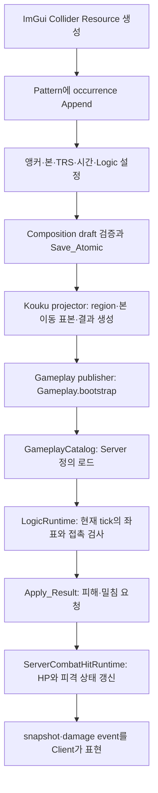

# 쿠크 Collider·앵커·판정과 세이튼·조커 위치 학습 기록

## G00. 현재 상태와 읽는 목적

2026-10-12 현재 작업 폴더의 코드와 Composition revision 2500을 조사했다. 사용자가 기술소개서를
작성하면서 직접 반영하고 싶다고 요청하여 제품 소스·저작 데이터·게시 데이터 수정은 보류했다.
이 문서는 현재 구현 조사와 다음 구현의 설계 설명이다. 수정·게시·제품 빌드 완료 보고가 아니다.
사용자의 독립 구현·이해도·과거 개인 기여도 여기서 판정하지 않는다.

기준 정본은 `Data/KoukuSaydon/Gate1/KoukuSaydonComposition.json`이다. 오래된 Sequence Composition과
`Data/Encounters/KoukuSaydon/KoukuSaydonEncounter.json` 생성 projection을 직접 고치는 방식은 쓰지 않는다.
시작 때 이미 다른 세션의 미커밋 변경이 있었으며 이를 보존했다.

## G01. ImGui에서 만든 Collider가 Server 피해가 되는 과정



### 파일과 자료구조

| 파일·함수 | 책임과 다음 소비자 |
|---|---|
| `Client/Public/KoukuSaydonCompositionDocument.h`의 `KOUKU_SAYDON_COMPOSITION_PRESENTATION_RESOURCE` | 재사용 도형 정의. shape, HalfExtents, radius 등을 가진다. |
| 같은 헤더의 `KOUKU_SAYDON_COMPOSITION_PRESENTATION_OCCURRENCE` | 특정 Pattern에 배치한 한 번의 사용. stable occurrence ID, resource ID, 시작·수명, 위치·회전·크기, anchor, bone, Logic 연결을 가진다. |
| `KoukuSaydonActionWorkbench.cpp::Create_PresentationResource` | draft 복사본에 resource ID를 발급하고 `Commit_Candidate`를 통과한 뒤 반영한다. 실패하면 이전 draft를 유지한다. |
| `Append_PresentationCandidate` | 현재 Pattern·커서 시각에 occurrence를 만든다. 정의를 만들었다는 사실만으로 공격이 실행되는 것은 아니다. |
| `Render_ColliderBoxDetails` → `Render_PresentationAnchor` | ImGui 입력을 편집값에 반영한다. Anchor, Body/Weapon, Bone, Follow, TRS와 시간 설정이 이 경계에 있다. |
| `Set_ColliderLogicValues` / `Set_ColliderTriggerDamage` | 도형을 Logic occurrence와 연결하고 접촉 성공 시 실행할 피해·넉백 RESULT를 연결한다. 연결 대상과 시계가 맞지 않으면 거절한다. |
| `Save` → `KoukuSaydonCompositionDocument.cpp::Save_Atomic` | draft를 저작 JSON으로 저장한다. 실행 중 Server의 HP나 정의를 직접 바꾸지 않는다. |
| `Tools/KoukuSaydonPipeline/project_kouku_saydon_composition.py::_project_collider_regions` | 저작 앵커·shape·scale·Logic 연결을 Server용 region으로 투영한다. |
| 같은 파일의 `_project_bone_collider_track` / `_build_bone_collider_track` | 설치 모델과 재생 clip에서 본의 시간별 위치를 표본화한다. Server가 CModel을 직접 실행하는 구조는 아니다. |
| `Server/Private/GameplayCatalog.cpp`의 `PATTERNLOGICREGION`·`PATTERNLOGICREGIONWORLDKEY`·`PATTERNLOGICOUTCOME` reader | 게시된 도형·이동 표본·결과를 읽고 검증한다. |
| `Server/Private/KoukuSaydonLogicRuntime.cpp::Resolve_LogicRegionTransform` | 해당 tick의 표본, 보스 root와 yaw를 합성한다. |
| `Contains_LogicRegion` 및 ENTER_AREA 분기 | Server player 위치와 XZ 도형을 검사한다. Cylinder/이동 도형은 Y 높이 겹침도 검사한다. 플레이어별 처리 이력으로 반복 피해를 제어한다. |
| `Apply_Result` → `ServerCombatHitRuntime.cpp::Apply_WorldToPlayer` | HP 피해 요청·접촉 중심·밀침 정책을 만들고, 사망·잡힘 소유자·전투 준비·무적 등 조건을 거쳐 실제 상태와 damage event를 갱신한다. |

ImGui에서 보이는 도형은 편집·검사용 표현이다. 실제 피해는 게시된 region과 Server player 상태로
계산한다. 화면에 도형이 보인다는 사실은 Server가 같은 위치·시각·대상을 검사했다는 증거가 아니다.

### 앵커 이름을 구분한다

| ImGui / 저작 JSON | 의미 | Server region |
|---|---|---|
| Boss, `BOSS`, Follow 켬 | 매 tick 보스 root 위치·yaw에 상대 위치를 합성 | `BOSS_CURRENT` |
| Boss, `BOSS`, Follow 끔 | Collider 또는 지정 Effect의 시작 시 보스 기준을 고정 | `BOSS_START`를 시작 시 캡처 |
| Map (fixed position), `MAP` | 저장한 절대 맵 좌표 | `WORLD` |
| World Object, `WORLD` | 선택한 World Object occurrence의 TRS·재생을 참조 | 그 객체의 좌표 표본과 `WORLD` 또는 `BOSS_SPAWN` |

즉 저작 `WORLD`와 Server `WORLD`는 같은 enum의 단순 복사가 아니다. 피자에서 말하는 고정 월드
판정은 저작 `MAP` → Server `WORLD`다. 손·뿅망치 부착은 Boss의 BODY/WEAPON과 실제 Bone을
선택한다. 본 선택과 Follow, `boneRotation`에 따라 위치만 추종할지 본 회전까지 반영할지 달라진다.

일반 보스 상대 좌표의 XZ 합성은 다음과 같다. `theta`는 Server boss yaw의 radian 값이다.

```text
worldX = bossX + localX*cos(theta) + localZ*sin(theta)
worldZ = bossZ - localX*sin(theta) + localZ*cos(theta)
```

본 부착은 시간별 본 표본을 먼저 계산한 후 이 보스 root 변환을 한 번 적용한다.
preScale·소켓·로컬 offset을 여러 경계에서 중복 적용하면 화면과 판정이 벌어진다.

## G02. 대형 세이튼 잡기와 피자 마지막 찍기의 현재 근거

### 잡기: 화면 손과 Server player의 좌표 소유자가 다르다

`GameRoom_PlayerSimulation.cpp::Capture_PlayerAttachment`는 잡힌 순간 player 위치를 보스의
로컬 offset으로 저장한다. `Update_PlayerAttachment`의 손 부착 경로는 저장 offset에 현재
boss root 위치·yaw를 다시 합성한다. 현재 이 경로는 손 애니메이션 본을 매 tick 추종하지 않는다.

반면 `Client/Private/Npc.cpp::Try_Get_PlayerHandGripSocketView`는 실제 왼손 본 행렬과
owner world 행렬로 화면의 손 소켓을 만든다. 따라서 화면에서 잡힌 플레이어가 손과 함께
이동하는 것과 Server player XYZ가 그 손을 따라가는 것은 현재 별개다.

P17의 피해 Collider occurrence 17/21/22/23은 bone이 비어 있는 BOSS 상대 고정 도형이다.
동일한 잡힘 owner·sequence·deadline을 주고 기존 Debug Server OBJ를 연결한 독립 실행에서,
과거 local X=3.1은 피해4회(HP1000→618), X=8은 피해0회(HP1000 유지)를 확인했다.
설치 WModel의4257/4820/5332/7148ms 실제 손 local X는2.986~3.137m였고,
X8 위치와는 수평 약4.92~5.08m 차이가 있었다. 본 표시는 같은 손을 쓰지만 Server 위치는
잡힌 당시 위치에 따라 달라지는 결함을 설명하는 수치다. 전체 room 입력 재현과는 구분한다.
수정에는 잡힌 player의 Server 위치와 손 판정이 같은 게시 표본·시계·root를
소비하게 하고, 올바른 capture owner만 피격할 수 있는 기존 검증을 보존하는 설계가 필요하다.

### 피자: 고정 WORLD 게시 자체는 현재 존재한다

`KAKULSAYDON_G1_PATTERN_26.presentation.7`의 고정 판정은 현재 source와 설치된
`Gameplay.bootstrap` 양쪽에 존재한다.

- 중심: `[4.34000015, 10, 323.100006]`m.
- 도형: CYLINDER, 반경 약4.9m, 반높이1.25m.
- 창: Pattern 시작 기준16997~17097ms.
- 결과: 최대HP10%, 밀침10m/1500ms, `AWAY_FROM_CONTACT`, force/ballistic/arena 이탈 허용.
- `bundle.5`의 P26 member 시작 offset은0이다.

과거 [09-30 피자 결과](../09-30/2026-09-30_KOUKU_PIZZA_FINAL_CONTACT_RESULT.md)에도
고정 MAP 변경과 당시 사용자 확인이 기록되어 있다. 따라서 지금 같은 앵커를 다시 저장하거나
콜라이더를 크게 만드는 것으로 원인을 설명할 수 없다. 실제 bundle tick의 Logic 소유자,
player X/Y/Z·피격 가능 상태, 창 소비 및 결과 적용을 함께 재현해야 한다.
실제 게시 pattern과 navigation을 읽은 독립 LogicRuntime 실행에서는 지면Y10.56과 Y10
양쪽 모두17초에 HP1000→904, 넉백1.5초가 발생했다. 따라서 단독 region 소비는 재현 조건에서
동작하며 전체 room/bundle 실패 원인은 아직 미확정이다. 기존 Debug OBJ를 링크한 조사이며,
파일 hash·시각 기록이 모든 현재 source의 재컴파일을 증명하지는 않는다.
새 피해·넉백 수정 완료나 전체 bundle 성공으로 확대하지 않는다.

조사 코드·로그·모델 표본·입력과 OBJ 기록은 `out/KoukuContactAudit20261012/`의
`probe.cpp`, `probe.log`, `hand-samples.json`, `receipt.json`에 있다.

## G03. 네 방향 이동 후 중앙에 가까운 진짜를 고르는 기존 코드

`Server/Private/KoukuSaydonBrain.cpp::Select_CrossDirection`이 현재 이 계산을 한다.

1. `DirectionPatternIds` 네 child를 조회·검증한다.
2. 각 child의 지정 `cloneEndStage`까지 원본 root motion 끝점의 forward/lateral 이동을 더한다.
3. 현재 boss yaw로 예상 도착 XZ를 월드 좌표로 바꾼다.
4. 각 도착점과 `boss.fSpawnPositionX/Z`의 거리제곱을 비교한다.
5. 최소 거리의 child를 본체로 고른다. 동률은 저작 순서이며 명시 `strRealPatternId`가 있으면 우선한다.
6. `GameRoom_BossSimulation.cpp`의 CROSS_DIRECTION_CLONES 처리에서 본체 child와 나머지 분신을 실행한다.

```text
predictedX = bossX + lateral*cos(yaw) + forward*sin(yaw)
predictedZ = bossZ - lateral*sin(yaw) + forward*cos(yaw)
distanceSquared = (predictedX - spawnX)^2 + (predictedZ - spawnZ)^2
```

여기서 중앙은 임의 맵 bounding box의 중앙이 아니라 해당 boss의 저장 spawn 기준이다.
이것은 root motion의 예상 끝점 비교이며 장애물까지 포함한 미래 이동의 전수 시뮬레이션이라는
뜻이 아니다. 실제 `Apply_StageRootMotion`의 navigation·collision에 따라 최종 도착은 달라질 수 있다.
현재 이 선택은 랜덤이 아니다.

| 현재 Pattern | 현재 경로 |
|---|---|
| P2 진짜 세이튼 찾기 | `REAL_GAZE_TELEPORT` 고정 본체 자리와 원형 분신 배치 |
| P7 룰렛 | `resetBossToSpawn=true`, `resetBossYawDegrees=237`로 시작 위치·방향 복원 |
| P48 빙글빙글 돌며 카드 던지기 | 현재 stage 시작 pose 기준 root motion. 중앙 종점 선택 없음 |
| P103 카드비 | 현재 stage 시작 pose 기준 root motion. 중앙 종점 선택 없음 |
| P52 기분나빠 분신 | `[P50,P53,P54,P55]`, cloneEnd `STAGE_1`, 중앙 가까운 child 선택 |
| P66 3갈레 불뿜기 분신 | `[P67,P68,P69,P70]`, cloneEnd `STAGE_1`, 같은 선택 |
| P65 십자화염폭발 분신 | `[P71,P72,P63,P64]`, cloneEnd `STAGE_18`. 현재 `realPatternId=P63`으로 최종 왼쪽 고정 |

따라서 위 패턴들이 모두 중앙 가까운 방향 선택을 공유한다고 설명하면 현재 코드와 다르다.

## G04. 진짜 세이튼 찾기의 랜덤 위치를 직접 구현할 경계

앞 G03과 별개다. P2는 `REAL_GAZE_TELEPORT`를 사용한다.
`GameRoom_BossSimulation.cpp::Commit_KoukuMechanicTriggers`는 현재 본체를
`trigger.fTeleportX/Y/Z`에 고정하고 `ClockHours={4,7,10}`으로 가짜 세 자리를 계산한다.

현재 logic9의 기준 위치는 `[0.604172031,1.3,729.87770021]`, 중앙 바라보기 보정은-90도다.
P2 저작 시작 시각은1988ms이며30Hz Server의 `Ticks_FromMs` 올림으로 실제 소비 시각은
시작 후60tick(2000ms)이다. 이 위치 값은 지금 네 위치 중 기준 한 자리를 나타낸다.

다음 구현에서는 네 후보 위치를 먼저 만들고 Server가 실행당 본체 슬롯 한 개를 선택한다.
나머지 세 자리에 기존 가짜 P5를 배치한다. boss ID·pattern sequence·시작 tick 등을 포함한
Server 실행 seed로 한 번 선택하며 매 프레임 추첨하지 않는다.
네 위치·분신 정의·navigation admission을 전부 검사한 뒤 본체 이동과 분신 생성을 commit해야 한다.
실패 시 본체만 먼저 옮기는 부분 성공을 만들지 않는다.

각 자리의 방향은 현재 공식을 유지한다.

```text
yawDegrees = atan2(centerX - positionX, centerZ - positionZ) * 180/pi
             + faceCenterYawOffsetDegrees
```

-90도는 Saydon 모델 정면 +X와 Server yaw 규약을 연결하는 기존 보정이다. 가짜의 뒤돌기
clip 자체는 유지하고 배우의 기본 yaw만 자리별로 정한다. 가짜 몸 방향, 실제 진짜를 향한
플레이어 응시 판정, 네 방향 이동 끝점 선택은 서로 다른 계산이다.

`KoukuSaydonLogicRuntime.cpp::Judge_Gaze`는 현재 실제 boss 위치와 player 위치·yaw를
사용한다. 본체를 Server에서 옮기면 응시 대상 위치도 이 실제 위치를 사용한다.

검증 기대: 네 슬롯 각각 본체1+가짜3, 중복 위치0, 중심까지 반지름 유지, 자리별 중앙 yaw,
같은 실행 중 선택 불변, 준비 실패 시 이전 actors 보존, 새 본체 방향을 보는 플레이어의 판정.
무작위이므로 두 실행에서 같은 자리가 나오는 것은 허용한다. 매번 다른 자리를 보장하는 규칙은 별개다.

## G05. 조커 랜덤은 배치와 판정을 함께 이동한다

P13 카드 occurrence는 `world.5~world.11` 일곱 개이고 조커는 `world.11`이다.
성공 RESULT logic26 역시 이 stable occurrence ID를 참조한다.

현재 `KoukuSaydonLogicRuntime.cpp`는 WorldSequence 재생 시 원래 `sequence.Placement`를 보내고,
OBJECT_CONTACT에서는 원래 `window.ContactTargets`의 XZ를 사용한다.

다음 구현의 실행 상태는 `Server/Public/KoukuSaydonLogicRuntime.h::KOUKUSAYDON_LOGIC_LEDGER`가
소유하는 occurrence ID → 이번 실행 배치 대응표가 적절하다. ledger의 생성·종료와 같은 수명을
사용하며 공유 catalog 정의나 저장 JSON을 실행 때마다 바꾸지 않는다.

1. 실제 카드 후보와 조커 ID를 정의의 연결에서 확인한다.
2. Server에서 일곱 자리 중 조커 자리를 한 번 고른다.
3. 조커와 선택 카드의 배치를 교환한다. 모델·stable ID·성공 조건 ID는 유지한다.
4. 최초 `WorldSequencePlays`의 Placement와 OBJECT_CONTACT의 target XZ가 같은 대응표를 읽게 한다.
   접촉 중심에 template local offset이 구워진 경우 그 상대 offset도 보존한다.
5. 뒤집기·성공 결과는 기존 stable occurrence ID로 처리한다.

기존 `GameRoom_KoukuPlayerCommands.cpp::Apply_KoukuLogicOutput`이 만드는
`S2C_WORLD_SEQUENCE_PLAY`의 Placement와 `Broadcast_OwnedWorldSequence`,
Client의 `WorldPlacementFromCue`·`CWorldSequencePlayer`
소비 경로를 재사용할 수 있다. 별도 Client 난수나 두 번째 카드 runtime은 필요하지 않다.
정책은 조커 성공 조건이 확인된 카드 후보에만 적용하며 다른 WorldSequence를 섞지 않는다.
후보 ID 중복·누락·Placement 부재는 배치 준비를 거절하고 부분 대응표를 commit하지 않는다.

검증 기대: 각 후보에 조커 배치 가능, 겹친 카드0, 표시와 접촉 위치 일치, 새 위치 조커는 성공,
옛 위치 일반 카드는 조커 성공으로 처리되지 않음, 종료·재시작 시 이전 실행 배치가 남지 않음.

## G06. 나머지 기능의 읽을 위치

| 기능 | 실제 시작점 |
|---|---|
| 룰렛에서 플레이어 카드 문양·색 배정 | `KoukuSaydonLogicRuntime.cpp::Assign_EncounterCard` |
| 룰렛 바닥 문양·색과 플레이어 카드 비교 | 같은 CPP의 `Judge_Roulette`. 명시 CardRegions 경로를 우선한다. |
| 진짜 응시 방향 판정 | 같은 CPP의 `Judge_Gaze` |
| 카드비 병사 배치·navigation·일괄 admission | `GameRoom_KoukuMiniGames.cpp::Spawn_KoukuCardRainSoldiers` |
| 네 방향 root motion 예상 끝점 선택 | `KoukuSaydonBrain.cpp::Select_CrossDirection` |

## G07. 직접 반영·게시·검증을 구분하는 순서

먼저 G04의 한 기능만 직접 수정하고 diff를 검토한다. 이후 필요한 제품 Build와 실제 Server
회귀에서 네 자리의 변환·생성·응시 판정을 확인한다. 다음 G05의 실행 상태와 두 소비자를 연결한다.
Collider 버그는 별도 재현의 실패 근거를 확보한 뒤 수정한다. 조사만으로 피해 수치를 바꾸지 않는다.

저작/projector를 바꾸었을 때의 정본 게시 경로는 다음과 같다. 이번 조사에서 실행하지 않았다.

```powershell
python -B Tools/KoukuSaydonPipeline/project_kouku_saydon_composition.py --repository-root . --mode publish
powershell -NoProfile -ExecutionPolicy Bypass -File Tools/GameplayPipeline/Publish-GameplayBalance.ps1 -Mode Publish -SkipValtanSplitProjection
```

Client presentation 게시 내용이 바뀌면 `Tools/CompositionPipeline/Publish-Compositions.ps1`의 해당
domain도 게시한다. 코드 변경은 정본 Product runner를 사용한다.

```powershell
powershell -ExecutionPolicy Bypass -File Tools/Build/Invoke-BuildAndRegression.ps1 -Configuration Debug
```

관련 기존 Server selector는 `--kouku-object-overlap-contract-test`, `--kouku-product-contract-test`,
`--kouku-raid-contract-test`다. 기능에 맞는 사례를 추가·선택한다. 게시 후 별도 loopback 포트의
`--headless --bind-address 127.0.0.1 --port 17877 --smoke-timeout-ms 500`으로 시작 파일 로드를
확인할 수 있다. 이는 팀 endpoint 설정 변경이 아니다. Client/UI와 최종 아레나 화면은 사용자가 확인한다.

현재 파일 조사·과거 결과 문서 확인과 기존 Debug OBJ를 사용한 독립 native 소비자 검사는 수행했다.
이번 변경의 제품 소스 수정·제품 재컴파일·게시·전체 room/bundle의 피해·넉백 성공 및 사용자
화면 확인은 완료되지 않았다. Server/Client 제품 프로세스는 시작 확인 당시 실행 중이지 않았다.

## G08. 카드 접촉 logic.22~25의 파싱과 실행 경로 학습

2026-10-12 후속 질문은 JSON이 Brain에서 직접 실행되는지와 전체 호출 흐름이다.
이번에는 현재 소스와 디스크 게시본을 읽었으며 제품 코드·데이터 수정, 게시, 빌드,
Server/Client 실행은 하지 않았다. 설명 제공은 사용자의 독립 구현·이해 완료 증거가 아니다.

- 저작 `KoukuSaydonComposition.json`의 `kakulsaydon.g1.logic.22/23`은 접촉 정의이고
  `logic.24/25`는 접촉 카드의 flip/hop 결과 정의다. P13 첫 배치는 occurrence `.logic.2/3`이며
  4858ms부터1044ms 동안 각각 정의22/23을 사용한다. `onSuccessLogicIds`가 결과를 연결한다.
- 정의 ID와 occurrence ID는 별개다. P13의 `.logic.22`는 정의23(hop), `.logic.23`은
  정의22(flip)를 사용하므로 접미 숫자가 같다고 같은 로직으로 해석하지 않는다.
- Python `project_kouku_saydon_composition.py::load_json/project_encounter`가 JSON을 읽고
  ID 사전으로 정의를 찾는다. `_project_logic_window`, `_project_outcomes`,
  `_project_collider_regions`, `_project_object_contact_targets`가 시간·결과·망치 도형·카드의
  XZ 좌표를 `Data/Encounters/KoukuSaydon/KoukuSaydonEncounter.json`의 logicWindows로 펼친다.
- `Publish-GameplayBalance.ps1`이 Encounter를 읽고 `KoukuBootstrapRows.ps1`이
  PATTERNLOGICCONTACTGROUP/TARGET/MOTION 등의 탭 구분 행을 생성한다.
  Server의 직접 입력은 기본 경로 `Server/Bin/DataFiles/Gameplay/Gameplay.bootstrap`이다.
  LOSTARK_SERVER_DATA_ROOT가 있으면 데이터 루트가 달라질 수 있다.
- `CGameplayCatalog::Load -> Load_BootstrapPath -> Load_BootstrapBytes`가 문자열 kind를 enum으로,
  숫자를 typed field로 읽고 `BOSS_PATTERN_DEFINITION::LogicWindows`에 저장한다.
  임시 Catalog와 rollback으로 실패 시 기존 정의를 보존한다. ServerApp은 초기 generation을
  GameRoom에 전달하고, 패턴 실행은 PinnedGameplayRevision으로 정의를 고정한다.
- `CKoukuSaydonBrain::Begin_Pattern`은 정의 검증과 보스 실행 상태 시작을 담당한다.
  GameRoom이 `CKoukuSaydonLogicRuntime::Build`로 실행 ledger를 만들고 매 tick `Update`한다.
  OBJECT_CONTACT는 player 피해 결과 경로와 별도인 object 접촉 루프에서 처리한다.
- 접촉은 카드의 BODY_CIRCLE_XZ와 현재 보스·게시된 본 도형 표본을 비교한다. 이 경로는 XZ
  판정이며 Y 중첩 검사 경로가 아니다. 카드 대상 반경1.25m와 망치 도형 크기는 서로 다른 입력이다.
- priority200은100보다 먼저 검사한다. 같은 group/startTick/card occurrence는 타격당 한 번
  소비하고, 패턴 실행 동안 유지하는 motion priority는 뒤집힌 카드가 hop으로 돌아가는 것을 막는다.
- 실제 접촉 ID에 해당하는 ContactMotions 항목 하나만 WorldSequencePlays에 추가한다.
  world.11은 joker_card_flip/hop, world.5~10은 일반 card_flip/hop이다.
- `CGameRoom::Apply_KoukuLogicOutput`이 WorldCueByOccurrence로 생성 당시 cue를 찾고
  S2C_WORLD_SEQUENCE_PLAY의 targetCueId에 넣어 전송한다. Client
  `CLevel_KakulSaydonArena::Consume_OwnedWorldCue`가 실행·멤버·대상 cue를 확인하고
  `Apply_ObjectMotion`으로 기존 카드의 모션을 바꾼다.

다음 읽기 시작점은 Composition의 P13 `.logic.2`와 그 Success 정의24,
`GameplayCatalog.cpp`의 PATTERNLOGICCONTACTTARGET 분기,
`KoukuSaydonLogicRuntime.cpp`의 ContactWindowOrder 순회다. 진짜 세이튼 수동 구현 안내는
자리 선택 변수 추가까지 제공했으며 사용자의 실제 반영 완료는 아직 확인하지 않았다.

### G08 후속: 한글 displayName과 실행 ID의 분리

한글 이름은 Logic 의미를 해석하는 명령이 아니다. Workbench의 Create_Logic은 순번으로
strLogicId를 만들고 사용자 이름을 strDisplayName에 별도로 저장한다. Serialize는
CDataJson::Escape로 JSON 문자열을 쓰며, Parse_Text는 Required("displayName", STRING)과
Get_String으로 이름을 복사한다. CDataJson::ReadString은 직접 기록한 UTF-8 바이트를 보존하고
ReadEscape는 Unicode escape를 AppendUtf8로 변환한다. Is_DisplayName은 빈 문자열·255바이트
초과·제어 문자를 거부하지만 이 함수 자체가 전체 UTF-8 유효성 검사기는 아니다.

KoukuSaydonActionWorkbench_Logic.cpp의 목록은 `strDisplayName + "##" + strLogicId`를
표시용 label로 만들고 선택 결과에는 strLogicId를 저장한다. 실행 연결은 logicId,
실행 종류는 triggerKind/outcomeKind가 담당한다. 따라서 유효한 displayName만 바꾸어도
같은 접촉·결과 연결을 유지하며, 이름을 뒤집기로 바꾸는 것만으로 hop이 flip으로 바뀌지 않는다.
이번 후속도 코드 읽기와 설명만 수행했으며 제품 이름 변경·게시·실행은 하지 않았다.

## G09. 2026-10-13 — include에서 JSON·서버 판정·패킷까지 처음 읽을 순서

사용자는 발탄과 쿠크의 모든 패턴을 기술소개서에 설명할 수 있도록 실제 H/CPP, include, 변수, 함수, 클래스, API 의존과 C++/CS, 시간·공간 비용을 연결하고 breakpoint로 확인하려 한다. 이번 시작은 **쿠크 P13의 카드 하나가 망치에 닿으면 해당 카드가 뒤집히는 동작**이다. 이전 A00의 프로젝트 경계를 짧게 확인한 뒤, 실제 JSON 파서부터 내려간다. 모든 소스의 완독을 이 동작 이해의 선행 조건으로 삼지 않는다.

조사일은 2026-10-13 KST, LostArk HEAD는 `01518032dde86b5558976a2fbe5fd94ad625cfd1`이다. 대규모 기존 미커밋 변경을 포함한 현재 디스크 소스의 근거이며 HEAD의 고정 permalink가 아니다. 이번 회차는 소스·데이터 조사와 설명 보충이다. 사용자 breakpoint 관측·독립 설명·직접 구현·성능 측정은 아직 없다.

### 먼저 구분할 네 가지 읽기

| 시점 | 실제 입력과 소비자 | 결과 |
|---|---|---|
| 전처리·컴파일 | CPP의 `#include`와 H | 타입·함수 선언, 템플릿·inline 정의 등을 번역 단위에서 사용할 수 있다. 게임 중 JSON을 읽는 호출이 아니다. |
| 링크 | OBJ, `Shared.lib`, `Engine.lib` | Client/Server EXE의 심볼을 연결한다. Shared는 정적 구현, Engine.lib는 DLL용 import library다. |
| 프로세스 시작 | Client EXE의 DLL import와 `Engine.dll` | OS가 DLL을 Client 프로세스 주소 공간에 연결한다. 별도 Server 프로세스와 TCP로 통신하는 것과 다른 경계다. |
| 실행 중 데이터 로드 | 저작 JSON 또는 게시 bootstrap과 해당 reader | 파일 bytes를 읽고 검증하여 프로세스가 소유할 C++ 값으로 만든다. |

현재 x64 설정 근거는 [Client.vcxproj](C:/Users/tnest/Desktop/LostArk/Client/Default/Client.vcxproj:1029)의 include 경로, 1038의 Engine.lib, 1079/1084의 Engine/Shared ProjectReference다. [Shared](C:/Users/tnest/Desktop/LostArk/Shared/Default/Shared.vcxproj:73)는 StaticLibrary, [Engine](C:/Users/tnest/Desktop/LostArk/Engine/Default/Engine.vcxproj:43)은 DynamicLibrary다. Engine 참조의 `LinkLibraryDependencies=false`여도 명시적인 Engine.lib 링크가 있다. Shared라는 이름은 서로 다른 EXE의 변수가 자동 공유된다는 뜻이 아니다. 기존 [A00 설명](2026-10-12_DATA_DOMAIN_ARCHITECTURE_LEARNING_RESULT.md)의 빌드·진입점 상세를 연결한다.

언어·도구 계약은 Microsoft의 [include 설명](https://learn.microsoft.com/en-us/cpp/preprocessor/hash-include-directive-c-cpp?view=msvc-170)과 [DLL 연결 설명](https://learn.microsoft.com/en-us/cpp/build/linking-an-executable-to-a-dll?view=msvc-170)으로 대조했다.

### 첫 파일: Reload_FromPath의 입력·후보·반영

먼저 [KoukuSaydonCompositionDocument.cpp의 Reload_FromPath](C:/Users/tnest/Desktop/LostArk/Client/Private/KoukuSaydonCompositionDocument.cpp:7417)를 연다. 처음 읽을 구간은 7417~7457이며, 그 함수가 쓰는 선언을 [H](C:/Users/tnest/Desktop/LostArk/Client/Public/KoukuSaydonCompositionDocument.h:890)에서 연결한다. H 처음부터 모든 struct를 외우는 방식보다 이 한 함수의 계약을 먼저 고정한다.

직접 호출은 `CKoukuSaydonActionWorkbench::Reload → m_Document.Reload → Reload_FromPath`다. [Workbench Reload](C:/Users/tnest/Desktop/LostArk/Client/Private/KoukuSaydonActionWorkbench_Document.cpp:141)는 dirty draft의 명시적 폐기 없이 Reload를 진행하지 않는다. 학습을 위해 사용자의 편집본을 자동 Reload하지 않는다.

| 값 | 의미·소유·수명 |
|---|---|
| `const std::filesystem::path& path` | 호출자가 전달한 파일 경로를 함수 호출 중 읽는다. 파일 내용이나 열린 파일 HANDLE이 아니다. |
| `std::string& outStatus` | 호출자가 소유한 진단 문자열을 성공·실패 결과에 맞게 갱신한다. 참조 자체가 새 문자열의 소유자가 되지는 않는다. |
| `bytes` | 이 호출이 소유하는 원본 파일 bytes다. 성공하면 기준 저장본 문자열로 이동한다. |
| `stagedDocument` | 파싱·검증 중인 후보 값이다. 실패 반환하면 지역 객체가 소멸하며 이전 정상 문서를 교체하지 않는다. |
| `stagedReferences` | Action 참조를 준비할 후보 값이다. Composition 성공과 모든 참조 준비 성공은 같은 판정이 아니다. |
| `m_LastGood` | 문서 객체가 보관한 마지막 정상 문서. Workbench의 편집 중 `m_Draft`와 별개다. |
| `m_bFresh`, `m_bHasLastGood` | 최근 읽기 성공 여부와 과거 정상 문서 보유 여부다. 로드 실패 시 Fresh=false지만 마지막 정상 문서를 보유할 수 있다. |
| `m_iGeneration` | 성공한 메모리 문서 교체를 구분하는 세대. 디스크 JSON의 revision과 다른 값이다. |

실제 처리 순서는 경로 검사 → `Read_Text` → `Parse_Text` → 문서와 경로 대응 검사 → `Validate` → 참조 읽기 → 멤버 교체다. 조건식의 `||`는 앞 조건이 true이면 뒤를 평가하지 않으므로 최초 실패 뒤 불필요한 단계를 수행하지 않는다. 검증 조건에서 false로 반환하는 경우에는 `m_bFresh`와 진단을 바꾸고 기존 문서와 경로를 보존한다. C++ 할당 예외를 false로 바꾸는 catch는 없다. 성공 때 `m_LastGood = std::move(stagedDocument)` 등 실제 대입이 교체를 수행한다. `std::move` 자체가 저장·검증·이동 작업을 실행하는 것은 아니다.

[Read_Text](C:/Users/tnest/Desktop/LostArk/Client/Private/KoukuSaydonCompositionDocument.cpp:1232)는 `std::filesystem::file_size`로 크기와 오류를 확인하고 `std::ifstream`으로 bytes를 읽는다. 스트림 반복자로 지역 문자열을 채운 뒤 읽은 길이를 검사한다. 함수 범위를 나갈 때 ifstream의 소멸자가 파일 자원을 정리한다. 이는 RAII의 실제 예다. 이 단계는 파일 읽기이며 JSON의 logic 의미를 아직 해석하지 않는다.

### H와 CPP의 include가 각각 필요한 이유

[CompositionDocument.h](C:/Users/tnest/Desktop/LostArk/Client/Public/KoukuSaydonCompositionDocument.h:1)에 이미 필요한 헤더가 있다. 학습 때문에 새 H/CPP나 include를 추가하지 않는다.

| include | 이 선언에서 필요한 이유 |
|---|---|
| `Gameplay/AttackHitTemplate.h` | Logic이 값으로 보관하는 Shared 공격 정의 타입. 게임 규칙 타입을 양쪽에서 같은 선언으로 사용한다. |
| `KoukuSaydonAnimationActionDocument.h` | 문서가 값으로 보관하는 Action 참조 집합과 관련 선언. 값 멤버의 크기·소멸을 알아야 한다. |
| `<array>`, `<cstdint>` | 크기가 고정된 목록·XYZ, 고정 폭 ID·revision·ms 표현. |
| `<filesystem>`, `<optional>` | 경로 타입, 생략됨과 명시된 값을 구분하는 선택 값. |
| `<string>`, `<string_view>` | 문서가 소유할 문자열과 호출 중 차용할 문자열 범위. view는 원본 수명을 연장하지 않는다. |
| `<vector>` | 정의·occurrence·결과 목록을 값으로 소유한다. 원소 재배치 후 예전 포인터는 사용할 수 없다. |

CPP의 `DataJson.h`는 JSON 값 트리와 파싱 API, `ProjectDataRoot.h`는 저작 루트 경로 해석, `<fstream>`은 파일 스트림, `<algorithm>`은 검색·정렬에 필요하다. `Windows.h`의 저장 잠금·교체 API는 같은 파일의 Save 경로에서 필요하다. include 목록 전체를 Reload의 실제 실행 API 목록으로 읽으면 안 된다.

H에는 선언뿐 아니라 struct·inline 구현도 있다. `class CKoukuSaydonCompositionDocument final`의 final은 파생 상속을 제한한다. JSON 검증 완료나 객체 불변을 뜻하지 않는다. `Parse_Text`의 static은 특정 문서 객체의 `this` 없이 전달받은 입력·출력으로 작업한다는 의미다. `struct`와 `class` 모두 멤버 함수를 가질 수 있으며 기본 접근 지정 등이 다르다.

### Parse_Text에서 JSON이 C++ 값이 되는 순간

[Parse_Text](C:/Users/tnest/Desktop/LostArk/Client/Private/KoukuSaydonCompositionDocument.cpp:4290)의 서명은 `text`라는 `string_view`, 출력 문서 참조, 진단 문자열 참조를 받는다. 반환 bool과 출력 인자는 서로 다른 결과 채널이다.

1. bytes 크기를 검사한다.
2. `CDataJson::Parse(text, root, parseError)`가 문자열·숫자·array·object 등의 지역 값 트리를 만든다.
3. `Required`와 `Has_Properties`로 필수 키·타입·허용 키를 검사한다. JSON 문법이 맞는 것과 게임 문서 계약이 맞는 것은 다르다.
4. 지역 `staged`에 ID·revision·30Hz·목록을 채운다. Logic 목록을 pattern보다 먼저 읽는다.
5. [4449의 optionalText](C:/Users/tnest/Desktop/LostArk/Client/Private/KoukuSaydonCompositionDocument.cpp:4449)는 lambda다. `[&logicValue]`는 현재 JSON 객체를 참조 캡처하며 호출 중에만 사용한다. 키가 없으면 기본값을 보존하고, 문자열이 아니면 실패하고, 있으면 소유 문자열에 복사한다.
6. `optionalText("triggerKind", stagedLogic.strTriggerKind)`는 문자열을 필드에 넣는다. 여기에서 카드 접촉이나 피해를 실행하지 않는다.
7. `staged.Logics.push_back(std::move(stagedLogic))`로 후보 목록에 넣는다. 전체 성공 경로의 [6253](C:/Users/tnest/Desktop/LostArk/Client/Private/KoukuSaydonCompositionDocument.cpp:6253)에서만 `outDocument = std::move(staged)`한다. 격리 가능한 개별 pattern 오류는 원본·진단을 보존하는 별도 정책이 있으므로 모든 항목 오류가 문서 전체 거절이라는 뜻은 아니다.

`const DATA_JSON_VALUE* const value`에서 앞 const는 가리킨 값을 이 포인터로 수정하지 못하게 하고 뒤 const는 지역 포인터를 재지정하지 못하게 한다. 객체 수명이나 스레드 안전을 자동 보장하지 않는다. root가 소유한 값을 차용하므로 함수 밖에 그 포인터를 저장하면 안 된다. 문서에는 문자열·값을 복사한다.

실제 [DATA_JSON_VALUE::OBJECT](C:/Users/tnest/Desktop/LostArk/Client/Public/DataJson.h:27)는 `std::map`이고 [Find](C:/Users/tnest/Desktop/LostArk/Client/Private/DataJson.cpp:563)는 `map::find`를 사용한다. JSON의 키 조회를 근거 없이 unordered_map 평균 O(1)이라고 설명하지 않는다.

### 같은 입력을 Server가 받기까지

```text
저작 도구: Composition JSON → CDataJson → Composition 문서 값
게시 도구: Composition JSON → Python project_encounter → Encounter JSON
           → Publish-GameplayBalance.ps1 → Gameplay.bootstrap
Server:    CGameplayCatalog::Load → Load_BootstrapPath → Load_BootstrapBytes
           → BOSS_PATTERN_DEFINITION::LogicWindows
           → Brain::Begin_Pattern + LogicRuntime::Build → 매 tick Update
           → typed 결과 → GameRoom → Shared Write_Message → TCP
Client:    Shared Read_Message → 복제/World cue → 해당 객체 표현
```

Python [project_encounter](C:/Users/tnest/Desktop/LostArk/Tools/KoukuSaydonPipeline/project_kouku_saydon_composition.py:5000)는 정의 ID와 occurrence를 조합하고, [게시자](C:/Users/tnest/Desktop/LostArk/Tools/GameplayPipeline/Publish-GameplayBalance.ps1:3565)는 Encounter를 읽어 [KoukuBootstrapRows](C:/Users/tnest/Desktop/LostArk/Tools/KoukuSaydonPipeline/KoukuBootstrapRows.ps1:1351)의 탭 구분 행으로 만든다. Server의 직접 입력은 `Gameplay.bootstrap`이며 Composition JSON이 아니다. publish 도구 실행과 파일 교체는 이번에 수행하지 않았다.

[Load_BootstrapPath](C:/Users/tnest/Desktop/LostArk/Server/Private/GameplayCatalog.cpp:1752)는 ifstream으로 파일 크기·읽기 길이를 검사한다. [PATTERNLOGIC 분기](C:/Users/tnest/Desktop/LostArk/Server/Private/GameplayCatalog.cpp:3135)는 `fields`의 열 수와 ID·숫자·종류를 검사하고 `ParseBossPatternLogicKind`로 문자열을 enum에 대응시킨다. 모르는 종류는 실패다. 소유 pattern과 중복·순서를 검사한 뒤 [3215](C:/Users/tnest/Desktop/LostArk/Server/Private/GameplayCatalog.cpp:3215)에서 `owner->LogicWindows.push_back(std::move(window))`한다.

`SplitTabs`의 string_view는 현재 행 문자열을 차용한다. 장기 보관할 `strWindowId`에는 `std::string(fields[4])`로 복사한다. `std::from_chars`를 쓰는 ParseNumber는 변환 오류와 끝까지 소비했는지를 검사한다. 파일 로드에는 후보 Catalog와 `LOAD_ROLLBACK`이 있어 실패 시 기존 정의를 보존한다. 문자열에 적힌 C++ 코드를 평가하는 인터프리터가 아니며, 이미 컴파일된 enum 분기와 연산에 데이터를 공급하는 구조다.

### P13에서 실제 추적할 한 줄

현재 Composition revision은 2500이다. [P13의 첫 flip 배치](C:/Users/tnest/Desktop/LostArk/Data/KoukuSaydon/Gate1/KoukuSaydonComposition.json:7387)는 다음 연결을 갖는다. 이 패턴의 실제 `gateId`는 **GATE2**다. Gate1 폴더와 G1 ID 접두어로 관문을 판단하지 않는다.

| 입력 | 값 |
|---|---|
| pattern / 표시 이름 | `KAKULSAYDON_G1_PATTERN_13` / 대형세이튼_조커찾기 |
| occurrence → definition | `KAKULSAYDON_G1_PATTERN_13.logic.2` → `kakulsaydon.g1.logic.22` |
| 종류 | `TRIGGER / OBJECT_CONTACT` |
| 시작·길이 | 4858ms / 1044ms |
| 접촉 대상 | `.world.5~.world.11`의 카드 7개, 반경 1.25m |
| 그룹·우선순위 | `joker.hammer.contact`, 200; 대응 hop은 100 |
| 성공 결과 | logic24의 해당 카드 모션 + logic26의 조커 조건부 외부창 완료 |

logic24는 일반 카드에 `card_flip`, 조커인 world.11에 `joker_card_flip`을 선택한다. [logic26](C:/Users/tnest/Desktop/LostArk/Data/KoukuSaydon/Gate1/KoukuSaydonComposition.json:273)은 world.11일 때만 P13.logic.6을 완료시킨다. 그 EXTERNAL_SIGNAL 창은 성공 시 P14를 후속 요청하고 만료 시 INSTANT_DEATH 결과를 갖는다. 앞 G08의 성공24 설명에 이 두 번째 성공 결과를 함께 붙인다.

디스크 게시본 [Gameplay.bootstrap](C:/Users/tnest/Desktop/LostArk/Server/Bin/DataFiles/Gameplay/Gameplay.bootstrap:1122)에도 OBJECT_CONTACT와 4858/1044가 있으며 1903/1904에 두 SUCCESS, 1912에 조커 조건 신호가 있다. 디스크 정합성 확인과 실행 중 Server가 이 revision을 활성화했다는 확인은 별개다.

[LogicRuntime::Build](C:/Users/tnest/Desktop/LostArk/Server/Private/KoukuSaydonLogicRuntime.cpp:129)는 `ceil(ms*30/1000)`로 절대 tick을 만든다. wrap 없는 구간에서 창 시작은 patternStartTick+146, 끝은 patternStartTick+178이다. 종료는 시작 ms와 길이를 **먼저 합친 뒤** 환산한다. tick 환산 계산이며 실제 실행 측정값은 아니다.

[Update의 접촉 전용 루프](C:/Users/tnest/Desktop/LostArk/Server/Private/KoukuSaydonLogicRuntime.cpp:1984)는 시작·종료 상태 → 이미 접촉한 카드 → 기존 motion priority → 카드와 도형의 XZ 교차 → 그룹 중복 소비 → 결과를 처리한다. `std::any_of`가 지역 도형을 검사하고 Shared의 `Circle_IntersectsForwardBox` 등 순수 도형 함수를 사용한다. 본 도형 위치는 게시 track의 key를 `upper_bound`로 찾고 보간한다. 일반 switch의 OBJECT_CONTACT case는 break만 하므로 그곳을 접촉 실행 본문으로 안내하지 않는다.

정의는 Catalog의 `LogicWindows`, 진행 이력은 member가 소유한 `LogicLedger`에 있다. `ContactedWorldOccurrences`, `ConsumedContactGroups`, `AppliedContactMotionPriorities`는 각각 창의 재접촉, 같은 타격 그룹의 중복 소비, 높은 우선순위 모션 이후 낮은 모션 덮어쓰기를 구분한다. 같은 “중복 방지 set” 한 단어로 합치지 않는다.

### 패킷과 본체 snapshot을 따로 추적한다

카드 flip 결과는 [GameRoom::Apply_KoukuLogicOutput](C:/Users/tnest/Desktop/LostArk/Server/Private/GameRoom_KoukuPlayerCommands.cpp:864)에서 occurrence를 생성 때의 cue ID에 연결하고 S2C_WORLD_SEQUENCE_PLAY로 전송한다. Shared Write_Message가 필드를 bytes로 만들며, Client의 `CLevel_KakulSaydonArena::Consume_OwnedWorldCue`가 대상·실행 identity를 확인해 `Apply_ObjectMotion`으로 기존 카드를 갱신한다. 이 예제는 보스 본체 snapshot만 따라가면 끝까지 보이지 않는다.

본체는 별도로 [ClientReplication의 쿠크 분기](C:/Users/tnest/Desktop/LostArk/Client/Private/ClientReplication.cpp:4340)가 `CNpc::Apply_NetworkState`, Action 해석과 `Play_NetworkAction`을 사용한다. 발탄은 [CValtan::Apply_NetworkState 호출](C:/Users/tnest/Desktop/LostArk/Client/Private/ClientReplication.cpp:4514)로 연결된다. 모든 쿠크 표현을 PresentationPlayer 하나로 묶지 않는다.

도구의 쿠크 audition 요청은 [CKoukuSaydonPatternAuditionService::Submit](C:/Users/tnest/Desktop/LostArk/Client/Private/KoukuSaydonPatternAuditionService.cpp:296) → CNetworkManager → [Shared Write_Message](C:/Users/tnest/Desktop/LostArk/Shared/Private/Network/PacketMessages.cpp:7539) → TCP → Server Read_Message → ROOM_COMMAND → 룸의 검증·실행이다. 현재 이 서비스는 IPlayerCommandSink를 거치지 않는다. 일반 플레이어 입력의 sink 경로와 구분한다.

Shared는 JSON 전체나 std::string 객체의 내부 주소를 보내지 않는다. [PacketWriter::Write_U32](C:/Users/tnest/Desktop/LostArk/Shared/Private/Network/PacketWriter.cpp:31)처럼 정한 순서로 필드를 기록한다. 수신측도 같은 순서로 복원한다. TCP의 recv 한 번이 메시지 한 개라는 보장이 없으므로 [PacketStreamParser](C:/Users/tnest/Desktop/LostArk/Shared/Private/Network/PacketStreamParser.cpp:23)가 bytes를 축적해 완성 frame을 구분한다.

### breakpoint 순서와 기록할 값

처음에는 아래 1~3만 사용한다. 그 뒤 4~8을 따라간다. Server 파일 파싱은 시작·명시 reload 시점, Update는 매 tick, Client 저작 파서는 문서 열기·Reload 시점이므로 breakpoint가 같은 동작에서 전부 걸리지는 않는다. 실제 디버깅은 사용자가 현재 소스와 일치하는 Debug 산출물·PDB, 선택 프로세스와 Modules의 모듈 경로를 확인하여 진행한다. 이번 조사에서 실행 파일과 PDB의 일치나 연결 가능한 endpoint는 검증하지 않았다.

| 순서 | breakpoint | Watch와 확인할 변화 |
|---|---|---|
| 1 | `CompositionDocument.cpp::Reload_FromPath` 7417 | path, bytes.size(), 기존 m_LastGood/m_iGeneration |
| 2 | `CompositionDocument.cpp::Parse_Text` 4290, optionalText 4449 | text.size(), root, stagedLogic.strLogicId/strTriggerKind |
| 3 | `CompositionDocument.cpp` 6253, Reload 성공 대입 7445 | 후보→outDocument→m_LastGood. 각각 다른 교체라는 점 |
| 4 | `GameplayCatalog.cpp` 1757, 3135, 3215 | 실제 path, fields[2]/[4]/[5]/[6]/[7], window, owner |
| 5 | `GameRoom_KoukuAudition.cpp` 1134; `LogicRuntime.cpp` 155 | pattern, start.staged, start/end tick |
| 6 | `LogicRuntime.cpp` 1999 | serverTick, target occurrence, CardRegions, 접촉 이력 |
| 7 | `LogicRuntime.cpp` 2018, 2024, 2037 | WorldSequencePlays, 조커 완료 신호, 후속 P14 출력 |
| 8 | `GameRoom_KoukuPlayerCommands.cpp` 928; Client `Consume_OwnedWorldCue` | instanceId, strTargetCueId, 실행·대상 일치 |

P13 및 `.logic.2`로 범위를 좁힌다. 문자열 조건식 지원 여부는 디버거 환경에 따라 확인한다. 처음 한 번 정지하여 Locals·Watch·Call Stack으로 실제 타입과 프로세스를 먼저 본다. 멈춘 시간에는 다른 프로세스와 네트워크가 계속 움직일 수 있으므로 breakpoint 관측을 정상 실행 시간 측정으로 사용하지 않는다.

기록은 `멈추기 전 예상 → 실제 값 → 직접 호출자 → 이번 줄 뒤 바뀐 값 → 값의 소유자` 한 행씩 작성한다. H의 선언·전처리 include에는 보통 실행할 명령이 없으므로 함수 본문에 breakpoint를 둔다. 실제 실행되는 inline 함수 본문은 별도다.

### 시간·공간 비용을 붙이는 범위

| 연산 | 변수와 분석 |
|---|---|
| 원본 bytes 읽기 | B bytes를 읽고 보관하는 작업은 O(B) 규모다. 디스크 지연의 실제 ms와 같지 않다. |
| JSON object key 조회 | 한 object에 K개 key이면 map 조회는 O(log K)번 비교, 각 문자열 비교 비용은 별도다. 트리 구축·문서 검증·참조 검증까지 전체를 무조건 O(B)라 부르지 않는다. |
| 문서 메모리 | bytes B, JSON 트리 J, typed 문서 D, 이전 정상 문서·Workbench draft·참조가 겹쳐 존재한다. 총량을 sizeof(문서 struct)만으로 계산하지 않는다. |
| Catalog의 PATTERNLOGIC 행 | encounter hash 조회에 더해 P개 pattern 선형 검색과 W개 창 중복 검사가 있다. 문자열 비용을 제외한 해당 owner/중복 탐색은 평균 해시 조건에서 O(P+W) 규모다. 전체 load에는 다른 행·전역 검사도 있다. |
| LogicRuntime Build | 기본 W개 창 생성, C개 접촉 창 정렬 O(C log C). hold 연결의 중첩 조회 O(W²), Q개 WorldSequences와 연결 조회 O(WQ) 경로도 있으므로 전체를 O(W)라고 단정하지 않는다. |
| 접촉 루프 | C개 창, T개 카드, R개 도형, 이동 key K개이면 도형 검사에 C×T×R×log K 규모가 생길 수 있다. set/map 검색·삽입 및 성공 결과의 motion M개 검색 비용을 더한다. P13 한 창의 T=7을 전체 시스템의 상수 상한으로 쓰지 않는다. |
| ledger 공간 | 창 O(W), 창별 접촉 이력 O(WT), 그룹 기록·우선순위·플레이어 응답 등 별도 저장량. Catalog 정의의 수명과 실행 ledger 수명을 구분한다. |
| wire 작성 | U32는 고정 바이트 작업, 길이 L 문자열은 O(L), B바이트 frame 작성·복사는 O(B) 시간·저장공간. snapshot 전체 검사와 stream compaction은 별도다. |

이는 현재 반복문과 컨테이너에서 도출한 분석이다. 계측된 성능 향상·최적 자료구조라는 결론은 아니다. Shared 함수가 같은 프로세스에서 호출되는 비용과 TCP 전달·대기 비용도 분리한다.

### 이번 종료 상태와 다음 질문

확인한 사실은 현재 소스의 호출·필드·소유 관계와 디스크 JSON/게시 행 대응이다. 기술소개서의 전체 패턴 범위와 목록은 [Interview 원고](C:/Users/tnest/Desktop/Interview/기술소개서/기술소개서_작성원고.md)의 2026-10-13 보충에 둔다. 기존 사용자 메모·PPTX와 제품 코드·데이터는 이번 설명 작업으로 수정하지 않는다.

다음에는 첫 함수의 질문 하나부터 답한다. **Read_Text는 성공하고 Parse_Text가 false를 반환했을 때, `bytes`, `stagedDocument`, `m_LastGood`, `m_bFresh`, `m_iGeneration`은 각각 어떻게 되는가?** 소스를 보며 답해도 된다. 그 뒤 실제 breakpoint 관측을 기록하고 P13의 logic22 문자열이 enum과 접촉 결과로 바뀌는 구간으로 이동한다.

문서 검증: 이번에 보충한 세 문서의 기존 bytes가 모두 앞부분에 그대로 보존됨을 확인했다. UTF-8 읽기, 새 로컬 링크 경로, 변경 전 백업과의 `git diff --no-index --check`에서 공백 오류가 없음을 확인했다(기존 LF/CRLF 변환 경고는 별도). 기술소개서 목록의 발탄 67개와 쿠크 저장 121개 ID를 현재 JSON과 전수 대조했고, 후보 조사 입력 8개의 SHA-256이 반영 전과 같음을 확인했다. 독립 소스 검토에서 optionalText와 LastGood 교체 breakpoint의 줄 번호 및 복잡도 변수 Q의 설명을 교정했다. 제품 C++/JSON/XML 변경이 없어 새 컴파일·publish·제품 실행은 수행하지 않았다.

## G10. Reload_FromPath 한 줄 읽기와 처음 보는 코드베이스의 접근

사용자가 함수의 실제 위치를 찾았다고 확인했다. 이번 요청은 매개변수·지역 변수·각 호출을 C++ 문법과 데이터 흐름으로 설명하고, 코테에서 사용하던 요구사항→목표→제약→기억할 정보의 순서를 기존 프로젝트 분석에도 적용하는 것이다. 독립 설명·breakpoint 관측을 완료했다는 뜻은 아니다.

대상은 [CPP의 7417행 Reload_FromPath](C:/Users/tnest/Desktop/LostArk/Client/Private/KoukuSaydonCompositionDocument.cpp:7417), [H의 895행 선언](C:/Users/tnest/Desktop/LostArk/Client/Public/KoukuSaydonCompositionDocument.h:895), [직접 호출자 Workbench Reload](C:/Users/tnest/Desktop/LostArk/Client/Private/KoukuSaydonActionWorkbench_Document.cpp:142)다. 아래는 다음 세션에서 놓치지 않을 현재 구현 사실이며 상세한 한 줄 설명은 대화에서 제공한다.

| 줄 | 확인한 의미 |
|---|---|
| 7417~7419 | bool_t는 Engine_Typedef.h의 bool 별칭. 비정적 멤버 함수이며 path는 const 참조 입력, outStatus는 호출자가 소유한 수정 가능한 출력 문자열 참조다. |
| 7421~7424 | 원본 bytes, typed 후보 문서, 선택적 Action 참조 후보, 중간 진단을 지역 값으로 소유한다. struct의 기본 멤버 초기값과 문자열·vector 생성이 적용되며 전부 0으로 초기화되는 것이 아니다. |
| 7425 | Is_ExpectedCompositionPath는 허용 파일명과 점 경로 요소 등을 검사한다. 저장소 내부에 있는지 증명하거나 파일을 여는 함수가 아니다. 이 함수에는 오류 문자열 출력이 없어 실패 시 status가 비어 있을 수 있다. |
| 7426~7427 | Read_Text가 최대16MiB 조건 아래 bytes를 읽는다. label은 오류 설명용 이름이다. 이 단계는 JSON 의미 해석을 하지 않는다. |
| 7428 | Parse_Text는 JSON 값과 문서 필드를 해석하며 마지막에 Validate_Shape까지 호출한다. 출력 후보를 완성해도 m_LastGood은 아직 바뀌지 않는다. |
| 7429 | Matches_CompositionPath는 일반/Sequence 파일명에 대응하는 compositionId를 검사한다. |
| 7430 | Validate는 현재 Validate_Shape만 호출하고 `(void)references`로 참조 인자를 사용하지 않는다. 따라서 여기서 Action 참조까지 검증한다고 설명하지 않는다. Parse_Text 끝과 구조 검증이 중복된다. 현재 코드에 있다는 이유로 이 중복의 필요성·과거 설계 의도를 확정하지 않는다. |
| 7432~7437 | bool false 실패 경로는 Fresh와 진단을 갱신하되 기존 path/LastGood/References/baseline/generation을 보존한다. return 시 지역 객체가 소멸한다. |
| 7442~7443 | 네 Action 참조를 별도로 읽는다. 실패한 profile은 비우고 오류를 누적하며 나머지를 계속 읽는다. 하위 함수는 끝에서 true를 반환하고 이 호출자는 반환값을 검사하지 않는다. |
| 7444 | 성공한 경로를 문서 객체의 m_Path가 값으로 보관한다. const 참조 입력도 이 대입에서는 값이 복사된다. |
| 7445~7447 | 후보 문서·선택적 참조·원본 bytes를 각각 멤버로 이동 대입한다. std::move는 이동을 허용하는 표현이고 실제 대입이 상태를 바꾼다. baseline은 Save_Atomic의 디스크 변경 대조(7508행)에 사용한다. |
| 7448~7450 | 정상 문서 보유와 이번 Composition 로드 성공을 기록하고 메모리 generation을 증가시킨다. 같은 JSON revision을 재로드해도 generation은 증가한다. Fresh가 모든 참조 준비나 디스크 변화의 지속 감시를 뜻하지 않는다. |
| 7451~7454 | 문서 revision과 참조 진단을 문자열로 묶고 outStatus에 복사한 뒤 true를 반환한다. 이 함수는 디스크 Save나 Server publish를 하지 않는다. |

Workbench는 성공 반환 후 `m_Draft = m_Document.Get_LastGood()`으로 별도 편집본을 복사한다. Reload_FromPath의 LastGood 반영과 Workbench draft 교체는 서로 다른 호출 단계다. 이 함수에는 mutex나 catch가 없고 멤버를 순차 대입하므로 bool false 경로의 보존을 모든 예외·동시 접근에 대한 원자적 rollback으로 확대하지 않는다.

코드베이스 읽기의 첫 작업 단위는 사용자 동작 하나다. 이번에는 “저장된 Composition을 다시 읽되, 잘못된 파일 때문에 이전 정상 문서를 잃지 않게 한다”이다. 문서·데이터·호출자·테스트/관측에서 의도한 요구와 현재 동작을 각각 재구성하고, 입력·출력·기존 상태·후보 상태·실패 후 보존·소유와 수명을 적는다. 다음으로 상태가 실제 바뀌는 대입을 찾고, 하위 함수는 질문에 필요한 계약만 확인한다. 문법은 이 연결에 등장하는 const&, 기본 생성, short-circuit, 삼항 연산, move 대입, 지역 객체 소멸부터 배운다. 컨테이너·설계 패턴 이름을 먼저 정당화하거나 모든 파일을 진입점부터 완독할 필요는 없다.

이번 설명 뒤의 새 확인 질문은 “정상 Composition을 읽었지만 네 Action 참조 중 한 개를 읽지 못했다면 Reload_FromPath의 반환값, LastGood, Fresh, 참조 진단은 어떻게 되는가?”다. 앞선 Parse_Text 실패 질문은 설명 예제로 다루며, 아직 새 질문에 대한 사용자 답이나 디버거 관측은 없다. 제품 파일·기존 사용자 메모를 수정하지 않았고 빌드·게임 실행은 수행하지 않았다.
