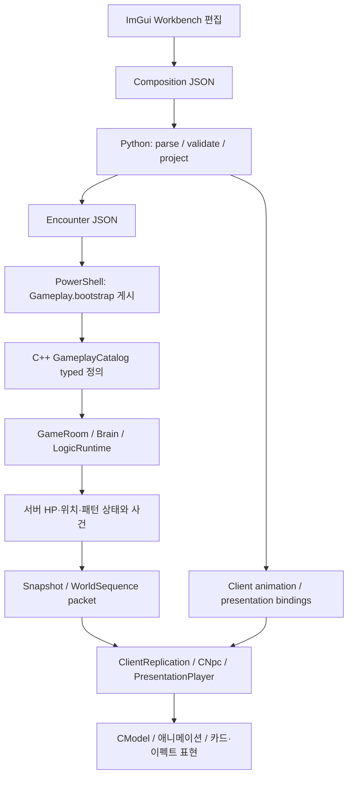

# 쿠크세이튼: 기술소개서에서 실제 패턴 실행까지 전체 학습 기록

2026-10-14 현재 저장본을 기준으로 기술소개서 9~12쪽의 질문을 실제 코드·데이터와 연결했다. PPT 44쪽을 텍스트로 읽었고, 제품 코드·저작 데이터·게시 데이터·PPT는 이 학습 작업에서 수정하지 않았다. 빌드와 Client 실행도 하지 않았다.

## 문서 구성과 읽는 순서

| 순서 | 문서 | 여기서 끝까지 확인할 내용 |
|---|---|---|
| 00 | [00 처음부터 읽기](C:/Users/tnest/Desktop/LostArk/.md/GB/10-14/2026-10-14_KOUKU_FULL_PATTERN_WALKTHROUGH_LEARNING_RESULT.md) | 전체 책임 분리, 실제 JSON 필드, 한글 이름/ID, stage와 시간, 관문·분신·빙고의 현재 범위 |
| 01 | [01 Python 파싱·투영](C:/Users/tnest/Desktop/LostArk/.md/GB/10-14/2026-10-14_KOUKU_JSON_PIPELINE_LEARNING_RESULT.md) | 실제 Python 원문, dict/list/index, 검증과 게시 후보, P1/P13 입력→Encounter 변환 |
| 02 | [02 Server 구조체·판정](C:/Users/tnest/Desktop/LostArk/.md/GB/10-14/2026-10-14_KOUKU_SERVER_RUNTIME_LEARNING_RESULT.md) | 게시 행 필드 순서, C++ 구조체 전체 핵심 정의와 역할, Catalog rollback, Brain/Logic/Room, packet |
| 03 | [03 Client 저작·애니메이션](C:/Users/tnest/Desktop/LostArk/.md/GB/10-14/2026-10-14_KOUKU_CLIENT_ANIMATION_LEARNING_RESULT.md) | ImGui 편집·저장·게시, snapshot→CNpc→CModel, source window/loop/blend/root/bone, 카드 motion |
| 04 | [04 Collider·좌표·피해](C:/Users/tnest/Desktop/LostArk/.md/GB/10-14/2026-10-14_KOUKU_COLLIDER_RUNTIME_LEARNING_RESULT.md) | 저작 anchor→서버 anchor, bone 표본, 최종 좌표, 접촉→피해/넉백, 실패 지점 구분 |
| 05 | [05 전체 패턴 지도](C:/Users/tnest/Desktop/LostArk/.md/GB/10-14/2026-10-14_KOUKU_PATTERN_ATLAS_LEARNING_RESULT.md) | 121패턴·573저장 stage·210 Logic 정의·11 bundle·4 Flow의 전체 항목과 실제값/사용처 |

본문의 원리를 읽은 뒤 05의 같은 patternId를 따라가면 각 패턴의 구체 clip·조건·결과를 확인할 수 있다. 05는 저장된 전체 항목 목록이며, 패턴 배열 순서와 실제 레이드 실행 순서를 구분한다. 210 Logic의 전체 원값은 각 ID 링크로 열 수 있다.



화살표는 객체 포인터를 프로세스 간 공유한다는 뜻이 아니다. 파일과 네트워크를 경계로 각각 다시 읽고, 해당 프로세스가 자기 자료구조와 실행 상태를 소유한다.

2026-10-14 현재 디스크의 코드·데이터와 기술소개서 정본을 기준으로 읽었다. 제품 코드·패턴·PPT는 수정하지 않았다. 앞서 준비한 세이튼/조커 랜덤 및 잡기 손 추적 후보는 현재 동작 설명에 섞지 않는다. 이 문서는 코드 학습 기록이며 사용자 이해나 제품 실행 검증을 완료했다고 판정하는 기록은 아니다.

## G00. PPT의 문장을 실제 구현과 맞춘다

현재 정본은 `C:/Users/tnest/Desktop/Interview/기술소개서/기술소개서.pptx`이고 44장이다. 쿠크 구조도는 9페이지, 파싱 설명은 10페이지, 시퀀서·기믹 질문은 11페이지, 반복·HP 조건과 설계의 질문은 12페이지다. 페이지 번호는 이번 읽기 시점 기준이다.

10페이지의 “Python에서 읽은 정보를 KoukuSaydon.cpp 내부 자료구조에 채운다”는 문장은 실제 경계를 건너뛴다. 다음 여섯 형태를 순서대로 구분해야 한다.

| 위치 | 그 시점의 실체 | 만들거나 읽는 주체 | 수명 |
|---|---|---|---|
| Composition 파일 | UTF-8 JSON bytes | Client 저작 도구가 저장 | 디스크에 보존 |
| Python 메모리 | 중첩된 dict/list/str/int/float/bool/None | load_json과 json.loads | 게시 도구 실행 동안 |
| Encounter·presentation 파일 | 실행용으로 변환한 JSON bytes | Python projector | 다음 게시까지 디스크에 보존 |
| Gameplay.bootstrap | 탭으로 필드를 구분하는 행 데이터 | PowerShell publisher | 배포된 실행 데이터 |
| Server 정의 | BOSS_PATTERN_DEFINITION과 내부 typed 구조체·vector | GameplayCatalog의 C++ parser | 해당 catalog generation 수명 |
| Server 실행 상태 | 보스 현재 stage/tick/sequence, logic ledger, 플레이어 HP·이동 | Brain, LogicRuntime, GameRoom | 각 보스·패턴 실행 수명 |

Python의 dict 주소가 C++에 전달되는 것이 아니다. Python 프로세스가 파일 bytes를 만들고, 별도 Server 프로세스가 그 bytes를 다시 읽어 자신의 메모리에 구조체를 만든다. Client도 별도 메모리에서 표현용 정의와 받은 사건·snapshot을 사용한다. Shared.lib는 양쪽에 링크되는 공통 코드·형식이며 두 프로세스가 같은 메모리 map을 공유한다는 뜻은 아니다.

PPT에 사용할 수 있는 현재 구조의 설명은 다음과 같다.

> ImGui에서 편집한 패턴과 시간 배치를 Composition JSON으로 저장한다. Python projector는 참조와 시간·좌표를 검증하고 Server용 Encounter와 Client 표현용 데이터를 만든다. 게시 도구가 Gameplay.bootstrap을 생성하면 Server의 GameplayCatalog가 이를 typed 정의로 로드한다. GameRoom은 30Hz에서 Brain의 단계 진행과 LogicRuntime의 판정을 조율하고, Client는 복제된 상태와 시각에 맞춰 모델·이펙트·월드 객체를 표현한다.

이 한 문장은 아래 전체 과정의 요약이다. 실제 이해는 각 행의 입력값이 다음 행의 어느 필드로 들어가는지 확인하는 것으로 진행한다.

## G01. 저장된 문서 전체의 역할

정본 [KoukuSaydonComposition.json](C:/Users/tnest/Desktop/LostArk/Data/KoukuSaydon/Gate1/KoukuSaydonComposition.json)의 root는 object다. 폴더가 Gate1이고 ID에 G1이 들어가도 현재 내용에는 GATE1·GATE2·GATE3·BINGO가 모두 있다. 관문 판정은 실제 gateId와 대상 보스 계약을 읽는다.

| root 필드 | 현재 값 또는 개수 | 필요한 이유 |
|---|---:|---|
| schema / formatVersion | lostark.kouku-saydon-composition / 3 | 어떤 문법·필드 계약으로 읽을지 확인 |
| revision | 2500 | 저작 저장본의 버전. 서버 tick이나 wire protocol 번호와 별개 |
| compositionId | boss.composition.koukusaydon.gate1 | 문서 identity |
| encounterId | ENCOUNTER_KOUKUSAYDON_G1 | 공유하는 보스 패턴 정의 묶음 |
| areaId | LV_LUT_MIDNIGHTC_ED | 배치·월드 자원 참조의 Area |
| fixedTickHz | 30 | 서버 시간 변환의 계약 |
| logics | 210 | 재사용할 조건·기믹·결과 정의 |
| summons | 9 | 소환 정의 |
| worlds | 81 | 월드 시퀀스 instance의 참조 정의 |
| presentationResources | 1139 | Collider·이펙트·소리 등 표현 자원 정의 |
| patterns | 121 | 패턴별 stage와 시간별 occurrence |
| bundles | 11 | 여러 패턴을 offset에 맞춰 함께 시작할 구성 |
| patternFlows | 4 | 각 관문의 패턴 순서·반복·HP 경계 |
| folders | 26 | 저작 도구의 목록 조직. 그 자체가 실행 순서인 것은 아님 |
| sceneProfiles | 2 | 패턴 중 사용하는 장면 설정 참조 |
| playAllPatternIds | 7 | Play All 저작 순서. 전체 raid flow와 구분 |
| madnessPolicy | maximum=100, clownHoldMs=15000 | 광기 상한과 광대 유지 시간의 게시 입력 |

nextPatternOrdinal·nextLogicOrdinal 등은 새 stable ID를 발급할 때 쓸 다음 번호다. 현재 배열 길이, 현재 실행 순서, 실행 횟수가 아니다. 삭제된 항목 때문에 번호에 빈칸이 생길 수 있다. 예를 들어 현재 nextPatternOrdinal=130인데 실제 패턴 개수는121이다.

관문별 저작 패턴은 GATE1 22, GATE2 29, GATE3 53, BINGO 17개다. 현재 Encounter에는 각각21·28·48·17개, 합114개가 있다. 빠진7개는 atlas에서 이유까지 읽는다. 숫자114가 114개 패턴 모두를 사용자 화면에서 검증했다는 뜻은 아니다.

## G02. 정의와 occurrence를 분리하는 이유

한 번 만든 “카드를 뒤집는 결과”를 여러 시간대와 패턴에서 사용하려면 결과 정의와 사용 시점을 나눠야 한다. logics의 한 행은 어떤 행동인지 정의하고, 패턴의 logicOccurrences 한 행은 어느 정의를 언제 어떤 결과 연결로 사용할지 정한다.

| 개념 | 예 | identity가 식별하는 것 |
|---|---|---|
| patternId | KOUKUSAYDON_G1_PATTERN_13 | 조커 찾기 패턴 정의 |
| logicId | koukusaydon.g1.logic.22 | 카드 뒤집기 접촉 조건 정의 |
| logic occurrenceId | KOUKUSAYDON_G1_PATTERN_13.logic.2 | 카드 뒤집기 조건을 첫 접촉 시각에 배치한 발생 |
| world occurrenceId | KOUKUSAYDON_G1_PATTERN_13.world.11 | 패턴 안에 등장한 특정 조커 객체 |
| motion instance ID | world.object.instance.kouku.joker_card_flip | 그 객체에 적용할 저장된 움직임 |
| displayName | 대형세이튼로직_카드뒤집기 | 사용자가 목록에서 읽는 이름 |

같은 logic.22 정의를 P13.logic.2, P13.logic.17, P13.logic.23이 서로 다른 시각에 참조한다. 정의 ID의 끝 숫자와 occurrence ID의 끝 숫자가 같을 필요가 없다. atlas에는 실제 occurrence ID와 시작 시각을 모두 쓴다.

정의가 있어도 아무 occurrence가 참조하지 않으면 해당 패턴의 시간축에 배치되지 않는다. occurrence가 disabled면 게시 시 제외될 수 있다. 반대로 같은 logicId를 두 occurrence가 참조하면 재사용하는 정의는 같지만 시작 시각·수명·실행 이력은 별개다.

한글 이름이 바뀌어도 같은 stable ID와 참조가 유지되면 연결 의미는 유지된다. “카드뒤집기”라는 한글을 분석해 C++ 함수를 만드는 구조가 아니다. triggerKind=OBJECT_CONTACT 같은 미리 정의된 종류를 parser가 enum으로 변환하고 C++의 해당 분기가 실행된다. 새로운 종류를 만들려면 저작 검증·projector·bootstrap writer/reader·runtime dispatcher와 필요한 표현 소비자를 함께 구현해야 한다.

## G03. JSON 문자가 Python 객체가 되는 순간

실제 진입 함수는 [project_kouku_saydon_composition.py의 load_json](C:/Users/tnest/Desktop/LostArk/Tools/KoukuSaydonPipeline/project_kouku_saydon_composition.py:392)이다. 핵심 호출은 다음과 같다.

```python
text = path.read_text(encoding="utf-8")
value = json.loads(text, object_pairs_hook=_reject_duplicate_pairs)
```

실제 함수는 publication session이 있으면 그 session이 고정한 bytes를 사용하고 재사용 cache를 확인한다. 위 두 줄은 session이 없는 경우의 읽기와 공통 parsing 호출을 보여준다. 구현에서 session 검사를 지워도 된다는 뜻이 아니다.

첫 줄은 파일 bytes를 UTF-8로 해석해 Python str을 만든다. 이때 아직 JSON object가 아니다. 둘째 줄은 중괄호·배열·문자열·숫자 등의 JSON 문법을 분석해 중첩 객체를 만든다.

| JSON 값 | Python 메모리 표현 | 실제 예 |
|---|---|---|
| object `{}` | dict | root 문서, 패턴 한 개, stage 한 개 |
| array `[]` | list | patterns, stages, animationOccurrences |
| string | str | patternId, runtimeClip, 한글 displayName |
| 정수 | int | durationMs=2267 |
| 소수 | float | 좌표·배율·playRate가 소수로 저장된 경우 |
| true / false | bool | enabled |
| null | None | null을 허용하는 필드가 실제 있는 경우 |

JSON은 키가 문자열인 트리 형태의 값이다. json.loads가 C++의 BOSS_PATTERN_DEFINITION을 자동으로 만드는 것은 아니다. `dict[str, Any]`는 Python의 타입 힌트이며 JSON 필드가 맞는지 자동 보증하지 않는다. 그 검사는 별도 validator가 한다.

한글 displayName도 JSON string이다. UTF-8 decoding 후 Python에서는 Unicode str로 보관한다. Python은 이를 다시 JSON으로 쓸 때 ensure_ascii=False와 UTF-8 encoding을 사용한다. C++에서는 parser가 읽은 문자열을 std::string 등에 보관하며, stable ID 조회와 화면 표시 소비를 구분한다.

`_reject_duplicate_pairs`가 필요한 이유는 `{"durationMs":100,"durationMs":500}`처럼 같은 키가 두 번 나온 파일을 조용히 마지막 값으로 받아들이지 않기 위해서다. 현재 load_json은 읽기/Unicode 오류, JSON 문법/중복 오류를 CompositionError로 바꾸고 root가 dict인지도 검사한다. 이후 필수 필드·값 범위·참조 대상·시간 범위·자원 제약을 검증한다.

## G04. dict와 list 안에서 실제 항목을 찾는다

다음은 이해를 위한 읽기 전용 예시다. 제품 publisher를 대체하는 코드가 아니다.

```python
patterns = document["patterns"]
pattern = next(row for row in patterns
               if row["patternId"] == "KOUKUSAYDON_G1_PATTERN_1")
stage = pattern["stages"][0]
animation = stage["animationOccurrences"][0]
clip_name = animation["runtimeClip"]
```

document는 root dict다. `document["patterns"]`는 list를 꺼낸다. next는 원하는 stable ID를 가진 dict 하나를 고른다. `[0]`은 그 list의 첫 원소를 고르는 접근이며 저장 ID가 아니다. stageId가 STAGE_43이어도 첫 원소일 수 있다. runtimeClip의 실제 값은 `rpct00_att_battle_6_04`다.

여러 logic occurrence가 정의를 반복 조회하므로 실제 project_encounter는 다음 검색 표를 만든다.

```python
logics = {logic["logicId"]: logic
          for logic in document.get("logics", [])}
worlds = {world["worldId"]: world
          for world in document.get("worlds", [])}

for box in source.get("logicOccurrences", []):
    if not box.get("enabled", True):
        continue
    logic = logics[box["logicId"]]
    kind = logic.get("judgementKind", logic.get("triggerKind"))
```

입력 JSON의 logics는 list지만 lookup용 logics는 ID→정의 dict다. 각 값은 정의 object에 대한 참조이며 이 comprehension만으로 모든 정의를 깊게 복사하지 않는다. 현재 occurrence의 logicId를 key로 lookup한 뒤 judgementKind/triggerKind를 읽는다. enabled가 없으면 True라는 기본값을 적용한다.

정의 수 L에 대해 이 dict 구성은 보통 O(L) 시간·추가 O(L) 참조 공간이다. 이후 Python dict lookup은 평균 O(1)이다. 전체 게시가 O(L)이라는 뜻은 아니다. 실제 게시에는 의존성 graph, 모델·본 표본화, 도형·시간 검증, JSON 직렬화 등의 별도 비용이 있다.

## G05. stage와 애니메이션을 실제 첫 패턴으로 읽는다

현재 P1의 표시 이름은 `세이튼_무력화 시작`이다. 첫 stage의 실제 데이터다.

```json
{
  "stageId": "STAGE_43",
  "actionId": "KOUKUSAYDON_G1_PATTERN_1.stage.43",
  "stageKind": "ACTIVE",
  "durationMs": 2267,
  "animationOccurrences": [
    {
      "occurrenceId": "KOUKUSAYDON_G1_PATTERN_1.animation.43",
      "profileId": "MN_RPCT_07",
      "sourceActionId": 4219945,
      "sourceStageId": "stage-004",
      "sourceSlotId": "animation-000",
      "referenceRevision": "6c04775d1325013e0ae83ba1dd33edcda5da3e765ff9698c538617a30cd7c98c",
      "runtimeClip": "rpct00_att_battle_6_04",
      "startOffsetMs": 0,
      "sourceStartMs": 0,
      "playMs": 2267,
      "playRate": 1,
      "endPolicy": "EXACT"
    }
  ]
}
```

| 필드 | 여기서 의미 |
|---|---|
| stageId | 이 패턴 안에서 stage를 식별하는 문자열. 숫자43순서로 실행한다는 뜻은 아님 |
| actionId | 이 stage의 제품 동작 identity. 원본 numeric sourceActionId와 구분 |
| stageKind | Server가 읽을 단계 종류. 이름만으로 damage가 생기지는 않음 |
| durationMs | 단계의 명시적 지속 시간 |
| animation occurrenceId | 이 stage에 놓인 특정 clip 사용 |
| profileId | clip을 가져온 애니메이션 참조 profile |
| sourceActionId / sourceStageId / sourceSlotId | 원본 Action 안에서 가져온 stage·slot의 출처 |
| referenceRevision | 참조 원본이 달라졌는지 확인할 정보 |
| runtimeClip | 실제 모델 애니메이션 목록에서 찾을 clip 이름 |
| startOffsetMs | 현재 stage 안에서 재생을 시작할 offset |
| sourceStartMs | clip 원본의 어느 시각부터 사용할지 |
| playMs | timeline에서 차지하는 재생 구간 |
| playRate | 원본 clip 시각이 흘러가는 배율 |
| endPolicy | 재생 구간 끝 처리의 저작 정책. 실제 clip 검증·binding 소비까지 함께 봐야 함 |

stage의 시간과 clip의 원본 시간은 다르다. 예를 들어 stage 안의 500ms에 시작하고 sourceStartMs=1000, playRate=2라면, 재생 시작 후 250ms의 원본 표본 시각은 1000+250×2=1500ms다. 이는 시간 좌표의 설명용 계산이며 현재 P1의 실제 값은 offset0/source0/rate1이다. loop/clip 끝/혼합 정책은 실제 consumer의 검증과 분기를 추가로 따른다.

현재 P1은 STAGE_43→51→53→54→55→52의 배열 순서다. 중간의 같은 clip을 네 번 배치했으며 마지막 stage ID가52라고 앞 stage로 돌아가는 것이 아니다. 패턴 명시 duration15156ms와 stage duration 합15135ms도 서로 다른 저장값이다. projector의 `_pattern_duration`은 명시 duration이0이 아니면 그것을 사용한다. 현재 fixedTimeline stage 진행은 각 stage 길이를 개별 tick 올림해서 더하지 않고 패턴 시작부터의 누적 ms 경계와 비교한다. 독립 occurrence의 수명과 stage 완료 시각은 별도로 읽는다. 21ms 차이가 생긴 편집 의도는 저장된 숫자만으로 단정하지 않는다.

현재 쿠크 `_project_stage`는 stage의 ID·종류·duration과 필요한 root-motion/retarget 데이터를 Server 쪽으로 옮기면서 stage hitShape를 NONE으로 만든다. 그 자체로 모든 stage가 무피해라는 뜻은 아니다. 실제 저작 Collider와 연결된 별도 Logic 판정창이 피해를 실행한다. 애니메이션 occurrence는 Client 표현용 projection에서 별도로 소비한다.

## G06. 같은 패턴의 Logic 시간축을 읽는다

P1의 실제 logic occurrence다.

```json
{
  "occurrenceId": "KOUKUSAYDON_G1_PATTERN_1.logic.1",
  "logicId": "koukusaydon.g1.logic.1",
  "startMs": 2263,
  "durationMs": 10684,
  "enabled": true,
  "onSuccessLogicIds": ["koukusaydon.g1.logic.7"],
  "onFailLogicIds": [],
  "onTimeoutLogicIds": ["koukusaydon.g1.logic.2"]
}
```

이 행만으로 성공 결과의 구체 행동을 알 수는 없다. logics에서 .1의 조건 정의, .7과 .2의 RESULT 정의를 각각 lookup해야 한다. startMs는 pattern 시작 기준이며 stage 안의 animation startOffsetMs와 기준이 다르다. 같은 시간 단위 ms라도 기준점을 함께 읽어야 한다.

project_encounter는 이 occurrence와 정의를 `_project_logic_window`에 전달한다. windowId에는 occurrenceId, kind에는 정의의 판단 종류, start/duration에는 배치의 시간을 넣는다. onSuccess/onFail/onTimeout의 RESULT ID들은 `_project_outcomes`가 실행용 결과 값으로 변환한다. 이후 cardRegions·contactTargets·움직임 표본처럼 종류별 추가 데이터가 붙는다.

논리 정의 전체를 하나의 한글 이름으로 dispatch하는 것이 아니다. 어떤 것은 LogicWindows, 어떤 것은 MechanicTriggers, 어떤 것은 추적/연출 제어로 나뉜다. 이 분리 결과와 실제 enum/dispatcher는 이어지는 Python·Server 절에서 원문 기준으로 확인한다.

## G07. 저장, projection, publish, 활성화는 다른 사건이다

Save는 현재 저작 문서를 저장한다. projection은 그 문서를 검증해 Encounter·Client 표현 데이터를 만든다. publish는 runtime 배치 경로에 파일을 만든다. Server 활성화는 catalog generation을 실제 방/패턴에서 채택하는 과정이다.

현재 Python `projected_outputs`는 `project_encounter`와 `project_presentation`을 호출하고, Sequence Composition이 있으면 `project_raid_gates` 결과를 Encounter에 붙인다. 출력형은 `dict[Path, bytes]`다. Path는 쓸 파일의 위치이고 bytes는 해당 파일 내용이다. 그래서 검증·파일 교체 전에 출력 전체를 준비할 수 있다.

현재 source의 authoringStatus가 DRAFT여도 publication 후보는 private deep copy를 만들어 검증한다. 최종 admission은 의존성과 실제 projection 성공 여부를 기준으로 한다. 원본 DRAFT 문자열을 PRODUCT로 직접 일괄 수정하는 과정과 혼동하지 않는다. 제외된 패턴은 생성 Encounter의 patternInventory 사유를 읽는다.

실행 중 패턴은 자신이 시작한 definition generation과 sequence를 함께 식별한다. 디스크에 새 파일을 썼다고 진행 중 공격이 중간에 다른 도형·결과 정의로 바뀌면 안 된다. 실패 시 이전 catalog/실행 상태 보존, 새 실행의 채택과 기존 실행의 pin 구분은 뒤 Server 절에서 확인한다.

## G08. 전체 설명을 읽는 순서

이후 본문은 실제 Python 변환, Server typed 구조와 실행, Client 애니메이션·표현 순서다. 별도 atlas에는121패턴, 개별 stage·clip, logic 배치, parent/bundle·flow 연결을 펼쳐놓았다. 본문의 공통 원리를 atlas의 각 행에 적용하면 같은 코드를121번 설명하지 않으면서도 각 패턴의 차이를 빠뜨리지 않을 수 있다.

한 패턴을 읽을 때의 종료 지점은 다음과 같다. 이름만 읽고 멈추지 말고 이 질문들에 실제 값을 대응시킨다.

1. 어느 관문·보스에서 어떤 ID의 패턴이 시작하는가?
2. stage는 어떤 순서와 시간으로 진행하며 각 animation은 어떤 원본 clip 시각을 쓰는가?
3. Logic 창은 pattern 시작 후 언제 열리고 어떤 region/target/input을 읽는가?
4. 조건의 성공·실패·시간 초과가 어느 RESULT로 이어지는가?
5. Server의 어느 상태가 바뀌고 어떤 사건·snapshot을 Client에 보내는가?
6. 완료·중단·사망·관문 이동 때 누가 객체와 ledger를 정리하며 다음 패턴을 고르는가?

이것은 사용자의 이해도를 시험하는 목록이 아니라 파일과 breakpoint를 따라갈 때 빠진 연결을 찾는 기준이다.

## G09. 자세한 코드 설명으로 이어지는 연결

[01 Python 파싱·투영](C:/Users/tnest/Desktop/LostArk/.md/GB/10-14/2026-10-14_KOUKU_JSON_PIPELINE_LEARNING_RESULT.md)의 P13 첫 접촉(4858ms)과 [02 Server 구조체·판정](C:/Users/tnest/Desktop/LostArk/.md/GB/10-14/2026-10-14_KOUKU_SERVER_RUNTIME_LEARNING_RESULT.md)의 세 번째 접촉(20205ms)은 같은 L22/L23 정의를 재사용한 서로 다른 occurrence다. 시간과 occurrence 번호를 혼동하지 않는다. 이후 [03 Client 저작·애니메이션](C:/Users/tnest/Desktop/LostArk/.md/GB/10-14/2026-10-14_KOUKU_CLIENT_ANIMATION_LEARNING_RESULT.md)의 G10에서 실제 카드 하나의 flip clip까지 이어진다.

손·뿅망치의 저작 UI는 [03 Client 저작·애니메이션](C:/Users/tnest/Desktop/LostArk/.md/GB/10-14/2026-10-14_KOUKU_CLIENT_ANIMATION_LEARNING_RESULT.md) G13, 서버 표본과 최종 피해는 [04 Collider·좌표·피해](C:/Users/tnest/Desktop/LostArk/.md/GB/10-14/2026-10-14_KOUKU_COLLIDER_RUNTIME_LEARNING_RESULT.md)에서 이어 읽는다.

## G10. 네 방향 이동과 중앙 응시의 현재 적용 범위

2026-10-14 현재 코드와 Composition/Encounter 저장값을 읽었다. 아래 네 패턴 모두에 공통으로 네 방향 이동을 미리 계산하는 기능이 적용되어 있다고 설명하면 틀린다.

| 대상 | 현재 데이터 | 실제 위치·방향 처리 |
|---|---|---|
| P2 세이튼_진짜세이튼찾기 | REAL_GAZE_TELEPORT, start1988ms, clone P5, clockHours=[4,7,10], faceCenterYawOffset=-90 | 본체는 저작 teleportPosition에 고정된다. 그 점을 상대 1시 기준으로 삼아 같은 원의 4/7/10시 가짜 위치를 계산한다. 네 자리에서 본체 하나를 무작위 선택하는 코드는 현재 제품에 없다. |
| P7 세이튼_룰렛 | duration34000ms, resetBossToSpawn=true, resetBossYawDegrees=237, mechanicTriggers 없음 | 시작 때 spawn으로 복귀하고 yaw237을 적용한다. 3개의 ROULETTE_CARD_MATCH와 마지막 영역 판정이 있다. 네 방향 후보 이동이나 매 tick 중앙 응시를 이 패턴이 요청하지 않는다. |
| P48 세이튼_빙글빙글돌며카드던지기 | resetBossToSpawn=false, PURSUIT_PROJECTILES, homing=false, countPerWave6, speed8m/s, interval300ms, lifetime5000ms, maxDistance15m | 보스의 네 방향 이동이 아니라 카드 발사 방향·이동을 처리한다. homing=false인 현재 값은 각 ordinal의 결정적 sample을 360도로 바꾸는 방향 분기를 사용한다. |
| P103 세이튼_카드비 | resetBossToSpawn=false, CARD_RAIN_SOLDIERS count=[3,3,3], spawn반경3~10m, 별도 SHOWTIME_PLAYER_TARGETS/randomVolley | 병정 소환과 낙하 카드의 랜덤 지점을 처리한다. 낙하 반경15m, 간격500ms, randomAnchorKind=BOSS다. 보스를 네 방향 중 하나로 이동시키거나 중앙을 계속 보게 하는 요청은 없다. |

### P2가 실제로 계산하는 것

[GameRoom_KoukuMechanics.cpp:1115](C:/Users/tnest/Desktop/LostArk/Server/Private/GameRoom_KoukuMechanics.cpp:1115)에서 `dx,dz = teleportPosition - owner.spawnPosition`, `radius = sqrt(dx²+dz²)`, `anchor = atan2(dx,dz)`를 구한다.
[1130](C:/Users/tnest/Desktop/LostArk/Server/Private/GameRoom_KoukuMechanics.cpp:1130)의 가짜 loop는 `angle = anchor + (hour - 1) × π/6`을 사용한다. 따라서 [4,7,10]은 기준점에서 각각90/180/270도 차이다. 이는 저작 기준의 상대 시계 방향이며 월드의 고정 북쪽을 12시로 강제하지 않는다.
가짜 위치는 `spawn + (sin(angle),cos(angle)) × radius`, yaw는 `atan2(spawnX-x,spawnZ-z) × 180/π - 90`이다. -90은 이 모델의 앞 방향과 atan2 yaw 기준을 맞추는 저작 offset이다.
세 가짜의 생성·navigation·pattern 시작이 모두 준비된 뒤 [1181~1193](C:/Users/tnest/Desktop/LostArk/Server/Private/GameRoom_KoukuMechanics.cpp:1181)에서 본체를 `[0.604172031,1.3,729.87770021]`로 옮기고 같은 중앙 기준 yaw를 적용한다. 실패하면 본체/배우 배치를 commit하지 않는다.
본체 P2는 `rpct00_att_battle_20_05`, 가짜 P5는 대응 구간에서 `rpct00_att_battle_20_06`을 재생한다. 둘의 다르게 도는 표현은 서로 다른 저작 clip 선택이다. 위치 계산에서 yaw 부호만 반대로 바꿔 가짜 회전을 만드는 코드로 설명하면 안 된다. 실제 화면상 회전은 사용자 확인 범위다.

### 네 방향 이동의 도착점을 미리 계산하는 다른 경로

[CKoukuSaydonBrain::Select_CrossDirection:1043](C:/Users/tnest/Desktop/LostArk/Server/Private/KoukuSaydonBrain.cpp:1043)은 `CROSS_DIRECTION_CLONES` 전용이다.
네 자식 패턴 각각의 cloneEndStage까지 root-motion forward/lateral 변위를 더하고, 현재 owner yaw·위치로 월드 XZ에 옮긴다. [1104~1118](C:/Users/tnest/Desktop/LostArk/Server/Private/KoukuSaydonBrain.cpp:1104)에서 그 예상 도착점과 owner.spawnPosition의 제곱 거리를 비교해 가장 가까운 후보를 고른다.
이것은 네 방향 중 무작위 본체 선택이 아니다. 같은 거리에서는 저작 후보 순서를 유지하고, 명시 realPatternId가 있으면 [1121](C:/Users/tnest/Desktop/LostArk/Server/Private/KoukuSaydonBrain.cpp:1121)에서 그 선택이 우선한다.
현재 Encounter에서 이 trigger를 사용하는 직접 패턴은 P52(자식 P50/P53/P54/P55)와 P66(자식 P67/P68/P69/P70)이다. P2/P7/P48/P103과 동일한 기능으로 묶지 않는다.
[GameRoom_KoukuMechanics.cpp:634](C:/Users/tnest/Desktop/LostArk/Server/Private/GameRoom_KoukuMechanics.cpp:634)가 해당 선택 결과와 나머지 가짜 배우를 stage한 뒤 commit한다.

### 중앙 응시와 일반 이동은 별도 책임이다

일반 `BOSS_TELEPORT_FACE_CENTER`의 순간이동/중앙 응시는 [GameRoom_KoukuMechanics.cpp:545](C:/Users/tnest/Desktop/LostArk/Server/Private/GameRoom_KoukuMechanics.cpp:545)와 [607](C:/Users/tnest/Desktop/LostArk/Server/Private/GameRoom_KoukuMechanics.cpp:607)에 있다. 네 대상 패턴이 모두 이 trigger를 사용하는 것은 아니다.
P7의 spawn reset은 [GameRoom_KoukuAudition.cpp:1119](C:/Users/tnest/Desktop/LostArk/Server/Private/GameRoom_KoukuAudition.cpp:1119)에서 staged boss에 적용한다. stage root motion은 [1580](C:/Users/tnest/Desktop/LostArk/Server/Private/GameRoom_KoukuAudition.cpp:1580)의 공통 경로로 실제 보스 위치를 진행시킨다.
P48 카드 방향은 [GameRoom_KoukuTargeting.cpp:294](C:/Users/tnest/Desktop/LostArk/Server/Private/GameRoom_KoukuTargeting.cpp:294)의 homing/비homing 분기이고, P103 병정은 [GameRoom_KoukuMechanics.cpp:747](C:/Users/tnest/Desktop/LostArk/Server/Private/GameRoom_KoukuMechanics.cpp:747)에서 `Spawn_KoukuCardRainSoldiers`로 넘긴다.

### 제안과 현재 적용 구분

이전에 작성한 [수동 랜덤 구현 후보](C:/Users/tnest/Desktop/LostArk/out/BossSimulationRefactor20261014/manual-random/MANUAL_RANDOM_NOTES.md)의 P2 네 위치 중 본체 선택은 학습용 제안이다. 현재 제품의 고정 본체 분기와 혼동하지 않는다.
이번 작업은 전체 패턴 이해용 읽기 조사와 out 문서 작성만 했다. 네 방향 위치·중앙 yaw를 유지하는 랜덤 변경이나 실제 플레이 검증을 완료했다고 기록하지 않는다.

## G11. 반복·관문·빙고는 어느 상태가 소유하는가

### 1. 반복이라고 부르는 서로 다른 실행

| 반복의 단위 | 저장/실행 위치 | 실제 의미 |
|---|---|---|
| clip 원본 구간 반복 | animation binding의 endPolicy와 Client source-window 재생 | 같은 동작을 화면에서 반복한다. 그 자체로 서버 판정을 다시 열지 않는다. |
| 같은 clip을 가진 여러 stage | patterns[].stages 배열 | 각 stage마다 별도의 action/time 경계를 가진다. P1 중간 네 stage가 이 사례다. |
| 접촉 결과 재실행 | logic 정의의 rearmOnExit/repeatAfterKnockback/repeatIntervalMs와 window state | 동일 판정창에서 플레이어/대상별 실행 이력을 검사하며 다시 결과를 허용한다. |
| 여러 패턴 동시 실행 | bundles[].members와 startOffsetMs | 여러 owner의 패턴을 공통 시작 기준에 맞춘다. 동일 패턴의 loop가 아니다. |
| parent 안의 child 패턴 | patternOccurrences와 presentation/logic 투영 | 부모 시간에 child 사용을 배치한다. 실행에 필요한 stage/occurrence ID와 시간도 파생한다. |
| 관문 일반 패턴 반복 | patternFlows의 entryGroups/repeatUntilHealthBars | 패턴 완료 후 다음 entry를 고를 때 HP 경계를 검사한다. |
| 빙고 일반 순서 재시작 | loopStartEntryId | 마지막 entry 뒤 지정 entry로 돌아간다. 보드 시작을 매번 반복할 필요가 없다. |
| 빙고 특수 패턴 삽입 | bingoSpecialPatternId와 bSpecialPatternPending | 보드 진행에 맞춰 특수 패턴을 실행하고 중단했던 일반 entry를 다시 시작한다. |

따라서 “repeat라는 bool 하나로 모든 패턴을 처리한다”는 설명은 현재 코드와 다르다. 정의의 반복 설정과 현재 실행 횟수/소비 여부도 분리돼 있다. bool은 특정 상태를 기억하는 데 쓰이며, 다음 상태를 결정하는 조건·시각·ID와 함께 읽는다.

### 2. 관문 Flow의 실제 완료 처리

[GameRoom_KoukuRaidFlow.cpp](C:/Users/tnest/Desktop/LostArk/Server/Private/GameRoom_KoukuRaidFlow.cpp:791)에서 entry가 실행 중이었는데 audition 실행이 INACTIVE가 되면 완료 receipt를 확인한다. room audition epoch가 맞고 lifecycle이 COMPLETED여야 정상 완료다. 실패를 성공으로 간주하고 다음 패턴으로 넘어가지 않는다.

정상 완료 후에는 현재 entry의 waitAfterMs를 tick으로 바꾸고 `Resolve_NextCompletedEntry`에 현재 HP·최대 HP·최대 체력줄 수를 전달한다. 그 함수의 반환 index가 다음 entry다. 전체 목록 끝이면 loopStartEntryId를 stable ID로 찾아 되돌아간다. 데이터에 없는 loop 시작점이면 레이드를 중단하고 원인을 남긴다.

`transitionAt=PATTERN_END`인 그룹은 HP 경계를 넘었다고 현재 공격을 즉시 다른 공격으로 교체한다는 뜻이 아니다. 현재 entry의 완료 지점에서 전환하는 계약이다. 무력화 성공의 followup, 일반 HP 그룹의 완료 전환, 빙고 특수 패턴 삽입은 서로 다른 요청 경로다. 소개서에서는 각각의 전환 조건을 구분해 설명해야 한다.

카드 미로가 진행 중이면 `WAIT_MINIGAME` 상태로 전환하고 다음 일반 entry 시작을 막는다. 미로 진입 후 역할 배정이 아직 안 끝났더라도 player의 Area HUD ownership을 함께 검사해 너무 일찍 일반 전투로 복귀하지 않는다. 코드 근거는 [mazeActive 계산](C:/Users/tnest/Desktop/LostArk/Server/Private/GameRoom_KoukuRaidFlow.cpp:780)이다.

### 3. 빙고는 25개 bool 대신 25비트 보드를 사용한다

현재 공통 좌표 정의는 [PacketMessages.h](C:/Users/tnest/Desktop/LostArk/Shared/Public/Network/PacketMessages.h:1155)에 있다.

```text
SIDE = 5
cell = row * 5 + column
cell center X = -6.08 + column * 3.04  (m)
cell center Z = 1140.8 + row * 3.04    (m)
bit for cell = 1u << cell
```

row는 +Z, column은 +X 방향이다. ORIGIN은 보드 바깥 모서리가 아니라 cell0의 중심이다. 월드 좌표를 칸 index로 바꿀 때 반 칸을 더한 뒤 범위를 검사하는 이유가 여기에 있다. 범위 밖/NaN은 OFF_BOARD를 반환한다.

보드 실행 상태의 소유자는 CGameRoom의 `m_KoukuBingo`다. [CKoukuBingoRuntime](C:/Users/tnest/Desktop/LostArk/Server/Public/KoukuSaydonLogicRuntime.h:292)은 다음 세 mask를 구분한다.

| 상태 | 의미 |
|---|---|
| m_iWhiteMask | 현재 해골 칸 전체. red 칸도 포함한다. |
| m_iRedMask | 완성된 행·열에 속해 이후 폭발로 지우지 않는 칸 |
| m_iConsumedLineMask | 완성 보상을 이미 소비한 줄. 칸 mask와 다른 단위다. |

완성 줄을 판정하는 실제 코드는 다음과 같다. [Promote_Lines](C:/Users/tnest/Desktop/LostArk/Server/Private/KoukuSaydonLogicRuntime.cpp:2639)에서 가져온 핵심이다.

```cpp
for (std::int32_t line = 0; line < KOUKU_BINGO_SIDE * 2; ++line)
{
    const std::uint32_t lineMask = Kouku_BingoLineMask(line);
    if (0u != lineMask && lineMask == (m_iWhiteMask & lineMask))
        m_iRedMask |= lineMask;
}
```

`white & lineMask`는 그 줄에서 현재 채워진 칸만 남긴다. 결과가 lineMask와 같으면 그 줄의 다섯 칸이 모두 채워졌다. OR 연산으로 해당 칸을 red에 보존한다.

Shared의 `KOUKU_BINGO_LINE_COUNT=12`와 `Kouku_BingoLineMask`는 대각선 두 개도 표현할 수 있다. 그러나 현재 Server의 Promote_Lines/Count_CompletedRowsAndColumns/Consume_CompletedRowsAndColumns는 `SIDE*2`, 즉 행5+열5만 순회한다. 공통 상수나 주석 한 줄만 보고 현재 제품 판정에 대각선까지 포함된다고 설명하면 안 된다.

폭발은 [Detonate](C:/Users/tnest/Desktop/LostArk/Server/Private/KoukuSaydonLogicRuntime.cpp:2657)의 다음 연산이다.

```cpp
const std::uint32_t affected =
    (cellMask & KOUKU_BINGO_ALL_CELLS_MASK) & ~m_iRedMask;
m_iWhiteMask ^= affected;
Promote_Lines();
```

먼저 유효한 25칸만 남기고 red를 제외한다. XOR는 영향받은 칸의 0/1을 뒤집는다. 빈 칸은 해골이 되고 기존 일반 해골은 사라진다. 이후 새로 완성된 줄을 승격한다. 폭탄의 cellMask는 중심+상하좌우 인접 칸이며, 가장자리에서는 보드 밖 이웃을 제외한다.

### 4. 폭탄 하나의 생명주기와 Server 시간

[GameRoom_KoukuPlayerCommands.cpp](C:/Users/tnest/Desktop/LostArk/Server/Private/GameRoom_KoukuPlayerCommands.cpp:384)가 room tick에서 보드를 진행시킨다. BOMB 슬롯에는 carrier entity ID, phase, 위치, mark ordinal, plant/detonate tick, drop delay/fuse 시간이 값으로 들어간다. 플레이어 포인터를 장기간 붙잡아 두는 방식이 아니다.

1. 활성 보드의 다음 표식 tick에 살아 있고 보드 안에 있는 인간 플레이어 후보를 모은다.
2. Server tick/pattern sequence로 선택한 carrier ID를 `Start_Bomb`에 보낸다. 빈 슬롯이 없거나 동일 carrier의 MARKED가 이미 있으면 시작을 거절한다.
3. MARKED 동안 실제 player를 다시 찾는다. 죽거나 퇴장한 carrier라면 해당 표식을 취소한다.
4. 표식 종료 tick에 carrier의 현재 월드 위치가 속한 칸을 계산하고 그 칸 중심을 저장한다. 보드 밖이면 취소한다.
5. `Queue_BombPlant`로 낙하 지연 종료 tick을 예약한다.
6. 그 tick에 `Plant_Bomb`로 PLANTED로 바꾸고 fuse 종료 tick을 계산한다. WorldSequence 재생 사건도 보낸다.
7. fuse 종료 tick에 CrossMask로 보드를 뒤집고 새 완성 줄을 검사한다.
8. 미소비 완성 줄을 정의된 threshold만큼 소비해 OnSuccess의 무적 결과를 적용한다. 이미 소비한 같은 줄로 매 tick 보상을 반복하지 않는다.
9. 매 세 번째 표식의 폭발 시점에는 이번 구간의 줄 보상 성공 여부를 관련 logic ledger에 전달한다. 완료된 슬롯을 비운다.

상수의 기본 시간과 저장된 board settings는 구분한다. 실제 폭탄은 시작할 때 dropDelay/fuse 시간을 캡처하므로 뒤의 설정 변화가 이미 대기 중인 폭탄의 시간을 바꾸지 않는다. 화면의 폭탄 모델이 사라졌다는 이유로 서버 폭탄 판정이 완료됐다고 판단하지 않는다.

### 5. 일반 패턴과 별개로 유지되는 보드

[RaidFlow의 보드 시작](C:/Users/tnest/Desktop/LostArk/Server/Private/GameRoom_KoukuRaidFlow.cpp:756)은 BINGO 보드 owner가 없을 때 게시 패턴의 BINGO_BOARD mechanic trigger를 찾는다. 필요한 authored geometry를 확인하고 보드 duration을 시작한다. 비활성 저작 행이 투영에서 빠지면 일반 Flow와 선택적 보드 controller의 존재도 구분한다.

보드 시계는 일반 공격 패턴이 바뀔 때마다 초기화되지 않는다. 그래야 일반 공격을 하면서 표식·망치·폭발이 계속 진행된다. GameRoom이 board state와 현재 일반 pattern state를 별도로 소유하는 구조적 이유다.

특수 패턴 완료 후 [bBingoSpecialRunning 처리](C:/Users/tnest/Desktop/LostArk/Server/Private/GameRoom_KoukuRaidFlow.cpp:805)는 이를 해제하고 다음 tick에 중단했던 일반 entry를 다시 시작하도록 예약한다. 일반 entry를 완료한 것으로 건너뛰지 않는다. 보드 snapshot은 [GameRoom_Replication.cpp](C:/Users/tnest/Desktop/LostArk/Server/Private/GameRoom_Replication.cpp:859)가 white/red mask와 폭탄/망치 상태로 만든다.

### 6. 이 설계가 제공하는 것과 C++로 남아 있는 것

데이터로 바꿀 수 있는 것은 이미 구현된 kind의 수치·시간·대상·결과 연결·패턴 조합이다. JSON에 새로운 한글 이름을 쓰는 것으로 새로운 알고리즘이 생기지는 않는다. 룰렛의 방향 판정, 무력화 누적, 미로 역할, 보드 XOR, 물리 접촉, 피해·넉백 상태 전환은 C++ 구현이 담당한다.

이 분리로 동일한 접촉/결과 동작을 여러 패턴이 재사용하고, 저작 변경을 빌드 없이 게시할 수 있다. 대신 저작 schema, Python 검증/투영, bootstrap 행 계약, C++ parser, runtime enum/분기, Client 표현의 연결을 유지해야 한다. 여러 시간축과 좌표 기준을 명시해야 하며, 저장 성공·게시 성공·실제 Server 채택·사용자 화면 확인은 별개 증거다.

이번 설명은 현재 소스와 저장 데이터를 읽은 결과다. 새로운 키보드 연속 입력이나 Space UI 기믹을 구현·검증한 것으로 기록하지 않는다.

## G12. 소개서에 반영할 설명과 확인 범위

9쪽의 Data/Tools/Client/Server/Shared/Engine 책임 구분은 실제 파일과 연결해 설명할 수 있다. 10쪽의 “Python이 KoukuSaydon.cpp 내부 자료구조를 채운다”는 표현은 프로세스와 로드 단계를 생략하므로 G00의 문장으로 고쳐 설명한다. 11쪽의 stage/animation/관문 설명은 01~03과 전체 atlas를, 12쪽의 반복/조건/중단은 Server 실행 절과 G11을 근거로 삼는다. 이번 작업에서는 PPT 문구 자체를 저장하지 않았다.

확인한 것은 현재 소스·저장값·설치 bootstrap의 구조와 연결, P13 순수 dict 투영 단계의 비교다. 121개 패턴 모두의 실제 화면·피해 성공을 실행 검증한 것은 아니다. 이전 수동 구현 후보는 현재 제품 코드와 구분했다. 사용자 개인 기여의 범위도 코드 존재만으로 단정하지 않는다.

자료의 행 번호는 조사 시점 기준이다. 이후 편집으로 이동했다면 문서의 실제 함수명·stable ID로 검색한다. 현재 source revision=2500이며 전체 저작121개 중 Encounter114개, 제외7개 사유는 01과05에 보존했다.

- [PPT 텍스트·파일 지문](C:/Users/tnest/Desktop/LostArk/out/KoukuFullLearning20261014/ppt_source.json)
- [전체 데이터 추출·입력 지문 검증](C:/Users/tnest/Desktop/LostArk/out/KoukuFullLearning20261014/inventory_validation.json)
- [최종 문서 검증](C:/Users/tnest/Desktop/LostArk/out/KoukuFullLearning20261014/learning_validation.json)
- [앞선 구조 분리의 별도 빌드 기록](C:/Users/tnest/Desktop/LostArk/.md/GB/10-14/2026-10-14_BOSS_SIMULATION_RESPONSIBILITY_SPLIT_RESULT.md)
