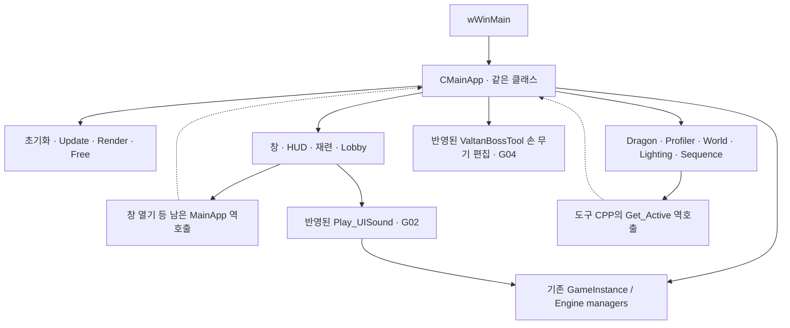
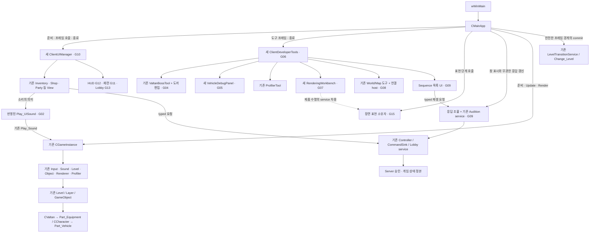
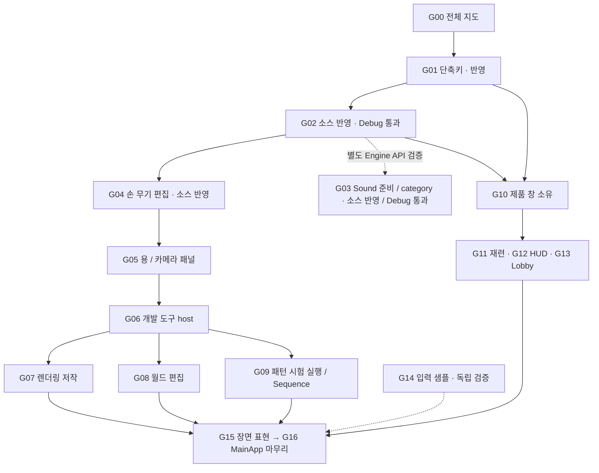
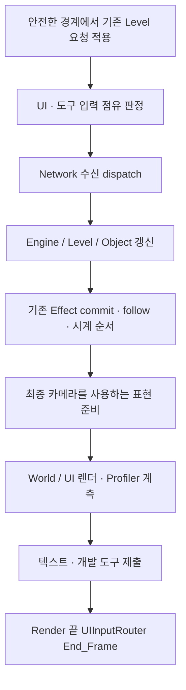
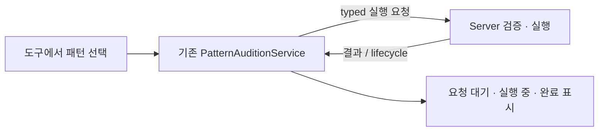

# G00 MainApp 구조와 G01~G10 의존성 지도

> G05 Dragon부터 G16까지의 최신 소유 관계·단계별 추가/교체 위치·전체 H/CPP·프로젝트 등록 코드는 [통합 구현 PLAN](../10-15/2026-10-15_MAINAPP_G05_G16_INTEGRATED_IMPLEMENTATION_PLAN.md) 한 파일에 모았다. G01~G04의 실제 반영 기록은 유지하며, G05~G16은 제품 미반영 후보다. 이 지도는 배경 설명이고 직접 구현할 코드의 정본은 통합 PLAN이다.

작성일: 2026-10-14. 실제 코드와 [전체 리팩터링 설계](2026-10-14_MAINAPP_RESPONSIBILITY_REFACTOR_DESIGN.md)를 연결하는 읽기 지도다.
기존 단계 번호를 유지한다. G00은 새 코드 단계가 아니라 전체 지도이며, G01은 반영 완료,
[G02 UI 사운드](2026-10-14_MAINAPP_G02_UI_SOUND_PLAN.md)는 소스 반영과 2026-10-15 00시대 Debug Product 빌드·링크를 확인했다.
실행·수동 청취는 미검증이며 [G02 RESULT](2026-10-14_MAINAPP_G02_UI_SOUND_RESULT.md)에 기록했다.
G03은 사용자 구현을 검토·보정해 Debug Product 빌드·링크와 반환값 검사 9건을 통과했다.
[G03 RESULT](../10-15/2026-10-15_MAINAPP_G03_SOUND_PREPARATION_RESULT.md)에 실제 검증과 남은 청취·UI 확인을 구분했다.
[G03 음원 준비 PLAN](../10-15/2026-10-15_MAINAPP_G03_SOUND_PREPARATION_PLAN.md)은 변경 위치·코드를 먼저, 전체 코드를 뒤에 둔다.
G04 손 무기 소켓 편집은 기존 BossTool로 제품 소스 반영을 마쳤다. [G04 RESULT](../10-15/2026-10-15_MAINAPP_G04_VALTAN_AXE_RESULT.md)에 검증 범위를 기록한다. G05~G16은 통합 PLAN에 전체 미적용 후보를 작성했고, 구 G06-a는 통합 G06에 포함됐다.
G11~G16은 전체 구조에서 빠진 기능이 아니라 뒤에 이어지는 기존 단계다.

## 현재 구조: CPP 분리와 책임 분리의 차이

MainApp.cpp와 남아 있는 MainApp_* CPP는 모두 같은 CMainApp의 멤버 구현이다. G04의 손 무기 편집은 ValtanBossTool_Axe.cpp로 옮겼다.
파일을 나눴어도 같은 헤더·멤버·수명을 공유하며 창 열기와 도구 연결은 여전히 MainApp으로 역호출한다.
G02의 UI 사운드 선택은 별도 함수로 이동했으며 음원 때문에 MainApp을 참조하던 경계는 제거됐다.

이 그림은 현재 의존의 문제를 요약한다. 각 UI와 도구 자체 클래스가 없는 것은 아니다.
이미 있는 객체 위에 선택·연결·상태·저장 처리가 MainApp에 누적된 부분을 옮긴다.

## 목표 구조: MainApp은 시작·순서·전환·종료를 읽는 곳

다음은 제안 구조다. 화살표는 표시된 호출 또는 차용을 뜻하며, 모든 대상의 독점 소유를 뜻하지 않는다.
`새` 표기는 아직 제품에 존재하지 않는 제안 소유자다.

도끼/탈것 실제 객체는 기존 GameObject 경로에 남는다. 편집·Save·Publish UI가 Tools로 이동한다.
Sound는 새 런타임 없이 기존 Sound Manager를 사용한다. Profiler 측정도 기존 Engine Profiler를 사용한다.
자료 구조를 추출하며 Server의 게임 상태를 Client에 새 정본으로 복제하지 않는다.

## G00~G10 단계별 목적지와 의존성

| 단계 | 현재 읽을 코드 | 옮길 책임과 상태 | 목적지 / 의존 | 완료 기준 |
|---|---|---|---|---|
| G00 | MainApp.h, MainApp*.cpp | 전체 책임 지도 | 문서만 | 함수·상태·소유자와 다음 경계 설명 가능 |
| G01 | Update의 I/P/N/M 블록 | 처리와 숨김 중 키 상태 기록 | 기존 MainApp helper | 중복 없음, 기존 순서 보존. 소스 반영됨 |
| G02 | UISoundPlayer, 네 창·UI 호출자 | 네 cue → WAV 선택 | 반영된 UISoundPlayer → 기존 GameInstance/Sound | 소스 반영·Debug Product 통과, 수동 청취 미검증 |
| G03 | Sound_Manager, GameInstance, UI 초기화 | 명시적 준비와 category | 기존 cache + Client의 준비 목록 | cache 재사용·실패 정책·volume/focus 보존 |
| G04 | ValtanBossTool_Axe.cpp | 손 무기 소켓 draft·선택·preview·Save/Publish | 기존 ValtanBossTool / BalanceTool / ActorCatalog | 소스 반영, MainApp의 axe 함수·옛 TU 등록 제거. 검증은 G04 RESULT |
| G05 | MainApp_Dragon.cpp | 속도 draft·baseline·publisher HANDLE·poll | 새 VehicleDebugPanel + 작은 CameraDebugControls | 요청·저장과 기존 Render polling 시점을 보존 |
| G06 | Ready/Ensure/Close/RenderDebugTools, _Profiler | 도구 보유·lazy 준비·focus·preview 소유 | 새 ClientDeveloperTools + 기존 도구 | MainApp callback 역의존 축소, 수명 정리 |
| G07 | MainApp_RenderingLighting.cpp | 저작 draft·선택·preview 복원 | 새 RenderingWorkbench, 제품 service 차용 | 제품 환경 소유와 저작 preview 구분 |
| G08 | MainApp_WorldLevel.cpp, MapTool, WorldSceneTool | pick·상세·도구 간 편집 양도 | 기존 도구 + 작은 WorldAuthoringHost | 선택만으로 편집 안 함, 기존 저장/부분 로드 보존 |
| G09 | MainApp_SequenceViewer.cpp, CompletePlay | 요청번호·응답 분배·재생 세션·목록 UI | 단일 coordinator + 기존 Audition service | 공유 큐 단일 소비, 이전 world/취소 결과 격리 |
| G10 | 창 함수, Update_CombatHUD 일부, Bern NPC 호출 | 창 생성/닫힘 순서·입력 점유·명령 연결 | 새 ClientUIManager + 기존 router/controller/view | MainApp의 창 상태·UI 열기 역호출 이관 |

각 목적지는 함수뿐 아니라 지속 상태, 초기화, 실패 처리, background 작업, callback 종료를 함께 받는다.
한 함수에 여러 책임이 섞여 있으면 내부를 나눈 뒤 이동한다. 특히 Update_CombatHUD를 통째로 HUD 클래스로 옮기지 않는다.

## 수정 순서와 실행 중 의존은 다르다

아래 화살표는 권장 작업 순서와 통합 시점이다. G04가 실행 중 G02를 호출한다는 뜻이 아니다.

G03은 G04 이후의 선행 조건이 아니다. G14 역시 함수·상태 이동을 먼저 진행하는 것을 막지 않는다.
G07~G09와 제품 UI 단계는 개념상 분리할 수 있지만 같은 MainApp.h/cpp를 수정하므로 실제 적용은 작은 단위로 합친다.
G10 이전에도 G02의 함수는 현재 MainApp과 각 View가 직접 호출할 수 있다.

## 프레임 순서에서 유지할 경계

다음은 단계 위치를 이해하기 위한 개념도다. 그대로 복사할 Update 코드는 아니다.

실제 Change_Level의 적용 지점과 프레임 중 추가 요청 처리는 현재 코드를 기준으로 보존한다.
G14 전에는 Input_Device 샘플이 기존 Engine Update 안에 있다. 그림 앞에 입력 sample을 추가하는 것만으로
키보드·마우스·문자·wheel의 모든 입력 계약이 해결되지 않는다.

## 파일·의존성 이동을 끝냈다는 기준

1. H의 지속 상태와 CPP 구현이 같은 목적지에 있다.
2. MainApp은 해당 기능의 내부 데이터 대신 좁은 호출 계약만 안다.
3. 직접 소비자도 바뀌어 이전 MainApp 정적 함수/Get_Active 호출이 남지 않는다.
4. 기존 runtime·cache·catalog·publisher와 Server 권위를 재사용한다.
5. 새 CPP는 물리 파일과 vcxproj/filter에 등록되고, 옛 TU는 책임이 모두 빠졌을 때 제거된다.
6. compile/link와 실제 입력·저장·취소·전환·종료·화면 검증을 구분해 기록한다.

## Audition의 이 코드에서의 뜻

Audition은 여기서 선택한 패턴을 시험 실행하고 결과를 확인하는 기능 이름이다.
필수 엔진 용어나 정해진 디자인 패턴 이름은 아니다.
`CKoukuSaydonPatternAuditionService`의 Play_Selected/Play_All/Play_Bundle/Stop,
REQUEST_PENDING/QUEUED/ACTIVE/COMPLETED/REJECTED/ABORTED를 함께 읽으면 역할이 드러난다.

로컬 preview 또는 선택만으로 ACTIVE를 선언하지 않는다. 실제 서버 결과가 실행 상태를 확정한다.
팀 설명에서는 '패턴 시험 실행'으로 병기하고, protocol·저장·하네스까지 이어지는 이름 변경은 이번 G02에 섞지 않는다.
